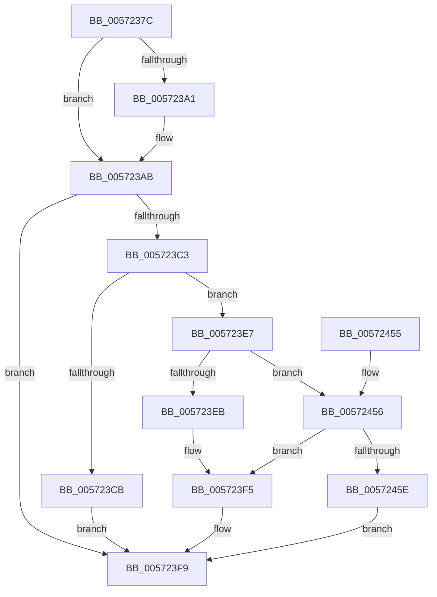

# IvtLegacyUpdateScalableModeTranslationStructures

- RVA: `0x0057237C`–`0x00572474` (길이 `248` bytes)
- VA: `0x000000014057237C`
- 실행 섹션: `.text`
- PDB 이름 있음: `예`; PDB Function 태그: `아니요`
- unwind 정보 RVA: `0x000C5148`
- 디코드: `69`개 명령, `248/248` bytes 표시
- 미해석 바이트: `0` (있으면 어셈블리에 `.byte`로 보존)

> 이 문서는 커널 이미지의 기계어와 PDB 기호를 분석해 생성했습니다. 4번과 5번은 함수 원형과 자료형을 바이너리 사용 방식에서 추정한 C 해석이며 원본 소스 복구 결과는 아닙니다.

## 1. Dependencies

- 직접 호출 지점: **5**; 고유 호출 대상: **5**
- 직접 호출자로 확인된 함수: **1**
- RIP 상대 이미지 참조: **0**

### Outgoing calls
- `0x005723A3` → [IvtGetScalableModePasidTables](../56/IvtGetScalableModePasidTables_function_0056FD5C.md) (function, `0x0056FD5C`)
- `0x005723D8` → [IvtGetBlockedDomain](../4D/IvtGetBlockedDomain_function_004D2204.md) (function, `0x004D2204`)
- `0x005723FE` → [IvtGetPasidGranularTranslationType](../4F/IvtGetPasidGranularTranslationType_function_004FC2FC.md) (function, `0x004FC2FC`)
- `0x00572416` → [IvtUpdateScalableModePasidTablesForPasid](../4C/IvtUpdateScalableModePasidTablesForPasid_function_004CD628.md) (function, `0x004CD628`)
- `0x0057243A` → [IvtLegacyUpdateScalableModeContextEntry](IvtLegacyUpdateScalableModeContextEntry_function_005721B8.md) (function, `0x005721B8`)

### Direct callers
- [IvtLegacyUpdateTranslationStructures](IvtLegacyUpdateTranslationStructures_function_0057247C.md) at `0x005724AC`

### Static image references
- 디코드된 RIP-relative 메모리 참조가 없습니다.

## 2. Other-region calls and transfers

- 다른 실행 섹션으로 향하는 call: **0**
- 별도 외부 분기/꼬리 이동을 확인하지 못했습니다.

## 3. Assembly (complete function range)

```asm
0057237C  48 89 5C 24 10                  mov qword ptr [rsp + 0x10], rbx
00572381  48 89 74 24 18                  mov qword ptr [rsp + 0x18], rsi
00572386  48 89 7C 24 20                  mov qword ptr [rsp + 0x20], rdi
0057238B  41 56                           push r14
0057238D  48 83 EC 40                     sub rsp, 0x40
00572391  33 DB                           xor ebx, ebx
00572393  49 8B F1                        mov rsi, r9
00572396  4C 8B F2                        mov r14, rdx
00572399  48 8B F9                        mov rdi, rcx
0057239C  4D 85 C9                        test r9, r9
0057239F  75 0A                           jne 0x1405723ab
005723A1  8B 12                           mov edx, dword ptr [rdx]
005723A3  E8 B4 D9 FF FF                  call 0x14056fd5c
005723A8  48 8B F0                        mov rsi, rax
005723AB  48 8B 84 24 80 00 00 00         mov rax, qword ptr [rsp + 0x80]
005723B3  4C 8B D3                        mov r10, rbx
005723B6  48 89 5C 24 50                  mov qword ptr [rsp + 0x50], rbx
005723BB  48 8B CB                        mov rcx, rbx
005723BE  48 85 C0                        test rax, rax
005723C1  74 36                           je 0x1405723f9
005723C3  8B 50 04                        mov edx, dword ptr [rax + 4]
005723C6  83 FA 01                        cmp edx, 1
005723C9  75 1C                           jne 0x1405723e7
005723CB  8A DA                           mov bl, dl
005723CD  4C 8D 44 24 50                  lea r8, [rsp + 0x50]
005723D2  49 8B D6                        mov rdx, r14
005723D5  48 8B CF                        mov rcx, rdi
005723D8  E8 27 FE F5 FF                  call 0x1404d2204
005723DD  48 8B 4C 24 50                  mov rcx, qword ptr [rsp + 0x50]
005723E2  4C 8B D0                        mov r10, rax
005723E5  EB 12                           jmp 0x1405723f9
005723E7  85 D2                           test edx, edx
005723E9  74 6B                           je 0x140572456
005723EB  48 8B 48 28                     mov rcx, qword ptr [rax + 0x28]
005723EF  B3 01                           mov bl, 1
005723F1  48 C1 E9 0C                     shr rcx, 0xc
005723F5  44 8B 50 30                     mov r10d, dword ptr [rax + 0x30]
005723F9  44 8A C3                        mov r8b, bl
005723FC  33 D2                           xor edx, edx
005723FE  E8 F9 9E F8 FF                  call 0x1404fc2fc
00572403  48 89 4C 24 28                  mov qword ptr [rsp + 0x28], rcx
00572408  44 8B C8                        mov r9d, eax
0057240B  48 8B CF                        mov rcx, rdi
0057240E  4C 89 54 24 20                  mov qword ptr [rsp + 0x20], r10
00572413  48 8B D6                        mov rdx, rsi
00572416  E8 0D B2 F5 FF                  call 0x1404cd628
0057241B  8B 84 24 90 00 00 00            mov eax, dword ptr [rsp + 0x90]
00572422  45 33 C9                        xor r9d, r9d
00572425  89 44 24 38                     mov dword ptr [rsp + 0x38], eax
00572429  4C 8B C6                        mov r8, rsi
0057242C  8B 44 24 70                     mov eax, dword ptr [rsp + 0x70]
00572430  49 8B D6                        mov rdx, r14
00572433  48 8B CF                        mov rcx, rdi
00572436  89 44 24 20                     mov dword ptr [rsp + 0x20], eax
0057243A  E8 79 FD FF FF                  call 0x1405721b8
0057243F  48 8B 5C 24 58                  mov rbx, qword ptr [rsp + 0x58]
00572444  48 8B 74 24 60                  mov rsi, qword ptr [rsp + 0x60]
00572449  48 8B 7C 24 68                  mov rdi, qword ptr [rsp + 0x68]
0057244E  48 83 C4 40                     add rsp, 0x40
00572452  41 5E                           pop r14
00572454  C3                              ret
00572455  CC                              int3
00572456  38 9F 3F 01 00 00               cmp byte ptr [rdi + 0x13f], bl
0057245C  74 97                           je 0x1405723f5
0057245E  48 8B 8F 48 01 00 00            mov rcx, qword ptr [rdi + 0x148]
00572465  B3 01                           mov bl, 1
00572467  44 8B 97 08 01 00 00            mov r10d, dword ptr [rdi + 0x108]
0057246E  48 C1 F9 0C                     sar rcx, 0xc
00572472  EB 85                           jmp 0x1405723f9
```

## 4. C-style interpretation (structured pseudocode)

```c
__int64 __fastcall IvtLegacyUpdateScalableModeTranslationStructures(__int64 a1, __int64 a2, __int64 a3, __int64 a4, unsigned int a5, __int64 a6, __int64 a7, __int64 a8, unsigned int a9)
{
    __int64 result;
    __int64 v_rbx;
    __int64 v_rsi;
    __int64 v_rsp;
    unsigned int v_stack_m10;
    unsigned __int64 v_stack_m20;
    unsigned __int64 v_stack_m28;
    unsigned __int64 v_stack_p10;
    unsigned __int64 v_stack_p18;
    unsigned __int64 v_stack_p20;
    unsigned __int64 v_stack_p8;

    v_stack_p10 = v_rbx;
    v_stack_p18 = v_rsi;
    v_stack_p20 = v_rdi;
    v_rsp = (v_rsp) - (64);
    v_rbx = 0;
    v_rsi = a4;
    if (a4 == 0) {
        a2 = *(unsigned int *)(a2);
        result = IvtGetScalableModePasidTables(a1, a2, a3, a4);
        v_rsi = result;
    }
    v_stack_p8 = 0;
    if (a7 == 0) goto loc_005723F9;
    if (((unsigned int)((unsigned int)(*(unsigned int *)(a7 + 4)))) != 1) goto loc_005723E7;
    result = IvtGetBlockedDomain(a1, a2, v_stack_p8, a4);
    goto loc_005723F9;
loc_005723E7:
    if ((unsigned int)(a2) == 0) goto loc_00572456;
    a1 = (*(unsigned __int64 *)(result + 40)) >> (12);
loc_005723F5:
loc_005723F9:
    a2 = 0;
    result = IvtGetPasidGranularTranslationType(a1, a2, 1, a4);
    v_stack_m20 = a1;
    v_stack_m28 = (unsigned int)(*(unsigned int *)(result + 48));
    result = IvtUpdateScalableModePasidTablesForPasid(a1, v_rsi, 1, (unsigned int)((unsigned int)(result)));
    a4 = 0;
    v_stack_m10 = (unsigned int)((unsigned int)(a9));
    v_stack_m28 = (unsigned int)((unsigned int)(a5));
    result = IvtLegacyUpdateScalableModeContextEntry(a1, 0, v_rsi, a4);
    v_rsp = (v_rsp) + (64);
    return result;
loc_00572456:
    if ((*(unsigned __int8 *)(v_stack_p20 + 319)) == ((unsigned __int8)(v_stack_p10))) goto loc_005723F5;
    a1 = (*(unsigned __int64 *)(v_stack_p20 + 328)) >> (12);
    goto loc_005723F9;
}
```

## 5. (Beta) C Style

```c
int64_t IvtLegacyUpdateScalableModeTranslationStructures(void *Arg1, void *Arg2, int64_t Arg3, int64_t Arg4, uint32_t Arg5, uint64_t Arg6, int64_t Arg7, uint64_t Arg8, uint32_t Arg9)
{
    uint8_t *arg1 = (uint8_t *)Arg1;
    uint8_t *arg2 = (uint8_t *)Arg2;

    int64_t result;
    int64_t local_rbx;
    int64_t local_rsi;
    int64_t local_rsp;
    uint32_t v_stack_m10;
    uint64_t v_stack_m20;
    uint64_t v_stack_m28;
    uint64_t v_stack_p10;
    uint64_t v_stack_p18;
    uint64_t v_stack_p20;
    uint64_t v_stack_p8;

    v_stack_p10 = local_rbx;
    v_stack_p18 = local_rsi;
    v_stack_p20 = local_rdi;
    local_rsp = (local_rsp) - (64);
    local_rbx = 0;
    local_rsi = Arg4;
    if (Arg4 == 0) {
        Arg2 = *(uint32_t *)(arg2);
        result = IvtGetScalableModePasidTables(Arg1, Arg2, Arg3, Arg4);
        local_rsi = result;
    }
    v_stack_p8 = 0;
    if (Arg7 == 0) goto loc_005723F9;
    if (((uint32_t)((uint32_t)(*(uint32_t *)(Arg7 + 0x4)))) != 1) goto loc_005723E7;
    result = IvtGetBlockedDomain(Arg1, Arg2, v_stack_p8, Arg4);
    goto loc_005723F9;
loc_005723E7:
    if ((uint32_t)(Arg2) == 0) goto loc_00572456;
    Arg1 = (*(uint64_t *)(result + 0x28)) >> (12);
loc_005723F5:
loc_005723F9:
    Arg2 = 0;
    result = IvtGetPasidGranularTranslationType(Arg1, Arg2, 1, Arg4);
    v_stack_m20 = Arg1;
    v_stack_m28 = (uint32_t)(*(uint32_t *)(result + 0x30));
    result = IvtUpdateScalableModePasidTablesForPasid(Arg1, local_rsi, 1, (uint32_t)((uint32_t)(result)));
    Arg4 = 0;
    v_stack_m10 = (uint32_t)((uint32_t)(Arg9));
    v_stack_m28 = (uint32_t)((uint32_t)(Arg5));
    result = IvtLegacyUpdateScalableModeContextEntry(Arg1, 0, local_rsi, Arg4);
    local_rsp = (local_rsp) + (64);
    return result;
loc_00572456:
    if ((*(uint8_t *)(v_stack_p20 + 0x13F)) == ((uint8_t)(v_stack_p10))) goto loc_005723F5;
    Arg1 = (*(uint64_t *)(v_stack_p20 + 0x148)) >> (12);
    goto loc_005723F9;
}
```

### 관측된 메모리 오프셋

구조체 형식이 확인되지 않은 접근은 인자 기준의 오프셋으로만 기록했습니다.

| 기준 인자 | 오프셋 표현 | 폭 (bit) | 접근 |
|---|---:|---:|---|
| `Arg1` | `+ 0x108` | `32` | `R` |
| `Arg1` | `+ 0x13F` | `8` | `R` |
| `Arg1` | `+ 0x148` | `64` | `R` |
| `Arg2` | `+ 0x0` | `32` | `R` |

## 6. Execution-region graph

[열기: 2D/3D 그래프와 함수 탐색 컨트롤 패널](../../../control-panel.html?section=text&rva=0x0057237C&view=graph)

- 2D 그래프는 위에서 아래로 흐르고, 3D 그래프는 빈 공간을 드래그해 회전합니다. Shift+드래그는 이동, 휠은 확대·축소, 함수 노드 선택은 대상 보고서 이동입니다.

### Static fallback


