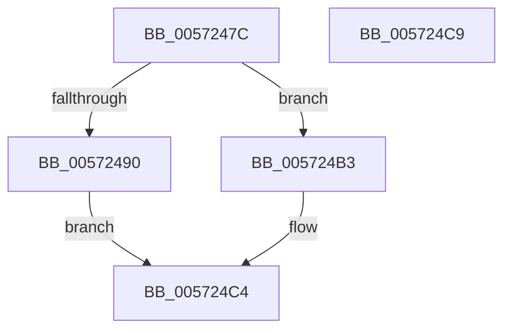

# IvtLegacyUpdateTranslationStructures

- RVA: `0x0057247C`–`0x005724CA` (길이 `78` bytes)
- VA: `0x000000014057247C`
- 실행 섹션: `.text`
- PDB 이름 있음: `예`; PDB Function 태그: `아니요`
- unwind 정보 RVA: `0x0006C2A4`
- 디코드: `17`개 명령, `78/78` bytes 표시
- 미해석 바이트: `0` (있으면 어셈블리에 `.byte`로 보존)

> 이 문서는 커널 이미지의 기계어와 PDB 기호를 분석해 생성했습니다. 4번과 5번은 함수 원형과 자료형을 바이너리 사용 방식에서 추정한 C 해석이며 원본 소스 복구 결과는 아닙니다.

## 1. Dependencies

- 직접 호출 지점: **2**; 고유 호출 대상: **2**
- 직접 호출자로 확인된 함수: **3**
- RIP 상대 이미지 참조: **0**

### Outgoing calls
- `0x005724AC` → [IvtLegacyUpdateScalableModeTranslationStructures](IvtLegacyUpdateScalableModeTranslationStructures_function_0057237C.md) (function, `0x0057237C`)
- `0x005724BF` → [IvtUpdateContextEntry](../4D/IvtUpdateContextEntry_function_004D207C.md) (function, `0x004D207C`)

### Direct callers
- [IvtLegacyAttachDeviceDomainInternal](IvtLegacyAttachDeviceDomainInternal_function_00570EDC.md) at `0x00570FCC`
- [IvtLegacyProcessDeviceExceptions](../../pagelk/B6/IvtLegacyProcessDeviceExceptions_function_00B62944.md) at `0x00B62A2D`
- [HalpIvtpLegacyInitializeReservedDomain](../../pagelk/B6/HalpIvtpLegacyInitializeReservedDomain_function_00B63924.md) at `0x00B639E7`

### Static image references
- 디코드된 RIP-relative 메모리 참조가 없습니다.

## 2. Other-region calls and transfers

- 다른 실행 섹션으로 향하는 call: **0**
- 별도 외부 분기/꼬리 이동을 확인하지 못했습니다.

## 3. Assembly (complete function range)

```asm
0057247C  48 83 EC 58                     sub rsp, 0x58
00572480  80 B9 40 01 00 00 00            cmp byte ptr [rcx + 0x140], 0
00572487  8B 84 24 A0 00 00 00            mov eax, dword ptr [rsp + 0xa0]
0057248E  74 23                           je 0x1405724b3
00572490  89 44 24 40                     mov dword ptr [rsp + 0x40], eax
00572494  48 8B 84 24 90 00 00 00         mov rax, qword ptr [rsp + 0x90]
0057249C  48 89 44 24 30                  mov qword ptr [rsp + 0x30], rax
005724A1  8B 84 24 80 00 00 00            mov eax, dword ptr [rsp + 0x80]
005724A8  89 44 24 20                     mov dword ptr [rsp + 0x20], eax
005724AC  E8 CB FE FF FF                  call 0x14057237c
005724B1  EB 11                           jmp 0x1405724c4
005724B3  4C 8B 84 24 90 00 00 00         mov r8, qword ptr [rsp + 0x90]
005724BB  89 44 24 20                     mov dword ptr [rsp + 0x20], eax
005724BF  E8 B8 FB F5 FF                  call 0x1404d207c
005724C4  48 83 C4 58                     add rsp, 0x58
005724C8  C3                              ret
005724C9  CC                              int3
```

## 4. C-style interpretation (structured pseudocode)

```c
__int64 __fastcall IvtLegacyUpdateTranslationStructures(__int64 a1, __int64 a2, __int64 a3, __int64 a4, unsigned int a5, __int64 a6, __int64 a7, __int64 a8, unsigned int a9)
{
    __int64 result;
    __int64 v_rsp;
    unsigned int v_stack_m18;
    unsigned __int64 v_stack_m28;
    unsigned int v_stack_m38;

    v_rsp = (v_rsp) - (88);
    if ((*(unsigned __int8 *)(a1 + 320)) == 0) goto loc_005724B3;
    v_stack_m18 = (unsigned int)((unsigned int)(a9));
    v_stack_m28 = a7;
    v_stack_m38 = (unsigned int)((unsigned int)(a5));
    result = IvtLegacyUpdateScalableModeTranslationStructures(a1, a2, a3, a4);
    goto loc_005724C4;
loc_005724B3:
    v_stack_m38 = (unsigned int)(result);
    result = IvtUpdateContextEntry(a1, a2, a7, a4);
loc_005724C4:
    v_rsp = (v_rsp) + (88);
    return result;
}
```

## 5. (Beta) C Style

```c
int64_t IvtLegacyUpdateTranslationStructures(void *Arg1, int64_t Arg2, int64_t Arg3, int64_t Arg4, uint32_t Arg5, uint64_t Arg6, int64_t Arg7, uint64_t Arg8, uint32_t Arg9)
{
    uint8_t *arg1 = (uint8_t *)Arg1;

    int64_t result;
    int64_t local_rsp;
    uint32_t v_stack_m18;
    uint64_t v_stack_m28;
    uint32_t v_stack_m38;

    local_rsp = (local_rsp) - (88);
    if ((*(uint8_t *)(arg1 + 0x140)) == 0) goto loc_005724B3;
    v_stack_m18 = (uint32_t)((uint32_t)(Arg9));
    v_stack_m28 = Arg7;
    v_stack_m38 = (uint32_t)((uint32_t)(Arg5));
    result = IvtLegacyUpdateScalableModeTranslationStructures(Arg1, Arg2, Arg3, Arg4);
    goto loc_005724C4;
loc_005724B3:
    v_stack_m38 = (uint32_t)(result);
    result = IvtUpdateContextEntry(Arg1, Arg2, Arg7, Arg4);
loc_005724C4:
    local_rsp = (local_rsp) + (88);
    return result;
}
```

### 관측된 메모리 오프셋

구조체 형식이 확인되지 않은 접근은 인자 기준의 오프셋으로만 기록했습니다.

| 기준 인자 | 오프셋 표현 | 폭 (bit) | 접근 |
|---|---:|---:|---|
| `Arg1` | `+ 0x140` | `8` | `R` |

## 6. Execution-region graph

[열기: 2D/3D 그래프와 함수 탐색 컨트롤 패널](../../../control-panel.html?section=text&rva=0x0057247C&view=graph)

- 2D 그래프는 위에서 아래로 흐르고, 3D 그래프는 빈 공간을 드래그해 회전합니다. Shift+드래그는 이동, 휠은 확대·축소, 함수 노드 선택은 대상 보고서 이동입니다.

### Static fallback


