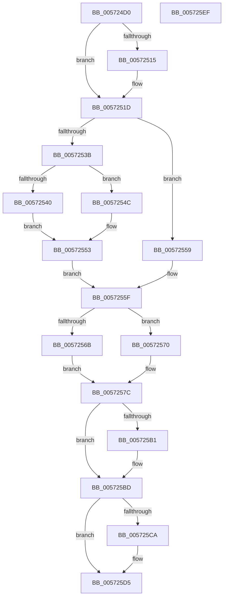

# IvtSetDevicePasidTable

- RVA: `0x005724D0`–`0x005725F0` (길이 `288` bytes)
- VA: `0x00000001405724D0`
- 실행 섹션: `.text`
- PDB 이름 있음: `예`; PDB Function 태그: `아니요`
- unwind 정보 RVA: `0x000BD554`
- 디코드: `82`개 명령, `288/288` bytes 표시
- 미해석 바이트: `0` (있으면 어셈블리에 `.byte`로 보존)

> 이 문서는 커널 이미지의 기계어와 PDB 기호를 분석해 생성했습니다. 4번과 5번은 함수 원형과 자료형을 바이너리 사용 방식에서 추정한 C 해석이며 원본 소스 복구 결과는 아닙니다.

## 1. Dependencies

- 직접 호출 지점: **6**; 고유 호출 대상: **6**
- 직접 호출자로 확인된 함수: **0**
- RIP 상대 이미지 참조: **1**

### Outgoing calls
- `0x00572518` → [KiRaiseIrqlProcessIrqlFlags](../4F/KiRaiseIrqlProcessIrqlFlags_function_004F56FC.md) (function, `0x004F56FC`)
- `0x00572529` → [KeAcquireInStackQueuedSpinLockAtDpcLevel](../27/KeAcquireInStackQueuedSpinLockAtDpcLevel_function_00275740.md) (function, `0x00275740`)
- `0x00572599` → [IvtUpdateScalableModeContextEntry](../4C/IvtUpdateScalableModeContextEntry_function_004CD880.md) (function, `0x004CD880`)
- `0x005725A3` → [KeReleaseInStackQueuedSpinLockFromDpcLevel](../21/KeReleaseInStackQueuedSpinLockFromDpcLevel_function_002171B0.md) (function, `0x002171B0`)
- `0x005725B8` → [KiLowerIrqlProcessIrqlFlags](../4F/KiLowerIrqlProcessIrqlFlags_function_004F5698.md) (function, `0x004F5698`)
- `0x005725D0` → [IvtFreeScalableModePasidTables](../56/IvtFreeScalableModePasidTables_function_0056F980.md) (function, `0x0056F980`)

### Direct callers
- 이 함수 시작 RVA로 연결되는 직접 call은 확인되지 않았습니다. 간접 호출은 완전히 역산할 수 없습니다.

### Static image references
- `0x0057250D` → RVA `0x00FC6D20` (`ALMOSTRO`; read)

## 2. Other-region calls and transfers

- 다른 실행 섹션으로 향하는 call: **0**
- 별도 외부 분기/꼬리 이동을 확인하지 못했습니다.

## 3. Assembly (complete function range)

```asm
005724D0  4C 8B DC                        mov r11, rsp
005724D3  49 89 5B 08                     mov qword ptr [r11 + 8], rbx
005724D7  49 89 6B 10                     mov qword ptr [r11 + 0x10], rbp
005724DB  49 89 73 18                     mov qword ptr [r11 + 0x18], rsi
005724DF  57                              push rdi
005724E0  41 56                           push r14
005724E2  41 57                           push r15
005724E4  48 83 EC 70                     sub rsp, 0x70
005724E8  33 C0                           xor eax, eax
005724EA  0F 57 C0                        xorps xmm0, xmm0
005724ED  0F 11 44 24 50                  movups xmmword ptr [rsp + 0x50], xmm0
005724F2  49 89 43 D8                     mov qword ptr [r11 - 0x28], rax
005724F6  45 8A F8                        mov r15b, r8b
005724F9  48 8B FA                        mov rdi, rdx
005724FC  48 8B E9                        mov rbp, rcx
005724FF  45 32 F6                        xor r14b, r14b
00572502  44 0F 20 C6                     mov rsi, cr8
00572506  8D 50 0F                        lea edx, [rax + 0xf]
00572509  44 0F 22 C2                     mov cr8, rdx
0057250D  39 05 0D 48 A5 00               cmp dword ptr [rip + 0xa5480d], eax
00572513  74 08                           je 0x14057251d
00572515  40 8A CE                        mov cl, sil
00572518  E8 DF 31 F8 FF                  call 0x1404f56fc
0057251D  48 8D 8D D0 00 00 00            lea rcx, [rbp + 0xd0]
00572524  48 8D 54 24 50                  lea rdx, [rsp + 0x50]
00572529  E8 12 32 D0 FF                  call 0x140275740
0057252E  48 8B 4F 48                     mov rcx, qword ptr [rdi + 0x48]
00572532  48 8B 5F 40                     mov rbx, qword ptr [rdi + 0x40]
00572536  48 85 C9                        test rcx, rcx
00572539  74 1E                           je 0x140572559
0057253B  48 85 DB                        test rbx, rbx
0057253E  74 0C                           je 0x14057254c
00572540  8B 43 2C                        mov eax, dword ptr [rbx + 0x2c]
00572543  48 3B CB                        cmp rcx, rbx
00572546  41 0F 95 C6                     setne r14b
0057254A  EB 07                           jmp 0x140572553
0057254C  48 8B 45 68                     mov rax, qword ptr [rbp + 0x68]
00572550  8B 40 2C                        mov eax, dword ptr [rax + 0x2c]
00572553  48 89 4F 40                     mov qword ptr [rdi + 0x40], rcx
00572557  EB 06                           jmp 0x14057255f
00572559  8B 43 2C                        mov eax, dword ptr [rbx + 0x2c]
0057255C  48 8B CB                        mov rcx, rbx
0057255F  48 83 67 48 00                  and qword ptr [rdi + 0x48], 0
00572564  8B D0                           mov edx, eax
00572566  45 84 FF                        test r15b, r15b
00572569  75 05                           jne 0x140572570
0057256B  8B 41 30                        mov eax, dword ptr [rcx + 0x30]
0057256E  EB 0C                           jmp 0x14057257c
00572570  B8 04 00 00 00                  mov eax, 4
00572575  C7 41 30 03 00 00 00            mov dword ptr [rcx + 0x30], 3
0057257C  44 8B 4F 50                     mov r9d, dword ptr [rdi + 0x50]
00572580  48 8B CD                        mov rcx, rbp
00572583  4C 8B 47 40                     mov r8, qword ptr [rdi + 0x40]
00572587  48 89 54 24 40                  mov qword ptr [rsp + 0x40], rdx
0057258C  83 64 24 38 00                  and dword ptr [rsp + 0x38], 0
00572591  48 8B 57 38                     mov rdx, qword ptr [rdi + 0x38]
00572595  89 44 24 20                     mov dword ptr [rsp + 0x20], eax
00572599  E8 E2 B2 F5 FF                  call 0x1404cd880
0057259E  48 8D 4C 24 50                  lea rcx, [rsp + 0x50]
005725A3  E8 08 4C CA FF                  call 0x1402171b0
005725A8  83 3D 71 47 A5 00 00            cmp dword ptr [rip + 0xa54771], 0
005725AF  74 0C                           je 0x1405725bd
005725B1  44 0F 20 C1                     mov rcx, cr8
005725B5  40 8A D6                        mov dl, sil
005725B8  E8 DB 30 F8 FF                  call 0x1404f5698
005725BD  40 0F B6 C6                     movzx eax, sil
005725C1  44 0F 22 C0                     mov cr8, rax
005725C5  45 84 F6                        test r14b, r14b
005725C8  74 0B                           je 0x1405725d5
005725CA  48 8B D3                        mov rdx, rbx
005725CD  48 8B CD                        mov rcx, rbp
005725D0  E8 AB D3 FF FF                  call 0x14056f980
005725D5  4C 8D 5C 24 70                  lea r11, [rsp + 0x70]
005725DA  49 8B 5B 20                     mov rbx, qword ptr [r11 + 0x20]
005725DE  49 8B 6B 28                     mov rbp, qword ptr [r11 + 0x28]
005725E2  49 8B 73 30                     mov rsi, qword ptr [r11 + 0x30]
005725E6  49 8B E3                        mov rsp, r11
005725E9  41 5F                           pop r15
005725EB  41 5E                           pop r14
005725ED  5F                              pop rdi
005725EE  C3                              ret
005725EF  CC                              int3
```

## 4. C-style interpretation (structured pseudocode)

```c
__int64 __fastcall IvtSetDevicePasidTable(__int64 a1, __int64 a2, unsigned __int8 a3)
{
    __int64 result;
    __int64 v_r14;
    __int64 v_rsp;
    unsigned __int64 v_stack_m18;
    unsigned __int64 v_stack_m38;
    unsigned __int64 v_stack_m48;
    unsigned int v_stack_m50;
    unsigned int v_stack_m68;

    *(unsigned __int64 *)(v_rsp + 8) = v_rbx;
    *(unsigned __int64 *)(v_rsp + 16) = v_rbp;
    *(unsigned __int64 *)(v_rsp + 24) = v_rsi;
    v_rsp = (v_rsp) - (112);
    result = 0;
    v_stack_m38 = v_xmm0;
    *(unsigned __int64 *)(v_rsp - 40) = 0;
    v_r14 = 0;
    if ((*(unsigned int *)(v_rip + 10831885)) != 0) {
        a1 = (unsigned __int8)(v_cr8);
        result = KiRaiseIrqlProcessIrqlFlags(a1, result + 15, a3, a4);
    }
    result = KeAcquireInStackQueuedSpinLockAtDpcLevel(a1 + 208, v_stack_m38, a3, a4);
    if (*(unsigned __int64 *)(a2 + 72) == 0) goto loc_00572559;
    if (*(unsigned __int64 *)(a2 + 64) == 0) goto loc_0057254C;
    v_r14 = ((*(unsigned __int64 *)(a2 + 72)) != (*(unsigned __int64 *)(a2 + 64))) ? 1 : 0;
    goto loc_00572553;
loc_0057254C:
loc_00572553:
    *(unsigned __int64 *)(a2 + 64) = *(unsigned __int64 *)(a2 + 72);
    goto loc_0057255F;
loc_00572559:
loc_0057255F:
    if (a3 != 0) goto loc_00572570;
    goto loc_0057257C;
loc_00572570:
    *(unsigned int *)(*(unsigned __int64 *)(a2 + 64) + 48) = 3;
loc_0057257C:
    v_stack_m48 = (unsigned int)((unsigned int)((unsigned int)(*(unsigned int *)(*(unsigned __int64 *)(a2 + 64) + 44))));
    v_stack_m68 = 4;
    result = IvtUpdateScalableModeContextEntry(a1, *(unsigned __int64 *)(a2 + 56), *(unsigned __int64 *)(a2 + 64), (unsigned int)(*(unsigned int *)(a2 + 80)));
    result = KeReleaseInStackQueuedSpinLockFromDpcLevel(v_stack_m38, *(unsigned __int64 *)(a2 + 56), *(unsigned __int64 *)(a2 + 64), (unsigned int)(*(unsigned int *)(a2 + 80)));
    if ((*(unsigned int *)(v_rip + 10831729)) != 0) {
        a1 = result + 15;
        a2 = (unsigned __int8)(v_cr8);
        result = KiLowerIrqlProcessIrqlFlags(a1, a2, *(unsigned __int64 *)(a2 + 64), (unsigned int)(*(unsigned int *)(a2 + 80)));
    }
    result = (unsigned __int8)(v_cr8);
    if ((unsigned __int8)(v_r14) != 0) {
        a2 = *(unsigned __int64 *)(a2 + 64);
        a1 = a1;
        result = IvtFreeScalableModePasidTables(a1, a2, *(unsigned __int64 *)(a2 + 64), (unsigned int)(*(unsigned int *)(a2 + 80)));
    }
    return result;
}
```

## 5. (Beta) C Style

```c
int64_t IvtSetDevicePasidTable(void *Arg1, void *Arg2, uint8_t Arg3)
{
    uint8_t *arg1 = (uint8_t *)Arg1;
    uint8_t *arg2 = (uint8_t *)Arg2;

    int64_t result;
    int64_t local_r14;
    int64_t local_rsp;
    uint64_t v_stack_m18;
    uint64_t v_stack_m38;
    uint64_t v_stack_m48;
    uint32_t v_stack_m50;
    uint32_t v_stack_m68;

    *(uint64_t *)(local_rsp + 0x8) = local_rbx;
    *(uint64_t *)(local_rsp + 0x10) = local_rbp;
    *(uint64_t *)(local_rsp + 0x18) = local_rsi;
    local_rsp = (local_rsp) - (112);
    result = 0;
    v_stack_m38 = v_xmm0;
    *(uint64_t *)(local_rsp - 0x28) = 0;
    local_r14 = 0;
    if ((*(uint32_t *)(v_rip + 0xA5480D)) != 0) {
        Arg1 = (uint8_t)(v_cr8);
        result = KiRaiseIrqlProcessIrqlFlags(Arg1, result + 15, Arg3, a4);
    }
    result = KeAcquireInStackQueuedSpinLockAtDpcLevel(Arg1 + 208, v_stack_m38, Arg3, a4);
    if (*(uint64_t *)(arg2 + 0x48) == 0) goto loc_00572559;
    if (*(uint64_t *)(arg2 + 0x40) == 0) goto loc_0057254C;
    local_r14 = ((*(uint64_t *)(arg2 + 0x48)) != (*(uint64_t *)(arg2 + 0x40))) ? 1 : 0;
    goto loc_00572553;
loc_0057254C:
loc_00572553:
    *(uint64_t *)(arg2 + 0x40) = *(uint64_t *)(arg2 + 0x48);
    goto loc_0057255F;
loc_00572559:
loc_0057255F:
    if (Arg3 != 0) goto loc_00572570;
    goto loc_0057257C;
loc_00572570:
    *(uint32_t *)(*(uint64_t *)(arg2 + 0x40) + 0x30) = 3;
loc_0057257C:
    v_stack_m48 = (uint32_t)((uint32_t)((uint32_t)(*(uint32_t *)(*(uint64_t *)(arg2 + 0x40) + 0x2C))));
    v_stack_m68 = 4;
    result = IvtUpdateScalableModeContextEntry(Arg1, *(uint64_t *)(arg2 + 0x38), *(uint64_t *)(arg2 + 0x40), (uint32_t)(*(uint32_t *)(arg2 + 0x50)));
    result = KeReleaseInStackQueuedSpinLockFromDpcLevel(v_stack_m38, *(uint64_t *)(arg2 + 0x38), *(uint64_t *)(arg2 + 0x40), (uint32_t)(*(uint32_t *)(arg2 + 0x50)));
    if ((*(uint32_t *)(v_rip + 0xA54771)) != 0) {
        Arg1 = result + 15;
        Arg2 = (uint8_t)(v_cr8);
        result = KiLowerIrqlProcessIrqlFlags(Arg1, Arg2, *(uint64_t *)(arg2 + 0x40), (uint32_t)(*(uint32_t *)(arg2 + 0x50)));
    }
    result = (uint8_t)(v_cr8);
    if ((uint8_t)(local_r14) != 0) {
        Arg2 = *(uint64_t *)(arg2 + 0x40);
        Arg1 = Arg1;
        result = IvtFreeScalableModePasidTables(Arg1, Arg2, *(uint64_t *)(arg2 + 0x40), (uint32_t)(*(uint32_t *)(arg2 + 0x50)));
    }
    return result;
}
```

### 관측된 메모리 오프셋

구조체 형식이 확인되지 않은 접근은 인자 기준의 오프셋으로만 기록했습니다.

| 기준 인자 | 오프셋 표현 | 폭 (bit) | 접근 |
|---|---:|---:|---|
| `Arg1` | `+ 0x68` | `64` | `R` |
| `Arg1` | `+ 0xD0` | `64` | `R` |
| `Arg2` | `+ 0x38` | `64` | `R` |
| `Arg2` | `+ 0x40` | `64` | `R` |
| `Arg2` | `+ 0x40` | `64` | `W` |
| `Arg2` | `+ 0x48` | `64` | `R` |
| `Arg2` | `+ 0x48` | `64` | `R/W` |
| `Arg2` | `+ 0x50` | `32` | `R` |

## 6. Execution-region graph

[열기: 2D/3D 그래프와 함수 탐색 컨트롤 패널](../../../control-panel.html?section=text&rva=0x005724D0&view=graph)

- 2D 그래프는 위에서 아래로 흐르고, 3D 그래프는 빈 공간을 드래그해 회전합니다. Shift+드래그는 이동, 휠은 확대·축소, 함수 노드 선택은 대상 보고서 이동입니다.

### Static fallback


