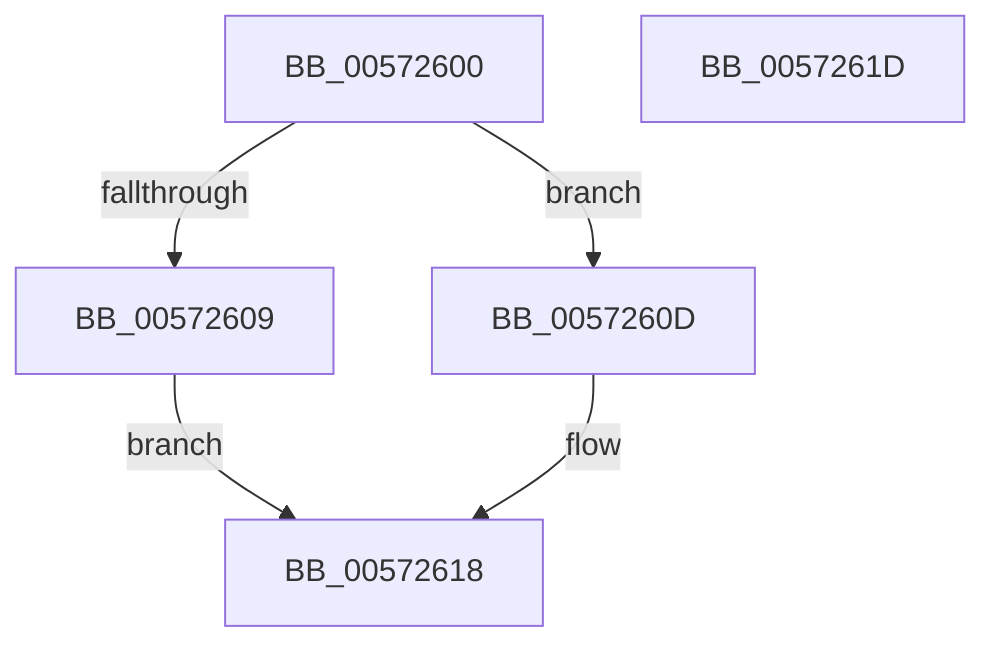

# IvtSetDeviceSvmCapabilities

- RVA: `0x00572600`–`0x0057261E` (길이 `30` bytes)
- VA: `0x0000000140572600`
- 실행 섹션: `.text`
- PDB 이름 있음: `예`; PDB Function 태그: `아니요`
- unwind 정보 RVA: `0x0005C788`
- 디코드: `11`개 명령, `30/30` bytes 표시
- 미해석 바이트: `0` (있으면 어셈블리에 `.byte`로 보존)

> 이 문서는 커널 이미지의 기계어와 PDB 기호를 분석해 생성했습니다. 4번과 5번은 함수 원형과 자료형을 바이너리 사용 방식에서 추정한 C 해석이며 원본 소스 복구 결과는 아닙니다.

## 1. Dependencies

- 직접 호출 지점: **1**; 고유 호출 대상: **1**
- 직접 호출자로 확인된 함수: **0**
- RIP 상대 이미지 참조: **0**

### Outgoing calls
- `0x00572613` → [IvtAllocateContextTable](../4D/IvtAllocateContextTable_function_004DE0D4.md) (function, `0x004DE0D4`)

### Direct callers
- 이 함수 시작 RVA로 연결되는 직접 call은 확인되지 않았습니다. 간접 호출은 완전히 역산할 수 없습니다.

### Static image references
- 디코드된 RIP-relative 메모리 참조가 없습니다.

## 2. Other-region calls and transfers

- 다른 실행 섹션으로 향하는 call: **0**
- 별도 외부 분기/꼬리 이동을 확인하지 못했습니다.

## 3. Assembly (complete function range)

```asm
00572600  48 83 EC 28                     sub rsp, 0x28
00572604  45 84 C0                        test r8b, r8b
00572607  75 04                           jne 0x14057260d
00572609  33 C0                           xor eax, eax
0057260B  EB 0B                           jmp 0x140572618
0057260D  48 8B 52 38                     mov rdx, qword ptr [rdx + 0x38]
00572611  8B 12                           mov edx, dword ptr [rdx]
00572613  E8 BC BA F6 FF                  call 0x1404de0d4
00572618  48 83 C4 28                     add rsp, 0x28
0057261C  C3                              ret
0057261D  CC                              int3
```

## 4. C-style interpretation (structured pseudocode)

```c
__int64 __fastcall IvtSetDeviceSvmCapabilities(__int64 a1, __int64 a2, unsigned __int8 a3)
{
    __int64 result;
    __int64 v_rsp;

    v_rsp = (v_rsp) - (40);
    if (a3 != 0) goto loc_0057260D;
    result = 0;
    goto loc_00572618;
loc_0057260D:
    result = IvtAllocateContextTable(a1, (unsigned int)(*(unsigned int *)(*(unsigned __int64 *)(a2 + 56))), a3, a4);
loc_00572618:
    v_rsp = (v_rsp) + (40);
    return result;
}
```

## 5. (Beta) C Style

```c
int64_t IvtSetDeviceSvmCapabilities(int64_t Arg1, void *Arg2, uint8_t Arg3)
{
    uint8_t *arg2 = (uint8_t *)Arg2;

    int64_t result;
    int64_t local_rsp;

    local_rsp = (local_rsp) - (40);
    if (Arg3 != 0) goto loc_0057260D;
    result = 0;
    goto loc_00572618;
loc_0057260D:
    result = IvtAllocateContextTable(Arg1, (uint32_t)(*(uint32_t *)(*(uint64_t *)(arg2 + 0x38))), Arg3, a4);
loc_00572618:
    local_rsp = (local_rsp) + (40);
    return result;
}
```

### 관측된 메모리 오프셋

구조체 형식이 확인되지 않은 접근은 인자 기준의 오프셋으로만 기록했습니다.

| 기준 인자 | 오프셋 표현 | 폭 (bit) | 접근 |
|---|---:|---:|---|
| `Arg2` | `+ 0x38` | `64` | `R` |

## 6. Execution-region graph

[열기: 2D/3D 그래프와 함수 탐색 컨트롤 패널](../../../control-panel.html?section=text&rva=0x00572600&view=graph)

- 2D 그래프는 위에서 아래로 흐르고, 3D 그래프는 빈 공간을 드래그해 회전합니다. Shift+드래그는 이동, 휠은 확대·축소, 함수 노드 선택은 대상 보고서 이동입니다.

### Static fallback


