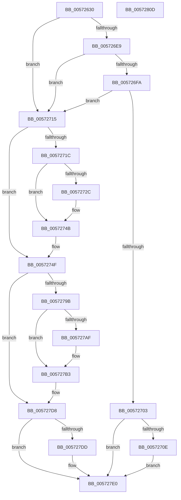

# IvtSetPasidAddressSpace

- RVA: `0x00572630`–`0x0057280E` (길이 `478` bytes)
- VA: `0x0000000140572630`
- 실행 섹션: `.text`
- PDB 이름 있음: `예`; PDB Function 태그: `아니요`
- unwind 정보 RVA: `0x000C52E0`
- 디코드: `125`개 명령, `478/478` bytes 표시
- 미해석 바이트: `0` (있으면 어셈블리에 `.byte`로 보존)

> 이 문서는 커널 이미지의 기계어와 PDB 기호를 분석해 생성했습니다. 4번과 5번은 함수 원형과 자료형을 바이너리 사용 방식에서 추정한 C 해석이며 원본 소스 복구 결과는 아닙니다.

## 1. Dependencies

- 직접 호출 지점: **6**; 고유 호출 대상: **6**
- 직접 호출자로 확인된 함수: **0**
- RIP 상대 이미지 참조: **1**

### Outgoing calls
- `0x00572680` → [memset](../6C/memset_function_006C6C40.md) (function, `0x006C6C40`)
- `0x00572722` → [IvtEnsureNoPendingFaults](../56/IvtEnsureNoPendingFaults_function_0056F60C.md) (function, `0x0056F60C`)
- `0x00572745` → [KeBugCheckEx](../4F/KeBugCheckEx_function_004FD660.md) (function, `0x004FD660`)
- `0x00572772` → [IvtBuildScalableModePasidTableS1Entry](../4F/IvtBuildScalableModePasidTableS1Entry_function_004F6644.md) (function, `0x004F6644`)
- `0x005727D3` → [IvtInvalidateScalableModePasidCache](IvtInvalidateScalableModePasidCache_function_005709B8.md) (function, `0x005709B8`)
- `0x005727ED` → [_security_check_cookie](../6A/_security_check_cookie_function_006AC640.md) (function, `0x006AC640`)

### Direct callers
- 이 함수 시작 RVA로 연결되는 직접 call은 확인되지 않았습니다. 간접 호출은 완전히 역산할 수 없습니다.

### Static image references
- `0x00572647` → RVA `0x00E0A740` (`.data`; read)

## 2. Other-region calls and transfers

- 다른 실행 섹션으로 향하는 call: **0**
- 별도 외부 분기/꼬리 이동을 확인하지 못했습니다.

## 3. Assembly (complete function range)

```asm
00572630  48 89 5C 24 20                  mov qword ptr [rsp + 0x20], rbx
00572635  55                              push rbp
00572636  56                              push rsi
00572637  57                              push rdi
00572638  41 54                           push r12
0057263A  41 55                           push r13
0057263C  41 56                           push r14
0057263E  41 57                           push r15
00572640  48 81 EC 00 01 00 00            sub rsp, 0x100
00572647  48 8B 05 F2 80 89 00            mov rax, qword ptr [rip + 0x8980f2]
0057264E  48 33 C4                        xor rax, rsp
00572651  48 89 84 24 F0 00 00 00         mov qword ptr [rsp + 0xf0], rax
00572659  48 8B B4 24 60 01 00 00         mov rsi, qword ptr [rsp + 0x160]
00572661  48 8B DA                        mov rbx, rdx
00572664  48 89 54 24 60                  mov qword ptr [rsp + 0x60], rdx
00572669  4C 8B F1                        mov r14, rcx
0057266C  33 D2                           xor edx, edx
0057266E  45 8B E0                        mov r12d, r8d
00572671  48 8D 8C 24 B0 00 00 00         lea rcx, [rsp + 0xb0]
00572679  49 8B E9                        mov rbp, r9
0057267C  44 8D 42 40                     lea r8d, [rdx + 0x40]
00572680  E8 BB 45 15 00                  call 0x1406c6c40
00572685  48 8B 4B 40                     mov rcx, qword ptr [rbx + 0x40]
00572689  45 8B EC                        mov r13d, r12d
0057268C  41 83 E5 3F                     and r13d, 0x3f
00572690  48 C1 ED 0C                     shr rbp, 0xc
00572694  49 C1 E5 06                     shl r13, 6
00572698  41 8B C4                        mov eax, r12d
0057269B  48 C1 E8 06                     shr rax, 6
0057269F  8B 51 2C                        mov edx, dword ptr [rcx + 0x2c]
005726A2  25 FF 3F 00 00                  and eax, 0x3fff
005726A7  48 89 44 24 48                  mov qword ptr [rsp + 0x48], rax
005726AC  48 89 4C 24 50                  mov qword ptr [rsp + 0x50], rcx
005726B1  89 54 24 40                     mov dword ptr [rsp + 0x40], edx
005726B5  48 8B 44 C1 40                  mov rax, qword ptr [rcx + rax*8 + 0x40]
005726BA  42 0F 10 14 28                  movups xmm2, xmmword ptr [rax + r13]
005726BF  42 0F 10 44 28 10               movups xmm0, xmmword ptr [rax + r13 + 0x10]
005726C5  66 48 0F 7E D7                  movq rdi, xmm2
005726CA  66 0F 73 DA 08                  psrldq xmm2, 8
005726CF  48 8B C7                        mov rax, rdi
005726D2  0F 29 84 24 80 00 00 00         movaps xmmword ptr [rsp + 0x80], xmm0
005726DA  83 E0 01                        and eax, 1
005726DD  66 49 0F 7E D7                  movq r15, xmm2
005726E2  48 89 44 24 58                  mov qword ptr [rsp + 0x58], rax
005726E7  74 2C                           je 0x140572715
005726E9  48 8B 84 24 80 00 00 00         mov rax, qword ptr [rsp + 0x80]
005726F1  48 C1 E8 0C                     shr rax, 0xc
005726F5  48 3B C5                        cmp rax, rbp
005726F8  75 1B                           jne 0x140572715
005726FA  41 0F B7 CF                     movzx ecx, r15w
005726FE  48 3B CA                        cmp rcx, rdx
00572701  75 12                           jne 0x140572715
00572703  33 DB                           xor ebx, ebx
00572705  48 85 F6                        test rsi, rsi
00572708  0F 84 D2 00 00 00               je 0x1405727e0
0057270E  88 1E                           mov byte ptr [rsi], bl
00572710  E9 CB 00 00 00                  jmp 0x1405727e0
00572715  33 DB                           xor ebx, ebx
00572717  48 85 ED                        test rbp, rbp
0057271A  75 33                           jne 0x14057274f
0057271C  41 8B D4                        mov edx, r12d
0057271F  49 8B CE                        mov rcx, r14
00572722  E8 E5 CE FF FF                  call 0x14056f60c
00572727  48 85 C0                        test rax, rax
0057272A  74 1F                           je 0x14057274b
0057272C  48 8B 48 08                     mov rcx, qword ptr [rax + 8]
00572730  4C 8B C0                        mov r8, rax
00572733  4C 8B 08                        mov r9, qword ptr [rax]
00572736  BA 00 10 00 00                  mov edx, 0x1000
0057273B  48 89 4C 24 20                  mov qword ptr [rsp + 0x20], rcx
00572740  B9 59 01 00 00                  mov ecx, 0x159
00572745  E8 16 AF F8 FF                  call 0x1404fd660
0057274A  CC                              int3
0057274B  8B 54 24 40                     mov edx, dword ptr [rsp + 0x40]
0057274F  8B C2                           mov eax, edx
00572751  48 8D 8C 24 B0 00 00 00         lea rcx, [rsp + 0xb0]
00572759  48 89 4C 24 30                  mov qword ptr [rsp + 0x30], rcx
0057275E  4C 8B C5                        mov r8, rbp
00572761  48 89 44 24 28                  mov qword ptr [rsp + 0x28], rax
00572766  49 8B CE                        mov rcx, r14
00572769  BA 01 00 00 00                  mov edx, 1
0057276E  88 5C 24 20                     mov byte ptr [rsp + 0x20], bl
00572772  E8 CD 3E F8 FF                  call 0x1404f6644
00572777  48 8B 4C 24 48                  mov rcx, qword ptr [rsp + 0x48]
0057277C  48 8B 54 24 50                  mov rdx, qword ptr [rsp + 0x50]
00572781  48 8B 4C CA 40                  mov rcx, qword ptr [rdx + rcx*8 + 0x40]
00572786  49 03 CD                        add rcx, r13
00572789  66 48 0F 38 F8 8C 24 B0 00 00 00  movdir64b rcx, zmmword ptr [rsp + 0xb0]
00572794  48 39 5C 24 58                  cmp qword ptr [rsp + 0x58], rbx
00572799  74 3D                           je 0x1405727d8
0057279B  48 C1 EF 06                     shr rdi, 6
0057279F  83 E7 07                        and edi, 7
005727A2  8D 47 FF                        lea eax, [rdi - 1]
005727A5  83 F8 01                        cmp eax, 1
005727A8  B8 00 00 01 00                  mov eax, 0x10000
005727AD  77 04                           ja 0x1405727b3
005727AF  41 0F B7 C7                     movzx eax, r15w
005727B3  48 8B 54 24 60                  mov rdx, qword ptr [rsp + 0x60]
005727B8  45 8B CC                        mov r9d, r12d
005727BB  88 5C 24 30                     mov byte ptr [rsp + 0x30], bl
005727BF  49 8B CE                        mov rcx, r14
005727C2  44 8B C0                        mov r8d, eax
005727C5  88 5C 24 28                     mov byte ptr [rsp + 0x28], bl
005727C9  48 8B 52 38                     mov rdx, qword ptr [rdx + 0x38]
005727CD  89 5C 24 20                     mov dword ptr [rsp + 0x20], ebx
005727D1  8B 12                           mov edx, dword ptr [rdx]
005727D3  E8 E0 E1 FF FF                  call 0x1405709b8
005727D8  48 85 F6                        test rsi, rsi
005727DB  74 03                           je 0x1405727e0
005727DD  C6 06 01                        mov byte ptr [rsi], 1
005727E0  33 C0                           xor eax, eax
005727E2  48 8B 8C 24 F0 00 00 00         mov rcx, qword ptr [rsp + 0xf0]
005727EA  48 33 CC                        xor rcx, rsp
005727ED  E8 4E 9E 13 00                  call 0x1406ac640
005727F2  48 8B 9C 24 58 01 00 00         mov rbx, qword ptr [rsp + 0x158]
005727FA  48 81 C4 00 01 00 00            add rsp, 0x100
00572801  41 5F                           pop r15
00572803  41 5E                           pop r14
00572805  41 5D                           pop r13
00572807  41 5C                           pop r12
00572809  5F                              pop rdi
0057280A  5E                              pop rsi
0057280B  5D                              pop rbp
0057280C  C3                              ret
0057280D  CC                              int3
```

## 4. C-style interpretation (structured pseudocode)

```c
__int64 __fastcall IvtSetPasidAddressSpace(__int64 a1, __int64 a2, int a3, __int64 a4, __int64 a5)
{
    __int64 result;
    __int64 v_r13;
    __int64 v_rbp;
    __int64 v_rbx;
    __int64 v_rdi;
    __int64 v_rsp;
    unsigned __int64 v_stack_m108;
    unsigned __int64 v_stack_m110;
    unsigned __int64 v_stack_m118;
    unsigned __int64 v_stack_m48;
    unsigned __int64 v_stack_m88;
    unsigned __int64 v_stack_mB8;
    unsigned __int64 v_stack_mD8;
    unsigned __int64 v_stack_mE0;
    unsigned __int64 v_stack_mE8;
    unsigned __int64 v_stack_mF0;
    unsigned int v_stack_mF8;
    unsigned __int64 v_stack_p20;

    v_stack_p20 = v_rbx;
    v_rsp = (v_rsp) - (256);
    result = (*(unsigned __int64 *)(v_rip + 9011442)) ^ (v_rsp);
    v_stack_m48 = result;
    v_stack_mD8 = a2;
    a2 = 0;
    result = memset(v_stack_m88, a2, a2 + 64, a4);
    v_r13 = (unsigned int)(((unsigned int)((unsigned int)((unsigned int)(a3)))) & (63));
    v_rbp = (a4) >> (12);
    v_r13 = (v_r13) << (6);
    result = ((unsigned int)((unsigned int)((unsigned int)(a3)))) >> (6);
    result = (unsigned int)((result) & (0x3FFFULL));
    v_stack_mF0 = result;
    v_stack_mE8 = *(unsigned __int64 *)(a2 + 64);
    v_stack_mF8 = (unsigned int)((unsigned int)(*(unsigned int *)(*(unsigned __int64 *)(a2 + 64) + 44)));
    v_stack_mB8 = v_xmm0;
    result = (unsigned int)((v_rdi) & (1));
    v_stack_mE0 = result;
    if (condition_is_equal) goto loc_00572715;
    result = (v_stack_mB8) >> (12);
    if (result != v_rbp) goto loc_00572715;
    if (((unsigned __int16)(v_r15)) != ((unsigned int)(*(unsigned int *)(*(unsigned __int64 *)(a2 + 64) + 44)))) goto loc_00572715;
    v_rbx = 0;
    if (a5 == 0) goto loc_005727E0;
    *(unsigned __int8 *)(a5) = 0;
    goto loc_005727E0;
loc_00572715:
    v_rbx = 0;
    if (v_rbp != 0) goto loc_0057274F;
    result = IvtEnsureNoPendingFaults(a1, (unsigned int)((unsigned int)((unsigned int)(a3))), a2 + 64, a4);
    if (result != 0) {
        a1 = *(unsigned __int64 *)(result + 8);
        a3 = result;
        a4 = *(unsigned __int64 *)(result);
        a2 = 0x1000ULL;
        v_stack_m118 = a1;
        a1 = 345;
        result = KeBugCheckEx(a1, a2, a3, a4);
    }
loc_0057274F:
    v_stack_m108 = v_stack_m88;
    v_stack_m110 = (unsigned int)((unsigned int)((unsigned int)(v_stack_mF8)));
    v_stack_m118 = 0;
    result = IvtBuildScalableModePasidTableS1Entry(a1, 1, v_rbp, a4);
    a1 = (*(unsigned __int64 *)(v_stack_mE8 + v_stack_mF0 * 8 + 64)) + (v_r13);
    if (v_stack_mE0 == 0) goto loc_005727D8;
    v_rdi = (v_rdi) >> (6);
    v_rdi = (unsigned int)((v_rdi) & (7));
    result = (unsigned int)(0x10000ULL);
    if (((unsigned int)(v_rdi - 1)) <= 1) {
        result = (unsigned __int16)(v_r15);
    }
    v_stack_m108 = 0;
    v_stack_m110 = 0;
    v_stack_m118 = 0;
    result = IvtInvalidateScalableModePasidCache(a1, (unsigned int)(*(unsigned int *)(*(unsigned __int64 *)(v_stack_mD8 + 56))), (unsigned int)((unsigned int)(result)), (unsigned int)((unsigned int)((unsigned int)(a3))));
loc_005727D8:
    if (a5 != 0) {
        *(unsigned __int8 *)(a5) = 1;
    }
    result = 0;
    a1 = (v_stack_m48) ^ (v_rsp);
    result = _security_check_cookie(a1, (unsigned int)(*(unsigned int *)(*(unsigned __int64 *)(v_stack_mD8 + 56))), (unsigned int)((unsigned int)(result)), (unsigned int)((unsigned int)((unsigned int)(a3))));
    v_rsp = (v_rsp) + (256);
    return result;
}
```

## 5. (Beta) C Style

```c
int64_t IvtSetPasidAddressSpace(int64_t Arg1, void *Arg2, int32_t Arg3, int64_t Arg4, int64_t Arg5)
{
    uint8_t *arg2 = (uint8_t *)Arg2;

    int64_t result;
    int64_t local_r13;
    int64_t local_rbp;
    int64_t local_rbx;
    int64_t local_rdi;
    int64_t local_rsp;
    uint64_t v_stack_m108;
    uint64_t v_stack_m110;
    uint64_t v_stack_m118;
    uint64_t v_stack_m48;
    uint64_t v_stack_m88;
    uint64_t v_stack_mB8;
    uint64_t v_stack_mD8;
    uint64_t v_stack_mE0;
    uint64_t v_stack_mE8;
    uint64_t v_stack_mF0;
    uint32_t v_stack_mF8;
    uint64_t v_stack_p20;

    v_stack_p20 = local_rbx;
    local_rsp = (local_rsp) - (256);
    result = (*(uint64_t *)(v_rip + 0x8980F2)) ^ (local_rsp);
    v_stack_m48 = result;
    v_stack_mD8 = Arg2;
    Arg2 = 0;
    result = memset(v_stack_m88, Arg2, Arg2 + 64, Arg4);
    local_r13 = (uint32_t)(((uint32_t)((uint32_t)((uint32_t)(Arg3)))) & (63));
    local_rbp = (Arg4) >> (12);
    local_r13 = (local_r13) << (6);
    result = ((uint32_t)((uint32_t)((uint32_t)(Arg3)))) >> (6);
    result = (uint32_t)((result) & (0x3FFFULL));
    v_stack_mF0 = result;
    v_stack_mE8 = *(uint64_t *)(arg2 + 0x40);
    v_stack_mF8 = (uint32_t)((uint32_t)(*(uint32_t *)(*(uint64_t *)(arg2 + 0x40) + 0x2C)));
    v_stack_mB8 = v_xmm0;
    result = (uint32_t)((local_rdi) & (1));
    v_stack_mE0 = result;
    if (condition_is_equal) goto loc_00572715;
    result = (v_stack_mB8) >> (12);
    if (result != local_rbp) goto loc_00572715;
    if (((uint16_t)(local_r15)) != ((uint32_t)(*(uint32_t *)(*(uint64_t *)(arg2 + 0x40) + 0x2C)))) goto loc_00572715;
    local_rbx = 0;
    if (Arg5 == 0) goto loc_005727E0;
    *(uint8_t *)(Arg5) = 0;
    goto loc_005727E0;
loc_00572715:
    local_rbx = 0;
    if (local_rbp != 0) goto loc_0057274F;
    result = IvtEnsureNoPendingFaults(Arg1, (uint32_t)((uint32_t)((uint32_t)(Arg3))), Arg2 + 64, Arg4);
    if (result != 0) {
        Arg1 = *(uint64_t *)(result + 0x8);
        Arg3 = result;
        Arg4 = *(uint64_t *)(result);
        Arg2 = 0x1000ULL;
        v_stack_m118 = Arg1;
        Arg1 = 345;
        result = KeBugCheckEx(Arg1, Arg2, Arg3, Arg4);
    }
loc_0057274F:
    v_stack_m108 = v_stack_m88;
    v_stack_m110 = (uint32_t)((uint32_t)((uint32_t)(v_stack_mF8)));
    v_stack_m118 = 0;
    result = IvtBuildScalableModePasidTableS1Entry(Arg1, 1, local_rbp, Arg4);
    Arg1 = (*(uint64_t *)(v_stack_mE8 + v_stack_mF0 * 8 + 0x40)) + (local_r13);
    if (v_stack_mE0 == 0) goto loc_005727D8;
    local_rdi = (local_rdi) >> (6);
    local_rdi = (uint32_t)((local_rdi) & (7));
    result = (uint32_t)(0x10000ULL);
    if (((uint32_t)(local_rdi - 1)) <= 1) {
        result = (uint16_t)(local_r15);
    }
    v_stack_m108 = 0;
    v_stack_m110 = 0;
    v_stack_m118 = 0;
    result = IvtInvalidateScalableModePasidCache(Arg1, (uint32_t)(*(uint32_t *)(*(uint64_t *)(v_stack_mD8 + 0x38))), (uint32_t)((uint32_t)(result)), (uint32_t)((uint32_t)((uint32_t)(Arg3))));
loc_005727D8:
    if (Arg5 != 0) {
        *(uint8_t *)(Arg5) = 1;
    }
    result = 0;
    Arg1 = (v_stack_m48) ^ (local_rsp);
    result = _security_check_cookie(Arg1, (uint32_t)(*(uint32_t *)(*(uint64_t *)(v_stack_mD8 + 0x38))), (uint32_t)((uint32_t)(result)), (uint32_t)((uint32_t)((uint32_t)(Arg3))));
    local_rsp = (local_rsp) + (256);
    return result;
}
```

### 관측된 메모리 오프셋

구조체 형식이 확인되지 않은 접근은 인자 기준의 오프셋으로만 기록했습니다.

| 기준 인자 | 오프셋 표현 | 폭 (bit) | 접근 |
|---|---:|---:|---|
| `Arg2` | `+ 0x40` | `64` | `R` |

## 6. Execution-region graph

[열기: 2D/3D 그래프와 함수 탐색 컨트롤 패널](../../../control-panel.html?section=text&rva=0x00572630&view=graph)

- 2D 그래프는 위에서 아래로 흐르고, 3D 그래프는 빈 공간을 드래그해 회전합니다. Shift+드래그는 이동, 휠은 확대·축소, 함수 노드 선택은 대상 보고서 이동입니다.

### Static fallback


