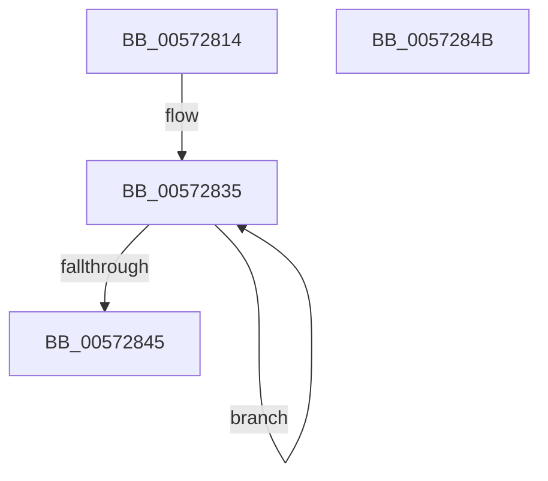

# IvtSetScalableModeContextEntry

- RVA: `0x00572814`–`0x0057284C` (길이 `56` bytes)
- VA: `0x0000000140572814`
- 실행 섹션: `.text`
- PDB 이름 있음: `예`; PDB Function 태그: `아니요`
- unwind 정보 RVA: `0x000C5118`
- 디코드: `17`개 명령, `56/56` bytes 표시
- 미해석 바이트: `0` (있으면 어셈블리에 `.byte`로 보존)

> 이 문서는 커널 이미지의 기계어와 PDB 기호를 분석해 생성했습니다. 4번과 5번은 함수 원형과 자료형을 바이너리 사용 방식에서 추정한 C 해석이며 원본 소스 복구 결과는 아닙니다.

## 1. Dependencies

- 직접 호출 지점: **0**; 고유 호출 대상: **0**
- 직접 호출자로 확인된 함수: **1**
- RIP 상대 이미지 참조: **0**

### Outgoing calls
- 직접 디코드된 call 명령이 없습니다.

### Direct callers
- [IvtInitializeIommu](../../pagelk/B6/IvtInitializeIommu_function_00B61FE0.md) at `0x00B62401`

### Static image references
- 디코드된 RIP-relative 메모리 참조가 없습니다.

## 2. Other-region calls and transfers

- 다른 실행 섹션으로 향하는 call: **0**
- 별도 외부 분기/꼬리 이동을 확인하지 못했습니다.

## 3. Assembly (complete function range)

```asm
00572814  40 53                           push rbx
00572816  48 83 EC 10                     sub rsp, 0x10
0057281A  49 8B 00                        mov rax, qword ptr [r8]
0057281D  48 8B 1A                        mov rbx, qword ptr [rdx]
00572820  48 8B 4A 08                     mov rcx, qword ptr [rdx + 8]
00572824  49 8B 50 08                     mov rdx, qword ptr [r8 + 8]
00572828  48 89 04 24                     mov qword ptr [rsp], rax
0057282C  48 8B 04 24                     mov rax, qword ptr [rsp]
00572830  48 89 54 24 08                  mov qword ptr [rsp + 8], rdx
00572835  F0 49 0F C7 08                  lock cmpxchg16b xmmword ptr [r8]
0057283A  48 89 04 24                     mov qword ptr [rsp], rax
0057283E  48 89 54 24 08                  mov qword ptr [rsp + 8], rdx
00572843  75 F0                           jne 0x140572835
00572845  48 83 C4 10                     add rsp, 0x10
00572849  5B                              pop rbx
0057284A  C3                              ret
0057284B  CC                              int3
```

## 4. C-style interpretation (structured pseudocode)

```c
__int64 __fastcall IvtSetScalableModeContextEntry(__int64 a1, __int64 a2, __int64 a3)
{
    __int64 v_rsp;
    unsigned __int64 v_stack_m10;
    unsigned __int64 v_stack_m18;

    v_rsp = (v_rsp) - (16);
    v_stack_m18 = *(unsigned __int64 *)(a3);
    v_stack_m10 = *(unsigned __int64 *)(a3 + 8);
loc_00572835:
    v_stack_m18 = v_stack_m18;
    v_stack_m10 = *(unsigned __int64 *)(a3 + 8);
    if (condition_is_not_equal) goto loc_00572835;
    v_rsp = (v_rsp) + (16);
    return v_stack_m18;
}
```

## 5. (Beta) C Style

```c
int64_t IvtSetScalableModeContextEntry(int64_t Arg1, void *Arg2, void *Arg3)
{
    uint8_t *arg2 = (uint8_t *)Arg2;
    uint8_t *arg3 = (uint8_t *)Arg3;

    int64_t local_rsp;
    uint64_t v_stack_m10;
    uint64_t v_stack_m18;

    local_rsp = (local_rsp) - (16);
    v_stack_m18 = *(uint64_t *)(arg3);
    v_stack_m10 = *(uint64_t *)(arg3 + 0x8);
loc_00572835:
    v_stack_m18 = v_stack_m18;
    v_stack_m10 = *(uint64_t *)(arg3 + 0x8);
    if (condition_is_not_equal) goto loc_00572835;
    local_rsp = (local_rsp) + (16);
    return v_stack_m18;
}
```

### 관측된 메모리 오프셋

구조체 형식이 확인되지 않은 접근은 인자 기준의 오프셋으로만 기록했습니다.

| 기준 인자 | 오프셋 표현 | 폭 (bit) | 접근 |
|---|---:|---:|---|
| `Arg2` | `+ 0x0` | `64` | `R` |
| `Arg2` | `+ 0x8` | `64` | `R` |
| `Arg3` | `+ 0x0` | `64` | `R` |
| `Arg3` | `+ 0x0` | `128` | `R` |
| `Arg3` | `+ 0x8` | `64` | `R` |

## 6. Execution-region graph

[열기: 2D/3D 그래프와 함수 탐색 컨트롤 패널](../../../control-panel.html?section=text&rva=0x00572814&view=graph)

- 2D 그래프는 위에서 아래로 흐르고, 3D 그래프는 빈 공간을 드래그해 회전합니다. Shift+드래그는 이동, 휠은 확대·축소, 함수 노드 선택은 대상 보고서 이동입니다.

### Static fallback


