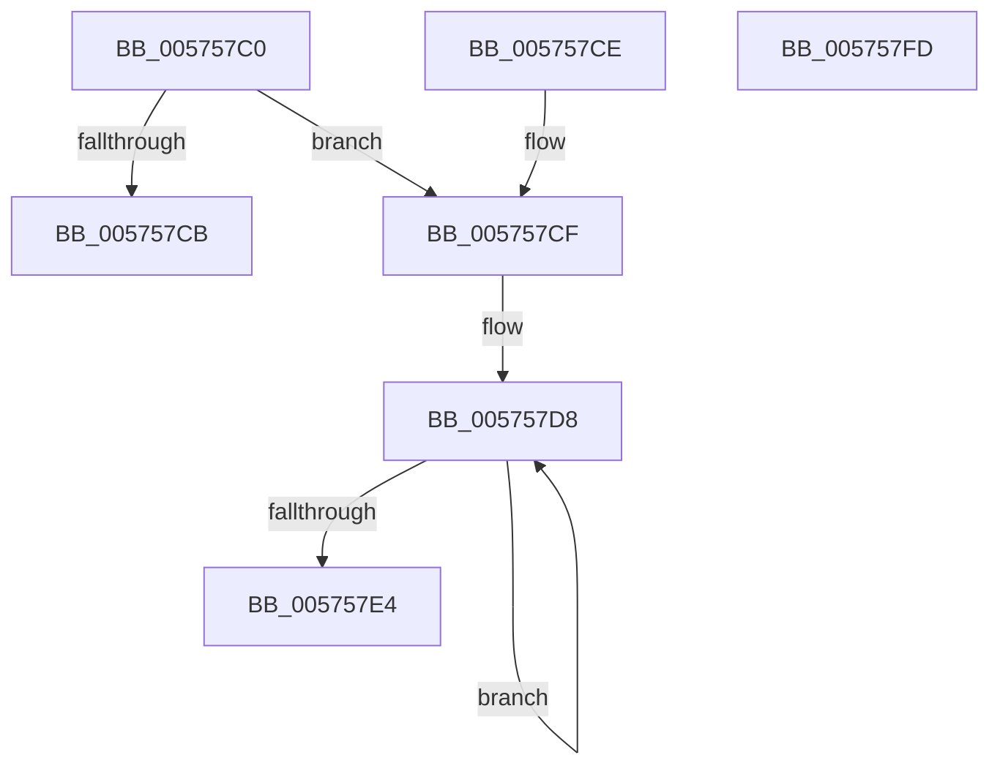

# IvtSlConfigureIntermediatePhysicalPte

- RVA: `0x005757C0`–`0x005757FE` (길이 `62` bytes)
- VA: `0x00000001405757C0`
- 실행 섹션: `.text`
- PDB 이름 있음: `예`; PDB Function 태그: `아니요`
- unwind 정보 RVA: `0x000DB714`
- 디코드: `21`개 명령, `62/62` bytes 표시
- 미해석 바이트: `0` (있으면 어셈블리에 `.byte`로 보존)

> 이 문서는 커널 이미지의 기계어와 PDB 기호를 분석해 생성했습니다. 4번과 5번은 함수 원형과 자료형을 바이너리 사용 방식에서 추정한 C 해석이며 원본 소스 복구 결과는 아닙니다.

## 1. Dependencies

- 직접 호출 지점: **0**; 고유 호출 대상: **0**
- 직접 호출자로 확인된 함수: **0**
- RIP 상대 이미지 참조: **0**

### Outgoing calls
- 직접 디코드된 call 명령이 없습니다.

### Direct callers
- 이 함수 시작 RVA로 연결되는 직접 call은 확인되지 않았습니다. 간접 호출은 완전히 역산할 수 없습니다.

### Static image references
- 디코드된 RIP-relative 메모리 참조가 없습니다.

## 2. Other-region calls and transfers

- 다른 실행 섹션으로 향하는 call: **0**
- 별도 외부 분기/꼬리 이동을 확인하지 못했습니다.

## 3. Assembly (complete function range)

```asm
005757C0  48 8B 11                        mov rdx, qword ptr [rcx]
005757C3  4C 8B C9                        mov r9, rcx
005757C6  48 85 D2                        test rdx, rdx
005757C9  74 04                           je 0x1405757cf
005757CB  32 C0                           xor al, al
005757CD  C3                              ret
005757CE  CC                              int3
005757CF  B9 01 00 00 00                  mov ecx, 1
005757D4  44 8D 51 01                     lea r10d, [rcx + 1]
005757D8  48 0B D1                        or rdx, rcx
005757DB  48 FF C1                        inc rcx
005757DE  49 83 EA 01                     sub r10, 1
005757E2  75 F4                           jne 0x1405757d8
005757E4  49 33 D0                        xor rdx, r8
005757E7  48 B9 FF 0F 00 00 00 00 F0 FF   movabs rcx, 0xfff0000000000fff
005757F1  48 23 D1                        and rdx, rcx
005757F4  B0 01                           mov al, 1
005757F6  49 33 D0                        xor rdx, r8
005757F9  49 89 11                        mov qword ptr [r9], rdx
005757FC  C3                              ret
005757FD  CC                              int3
```

## 4. C-style interpretation (structured pseudocode)

```c
__int64 __fastcall IvtSlConfigureIntermediatePhysicalPte(__int64 a1, __int64 a2, __int64 a3)
{
    __int64 result;
    __int64 v_r10;

    if (*(unsigned __int64 *)(a1) == 0) goto loc_005757CF;
    result = 0;
    return result;
loc_005757CF:
loc_005757D8:
    a2 = (*(unsigned __int64 *)(a1)) | (1);
    a1 = (1) + 1;
    v_r10 = (1 + 1) - (1);
    if (condition_is_not_equal) goto loc_005757D8;
    a2 = (a2) ^ (a3);
    a2 = (a2) & (a1);
    a2 = (a2) ^ (a3);
    *(unsigned __int64 *)(a1) = a2;
    return 1;
}
```

## 5. (Beta) C Style

```c
int64_t IvtSlConfigureIntermediatePhysicalPte(void *Arg1, int64_t Arg2, int64_t Arg3)
{
    uint8_t *arg1 = (uint8_t *)Arg1;

    int64_t result;
    int64_t local_r10;

    if (*(uint64_t *)(arg1) == 0) goto loc_005757CF;
    result = 0;
    return result;
loc_005757CF:
loc_005757D8:
    Arg2 = (*(uint64_t *)(arg1)) | (1);
    Arg1 = (1) + 1;
    local_r10 = (1 + 1) - (1);
    if (condition_is_not_equal) goto loc_005757D8;
    Arg2 = (Arg2) ^ (Arg3);
    Arg2 = (Arg2) & (Arg1);
    Arg2 = (Arg2) ^ (Arg3);
    *(uint64_t *)(arg1) = Arg2;
    return 1;
}
```

### 관측된 메모리 오프셋

구조체 형식이 확인되지 않은 접근은 인자 기준의 오프셋으로만 기록했습니다.

| 기준 인자 | 오프셋 표현 | 폭 (bit) | 접근 |
|---|---:|---:|---|
| `Arg1` | `+ 0x0` | `64` | `R` |
| `Arg1` | `+ 0x0` | `64` | `W` |

## 6. Execution-region graph

[열기: 2D/3D 그래프와 함수 탐색 컨트롤 패널](../../../control-panel.html?section=text&rva=0x005757C0&view=graph)

- 2D 그래프는 위에서 아래로 흐르고, 3D 그래프는 빈 공간을 드래그해 회전합니다. Shift+드래그는 이동, 휠은 확대·축소, 함수 노드 선택은 대상 보고서 이동입니다.

### Static fallback


