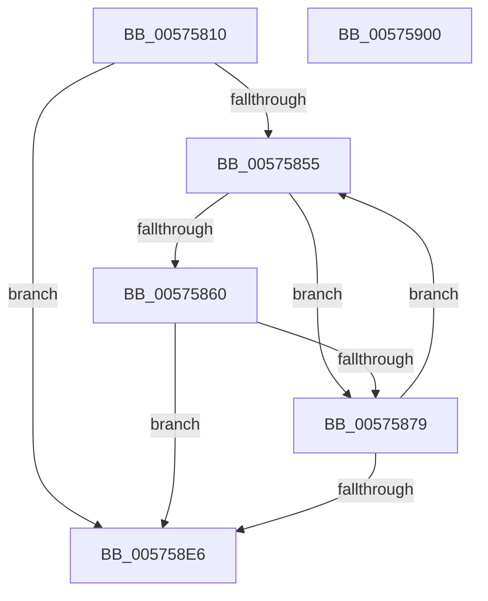

# IvtSlConfigureLeafPhysicalPte

- RVA: `0x00575810`–`0x00575901` (길이 `241` bytes)
- VA: `0x0000000140575810`
- 실행 섹션: `.text`
- PDB 이름 있음: `예`; PDB Function 태그: `아니요`
- unwind 정보 RVA: `0x000A6CEC`
- 디코드: `64`개 명령, `241/241` bytes 표시
- 미해석 바이트: `0` (있으면 어셈블리에 `.byte`로 보존)

> 이 문서는 커널 이미지의 기계어와 PDB 기호를 분석해 생성했습니다. 4번과 5번은 함수 원형과 자료형을 바이너리 사용 방식에서 추정한 C 해석이며 원본 소스 복구 결과는 아닙니다.

## 1. Dependencies

- 직접 호출 지점: **0**; 고유 호출 대상: **0**
- 직접 호출자로 확인된 함수: **0**
- RIP 상대 이미지 참조: **0**

### Outgoing calls
- 직접 디코드된 call 명령이 없습니다.

### Direct callers
- 이 함수 시작 RVA로 연결되는 직접 call은 확인되지 않았습니다. 간접 호출은 완전히 역산할 수 없습니다.

### Static image references
- 디코드된 RIP-relative 메모리 참조가 없습니다.

## 2. Other-region calls and transfers

- 다른 실행 섹션으로 향하는 call: **0**
- 별도 외부 분기/꼬리 이동을 확인하지 못했습니다.

## 3. Assembly (complete function range)

```asm
00575810  48 8B C4                        mov rax, rsp
00575813  48 89 58 08                     mov qword ptr [rax + 8], rbx
00575817  48 89 68 10                     mov qword ptr [rax + 0x10], rbp
0057581B  48 89 70 18                     mov qword ptr [rax + 0x18], rsi
0057581F  48 89 78 20                     mov qword ptr [rax + 0x20], rdi
00575823  41 56                           push r14
00575825  33 FF                           xor edi, edi
00575827  41 8B E9                        mov ebp, r9d
0057582A  45 8B D8                        mov r11d, r8d
0057582D  45 8B D0                        mov r10d, r8d
00575830  41 83 E3 01                     and r11d, 1
00575834  48 8B D9                        mov rbx, rcx
00575837  41 8A C3                        mov al, r11b
0057583A  34 01                           xor al, 1
0057583C  41 83 E2 02                     and r10d, 2
00575840  0F B6 C0                        movzx eax, al
00575843  0F 44 F8                        cmove edi, eax
00575846  48 C1 EA 0C                     shr rdx, 0xc
0057584A  45 33 C9                        xor r9d, r9d
0057584D  85 ED                           test ebp, ebp
0057584F  0F 84 91 00 00 00               je 0x1405758e6
00575855  4C 8B 03                        mov r8, qword ptr [rbx]
00575858  48 8B F2                        mov rsi, rdx
0057585B  4D 85 C0                        test r8, r8
0057585E  74 19                           je 0x140575879
00575860  49 8B C0                        mov rax, r8
00575863  48 B9 FF FF FF FF FF 00 00 00   movabs rcx, 0xffffffffff
0057586D  48 C1 E8 0C                     shr rax, 0xc
00575871  48 23 C1                        and rax, rcx
00575874  48 3B C2                        cmp rax, rdx
00575877  75 6D                           jne 0x1405758e6
00575879  48 C1 E2 0C                     shl rdx, 0xc
0057587D  41 8B C2                        mov eax, r10d
00575880  F7 D8                           neg eax
00575882  49 BE FD 0F 00 00 00 00 F0 FF   movabs r14, 0xfff0000000000ffd
0057588C  48 B8 FF 0F 00 00 00 00 F0 FF   movabs rax, 0xfff0000000000fff
00575896  48 1B C9                        sbb rcx, rcx
00575899  41 FF C1                        inc r9d
0057589C  83 E1 02                        and ecx, 2
0057589F  48 23 C8                        and rcx, rax
005758A2  41 8B C3                        mov eax, r11d
005758A5  49 23 C6                        and rax, r14
005758A8  48 0B C8                        or rcx, rax
005758AB  48 B8 FC 0F 00 00 00 00 F0 FF   movabs rax, 0xfff0000000000ffc
005758B5  4C 23 C0                        and r8, rax
005758B8  48 B8 00 F0 FF FF FF FF 0F 00   movabs rax, 0xffffffffff000
005758C2  48 23 D0                        and rdx, rax
005758C5  49 0B C8                        or rcx, r8
005758C8  48 33 CA                        xor rcx, rdx
005758CB  48 8D 56 01                     lea rdx, [rsi + 1]
005758CF  48 89 0B                        mov qword ptr [rbx], rcx
005758D2  48 83 C3 08                     add rbx, 8
005758D6  40 84 FF                        test dil, dil
005758D9  48 0F 45 D6                     cmovne rdx, rsi
005758DD  44 3B CD                        cmp r9d, ebp
005758E0  0F 82 6F FF FF FF               jb 0x140575855
005758E6  48 8B 5C 24 10                  mov rbx, qword ptr [rsp + 0x10]
005758EB  41 8B C1                        mov eax, r9d
005758EE  48 8B 6C 24 18                  mov rbp, qword ptr [rsp + 0x18]
005758F3  48 8B 74 24 20                  mov rsi, qword ptr [rsp + 0x20]
005758F8  48 8B 7C 24 28                  mov rdi, qword ptr [rsp + 0x28]
005758FD  41 5E                           pop r14
005758FF  C3                              ret
00575900  CC                              int3
```

## 4. C-style interpretation (structured pseudocode)

```c
__int64 __fastcall IvtSlConfigureLeafPhysicalPte(__int64 a1, __int64 a2, int a3, int a4)
{
    __int64 result;
    __int64 v_r10;
    __int64 v_r11;
    __int64 v_rbx;
    __int64 v_rdi;
    unsigned __int64 v_stack_p10;
    unsigned __int64 v_stack_p18;
    unsigned __int64 v_stack_p20;
    unsigned __int64 v_stack_p8;

    *(unsigned __int64 *)(v_rsp + 8) = v_rbx;
    *(unsigned __int64 *)(v_rsp + 16) = v_rbp;
    *(unsigned __int64 *)(v_rsp + 24) = v_rsi;
    *(unsigned __int64 *)(v_rsp + 32) = v_rdi;
    v_rdi = 0;
    v_r11 = (unsigned int)(((unsigned int)(a3)) & (1));
    result = (unsigned __int8)(((unsigned __int8)(v_r11)) ^ (1));
    v_r10 = (unsigned int)(((unsigned int)(a3)) & (2));
    if (condition_is_equal) { v_rdi = (unsigned int)((unsigned __int8)(result)); }
    a2 = (a2) >> (12);
    a4 = 0;
    if ((unsigned int)((unsigned int)(a4)) == 0) goto loc_005758E6;
loc_00575855:
    if (*(unsigned __int64 *)(a1) == 0) goto loc_00575879;
    result = (*(unsigned __int64 *)(a1)) >> (12);
    result = (result) & (a1);
    if (result != a2) goto loc_005758E6;
loc_00575879:
    a2 = (a2) << (12);
    result = (unsigned int)(-((unsigned int)((unsigned int)(v_r10))));
    a4 = (unsigned int)((a4) + 1);
    a1 = (unsigned int)((a1) & (2));
    a1 = (a1) & (result);
    result = ((unsigned int)((unsigned int)(v_r11))) & (v_r14);
    a1 = (a1) | (result);
    a3 = (*(unsigned __int64 *)(a1)) & (result);
    a2 = (a2) & (result);
    a1 = (a1) | (a3);
    a1 = (a1) ^ (a2);
    *(unsigned __int64 *)(a1) = a1;
    v_rbx = (a1) + (8);
    a2 = a2 + 1;
    if ((unsigned __int8)(v_rdi) != 0) { a2 = a2; }
    if (a4 < ((unsigned int)((unsigned int)(a4)))) goto loc_00575855;
loc_005758E6:
    return (unsigned int)(a4);
}
```

## 5. (Beta) C Style

```c
int64_t IvtSlConfigureLeafPhysicalPte(void *Arg1, int64_t Arg2, int32_t Arg3, int32_t Arg4)
{
    uint8_t *arg1 = (uint8_t *)Arg1;

    int64_t result;
    int64_t local_r10;
    int64_t local_r11;
    int64_t local_rbx;
    int64_t local_rdi;
    uint64_t v_stack_p10;
    uint64_t v_stack_p18;
    uint64_t v_stack_p20;
    uint64_t v_stack_p8;

    *(uint64_t *)(local_rsp + 0x8) = local_rbx;
    *(uint64_t *)(local_rsp + 0x10) = local_rbp;
    *(uint64_t *)(local_rsp + 0x18) = local_rsi;
    *(uint64_t *)(local_rsp + 0x20) = local_rdi;
    local_rdi = 0;
    local_r11 = (uint32_t)(((uint32_t)(Arg3)) & (1));
    result = (uint8_t)(((uint8_t)(local_r11)) ^ (1));
    local_r10 = (uint32_t)(((uint32_t)(Arg3)) & (2));
    if (condition_is_equal) { local_rdi = (uint32_t)((uint8_t)(result)); }
    Arg2 = (Arg2) >> (12);
    Arg4 = 0;
    if ((uint32_t)((uint32_t)(Arg4)) == 0) goto loc_005758E6;
loc_00575855:
    if (*(uint64_t *)(arg1) == 0) goto loc_00575879;
    result = (*(uint64_t *)(arg1)) >> (12);
    result = (result) & (Arg1);
    if (result != Arg2) goto loc_005758E6;
loc_00575879:
    Arg2 = (Arg2) << (12);
    result = (uint32_t)(-((uint32_t)((uint32_t)(local_r10))));
    Arg4 = (uint32_t)((Arg4) + 1);
    Arg1 = (uint32_t)((Arg1) & (2));
    Arg1 = (Arg1) & (result);
    result = ((uint32_t)((uint32_t)(local_r11))) & (local_r14);
    Arg1 = (Arg1) | (result);
    Arg3 = (*(uint64_t *)(arg1)) & (result);
    Arg2 = (Arg2) & (result);
    Arg1 = (Arg1) | (Arg3);
    Arg1 = (Arg1) ^ (Arg2);
    *(void **)(arg1) = Arg1;
    local_rbx = (Arg1) + (8);
    Arg2 = Arg2 + 1;
    if ((uint8_t)(local_rdi) != 0) { Arg2 = Arg2; }
    if (Arg4 < ((uint32_t)((uint32_t)(Arg4)))) goto loc_00575855;
loc_005758E6:
    return (uint32_t)(Arg4);
}
```

### 관측된 메모리 오프셋

구조체 형식이 확인되지 않은 접근은 인자 기준의 오프셋으로만 기록했습니다.

| 기준 인자 | 오프셋 표현 | 폭 (bit) | 접근 |
|---|---:|---:|---|
| `Arg1` | `+ 0x0` | `64` | `R` |
| `Arg1` | `+ 0x0` | `64` | `W` |

## 6. Execution-region graph

[열기: 2D/3D 그래프와 함수 탐색 컨트롤 패널](../../../control-panel.html?section=text&rva=0x00575810&view=graph)

- 2D 그래프는 위에서 아래로 흐르고, 3D 그래프는 빈 공간을 드래그해 회전합니다. Shift+드래그는 이동, 휠은 확대·축소, 함수 노드 선택은 대상 보고서 이동입니다.

### Static fallback


