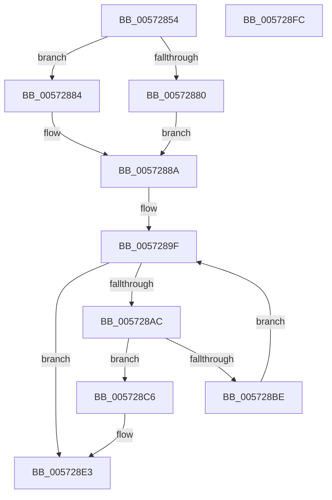

# IvtUpdateGlobalCommand

- RVA: `0x00572854`–`0x005728FD` (길이 `169` bytes)
- VA: `0x0000000140572854`
- 실행 섹션: `.text`
- PDB 이름 있음: `예`; PDB Function 태그: `아니요`
- unwind 정보 RVA: `0x00084C9C`
- 디코드: `56`개 명령, `169/169` bytes 표시
- 미해석 바이트: `0` (있으면 어셈블리에 `.byte`로 보존)

> 이 문서는 커널 이미지의 기계어와 PDB 기호를 분석해 생성했습니다. 4번과 5번은 함수 원형과 자료형을 바이너리 사용 방식에서 추정한 C 해석이며 원본 소스 복구 결과는 아닙니다.

## 1. Dependencies

- 직접 호출 지점: **2**; 고유 호출 대상: **2**
- 직접 호출자로 확인된 함수: **1**
- RIP 상대 이미지 참조: **0**

### Outgoing calls
- `0x005728B1` → [KeStallExecutionProcessor](../44/KeStallExecutionProcessor_function_0044F620.md) (function, `0x0044F620`)
- `0x005728DD` → [KeBugCheckEx](../4F/KeBugCheckEx_function_004FD660.md) (function, `0x004FD660`)

### Direct callers
- [IvtInitializeIommu](../../pagelk/B6/IvtInitializeIommu_function_00B61FE0.md) at `0x00B6208F`
- [IvtInitializeIommu](../../pagelk/B6/IvtInitializeIommu_function_00B61FE0.md) at `0x00B6219A`
- [IvtInitializeIommu](../../pagelk/B6/IvtInitializeIommu_function_00B61FE0.md) at `0x00B6220D`
- [IvtInitializeIommu](../../pagelk/B6/IvtInitializeIommu_function_00B61FE0.md) at `0x00B62230`
- [IvtInitializeIommu](../../pagelk/B6/IvtInitializeIommu_function_00B61FE0.md) at `0x00B625B4`
- [IvtInitializeIommu](../../pagelk/B6/IvtInitializeIommu_function_00B61FE0.md) at `0x00B6285D`
- [IvtInitializeIommu](../../pagelk/B6/IvtInitializeIommu_function_00B61FE0.md) at `0x00B62906`

### Static image references
- 디코드된 RIP-relative 메모리 참조가 없습니다.

## 2. Other-region calls and transfers

- 다른 실행 섹션으로 향하는 call: **0**
- 별도 외부 분기/꼬리 이동을 확인하지 못했습니다.

## 3. Assembly (complete function range)

```asm
00572854  48 89 5C 24 08                  mov qword ptr [rsp + 8], rbx
00572859  48 89 6C 24 10                  mov qword ptr [rsp + 0x10], rbp
0057285E  48 89 74 24 18                  mov qword ptr [rsp + 0x18], rsi
00572863  57                              push rdi
00572864  41 56                           push r14
00572866  41 57                           push r15
00572868  48 83 EC 30                     sub rsp, 0x30
0057286C  48 8B 59 08                     mov rbx, qword ptr [rcx + 8]
00572870  33 ED                           xor ebp, ebp
00572872  8B F2                           mov esi, edx
00572874  90                              nop
00572875  4C 8B F1                        mov r14, rcx
00572878  8B 5B 1C                        mov ebx, dword ptr [rbx + 0x1c]
0057287B  45 84 C0                        test r8b, r8b
0057287E  74 04                           je 0x140572884
00572880  0B DE                           or ebx, esi
00572882  EB 06                           jmp 0x14057288a
00572884  8B C6                           mov eax, esi
00572886  F7 D0                           not eax
00572888  23 D8                           and ebx, eax
0057288A  48 8B 41 08                     mov rax, qword ptr [rcx + 8]
0057288E  89 58 18                        mov dword ptr [rax + 0x18], ebx
00572891  F0 09 2C 24                     lock or dword ptr [rsp], ebp
00572895  48 8B 79 08                     mov rdi, qword ptr [rcx + 8]
00572899  44 8B FB                        mov r15d, ebx
0057289C  44 23 FE                        and r15d, esi
0057289F  90                              nop
005728A0  8B 7F 1C                        mov edi, dword ptr [rdi + 0x1c]
005728A3  8B C7                           mov eax, edi
005728A5  23 C6                           and eax, esi
005728A7  41 3B C7                        cmp eax, r15d
005728AA  74 37                           je 0x1405728e3
005728AC  B9 01 00 00 00                  mov ecx, 1
005728B1  E8 6A CD ED FF                  call 0x14044f620
005728B6  81 FD A0 86 01 00               cmp ebp, 0x186a0
005728BC  74 08                           je 0x1405728c6
005728BE  49 8B 7E 08                     mov rdi, qword ptr [r14 + 8]
005728C2  FF C5                           inc ebp
005728C4  EB D9                           jmp 0x14057289f
005728C6  8B C7                           mov eax, edi
005728C8  4C 8B C6                        mov r8, rsi
005728CB  44 8B CB                        mov r9d, ebx
005728CE  BA 00 05 00 00                  mov edx, 0x500
005728D3  B9 5C 00 00 00                  mov ecx, 0x5c
005728D8  48 89 44 24 20                  mov qword ptr [rsp + 0x20], rax
005728DD  E8 7E AD F8 FF                  call 0x1404fd660
005728E2  CC                              int3
005728E3  48 8B 5C 24 50                  mov rbx, qword ptr [rsp + 0x50]
005728E8  48 8B 6C 24 58                  mov rbp, qword ptr [rsp + 0x58]
005728ED  48 8B 74 24 60                  mov rsi, qword ptr [rsp + 0x60]
005728F2  48 83 C4 30                     add rsp, 0x30
005728F6  41 5F                           pop r15
005728F8  41 5E                           pop r14
005728FA  5F                              pop rdi
005728FB  C3                              ret
005728FC  CC                              int3
```

## 4. C-style interpretation (structured pseudocode)

```c
__int64 __fastcall IvtUpdateGlobalCommand(__int64 a1, int a2, unsigned __int8 a3)
{
    __int64 result;
    __int64 v_r15;
    __int64 v_rbp;
    __int64 v_rbx;
    __int64 v_rsp;
    unsigned __int64 v_stack_m28;
    unsigned int v_stack_m48;
    unsigned __int64 v_stack_p10;
    unsigned __int64 v_stack_p18;
    unsigned __int64 v_stack_p8;

    v_stack_p8 = v_rbx;
    v_stack_p10 = v_rbp;
    v_stack_p18 = v_rsi;
    v_rsp = (v_rsp) - (48);
    v_rbp = 0;
    if (a3 == 0) goto loc_00572884;
    v_rbx = (unsigned int)(((unsigned int)(*(unsigned int *)(*(unsigned __int64 *)(a1 + 8) + 28))) | ((unsigned int)((unsigned int)(a2))));
    goto loc_0057288A;
loc_00572884:
    result = (unsigned int)(~((unsigned int)((unsigned int)((unsigned int)(a2)))));
    v_rbx = (unsigned int)((v_rbx) & ((unsigned int)(result)));
loc_0057288A:
    *(unsigned int *)(*(unsigned __int64 *)(a1 + 8) + 24) = (unsigned int)(v_rbx);
    v_r15 = (unsigned int)(((unsigned int)((unsigned int)(v_rbx))) & ((unsigned int)((unsigned int)(a2))));
loc_0057289F:
    result = (unsigned int)(((unsigned int)((unsigned int)((unsigned int)(*(unsigned int *)(*(unsigned __int64 *)(a1 + 8) + 28))))) & ((unsigned int)((unsigned int)(a2))));
    if (((unsigned int)(result)) == ((unsigned int)(v_r15))) goto loc_005728E3;
    result = KeStallExecutionProcessor(1, a2, a3, a4);
    if (0 == 0x186A0ULL) goto loc_005728C6;
    v_rbp = (unsigned int)((v_rbp) + 1);
    goto loc_0057289F;
loc_005728C6:
    v_stack_m28 = (unsigned int)((unsigned int)(*(unsigned __int64 *)(a1 + 8)));
    result = KeBugCheckEx(92, (unsigned int)(0x500ULL), (unsigned int)(a2), (unsigned int)((unsigned int)(v_rbx)));
loc_005728E3:
    v_rsp = (v_rsp) + (48);
    return result;
}
```

## 5. (Beta) C Style

```c
int64_t IvtUpdateGlobalCommand(void *Arg1, int32_t Arg2, uint8_t Arg3)
{
    uint8_t *arg1 = (uint8_t *)Arg1;

    int64_t result;
    int64_t local_r15;
    int64_t local_rbp;
    int64_t local_rbx;
    int64_t local_rsp;
    uint64_t v_stack_m28;
    uint32_t v_stack_m48;
    uint64_t v_stack_p10;
    uint64_t v_stack_p18;
    uint64_t v_stack_p8;

    v_stack_p8 = local_rbx;
    v_stack_p10 = local_rbp;
    v_stack_p18 = local_rsi;
    local_rsp = (local_rsp) - (48);
    local_rbp = 0;
    if (Arg3 == 0) goto loc_00572884;
    local_rbx = (uint32_t)(((uint32_t)(*(uint32_t *)(*(uint64_t *)(arg1 + 0x8) + 0x1C))) | ((uint32_t)((uint32_t)(Arg2))));
    goto loc_0057288A;
loc_00572884:
    result = (uint32_t)(~((uint32_t)((uint32_t)((uint32_t)(Arg2)))));
    local_rbx = (uint32_t)((local_rbx) & ((uint32_t)(result)));
loc_0057288A:
    *(uint32_t *)(*(uint64_t *)(arg1 + 0x8) + 0x18) = (uint32_t)(local_rbx);
    local_r15 = (uint32_t)(((uint32_t)((uint32_t)(local_rbx))) & ((uint32_t)((uint32_t)(Arg2))));
loc_0057289F:
    result = (uint32_t)(((uint32_t)((uint32_t)((uint32_t)(*(uint32_t *)(*(uint64_t *)(arg1 + 0x8) + 0x1C))))) & ((uint32_t)((uint32_t)(Arg2))));
    if (((uint32_t)(result)) == ((uint32_t)(local_r15))) goto loc_005728E3;
    result = KeStallExecutionProcessor(1, Arg2, Arg3, a4);
    if (0 == 0x186A0ULL) goto loc_005728C6;
    local_rbp = (uint32_t)((local_rbp) + 1);
    goto loc_0057289F;
loc_005728C6:
    v_stack_m28 = (uint32_t)((uint32_t)(*(uint64_t *)(arg1 + 0x8)));
    result = KeBugCheckEx(92, (uint32_t)(0x500ULL), (uint32_t)(Arg2), (uint32_t)((uint32_t)(local_rbx)));
loc_005728E3:
    local_rsp = (local_rsp) + (48);
    return result;
}
```

### 관측된 메모리 오프셋

구조체 형식이 확인되지 않은 접근은 인자 기준의 오프셋으로만 기록했습니다.

| 기준 인자 | 오프셋 표현 | 폭 (bit) | 접근 |
|---|---:|---:|---|
| `Arg1` | `+ 0x8` | `64` | `R` |

## 6. Execution-region graph

[열기: 2D/3D 그래프와 함수 탐색 컨트롤 패널](../../../control-panel.html?section=text&rva=0x00572854&view=graph)

- 2D 그래프는 위에서 아래로 흐르고, 3D 그래프는 빈 공간을 드래그해 회전합니다. Shift+드래그는 이동, 휠은 확대·축소, 함수 노드 선택은 대상 보고서 이동입니다.

### Static fallback


