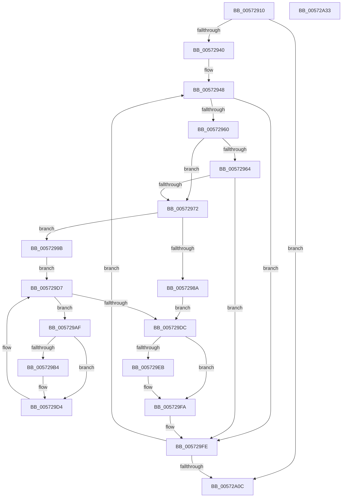

# IvtUpdateRemappingDestination

- RVA: `0x00572910`–`0x00572A34` (길이 `292` bytes)
- VA: `0x0000000140572910`
- 실행 섹션: `.text`
- PDB 이름 있음: `예`; PDB Function 태그: `아니요`
- unwind 정보 RVA: `0x000C5200`
- 디코드: `87`개 명령, `292/292` bytes 표시
- 미해석 바이트: `0` (있으면 어셈블리에 `.byte`로 보존)

> 이 문서는 커널 이미지의 기계어와 PDB 기호를 분석해 생성했습니다. 4번과 5번은 함수 원형과 자료형을 바이너리 사용 방식에서 추정한 C 해석이며 원본 소스 복구 결과는 아닙니다.

## 1. Dependencies

- 직접 호출 지점: **3**; 고유 호출 대상: **2**
- 직접 호출자로 확인된 함수: **0**
- RIP 상대 이미지 참조: **0**

### Outgoing calls
- `0x00572991` → [HsaUpdateSingleTargetExtendedDestination](HsaUpdateSingleTargetExtendedDestination_function_00572A3C.md) (function, `0x00572A3C`)
- `0x005729CC` → [HsaUpdateSingleTargetExtendedDestination](HsaUpdateSingleTargetExtendedDestination_function_00572A3C.md) (function, `0x00572A3C`)
- `0x00572A11` → [IvtInvalidateRemappingTableEntries](../46/IvtInvalidateRemappingTableEntries_function_0046A520.md) (function, `0x0046A520`)

### Direct callers
- 이 함수 시작 RVA로 연결되는 직접 call은 확인되지 않았습니다. 간접 호출은 완전히 역산할 수 없습니다.

### Static image references
- 디코드된 RIP-relative 메모리 참조가 없습니다.

## 2. Other-region calls and transfers

- 다른 실행 섹션으로 향하는 call: **0**
- 별도 외부 분기/꼬리 이동을 확인하지 못했습니다.

## 3. Assembly (complete function range)

```asm
00572910  48 8B C4                        mov rax, rsp
00572913  48 89 58 08                     mov qword ptr [rax + 8], rbx
00572917  48 89 68 18                     mov qword ptr [rax + 0x18], rbp
0057291B  48 89 70 20                     mov qword ptr [rax + 0x20], rsi
0057291F  88 50 10                        mov byte ptr [rax + 0x10], dl
00572922  57                              push rdi
00572923  41 54                           push r12
00572925  41 55                           push r13
00572927  41 56                           push r14
00572929  41 57                           push r15
0057292B  48 83 EC 30                     sub rsp, 0x30
0057292F  33 ED                           xor ebp, ebp
00572931  48 8B F1                        mov rsi, rcx
00572934  39 A9 30 01 00 00               cmp dword ptr [rcx + 0x130], ebp
0057293A  0F 86 CC 00 00 00               jbe 0x140572a0c
00572940  44 8B AC 24 80 00 00 00         mov r13d, dword ptr [rsp + 0x80]
00572948  8B DD                           mov ebx, ebp
0057294A  48 C1 E3 04                     shl rbx, 4
0057294E  48 03 9E 20 01 00 00            add rbx, qword ptr [rsi + 0x120]
00572955  48 8B 03                        mov rax, qword ptr [rbx]
00572958  A8 01                           test al, 1
0057295A  0F 84 9E 00 00 00               je 0x1405729fe
00572960  84 D2                           test dl, dl
00572962  74 0E                           je 0x140572972
00572964  48 8B 03                        mov rax, qword ptr [rbx]
00572967  48 0F BA E0 08                  bt rax, 8
0057296C  0F 83 8C 00 00 00               jae 0x1405729fe
00572972  48 8B 03                        mov rax, qword ptr [rbx]
00572975  48 8B 3B                        mov rdi, qword ptr [rbx]
00572978  83 E0 04                        and eax, 4
0057297B  48 C1 EF 20                     shr rdi, 0x20
0057297F  48 85 C0                        test rax, rax
00572982  0F 95 C2                        setne dl
00572985  48 85 C0                        test rax, rax
00572988  75 11                           jne 0x14057299b
0057298A  8B CF                           mov ecx, edi
0057298C  44 89 6C 24 20                  mov dword ptr [rsp + 0x20], r13d
00572991  E8 A6 00 00 00                  call 0x140572a3c
00572996  44 8B E0                        mov r12d, eax
00572999  EB 41                           jmp 0x1405729dc
0057299B  44 0F B7 FF                     movzx r15d, di
0057299F  81 E7 00 00 FF FF               and edi, 0xffff0000
005729A5  45 33 E4                        xor r12d, r12d
005729A8  45 8D 74 24 01                  lea r14d, [r12 + 1]
005729AD  EB 28                           jmp 0x1405729d7
005729AF  45 85 F7                        test r15d, r14d
005729B2  74 20                           je 0x1405729d4
005729B4  41 8B C6                        mov eax, r14d
005729B7  44 89 6C 24 20                  mov dword ptr [rsp + 0x20], r13d
005729BC  F7 D0                           not eax
005729BE  81 E7 00 00 FF FF               and edi, 0xffff0000
005729C4  41 0B FE                        or edi, r14d
005729C7  44 23 F8                        and r15d, eax
005729CA  8B CF                           mov ecx, edi
005729CC  E8 6B 00 00 00                  call 0x140572a3c
005729D1  44 0B E0                        or r12d, eax
005729D4  45 03 F6                        add r14d, r14d
005729D7  45 85 FF                        test r15d, r15d
005729DA  75 D3                           jne 0x1405729af
005729DC  48 8B 03                        mov rax, qword ptr [rbx]
005729DF  48 C1 E8 20                     shr rax, 0x20
005729E3  41 8B D4                        mov edx, r12d
005729E6  48 3B C2                        cmp rax, rdx
005729E9  74 0F                           je 0x1405729fa
005729EB  48 8B 0B                        mov rcx, qword ptr [rbx]
005729EE  8B C9                           mov ecx, ecx
005729F0  48 C1 E2 20                     shl rdx, 0x20
005729F4  48 0B CA                        or rcx, rdx
005729F7  48 89 0B                        mov qword ptr [rbx], rcx
005729FA  8A 54 24 68                     mov dl, byte ptr [rsp + 0x68]
005729FE  FF C5                           inc ebp
00572A00  3B AE 30 01 00 00               cmp ebp, dword ptr [rsi + 0x130]
00572A06  0F 82 3C FF FF FF               jb 0x140572948
00572A0C  33 D2                           xor edx, edx
00572A0E  48 8B CE                        mov rcx, rsi
00572A11  E8 0A 7B EF FF                  call 0x14046a520
00572A16  48 8B 5C 24 60                  mov rbx, qword ptr [rsp + 0x60]
00572A1B  48 8B 6C 24 70                  mov rbp, qword ptr [rsp + 0x70]
00572A20  48 8B 74 24 78                  mov rsi, qword ptr [rsp + 0x78]
00572A25  48 83 C4 30                     add rsp, 0x30
00572A29  41 5F                           pop r15
00572A2B  41 5E                           pop r14
00572A2D  41 5D                           pop r13
00572A2F  41 5C                           pop r12
00572A31  5F                              pop rdi
00572A32  C3                              ret
00572A33  CC                              int3
```

## 4. C-style interpretation (structured pseudocode)

```c
__int64 __fastcall IvtUpdateRemappingDestination(__int64 a1, unsigned __int8 a2, __int64 a3, __int64 a4, unsigned int a5)
{
    __int64 result;
    __int64 v_r12;
    __int64 v_r14;
    __int64 v_r15;
    __int64 v_rbp;
    __int64 v_rbx;
    __int64 v_rdi;
    __int64 v_rsp;
    unsigned int v_stack_m38;
    unsigned __int8 v_stack_p10;
    unsigned __int64 v_stack_p18;
    unsigned __int64 v_stack_p20;
    unsigned __int64 v_stack_p8;

    *(unsigned __int64 *)(v_rsp + 8) = v_rbx;
    *(unsigned __int64 *)(v_rsp + 24) = v_rbp;
    *(unsigned __int64 *)(v_rsp + 32) = v_rsi;
    *(unsigned __int8 *)(v_rsp + 16) = a2;
    v_rsp = (v_rsp) - (48);
    v_rbp = 0;
    if ((*(unsigned int *)(a1 + 304)) <= 0) goto loc_00572A0C;
loc_00572948:
    v_rbx = (0) << (4);
    v_rbx = (v_rbx) + (*(unsigned __int64 *)(a1 + 288));
    if ((((unsigned __int8)(*(unsigned __int64 *)(v_rbx))) & (1)) == 0) goto loc_005729FE;
    if (a2 == 0) goto loc_00572972;
    if (condition_is_above_or_equal) goto loc_005729FE;
loc_00572972:
    result = (unsigned int)((*(unsigned __int64 *)(v_rbx)) & (4));
    v_rdi = (*(unsigned __int64 *)(v_rbx)) >> (32);
    a2 = (result != 0) ? 1 : 0;
    if (result != 0) goto loc_0057299B;
    v_stack_m38 = (unsigned int)((unsigned int)(a5));
    result = HsaUpdateSingleTargetExtendedDestination((unsigned int)((unsigned int)(v_rdi)), a2, a3, a4);
    goto loc_005729DC;
loc_0057299B:
    v_rdi = (unsigned int)((v_rdi) & (0xFFFF0000ULL));
    v_r12 = 0;
    goto loc_005729D7;
loc_005729AF:
    v_r15 = (unsigned __int16)(v_rdi);
    if ((((unsigned int)((unsigned __int16)(v_rdi))) & ((unsigned int)(v_r12 + 1))) != 0) {
        result = (unsigned int)(v_r12 + 1);
        v_stack_m38 = (unsigned int)((unsigned int)(a5));
        result = (unsigned int)(~(result));
        v_rdi = (unsigned int)((v_rdi) & (0xFFFF0000ULL));
        v_rdi = (unsigned int)((v_rdi) | ((unsigned int)(v_r12 + 1)));
        v_r15 = (unsigned int)(((unsigned __int16)(v_rdi)) & ((unsigned int)(result)));
        a1 = (unsigned int)(v_rdi);
        result = HsaUpdateSingleTargetExtendedDestination(a1, a2, a3, a4);
        v_r12 = (unsigned int)((v_r12) | ((unsigned int)(result)));
    }
    v_r14 = (unsigned int)((v_r12 + 1) + ((unsigned int)(v_r12 + 1)));
loc_005729D7:
    if ((unsigned int)(v_r15) != 0) goto loc_005729AF;
loc_005729DC:
    result = (*(unsigned __int64 *)(v_rbx)) >> (32);
    if (result != ((unsigned int)((unsigned int)(v_r12)))) {
        a1 = *(unsigned __int64 *)(v_rbx);
        a1 = (unsigned int)(a1);
        a2 = ((unsigned int)((unsigned int)(v_r12))) << (32);
        a1 = (a1) | (a2);
        *(unsigned __int64 *)(v_rbx) = a1;
    }
loc_005729FE:
    v_rbp = (unsigned int)((v_rbp) + 1);
    if (((unsigned int)(v_rbp)) < (*(unsigned int *)(a1 + 304))) goto loc_00572948;
loc_00572A0C:
    a2 = 0;
    result = IvtInvalidateRemappingTableEntries(a1, a2, a3, a4);
    v_rsp = (v_rsp) + (48);
    return result;
}
```

## 5. (Beta) C Style

```c
int64_t IvtUpdateRemappingDestination(void *Arg1, uint8_t Arg2, int64_t Arg3, int64_t Arg4, uint32_t Arg5)
{
    uint8_t *arg1 = (uint8_t *)Arg1;

    int64_t result;
    int64_t local_r12;
    int64_t local_r14;
    int64_t local_r15;
    int64_t local_rbp;
    int64_t local_rbx;
    int64_t local_rdi;
    int64_t local_rsp;
    uint32_t v_stack_m38;
    uint8_t v_stack_p10;
    uint64_t v_stack_p18;
    uint64_t v_stack_p20;
    uint64_t v_stack_p8;

    *(uint64_t *)(local_rsp + 0x8) = local_rbx;
    *(uint64_t *)(local_rsp + 0x18) = local_rbp;
    *(uint64_t *)(local_rsp + 0x20) = local_rsi;
    *(uint8_t *)(local_rsp + 0x10) = Arg2;
    local_rsp = (local_rsp) - (48);
    local_rbp = 0;
    if ((*(uint32_t *)(arg1 + 0x130)) <= 0) goto loc_00572A0C;
loc_00572948:
    local_rbx = (0) << (4);
    local_rbx = (local_rbx) + (*(uint64_t *)(arg1 + 0x120));
    if ((((uint8_t)(*(uint64_t *)(local_rbx))) & (1)) == 0) goto loc_005729FE;
    if (Arg2 == 0) goto loc_00572972;
    if (condition_is_above_or_equal) goto loc_005729FE;
loc_00572972:
    result = (uint32_t)((*(uint64_t *)(local_rbx)) & (4));
    local_rdi = (*(uint64_t *)(local_rbx)) >> (32);
    Arg2 = (result != 0) ? 1 : 0;
    if (result != 0) goto loc_0057299B;
    v_stack_m38 = (uint32_t)((uint32_t)(Arg5));
    result = HsaUpdateSingleTargetExtendedDestination((uint32_t)((uint32_t)(local_rdi)), Arg2, Arg3, Arg4);
    goto loc_005729DC;
loc_0057299B:
    local_rdi = (uint32_t)((local_rdi) & (0xFFFF0000ULL));
    local_r12 = 0;
    goto loc_005729D7;
loc_005729AF:
    local_r15 = (uint16_t)(local_rdi);
    if ((((uint32_t)((uint16_t)(local_rdi))) & ((uint32_t)(local_r12 + 1))) != 0) {
        result = (uint32_t)(local_r12 + 1);
        v_stack_m38 = (uint32_t)((uint32_t)(Arg5));
        result = (uint32_t)(~(result));
        local_rdi = (uint32_t)((local_rdi) & (0xFFFF0000ULL));
        local_rdi = (uint32_t)((local_rdi) | ((uint32_t)(local_r12 + 1)));
        local_r15 = (uint32_t)(((uint16_t)(local_rdi)) & ((uint32_t)(result)));
        Arg1 = (uint32_t)(local_rdi);
        result = HsaUpdateSingleTargetExtendedDestination(Arg1, Arg2, Arg3, Arg4);
        local_r12 = (uint32_t)((local_r12) | ((uint32_t)(result)));
    }
    local_r14 = (uint32_t)((local_r12 + 1) + ((uint32_t)(local_r12 + 1)));
loc_005729D7:
    if ((uint32_t)(local_r15) != 0) goto loc_005729AF;
loc_005729DC:
    result = (*(uint64_t *)(local_rbx)) >> (32);
    if (result != ((uint32_t)((uint32_t)(local_r12)))) {
        Arg1 = *(uint64_t *)(local_rbx);
        Arg1 = (uint32_t)(Arg1);
        Arg2 = ((uint32_t)((uint32_t)(local_r12))) << (32);
        Arg1 = (Arg1) | (Arg2);
        *(void **)(local_rbx) = Arg1;
    }
loc_005729FE:
    local_rbp = (uint32_t)((local_rbp) + 1);
    if (((uint32_t)(local_rbp)) < (*(uint32_t *)(arg1 + 0x130))) goto loc_00572948;
loc_00572A0C:
    Arg2 = 0;
    result = IvtInvalidateRemappingTableEntries(Arg1, Arg2, Arg3, Arg4);
    local_rsp = (local_rsp) + (48);
    return result;
}
```

### 관측된 메모리 오프셋

구조체 형식이 확인되지 않은 접근은 인자 기준의 오프셋으로만 기록했습니다.

| 기준 인자 | 오프셋 표현 | 폭 (bit) | 접근 |
|---|---:|---:|---|
| `Arg1` | `+ 0x120` | `64` | `R` |
| `Arg1` | `+ 0x130` | `32` | `R` |

## 6. Execution-region graph

[열기: 2D/3D 그래프와 함수 탐색 컨트롤 패널](../../../control-panel.html?section=text&rva=0x00572910&view=graph)

- 2D 그래프는 위에서 아래로 흐르고, 3D 그래프는 빈 공간을 드래그해 회전합니다. Shift+드래그는 이동, 휠은 확대·축소, 함수 노드 선택은 대상 보고서 이동입니다.

### Static fallback


