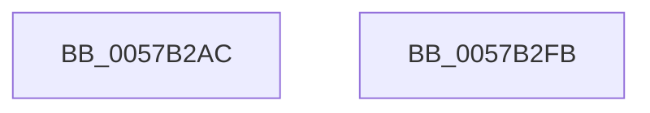

# McTemplateK0j_EtwWriteTransfer

- RVA: `0x0057B2AC`–`0x0057B2FC` (길이 `80` bytes)
- VA: `0x000000014057B2AC`
- 실행 섹션: `.text`
- PDB 이름 있음: `예`; PDB Function 태그: `아니요`
- unwind 정보 RVA: `0x0006F9F8`
- 디코드: `18`개 명령, `80/80` bytes 표시
- 미해석 바이트: `0` (있으면 어셈블리에 `.byte`로 보존)

> 이 문서는 커널 이미지의 기계어와 PDB 기호를 분석해 생성했습니다. 4번과 5번은 함수 원형과 자료형을 바이너리 사용 방식에서 추정한 C 해석이며 원본 소스 복구 결과는 아닙니다.

## 1. Dependencies

- 직접 호출 지점: **2**; 고유 호출 대상: **2**
- 직접 호출자로 확인된 함수: **2**
- RIP 상대 이미지 참조: **1**

### Outgoing calls
- `0x0057B2E4` → [McGenEventWrite_EtwWriteTransfer](../42/McGenEventWrite_EtwWriteTransfer_function_00424FC8.md) (function, `0x00424FC8`)
- `0x0057B2F1` → [_security_check_cookie](../6A/_security_check_cookie_function_006AC640.md) (function, `0x006AC640`)

### Direct callers
- [sub_006E5110](../6E/Unknown_function_006E5110.md) at `0x006E52DD`
- [PpCheckInDriverDatabase](../../page/99/PpCheckInDriverDatabase_function_0099A9E4.md) at `0x0099AB68`

### Static image references
- `0x0057B2B0` → RVA `0x00E0A740` (`.data`; read)

## 2. Other-region calls and transfers

- 다른 실행 섹션으로 향하는 call: **0**
- 별도 외부 분기/꼬리 이동을 확인하지 못했습니다.

## 3. Assembly (complete function range)

```asm
0057B2AC  48 83 EC 68                     sub rsp, 0x68
0057B2B0  48 8B 05 89 F4 88 00            mov rax, qword ptr [rip + 0x88f489]
0057B2B7  48 33 C4                        xor rax, rsp
0057B2BA  48 89 44 24 50                  mov qword ptr [rsp + 0x50], rax
0057B2BF  83 64 24 4C 00                  and dword ptr [rsp + 0x4c], 0
0057B2C4  48 8D 44 24 30                  lea rax, [rsp + 0x30]
0057B2C9  4C 89 4C 24 40                  mov qword ptr [rsp + 0x40], r9
0057B2CE  45 33 C0                        xor r8d, r8d
0057B2D1  41 B9 02 00 00 00               mov r9d, 2
0057B2D7  48 89 44 24 20                  mov qword ptr [rsp + 0x20], rax
0057B2DC  C7 44 24 48 10 00 00 00         mov dword ptr [rsp + 0x48], 0x10
0057B2E4  E8 DF 9C EA FF                  call 0x140424fc8
0057B2E9  48 8B 4C 24 50                  mov rcx, qword ptr [rsp + 0x50]
0057B2EE  48 33 CC                        xor rcx, rsp
0057B2F1  E8 4A 13 13 00                  call 0x1406ac640
0057B2F6  48 83 C4 68                     add rsp, 0x68
0057B2FA  C3                              ret
0057B2FB  CC                              int3
```

## 4. C-style interpretation (structured pseudocode)

```c
__int64 __fastcall McTemplateK0j_EtwWriteTransfer(__int64 a1, __int64 a2, int a3, __int64 a4)
{
    __int64 result;
    __int64 v_rsp;
    unsigned __int64 v_stack_m18;
    unsigned int v_stack_m1C;
    unsigned int v_stack_m20;
    unsigned __int64 v_stack_m28;
    unsigned __int64 v_stack_m38;
    unsigned __int64 v_stack_m48;

    v_rsp = (v_rsp) - (104);
    result = (*(unsigned __int64 *)(v_rip + 8975497)) ^ (v_rsp);
    v_stack_m18 = result;
    v_stack_m28 = a4;
    a3 = 0;
    v_stack_m48 = v_stack_m38;
    v_stack_m20 = 16;
    result = McGenEventWrite_EtwWriteTransfer(a1, a2, a3, 2);
    a1 = (v_stack_m18) ^ (v_rsp);
    result = _security_check_cookie(a1, a2, a3, 2);
    v_rsp = (v_rsp) + (104);
    return result;
}
```

## 5. (Beta) C Style

```c
int64_t McTemplateK0j_EtwWriteTransfer(int64_t Arg1, int64_t Arg2, int32_t Arg3, int64_t Arg4)
{
    int64_t result;
    int64_t local_rsp;
    uint64_t v_stack_m18;
    uint32_t v_stack_m1C;
    uint32_t v_stack_m20;
    uint64_t v_stack_m28;
    uint64_t v_stack_m38;
    uint64_t v_stack_m48;

    local_rsp = (local_rsp) - (104);
    result = (*(uint64_t *)(v_rip + 0x88F489)) ^ (local_rsp);
    v_stack_m18 = result;
    v_stack_m28 = Arg4;
    Arg3 = 0;
    v_stack_m48 = v_stack_m38;
    v_stack_m20 = 16;
    result = McGenEventWrite_EtwWriteTransfer(Arg1, Arg2, Arg3, 2);
    Arg1 = (v_stack_m18) ^ (local_rsp);
    result = _security_check_cookie(Arg1, Arg2, Arg3, 2);
    local_rsp = (local_rsp) + (104);
    return result;
}
```

## 6. Execution-region graph

[열기: 2D/3D 그래프와 함수 탐색 컨트롤 패널](../../../control-panel.html?section=text&rva=0x0057B2AC&view=graph)

- 2D 그래프는 위에서 아래로 흐르고, 3D 그래프는 빈 공간을 드래그해 회전합니다. Shift+드래그는 이동, 휠은 확대·축소, 함수 노드 선택은 대상 보고서 이동입니다.

### Static fallback


