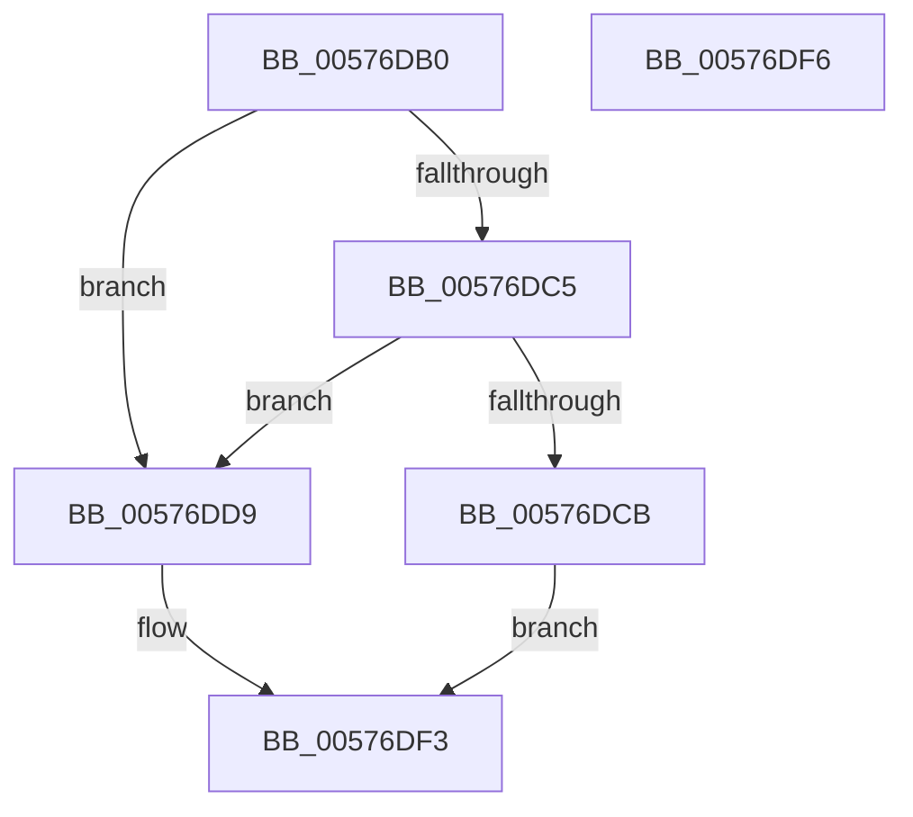

# XmAaaOp

- RVA: `0x00576DB0`–`0x00576DF7` (길이 `71` bytes)
- VA: `0x0000000140576DB0`
- 실행 섹션: `.text`
- PDB 이름 있음: `예`; PDB Function 태그: `아니요`
- unwind 정보 RVA: `0x000DB714`
- 디코드: `26`개 명령, `71/71` bytes 표시
- 미해석 바이트: `0` (있으면 어셈블리에 `.byte`로 보존)

> 이 문서는 커널 이미지의 기계어와 PDB 기호를 분석해 생성했습니다. 4번과 5번은 함수 원형과 자료형을 바이너리 사용 방식에서 추정한 C 해석이며 원본 소스 복구 결과는 아닙니다.

## 1. Dependencies

- 직접 호출 지점: **0**; 고유 호출 대상: **0**
- 직접 호출자로 확인된 함수: **0**
- RIP 상대 이미지 참조: **0**

### Outgoing calls
- 직접 디코드된 call 명령이 없습니다.

### Direct callers
- 이 함수 시작 RVA로 연결되는 직접 call은 확인되지 않았습니다. 간접 호출은 완전히 역산할 수 없습니다.

### Static image references
- 디코드된 RIP-relative 메모리 참조가 없습니다.

## 2. Other-region calls and transfers

- 다른 실행 섹션으로 향하는 call: **0**
- 별도 외부 분기/꼬리 이동을 확인하지 못했습니다.

## 3. Assembly (complete function range)

```asm
00576DB0  44 8A 49 18                     mov r9b, byte ptr [rcx + 0x18]
00576DB4  48 8D 51 10                     lea rdx, [rcx + 0x10]
00576DB8  45 8A C1                        mov r8b, r9b
00576DBB  41 80 E0 0F                     and r8b, 0xf
00576DBF  41 80 F8 09                     cmp r8b, 9
00576DC3  77 14                           ja 0x140576dd9
00576DC5  8B 02                           mov eax, dword ptr [rdx]
00576DC7  A8 10                           test al, 0x10
00576DC9  75 0E                           jne 0x140576dd9
00576DCB  83 E0 FE                        and eax, 0xfffffffe
00576DCE  44 88 41 18                     mov byte ptr [rcx + 0x18], r8b
00576DD2  89 02                           mov dword ptr [rdx], eax
00576DD4  83 E0 EF                        and eax, 0xffffffef
00576DD7  EB 1A                           jmp 0x140576df3
00576DD9  41 8D 41 06                     lea eax, [r9 + 6]
00576DDD  24 0F                           and al, 0xf
00576DDF  88 41 18                        mov byte ptr [rcx + 0x18], al
00576DE2  41 80 F9 F9                     cmp r9b, 0xf9
00576DE6  0F 97 C0                        seta al
00576DE9  FE C0                           inc al
00576DEB  00 41 19                        add byte ptr [rcx + 0x19], al
00576DEE  8B 02                           mov eax, dword ptr [rdx]
00576DF0  83 C8 11                        or eax, 0x11
00576DF3  89 02                           mov dword ptr [rdx], eax
00576DF5  C3                              ret
00576DF6  CC                              int3
```

## 4. C-style interpretation (structured pseudocode)

```c
__int64 __fastcall XmAaaOp(__int64 a1)
{
    __int64 result;

    a3 = (unsigned __int8)(((unsigned __int8)(*(unsigned __int8 *)(a1 + 24))) & (15));
    if (((unsigned __int8)(a3)) > 9) goto loc_00576DD9;
    if ((((unsigned __int8)((unsigned int)(*(unsigned int *)(a1 + 16)))) & (16)) != 0) goto loc_00576DD9;
    result = (unsigned int)(((unsigned int)(*(unsigned int *)(a1 + 16))) & (0xFFFFFFFEULL));
    *(unsigned __int8 *)(a1 + 24) = (unsigned __int8)(a3);
    *(unsigned int *)(a1 + 16) = (unsigned int)(result);
    result = (unsigned int)((result) & (0xFFFFFFEFULL));
    goto loc_00576DF3;
loc_00576DD9:
    result = (unsigned __int8)((*(unsigned __int8 *)(a1 + 24) + 6) & (15));
    *(unsigned __int8 *)(a1 + 24) = (unsigned __int8)(result);
    result = (((unsigned __int8)(*(unsigned __int8 *)(a1 + 24))) > 249) ? 1 : 0;
    result = (unsigned __int8)((result) + 1);
    result = (unsigned int)(((unsigned int)(*(unsigned int *)(a1 + 16))) | (17));
loc_00576DF3:
    *(unsigned int *)(a1 + 16) = (unsigned int)(result);
    return result;
}
```

## 5. (Beta) C Style

```c
int64_t XmAaaOp(void *Arg1)
{
    uint8_t *arg1 = (uint8_t *)Arg1;

    int64_t result;

    a3 = (uint8_t)(((uint8_t)(*(uint8_t *)(arg1 + 0x18))) & (15));
    if (((uint8_t)(a3)) > 9) goto loc_00576DD9;
    if ((((uint8_t)((uint32_t)(*(uint32_t *)(arg1 + 0x10)))) & (16)) != 0) goto loc_00576DD9;
    result = (uint32_t)(((uint32_t)(*(uint32_t *)(arg1 + 0x10))) & (0xFFFFFFFEULL));
    *(uint8_t *)(arg1 + 0x18) = (uint8_t)(a3);
    *(uint32_t *)(arg1 + 0x10) = (uint32_t)(result);
    result = (uint32_t)((result) & (0xFFFFFFEFULL));
    goto loc_00576DF3;
loc_00576DD9:
    result = (uint8_t)((*(uint8_t *)(arg1 + 0x18) + 6) & (15));
    *(uint8_t *)(arg1 + 0x18) = (uint8_t)(result);
    result = (((uint8_t)(*(uint8_t *)(arg1 + 0x18))) > 249) ? 1 : 0;
    result = (uint8_t)((result) + 1);
    result = (uint32_t)(((uint32_t)(*(uint32_t *)(arg1 + 0x10))) | (17));
loc_00576DF3:
    *(uint32_t *)(arg1 + 0x10) = (uint32_t)(result);
    return result;
}
```

### 관측된 메모리 오프셋

구조체 형식이 확인되지 않은 접근은 인자 기준의 오프셋으로만 기록했습니다.

| 기준 인자 | 오프셋 표현 | 폭 (bit) | 접근 |
|---|---:|---:|---|
| `Arg1` | `+ 0x0` | `32` | `R` |
| `Arg1` | `+ 0x0` | `32` | `W` |
| `Arg1` | `+ 0x10` | `64` | `R` |
| `Arg1` | `+ 0x18` | `8` | `R` |
| `Arg1` | `+ 0x18` | `8` | `W` |
| `Arg1` | `+ 0x19` | `8` | `R/W` |

## 6. Execution-region graph

[열기: 2D/3D 그래프와 함수 탐색 컨트롤 패널](../../../control-panel.html?section=text&rva=0x00576DB0&view=graph)

- 2D 그래프는 위에서 아래로 흐르고, 3D 그래프는 빈 공간을 드래그해 회전합니다. Shift+드래그는 이동, 휠은 확대·축소, 함수 노드 선택은 대상 보고서 이동입니다.

### Static fallback


