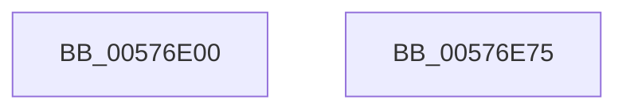

# XmAadOp

- RVA: `0x00576E00`–`0x00576E76` (길이 `118` bytes)
- VA: `0x0000000140576E00`
- 실행 섹션: `.text`
- PDB 이름 있음: `예`; PDB Function 태그: `아니요`
- unwind 정보 RVA: `0x000DB714`
- 디코드: `35`개 명령, `118/118` bytes 표시
- 미해석 바이트: `0` (있으면 어셈블리에 `.byte`로 보존)

> 이 문서는 커널 이미지의 기계어와 PDB 기호를 분석해 생성했습니다. 4번과 5번은 함수 원형과 자료형을 바이너리 사용 방식에서 추정한 C 해석이며 원본 소스 복구 결과는 아닙니다.

## 1. Dependencies

- 직접 호출 지점: **0**; 고유 호출 대상: **0**
- 직접 호출자로 확인된 함수: **0**
- RIP 상대 이미지 참조: **1**

### Outgoing calls
- 직접 디코드된 call 명령이 없습니다.

### Direct callers
- 이 함수 시작 RVA로 연결되는 직접 call은 확인되지 않았습니다. 간접 호출은 완전히 역산할 수 없습니다.

### Static image references
- `0x00576E04` → RVA `0x0001A190` (`.rdata`; read)

## 2. Other-region calls and transfers

- 다른 실행 섹션으로 향하는 call: **0**
- 별도 외부 분기/꼬리 이동을 확인하지 못했습니다.

## 3. Assembly (complete function range)

```asm
00576E00  0F B6 41 19                     movzx eax, byte ptr [rcx + 0x19]
00576E04  4C 8D 15 85 33 AA FF            lea r10, [rip - 0x55cc7b]
00576E0B  0F B6 51 6C                     movzx edx, byte ptr [rcx + 0x6c]
00576E0F  4C 8B C9                        mov r9, rcx
00576E12  0F AF D0                        imul edx, eax
00576E15  C6 41 19 00                     mov byte ptr [rcx + 0x19], 0
00576E19  00 51 18                        add byte ptr [rcx + 0x18], dl
00576E1C  0F B7 51 18                     movzx edx, word ptr [rcx + 0x18]
00576E20  0F B7 C2                        movzx eax, dx
00576E23  44 8B C2                        mov r8d, edx
00576E26  41 C1 E8 08                     shr r8d, 8
00576E2A  41 81 E0 80 FF FF 00            and r8d, 0xffff80
00576E31  66 F7 D8                        neg ax
00576E34  41 8B 41 10                     mov eax, dword ptr [r9 + 0x10]
00576E38  1B C9                           sbb ecx, ecx
00576E3A  25 3F FF FF FF                  and eax, 0xffffff3f
00576E3F  F7 D1                           not ecx
00576E41  83 E1 40                        and ecx, 0x40
00576E44  44 0B C1                        or r8d, ecx
00576E47  44 0B C0                        or r8d, eax
00576E4A  8B C2                           mov eax, edx
00576E4C  48 C1 E8 04                     shr rax, 4
00576E50  83 E2 0F                        and edx, 0xf
00576E53  83 E0 0F                        and eax, 0xf
00576E56  42 0F B6 0C 10                  movzx ecx, byte ptr [rax + r10]
00576E5B  42 0F B6 04 12                  movzx eax, byte ptr [rdx + r10]
00576E60  03 C8                           add ecx, eax
00576E62  F7 D1                           not ecx
00576E64  C1 E1 02                        shl ecx, 2
00576E67  41 33 C8                        xor ecx, r8d
00576E6A  83 E1 04                        and ecx, 4
00576E6D  41 33 C8                        xor ecx, r8d
00576E70  41 89 49 10                     mov dword ptr [r9 + 0x10], ecx
00576E74  C3                              ret
00576E75  CC                              int3
```

## 4. C-style interpretation (structured pseudocode)

```c
__int64 __fastcall XmAadOp(__int64 a1)
{
    __int64 result;

    a2 = (unsigned int)((*(unsigned __int8 *)(a1 + 108)) * ((unsigned int)(*(unsigned __int8 *)(a1 + 25))));
    *(unsigned __int8 *)(a1 + 25) = 0;
    a3 = (unsigned int)(((unsigned int)((unsigned int)(*(unsigned __int16 *)(a1 + 24)))) >> (8));
    a3 = (unsigned int)((a3) & (0xFFFF80ULL));
    result = (unsigned __int16)(-((unsigned __int16)(*(unsigned __int16 *)(a1 + 24))));
    result = (unsigned int)(((unsigned int)(*(unsigned int *)(a1 + 16))) & (0xFFFFFF3FULL));
    a1 = (unsigned int)(~(a1));
    a1 = (unsigned int)((a1) & (64));
    a3 = (unsigned int)((a3) | ((unsigned int)(a1)));
    a3 = (unsigned int)((a3) | ((unsigned int)(result)));
    result = ((unsigned int)((unsigned int)(*(unsigned __int16 *)(a1 + 24)))) >> (4);
    a2 = (unsigned int)((*(unsigned __int16 *)(a1 + 24)) & (15));
    result = (unsigned int)((result) & (15));
    a1 = (unsigned int)((*(unsigned __int8 *)(result + v_rip - 5622907 * 1)) + ((unsigned int)(*(unsigned __int8 *)(a2 + v_rip - 5622907 * 1))));
    a1 = (unsigned int)(~(a1));
    a1 = (unsigned int)((a1) << (2));
    a1 = (unsigned int)((a1) ^ ((unsigned int)(a3)));
    a1 = (unsigned int)((a1) & (4));
    a1 = (unsigned int)((a1) ^ ((unsigned int)(a3)));
    *(unsigned int *)(a1 + 16) = (unsigned int)(a1);
    return *(unsigned __int8 *)(a2 + v_rip - 5622907 * 1);
}
```

## 5. (Beta) C Style

```c
int64_t XmAadOp(void *Arg1)
{
    uint8_t *arg1 = (uint8_t *)Arg1;

    int64_t result;

    a2 = (uint32_t)((*(uint8_t *)(arg1 + 0x6C)) * ((uint32_t)(*(uint8_t *)(arg1 + 0x19))));
    *(uint8_t *)(arg1 + 0x19) = 0;
    a3 = (uint32_t)(((uint32_t)((uint32_t)(*(uint16_t *)(arg1 + 0x18)))) >> (8));
    a3 = (uint32_t)((a3) & (0xFFFF80ULL));
    result = (uint16_t)(-((uint16_t)(*(uint16_t *)(arg1 + 0x18))));
    result = (uint32_t)(((uint32_t)(*(uint32_t *)(arg1 + 0x10))) & (0xFFFFFF3FULL));
    Arg1 = (uint32_t)(~(Arg1));
    Arg1 = (uint32_t)((Arg1) & (64));
    a3 = (uint32_t)((a3) | ((uint32_t)(Arg1)));
    a3 = (uint32_t)((a3) | ((uint32_t)(result)));
    result = ((uint32_t)((uint32_t)(*(uint16_t *)(arg1 + 0x18)))) >> (4);
    a2 = (uint32_t)((*(uint16_t *)(arg1 + 0x18)) & (15));
    result = (uint32_t)((result) & (15));
    Arg1 = (uint32_t)((*(uint8_t *)(result + v_rip - 0x55CC7B * 1)) + ((uint32_t)(*(uint8_t *)(a2 + v_rip - 0x55CC7B * 1))));
    Arg1 = (uint32_t)(~(Arg1));
    Arg1 = (uint32_t)((Arg1) << (2));
    Arg1 = (uint32_t)((Arg1) ^ ((uint32_t)(a3)));
    Arg1 = (uint32_t)((Arg1) & (4));
    Arg1 = (uint32_t)((Arg1) ^ ((uint32_t)(a3)));
    *(uint32_t *)(arg1 + 0x10) = (uint32_t)(Arg1);
    return *(uint8_t *)(a2 + v_rip - 0x55CC7B * 1);
}
```

### 관측된 메모리 오프셋

구조체 형식이 확인되지 않은 접근은 인자 기준의 오프셋으로만 기록했습니다.

| 기준 인자 | 오프셋 표현 | 폭 (bit) | 접근 |
|---|---:|---:|---|
| `Arg1` | `+ 0x10` | `32` | `R` |
| `Arg1` | `+ 0x10` | `32` | `W` |
| `Arg1` | `+ 0x18` | `8` | `R/W` |
| `Arg1` | `+ 0x18` | `16` | `R` |
| `Arg1` | `+ 0x19` | `8` | `R` |
| `Arg1` | `+ 0x19` | `8` | `W` |
| `Arg1` | `+ 0x6C` | `8` | `R` |

## 6. Execution-region graph

[열기: 2D/3D 그래프와 함수 탐색 컨트롤 패널](../../../control-panel.html?section=text&rva=0x00576E00&view=graph)

- 2D 그래프는 위에서 아래로 흐르고, 3D 그래프는 빈 공간을 드래그해 회전합니다. Shift+드래그는 이동, 휠은 확대·축소, 함수 노드 선택은 대상 보고서 이동입니다.

### Static fallback


