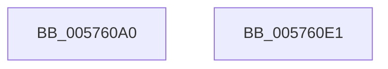

# XmAccumRegister

- RVA: `0x005760A0`–`0x005760E2` (길이 `66` bytes)
- VA: `0x00000001405760A0`
- 실행 섹션: `.text`
- PDB 이름 있음: `예`; PDB Function 태그: `아니요`
- unwind 정보 RVA: `0x0005C788`
- 디코드: `19`개 명령, `66/66` bytes 표시
- 미해석 바이트: `0` (있으면 어셈블리에 `.byte`로 보존)

> 이 문서는 커널 이미지의 기계어와 PDB 기호를 분석해 생성했습니다. 4번과 5번은 함수 원형과 자료형을 바이너리 사용 방식에서 추정한 C 해석이며 원본 소스 복구 결과는 아닙니다.

## 1. Dependencies

- 직접 호출 지점: **2**; 고유 호출 대상: **2**
- 직접 호출자로 확인된 함수: **0**
- RIP 상대 이미지 참조: **0**

### Outgoing calls
- `0x005760C9` → [XmSetSourceValue](../47/XmSetSourceValue_function_004737A8.md) (function, `0x004737A8`)
- `0x005760D2` → [XmSetDestinationValue](../47/XmSetDestinationValue_function_004734EC.md) (function, `0x004734EC`)

### Direct callers
- 이 함수 시작 RVA로 연결되는 직접 call은 확인되지 않았습니다. 간접 호출은 완전히 역산할 수 없습니다.

### Static image references
- 디코드된 RIP-relative 메모리 참조가 없습니다.

## 2. Other-region calls and transfers

- 다른 실행 섹션으로 향하는 call: **0**
- 별도 외부 분기/꼬리 이동을 확인하지 못했습니다.

## 3. Assembly (complete function range)

```asm
005760A0  48 83 EC 28                     sub rsp, 0x28
005760A4  44 8B 41 70                     mov r8d, dword ptr [rcx + 0x70]
005760A8  8A 81 8A 00 00 00               mov al, byte ptr [rcx + 0x8a]
005760AE  41 83 E0 07                     and r8d, 7
005760B2  F6 D8                           neg al
005760B4  1B D2                           sbb edx, edx
005760B6  83 E2 02                        and edx, 2
005760B9  FF C2                           inc edx
005760BB  89 51 78                        mov dword ptr [rcx + 0x78], edx
005760BE  41 8B D0                        mov edx, r8d
005760C1  48 83 C2 06                     add rdx, 6
005760C5  48 8D 14 91                     lea rdx, [rcx + rdx*4]
005760C9  E8 DA D6 EF FF                  call 0x1404737a8
005760CE  48 8D 51 18                     lea rdx, [rcx + 0x18]
005760D2  E8 15 D4 EF FF                  call 0x1404734ec
005760D7  B8 01 00 00 00                  mov eax, 1
005760DC  48 83 C4 28                     add rsp, 0x28
005760E0  C3                              ret
005760E1  CC                              int3
```

## 4. C-style interpretation (structured pseudocode)

```c
__int64 __fastcall XmAccumRegister(__int64 a1, int a2)
{
    __int64 result;
    __int64 v_rsp;

    v_rsp = (v_rsp) - (40);
    a3 = (unsigned int)(((unsigned int)(*(unsigned int *)(a1 + 112))) & (7));
    result = (unsigned __int8)(-(*(unsigned __int8 *)(a1 + 138)));
    a2 = (unsigned int)((a2) & (2));
    a2 = (unsigned int)((a2) + 1);
    *(unsigned int *)(a1 + 120) = a2;
    a2 = ((unsigned int)((unsigned int)(a3))) + (6);
    result = XmSetSourceValue(a1, a1 + a2 * 4, a3, a4);
    result = XmSetDestinationValue(a1, a1 + 24, a3, a4);
    v_rsp = (v_rsp) + (40);
    return 1;
}
```

## 5. (Beta) C Style

```c
int64_t XmAccumRegister(void *Arg1, int32_t Arg2)
{
    uint8_t *arg1 = (uint8_t *)Arg1;

    int64_t result;
    int64_t local_rsp;

    local_rsp = (local_rsp) - (40);
    a3 = (uint32_t)(((uint32_t)(*(uint32_t *)(arg1 + 0x70))) & (7));
    result = (uint8_t)(-(*(uint8_t *)(arg1 + 0x8A)));
    Arg2 = (uint32_t)((Arg2) & (2));
    Arg2 = (uint32_t)((Arg2) + 1);
    *(uint32_t *)(arg1 + 0x78) = Arg2;
    Arg2 = ((uint32_t)((uint32_t)(a3))) + (6);
    result = XmSetSourceValue(Arg1, Arg1 + Arg2 * 4, a3, a4);
    result = XmSetDestinationValue(Arg1, Arg1 + 24, a3, a4);
    local_rsp = (local_rsp) + (40);
    return 1;
}
```

### 관측된 메모리 오프셋

구조체 형식이 확인되지 않은 접근은 인자 기준의 오프셋으로만 기록했습니다.

| 기준 인자 | 오프셋 표현 | 폭 (bit) | 접근 |
|---|---:|---:|---|
| `Arg1` | `+ 0x0 + rdx*4` | `64` | `R` |
| `Arg1` | `+ 0x70` | `32` | `R` |
| `Arg1` | `+ 0x78` | `32` | `W` |
| `Arg1` | `+ 0x8A` | `8` | `R` |

## 6. Execution-region graph

[열기: 2D/3D 그래프와 함수 탐색 컨트롤 패널](../../../control-panel.html?section=text&rva=0x005760A0&view=graph)

- 2D 그래프는 위에서 아래로 흐르고, 3D 그래프는 빈 공간을 드래그해 회전합니다. Shift+드래그는 이동, 휠은 확대·축소, 함수 노드 선택은 대상 보고서 이동입니다.

### Static fallback


