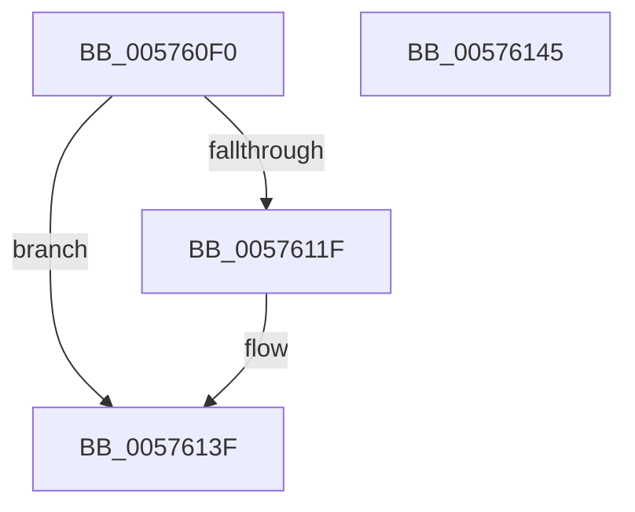

# XmBitScanGeneral

- RVA: `0x005760F0`–`0x00576146` (길이 `86` bytes)
- VA: `0x00000001405760F0`
- 실행 섹션: `.text`
- PDB 이름 있음: `예`; PDB Function 태그: `아니요`
- unwind 정보 RVA: `0x0005CF00`
- 디코드: `26`개 명령, `86/86` bytes 표시
- 미해석 바이트: `0` (있으면 어셈블리에 `.byte`로 보존)

> 이 문서는 커널 이미지의 기계어와 PDB 기호를 분석해 생성했습니다. 4번과 5번은 함수 원형과 자료형을 바이너리 사용 방식에서 추정한 C 해석이며 원본 소스 복구 결과는 아닙니다.

## 1. Dependencies

- 직접 호출 지점: **2**; 고유 호출 대상: **2**
- 직접 호출자로 확인된 함수: **0**
- RIP 상대 이미지 참조: **0**

### Outgoing calls
- `0x00576115` → [XmEvaluateAddressSpecifier](../47/XmEvaluateAddressSpecifier_function_00473224.md) (function, `0x00473224`)
- `0x00576135` → [XmSetSourceValue](../47/XmSetSourceValue_function_004737A8.md) (function, `0x004737A8`)

### Direct callers
- 이 함수 시작 RVA로 연결되는 직접 call은 확인되지 않았습니다. 간접 호출은 완전히 역산할 수 없습니다.

### Static image references
- 디코드된 RIP-relative 메모리 참조가 없습니다.

## 2. Other-region calls and transfers

- 다른 실행 섹션으로 향하는 call: **0**
- 별도 외부 분기/꼬리 이동을 확인하지 못했습니다.

## 3. Assembly (complete function range)

```asm
005760F0  40 53                           push rbx
005760F2  48 83 EC 20                     sub rsp, 0x20
005760F6  83 64 24 30 00                  and dword ptr [rsp + 0x30], 0
005760FB  48 8B D9                        mov rbx, rcx
005760FE  8A 81 8A 00 00 00               mov al, byte ptr [rcx + 0x8a]
00576104  F6 D8                           neg al
00576106  1B D2                           sbb edx, edx
00576108  83 E2 02                        and edx, 2
0057610B  FF C2                           inc edx
0057610D  89 51 78                        mov dword ptr [rcx + 0x78], edx
00576110  48 8D 54 24 30                  lea rdx, [rsp + 0x30]
00576115  E8 0A D1 EF FF                  call 0x140473224
0057611A  48 85 C0                        test rax, rax
0057611D  74 20                           je 0x14057613f
0057611F  8B 4C 24 30                     mov ecx, dword ptr [rsp + 0x30]
00576123  48 83 C1 06                     add rcx, 6
00576127  48 8D 14 8B                     lea rdx, [rbx + rcx*4]
0057612B  48 8B CB                        mov rcx, rbx
0057612E  48 89 53 58                     mov qword ptr [rbx + 0x58], rdx
00576132  48 8B D0                        mov rdx, rax
00576135  E8 6E D6 EF FF                  call 0x1404737a8
0057613A  B8 01 00 00 00                  mov eax, 1
0057613F  48 83 C4 20                     add rsp, 0x20
00576143  5B                              pop rbx
00576144  C3                              ret
00576145  CC                              int3
```

## 4. C-style interpretation (structured pseudocode)

```c
__int64 __fastcall XmBitScanGeneral(__int64 a1, int a2)
{
    __int64 result;
    __int64 v_rsp;
    unsigned int v_stack_p8;

    v_rsp = (v_rsp) - (32);
    result = (unsigned __int8)(-(*(unsigned __int8 *)(a1 + 138)));
    a2 = (unsigned int)((a2) & (2));
    a2 = (unsigned int)((a2) + 1);
    *(unsigned int *)(a1 + 120) = a2;
    result = XmEvaluateAddressSpecifier(a1, v_stack_p8, a3, a4);
    if (result != 0) {
        a1 = v_stack_p8;
        a1 = (a1) + (6);
        a2 = a1 + a1 * 4;
        a1 = a1;
        *(unsigned __int64 *)(a1 + 88) = a2;
        a2 = result;
        result = XmSetSourceValue(a1, a2, a3, a4);
        result = 1;
    }
    v_rsp = (v_rsp) + (32);
    return result;
}
```

## 5. (Beta) C Style

```c
int64_t XmBitScanGeneral(void *Arg1, int32_t Arg2)
{
    uint8_t *arg1 = (uint8_t *)Arg1;

    int64_t result;
    int64_t local_rsp;
    uint32_t v_stack_p8;

    local_rsp = (local_rsp) - (32);
    result = (uint8_t)(-(*(uint8_t *)(arg1 + 0x8A)));
    Arg2 = (uint32_t)((Arg2) & (2));
    Arg2 = (uint32_t)((Arg2) + 1);
    *(uint32_t *)(arg1 + 0x78) = Arg2;
    result = XmEvaluateAddressSpecifier(Arg1, v_stack_p8, a3, a4);
    if (result != 0) {
        Arg1 = v_stack_p8;
        Arg1 = (Arg1) + (6);
        Arg2 = Arg1 + Arg1 * 4;
        Arg1 = Arg1;
        *(uint64_t *)(arg1 + 0x58) = Arg2;
        Arg2 = result;
        result = XmSetSourceValue(Arg1, Arg2, a3, a4);
        result = 1;
    }
    local_rsp = (local_rsp) + (32);
    return result;
}
```

### 관측된 메모리 오프셋

구조체 형식이 확인되지 않은 접근은 인자 기준의 오프셋으로만 기록했습니다.

| 기준 인자 | 오프셋 표현 | 폭 (bit) | 접근 |
|---|---:|---:|---|
| `Arg1` | `+ 0x0 + rcx*4` | `64` | `R` |
| `Arg1` | `+ 0x58` | `64` | `W` |
| `Arg1` | `+ 0x78` | `32` | `W` |
| `Arg1` | `+ 0x8A` | `8` | `R` |

## 6. Execution-region graph

[열기: 2D/3D 그래프와 함수 탐색 컨트롤 패널](../../../control-panel.html?section=text&rva=0x005760F0&view=graph)

- 2D 그래프는 위에서 아래로 흐르고, 3D 그래프는 빈 공간을 드래그해 회전합니다. Shift+드래그는 이동, 휠은 확대·축소, 함수 노드 선택은 대상 보고서 이동입니다.

### Static fallback


