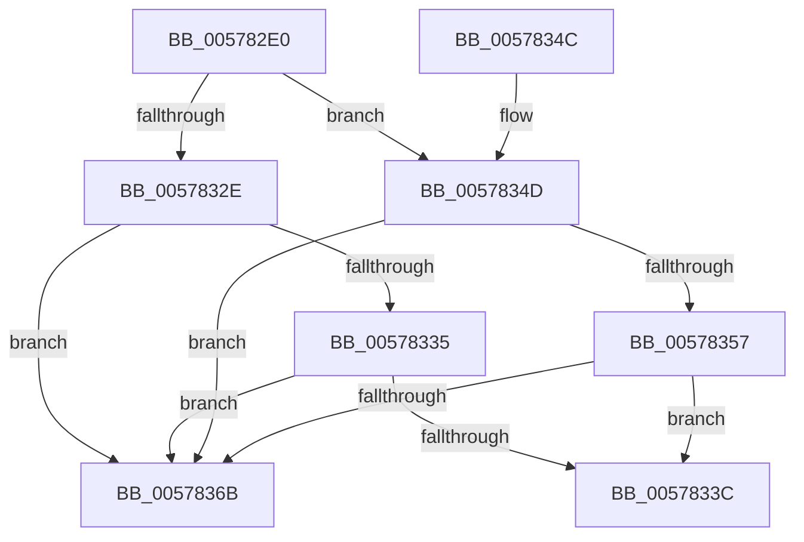

# XmBoundOp

- RVA: `0x005782E0`–`0x0057837D` (길이 `157` bytes)
- VA: `0x00000001405782E0`
- 실행 섹션: `.text`
- PDB 이름 있음: `예`; PDB Function 태그: `아니요`
- unwind 정보 RVA: `0x00098114`
- 디코드: `49`개 명령, `157/157` bytes 표시
- 미해석 바이트: `0` (있으면 어셈블리에 `.byte`로 보존)

> 이 문서는 커널 이미지의 기계어와 PDB 기호를 분석해 생성했습니다. 4번과 5번은 함수 원형과 자료형을 바이너리 사용 방식에서 추정한 C 해석이며 원본 소스 복구 결과는 아닙니다.

## 1. Dependencies

- 직접 호출 지점: **5**; 고유 호출 대상: **3**
- 직접 호출자로 확인된 함수: **0**
- RIP 상대 이미지 참조: **0**

### Outgoing calls
- `0x005782F7` → [XmGetOffsetAddress](XmGetOffsetAddress_function_00578B84.md) (function, `0x00578B84`)
- `0x00578302` → [XmSetSourceValue](../47/XmSetSourceValue_function_004737A8.md) (function, `0x004737A8`)
- `0x00578311` → [XmGetOffsetAddress](XmGetOffsetAddress_function_00578B84.md) (function, `0x00578B84`)
- `0x0057831C` → [XmSetSourceValue](../47/XmSetSourceValue_function_004737A8.md) (function, `0x004737A8`)
- `0x00578377` → [longjmp](../4F/longjmp_function_004FD5F0.md) (function, `0x004FD5F0`)

### Direct callers
- 이 함수 시작 RVA로 연결되는 직접 call은 확인되지 않았습니다. 간접 호출은 완전히 역산할 수 없습니다.

### Static image references
- 디코드된 RIP-relative 메모리 참조가 없습니다.

## 2. Other-region calls and transfers

- 다른 실행 섹션으로 향하는 call: **0**
- 별도 외부 분기/꼬리 이동을 확인하지 못했습니다.

## 3. Assembly (complete function range)

```asm
005782E0  48 89 5C 24 08                  mov qword ptr [rsp + 8], rbx
005782E5  48 89 74 24 10                  mov qword ptr [rsp + 0x10], rsi
005782EA  57                              push rdi
005782EB  48 83 EC 20                     sub rsp, 0x20
005782EF  8B 79 6C                        mov edi, dword ptr [rcx + 0x6c]
005782F2  48 8B F1                        mov rsi, rcx
005782F5  8B D7                           mov edx, edi
005782F7  E8 88 08 00 00                  call 0x140578b84
005782FC  48 8B D0                        mov rdx, rax
005782FF  48 8B CE                        mov rcx, rsi
00578302  E8 A1 B4 EF FF                  call 0x1404737a8
00578307  8B 56 78                        mov edx, dword ptr [rsi + 0x78]
0057830A  8B 5E 6C                        mov ebx, dword ptr [rsi + 0x6c]
0057830D  FF C2                           inc edx
0057830F  03 D7                           add edx, edi
00578311  E8 6E 08 00 00                  call 0x140578b84
00578316  48 8B D0                        mov rdx, rax
00578319  48 8B CE                        mov rcx, rsi
0057831C  E8 87 B4 EF FF                  call 0x1404737a8
00578321  83 7E 78 03                     cmp dword ptr [rsi + 0x78], 3
00578325  8B 4E 6C                        mov ecx, dword ptr [rsi + 0x6c]
00578328  4C 8B 46 58                     mov r8, qword ptr [rsi + 0x58]
0057832C  75 1F                           jne 0x14057834d
0057832E  41 8B 00                        mov eax, dword ptr [r8]
00578331  3B C3                           cmp eax, ebx
00578333  7C 36                           jl 0x14057836b
00578335  83 C1 04                        add ecx, 4
00578338  3B C1                           cmp eax, ecx
0057833A  7F 2F                           jg 0x14057836b
0057833C  48 8B 5C 24 30                  mov rbx, qword ptr [rsp + 0x30]
00578341  48 8B 74 24 38                  mov rsi, qword ptr [rsp + 0x38]
00578346  48 83 C4 20                     add rsp, 0x20
0057834A  5F                              pop rdi
0057834B  C3                              ret
0057834C  CC                              int3
0057834D  45 0F BF 00                     movsx r8d, word ptr [r8]
00578351  66 44 3B C3                     cmp r8w, bx
00578355  7C 14                           jl 0x14057836b
00578357  0F B7 46 78                     movzx eax, word ptr [rsi + 0x78]
0057835B  66 FF C0                        inc ax
0057835E  0F BF D0                        movsx edx, ax
00578361  0F BF C1                        movsx eax, cx
00578364  03 D0                           add edx, eax
00578366  44 3B C2                        cmp r8d, edx
00578369  7E D1                           jle 0x14057833c
0057836B  48 8D 8E A0 00 00 00            lea rcx, [rsi + 0xa0]
00578372  BA 0D 00 00 00                  mov edx, 0xd
00578377  E8 74 52 F8 FF                  call 0x1404fd5f0
0057837C  CC                              int3
```

## 4. C-style interpretation (structured pseudocode)

```c
__int64 __fastcall XmBoundOp(__int64 a1)
{
    __int64 result;
    __int64 v_rsp;
    unsigned __int64 v_stack_p10;
    unsigned __int64 v_stack_p8;

    v_stack_p8 = v_rbx;
    v_stack_p10 = v_rsi;
    v_rsp = (v_rsp) - (32);
    result = XmGetOffsetAddress(a1, (unsigned int)((unsigned int)((unsigned int)(*(unsigned int *)(a1 + 108)))), a3, a4);
    result = XmSetSourceValue(a1, result, a3, a4);
    a2 = (unsigned int)(((unsigned int)(*(unsigned int *)(a1 + 120))) + 1);
    a2 = (unsigned int)((a2) + ((unsigned int)((unsigned int)(*(unsigned int *)(a1 + 108)))));
    result = XmGetOffsetAddress(a1, a2, a3, a4);
    result = XmSetSourceValue(a1, result, a3, a4);
    if ((*(unsigned int *)(a1 + 120)) != 3) goto loc_0057834D;
    if (((unsigned int)((unsigned int)(*(unsigned int *)(*(unsigned __int64 *)(a1 + 88))))) < ((unsigned int)((unsigned int)(*(unsigned int *)(a1 + 108))))) goto loc_0057836B;
    a1 = (unsigned int)(((unsigned int)(*(unsigned int *)(a1 + 108))) + (4));
    if (((unsigned int)((unsigned int)(*(unsigned int *)(*(unsigned __int64 *)(a1 + 88))))) > ((unsigned int)(a1))) goto loc_0057836B;
loc_0057833C:
    v_rsp = (v_rsp) + (32);
    return (unsigned int)(*(unsigned int *)(*(unsigned __int64 *)(a1 + 88)));
loc_0057834D:
    if (((unsigned __int16)((__int16)(*(unsigned __int16 *)(*(unsigned __int64 *)(a1 + 88))))) < ((unsigned __int16)(v_stack_p8))) goto loc_0057836B;
    result = (unsigned __int16)((*(unsigned __int16 *)(v_stack_p10 + 120)) + 1);
    a2 = (unsigned int)(((__int16)((unsigned __int16)(result))) + ((unsigned int)((__int16)((unsigned __int16)(a1)))));
    if (((unsigned int)((__int16)(*(unsigned __int16 *)(*(unsigned __int64 *)(a1 + 88))))) <= ((unsigned int)(a2))) goto loc_0057833C;
loc_0057836B:
    result = longjmp(v_stack_p10 + 160, 13, (__int16)(*(unsigned __int16 *)(*(unsigned __int64 *)(a1 + 88))), a4);
    return result;
}
```

## 5. (Beta) C Style

```c
int64_t XmBoundOp(void *Arg1)
{
    uint8_t *arg1 = (uint8_t *)Arg1;

    int64_t result;
    int64_t local_rsp;
    uint64_t v_stack_p10;
    uint64_t v_stack_p8;

    v_stack_p8 = local_rbx;
    v_stack_p10 = local_rsi;
    local_rsp = (local_rsp) - (32);
    result = XmGetOffsetAddress(Arg1, (uint32_t)((uint32_t)((uint32_t)(*(uint32_t *)(arg1 + 0x6C)))), a3, a4);
    result = XmSetSourceValue(Arg1, result, a3, a4);
    a2 = (uint32_t)(((uint32_t)(*(uint32_t *)(arg1 + 0x78))) + 1);
    a2 = (uint32_t)((a2) + ((uint32_t)((uint32_t)(*(uint32_t *)(arg1 + 0x6C)))));
    result = XmGetOffsetAddress(Arg1, a2, a3, a4);
    result = XmSetSourceValue(Arg1, result, a3, a4);
    if ((*(uint32_t *)(arg1 + 0x78)) != 3) goto loc_0057834D;
    if (((uint32_t)((uint32_t)(*(uint32_t *)(*(uint64_t *)(arg1 + 0x58))))) < ((uint32_t)((uint32_t)(*(uint32_t *)(arg1 + 0x6C))))) goto loc_0057836B;
    Arg1 = (uint32_t)(((uint32_t)(*(uint32_t *)(arg1 + 0x6C))) + (4));
    if (((uint32_t)((uint32_t)(*(uint32_t *)(*(uint64_t *)(arg1 + 0x58))))) > ((uint32_t)(Arg1))) goto loc_0057836B;
loc_0057833C:
    local_rsp = (local_rsp) + (32);
    return (uint32_t)(*(uint32_t *)(*(uint64_t *)(arg1 + 0x58)));
loc_0057834D:
    if (((uint16_t)((int16_t)(*(uint16_t *)(*(uint64_t *)(arg1 + 0x58))))) < ((uint16_t)(v_stack_p8))) goto loc_0057836B;
    result = (uint16_t)((*(uint16_t *)(v_stack_p10 + 0x78)) + 1);
    a2 = (uint32_t)(((int16_t)((uint16_t)(result))) + ((uint32_t)((int16_t)((uint16_t)(Arg1)))));
    if (((uint32_t)((int16_t)(*(uint16_t *)(*(uint64_t *)(arg1 + 0x58))))) <= ((uint32_t)(a2))) goto loc_0057833C;
loc_0057836B:
    result = longjmp(v_stack_p10 + 160, 13, (int16_t)(*(uint16_t *)(*(uint64_t *)(arg1 + 0x58))), a4);
    return result;
}
```

### 관측된 메모리 오프셋

구조체 형식이 확인되지 않은 접근은 인자 기준의 오프셋으로만 기록했습니다.

| 기준 인자 | 오프셋 표현 | 폭 (bit) | 접근 |
|---|---:|---:|---|
| `Arg1` | `+ 0x58` | `64` | `R` |
| `Arg1` | `+ 0x6C` | `32` | `R` |
| `Arg1` | `+ 0x78` | `16` | `R` |
| `Arg1` | `+ 0x78` | `32` | `R` |
| `Arg1` | `+ 0xA0` | `64` | `R` |

## 6. Execution-region graph

[열기: 2D/3D 그래프와 함수 탐색 컨트롤 패널](../../../control-panel.html?section=text&rva=0x005782E0&view=graph)

- 2D 그래프는 위에서 아래로 흐르고, 3D 그래프는 빈 공간을 드래그해 회전합니다. Shift+드래그는 이동, 휠은 확대·축소, 함수 노드 선택은 대상 보고서 이동입니다.

### Static fallback


