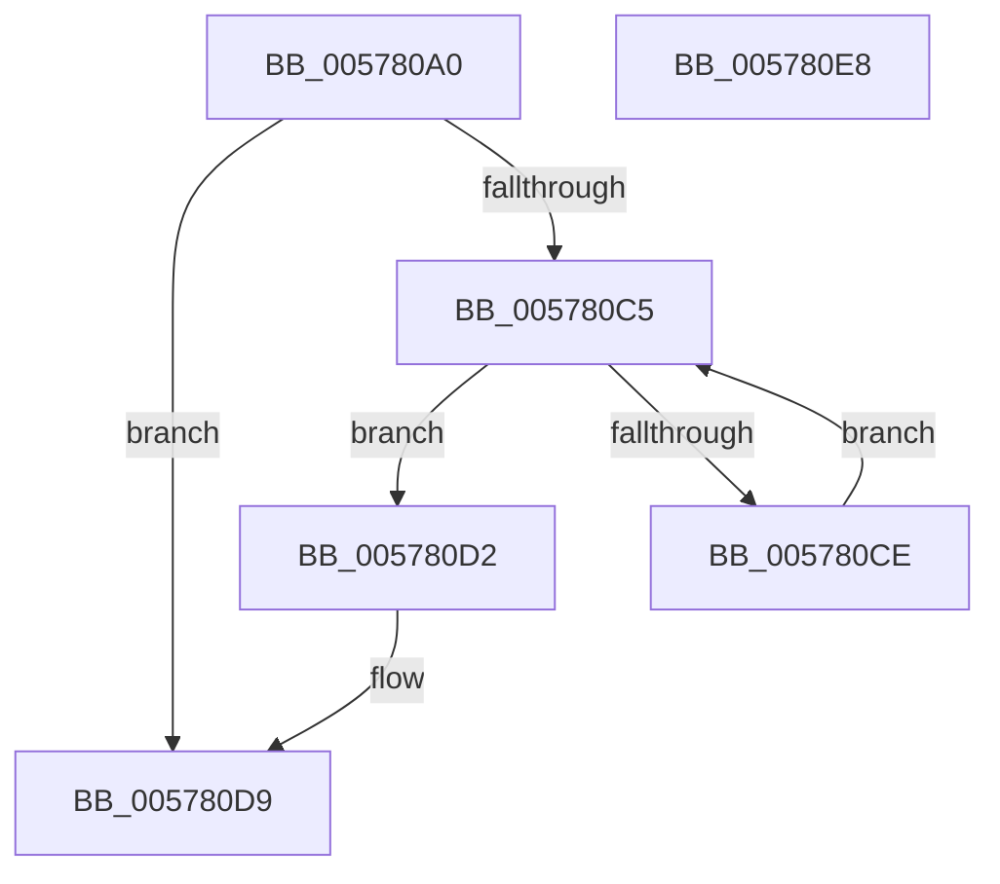

# XmBsrOp

- RVA: `0x005780A0`–`0x005780E9` (길이 `73` bytes)
- VA: `0x00000001405780A0`
- 실행 섹션: `.text`
- PDB 이름 있음: `예`; PDB Function 태그: `아니요`
- unwind 정보 RVA: `0x0005C788`
- 디코드: `24`개 명령, `73/73` bytes 표시
- 미해석 바이트: `0` (있으면 어셈블리에 `.byte`로 보존)

> 이 문서는 커널 이미지의 기계어와 PDB 기호를 분석해 생성했습니다. 4번과 5번은 함수 원형과 자료형을 바이너리 사용 방식에서 추정한 C 해석이며 원본 소스 복구 결과는 아닙니다.

## 1. Dependencies

- 직접 호출 지점: **1**; 고유 호출 대상: **1**
- 직접 호출자로 확인된 함수: **0**
- RIP 상대 이미지 참조: **0**

### Outgoing calls
- `0x005780DE` → [XmStoreResult](../47/XmStoreResult_function_004739FC.md) (function, `0x004739FC`)

### Direct callers
- 이 함수 시작 RVA로 연결되는 직접 call은 확인되지 않았습니다. 간접 호출은 완전히 역산할 수 없습니다.

### Static image references
- 디코드된 RIP-relative 메모리 참조가 없습니다.

## 2. Other-region calls and transfers

- 다른 실행 섹션으로 향하는 call: **0**
- 별도 외부 분기/꼬리 이동을 확인하지 못했습니다.

## 3. Assembly (complete function range)

```asm
005780A0  48 83 EC 28                     sub rsp, 0x28
005780A4  8B 41 78                        mov eax, dword ptr [rcx + 0x78]
005780A7  4C 8B C1                        mov r8, rcx
005780AA  41 8B 50 10                     mov edx, dword ptr [r8 + 0x10]
005780AE  8D 0C C5 07 00 00 00            lea ecx, [rax*8 + 7]
005780B5  45 8B 48 6C                     mov r9d, dword ptr [r8 + 0x6c]
005780B9  83 CA 40                        or edx, 0x40
005780BC  41 89 50 10                     mov dword ptr [r8 + 0x10], edx
005780C0  45 85 C9                        test r9d, r9d
005780C3  74 14                           je 0x1405780d9
005780C5  41 8B C1                        mov eax, r9d
005780C8  D3 E8                           shr eax, cl
005780CA  A8 01                           test al, 1
005780CC  75 04                           jne 0x1405780d2
005780CE  FF C9                           dec ecx
005780D0  EB F3                           jmp 0x1405780c5
005780D2  83 E2 BF                        and edx, 0xffffffbf
005780D5  41 89 50 10                     mov dword ptr [r8 + 0x10], edx
005780D9  8B D1                           mov edx, ecx
005780DB  49 8B C8                        mov rcx, r8
005780DE  E8 19 B9 EF FF                  call 0x1404739fc
005780E3  48 83 C4 28                     add rsp, 0x28
005780E7  C3                              ret
005780E8  CC                              int3
```

## 4. C-style interpretation (structured pseudocode)

```c
__int64 __fastcall XmBsrOp(__int64 a1)
{
    __int64 result;
    __int64 v_rsp;

    v_rsp = (v_rsp) - (40);
    a2 = (unsigned int)(((unsigned int)(*(unsigned int *)(a1 + 16))) | (64));
    *(unsigned int *)(a1 + 16) = (unsigned int)(a2);
    if ((unsigned int)((unsigned int)(*(unsigned int *)(a1 + 108))) == 0) goto loc_005780D9;
loc_005780C5:
    result = (unsigned int)(((unsigned int)((unsigned int)((unsigned int)(*(unsigned int *)(a1 + 108))))) >> ((unsigned __int8)((unsigned int)(*(unsigned int *)(a1 + 120)) * 8 + 7)));
    if ((((unsigned __int8)(result)) & (1)) != 0) goto loc_005780D2;
    a1 = (unsigned int)(((unsigned int)(*(unsigned int *)(a1 + 120)) * 8 + 7) - 1);
    goto loc_005780C5;
loc_005780D2:
    a2 = (unsigned int)((a2) & (0xFFFFFFBFULL));
    *(unsigned int *)(a1 + 16) = (unsigned int)(a2);
loc_005780D9:
    result = XmStoreResult(a1, (unsigned int)((unsigned int)(a1)), a1, (unsigned int)(*(unsigned int *)(a1 + 108)));
    v_rsp = (v_rsp) + (40);
    return result;
}
```

## 5. (Beta) C Style

```c
int64_t XmBsrOp(void *Arg1)
{
    uint8_t *arg1 = (uint8_t *)Arg1;

    int64_t result;
    int64_t local_rsp;

    local_rsp = (local_rsp) - (40);
    a2 = (uint32_t)(((uint32_t)(*(uint32_t *)(arg1 + 0x10))) | (64));
    *(uint32_t *)(arg1 + 0x10) = (uint32_t)(a2);
    if ((uint32_t)((uint32_t)(*(uint32_t *)(arg1 + 0x6C))) == 0) goto loc_005780D9;
loc_005780C5:
    result = (uint32_t)(((uint32_t)((uint32_t)((uint32_t)(*(uint32_t *)(arg1 + 0x6C))))) >> ((uint8_t)((uint32_t)(*(uint32_t *)(arg1 + 0x78)) * 8 + 7)));
    if ((((uint8_t)(result)) & (1)) != 0) goto loc_005780D2;
    Arg1 = (uint32_t)(((uint32_t)(*(uint32_t *)(arg1 + 0x78)) * 8 + 7) - 1);
    goto loc_005780C5;
loc_005780D2:
    a2 = (uint32_t)((a2) & (0xFFFFFFBFULL));
    *(uint32_t *)(arg1 + 0x10) = (uint32_t)(a2);
loc_005780D9:
    result = XmStoreResult(Arg1, (uint32_t)((uint32_t)(Arg1)), Arg1, (uint32_t)(*(uint32_t *)(arg1 + 0x6C)));
    local_rsp = (local_rsp) + (40);
    return result;
}
```

### 관측된 메모리 오프셋

구조체 형식이 확인되지 않은 접근은 인자 기준의 오프셋으로만 기록했습니다.

| 기준 인자 | 오프셋 표현 | 폭 (bit) | 접근 |
|---|---:|---:|---|
| `Arg1` | `+ 0x10` | `32` | `R` |
| `Arg1` | `+ 0x10` | `32` | `W` |
| `Arg1` | `+ 0x6C` | `32` | `R` |
| `Arg1` | `+ 0x78` | `32` | `R` |

## 6. Execution-region graph

[열기: 2D/3D 그래프와 함수 탐색 컨트롤 패널](../../../control-panel.html?section=text&rva=0x005780A0&view=graph)

- 2D 그래프는 위에서 아래로 흐르고, 3D 그래프는 빈 공간을 드래그해 회전합니다. Shift+드래그는 이동, 휠은 확대·축소, 함수 노드 선택은 대상 보고서 이동입니다.

### Static fallback


