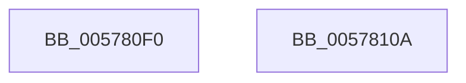

# XmBtOp

- RVA: `0x005780F0`–`0x0057810B` (길이 `27` bytes)
- VA: `0x00000001405780F0`
- 실행 섹션: `.text`
- PDB 이름 있음: `예`; PDB Function 태그: `아니요`
- unwind 정보 RVA: `0x000DB714`
- 디코드: `11`개 명령, `27/27` bytes 표시
- 미해석 바이트: `0` (있으면 어셈블리에 `.byte`로 보존)

> 이 문서는 커널 이미지의 기계어와 PDB 기호를 분석해 생성했습니다. 4번과 5번은 함수 원형과 자료형을 바이너리 사용 방식에서 추정한 C 해석이며 원본 소스 복구 결과는 아닙니다.

## 1. Dependencies

- 직접 호출 지점: **0**; 고유 호출 대상: **0**
- 직접 호출자로 확인된 함수: **0**
- RIP 상대 이미지 참조: **0**

### Outgoing calls
- 직접 디코드된 call 명령이 없습니다.

### Direct callers
- 이 함수 시작 RVA로 연결되는 직접 call은 확인되지 않았습니다. 간접 호출은 완전히 역산할 수 없습니다.

### Static image references
- 디코드된 RIP-relative 메모리 참조가 없습니다.

## 2. Other-region calls and transfers

- 다른 실행 섹션으로 향하는 call: **0**
- 별도 외부 분기/꼬리 이동을 확인하지 못했습니다.

## 3. Assembly (complete function range)

```asm
005780F0  8B 41 10                        mov eax, dword ptr [rcx + 0x10]
005780F3  4C 8B C1                        mov r8, rcx
005780F6  8B 51 68                        mov edx, dword ptr [rcx + 0x68]
005780F9  8B 49 6C                        mov ecx, dword ptr [rcx + 0x6c]
005780FC  D3 EA                           shr edx, cl
005780FE  33 D0                           xor edx, eax
00578100  83 E2 01                        and edx, 1
00578103  33 D0                           xor edx, eax
00578105  41 89 50 10                     mov dword ptr [r8 + 0x10], edx
00578109  C3                              ret
0057810A  CC                              int3
```

## 4. C-style interpretation (structured pseudocode)

```c
__int64 __fastcall XmBtOp(__int64 a1)
{
    a2 = (unsigned int)(((unsigned int)(*(unsigned int *)(a1 + 104))) >> ((unsigned __int8)((unsigned int)(*(unsigned int *)(a1 + 108)))));
    a2 = (unsigned int)((a2) ^ ((unsigned int)((unsigned int)(*(unsigned int *)(a1 + 16)))));
    a2 = (unsigned int)((a2) & (1));
    a2 = (unsigned int)((a2) ^ ((unsigned int)((unsigned int)(*(unsigned int *)(a1 + 16)))));
    *(unsigned int *)(a1 + 16) = (unsigned int)(a2);
    return (unsigned int)(*(unsigned int *)(a1 + 16));
}
```

## 5. (Beta) C Style

```c
int64_t XmBtOp(void *Arg1)
{
    uint8_t *arg1 = (uint8_t *)Arg1;

    a2 = (uint32_t)(((uint32_t)(*(uint32_t *)(arg1 + 0x68))) >> ((uint8_t)((uint32_t)(*(uint32_t *)(arg1 + 0x6C)))));
    a2 = (uint32_t)((a2) ^ ((uint32_t)((uint32_t)(*(uint32_t *)(arg1 + 0x10)))));
    a2 = (uint32_t)((a2) & (1));
    a2 = (uint32_t)((a2) ^ ((uint32_t)((uint32_t)(*(uint32_t *)(arg1 + 0x10)))));
    *(uint32_t *)(arg1 + 0x10) = (uint32_t)(a2);
    return (uint32_t)(*(uint32_t *)(arg1 + 0x10));
}
```

### 관측된 메모리 오프셋

구조체 형식이 확인되지 않은 접근은 인자 기준의 오프셋으로만 기록했습니다.

| 기준 인자 | 오프셋 표현 | 폭 (bit) | 접근 |
|---|---:|---:|---|
| `Arg1` | `+ 0x10` | `32` | `R` |
| `Arg1` | `+ 0x10` | `32` | `W` |
| `Arg1` | `+ 0x68` | `32` | `R` |
| `Arg1` | `+ 0x6C` | `32` | `R` |

## 6. Execution-region graph

[열기: 2D/3D 그래프와 함수 탐색 컨트롤 패널](../../../control-panel.html?section=text&rva=0x005780F0&view=graph)

- 2D 그래프는 위에서 아래로 흐르고, 3D 그래프는 빈 공간을 드래그해 회전합니다. Shift+드래그는 이동, 휠은 확대·축소, 함수 노드 선택은 대상 보고서 이동입니다.

### Static fallback


