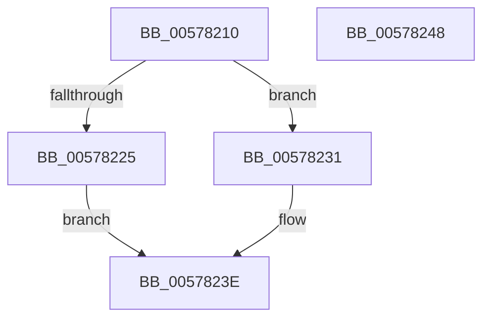

# XmCbwOp

- RVA: `0x00578210`–`0x00578249` (길이 `57` bytes)
- VA: `0x0000000140578210`
- 실행 섹션: `.text`
- PDB 이름 있음: `예`; PDB Function 태그: `아니요`
- unwind 정보 RVA: `0x0005C788`
- 디코드: `15`개 명령, `57/57` bytes 표시
- 미해석 바이트: `0` (있으면 어셈블리에 `.byte`로 보존)

> 이 문서는 커널 이미지의 기계어와 PDB 기호를 분석해 생성했습니다. 4번과 5번은 함수 원형과 자료형을 바이너리 사용 방식에서 추정한 C 해석이며 원본 소스 복구 결과는 아닙니다.

## 1. Dependencies

- 직접 호출 지점: **1**; 고유 호출 대상: **1**
- 직접 호출자로 확인된 함수: **0**
- RIP 상대 이미지 참조: **0**

### Outgoing calls
- `0x0057823E` → [XmStoreResult](../47/XmStoreResult_function_004739FC.md) (function, `0x004739FC`)

### Direct callers
- 이 함수 시작 RVA로 연결되는 직접 call은 확인되지 않았습니다. 간접 호출은 완전히 역산할 수 없습니다.

### Static image references
- 디코드된 RIP-relative 메모리 참조가 없습니다.

## 2. Other-region calls and transfers

- 다른 실행 섹션으로 향하는 call: **0**
- 별도 외부 분기/꼬리 이동을 확인하지 못했습니다.

## 3. Assembly (complete function range)

```asm
00578210  48 83 EC 28                     sub rsp, 0x28
00578214  80 B9 8A 00 00 00 00            cmp byte ptr [rcx + 0x8a], 0
0057821B  48 8D 41 18                     lea rax, [rcx + 0x18]
0057821F  48 89 41 58                     mov qword ptr [rcx + 0x58], rax
00578223  74 0C                           je 0x140578231
00578225  C7 41 78 03 00 00 00            mov dword ptr [rcx + 0x78], 3
0057822C  0F BF 10                        movsx edx, word ptr [rax]
0057822F  EB 0D                           jmp 0x14057823e
00578231  0F BE 00                        movsx eax, byte ptr [rax]
00578234  0F B7 D0                        movzx edx, ax
00578237  C7 41 78 01 00 00 00            mov dword ptr [rcx + 0x78], 1
0057823E  E8 B9 B7 EF FF                  call 0x1404739fc
00578243  48 83 C4 28                     add rsp, 0x28
00578247  C3                              ret
00578248  CC                              int3
```

## 4. C-style interpretation (structured pseudocode)

```c
__int64 __fastcall XmCbwOp(__int64 a1)
{
    __int64 result;
    __int64 v_rsp;

    v_rsp = (v_rsp) - (40);
    *(unsigned __int64 *)(a1 + 88) = a1 + 24;
    if ((*(unsigned __int8 *)(a1 + 138)) == 0) goto loc_00578231;
    *(unsigned int *)(a1 + 120) = 3;
    goto loc_0057823E;
loc_00578231:
    *(unsigned int *)(a1 + 120) = 1;
loc_0057823E:
    result = XmStoreResult(a1, (unsigned __int16)((__int8)(*(unsigned __int8 *)(a1 + 24))), a3, a4);
    v_rsp = (v_rsp) + (40);
    return result;
}
```

## 5. (Beta) C Style

```c
int64_t XmCbwOp(void *Arg1)
{
    uint8_t *arg1 = (uint8_t *)Arg1;

    int64_t result;
    int64_t local_rsp;

    local_rsp = (local_rsp) - (40);
    *(void **)(arg1 + 0x58) = Arg1 + 24;
    if ((*(uint8_t *)(arg1 + 0x8A)) == 0) goto loc_00578231;
    *(uint32_t *)(arg1 + 0x78) = 3;
    goto loc_0057823E;
loc_00578231:
    *(uint32_t *)(arg1 + 0x78) = 1;
loc_0057823E:
    result = XmStoreResult(Arg1, (uint16_t)((int8_t)(*(uint8_t *)(arg1 + 0x18))), a3, a4);
    local_rsp = (local_rsp) + (40);
    return result;
}
```

### 관측된 메모리 오프셋

구조체 형식이 확인되지 않은 접근은 인자 기준의 오프셋으로만 기록했습니다.

| 기준 인자 | 오프셋 표현 | 폭 (bit) | 접근 |
|---|---:|---:|---|
| `Arg1` | `+ 0x0` | `8` | `R` |
| `Arg1` | `+ 0x0` | `16` | `R` |
| `Arg1` | `+ 0x18` | `64` | `R` |
| `Arg1` | `+ 0x58` | `64` | `W` |
| `Arg1` | `+ 0x78` | `32` | `W` |
| `Arg1` | `+ 0x8A` | `8` | `R` |

## 6. Execution-region graph

[열기: 2D/3D 그래프와 함수 탐색 컨트롤 패널](../../../control-panel.html?section=text&rva=0x00578210&view=graph)

- 2D 그래프는 위에서 아래로 흐르고, 3D 그래프는 빈 공간을 드래그해 회전합니다. Shift+드래그는 이동, 휠은 확대·축소, 함수 노드 선택은 대상 보고서 이동입니다.

### Static fallback


