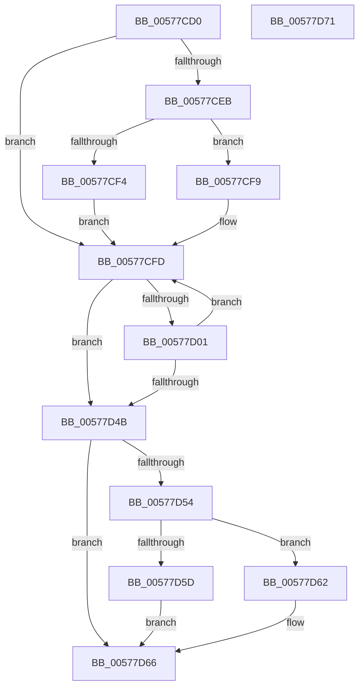

# XmCmpsOp

- RVA: `0x00577CD0`–`0x00577D72` (길이 `162` bytes)
- VA: `0x0000000140577CD0`
- 실행 섹션: `.text`
- PDB 이름 있음: `예`; PDB Function 태그: `아니요`
- unwind 정보 RVA: `0x0005CAAC`
- 디코드: `46`개 명령, `162/162` bytes 표시
- 미해석 바이트: `0` (있으면 어셈블리에 `.byte`로 보존)

> 이 문서는 커널 이미지의 기계어와 PDB 기호를 분석해 생성했습니다. 4번과 5번은 함수 원형과 자료형을 바이너리 사용 방식에서 추정한 C 해석이며 원본 소스 복구 결과는 아닙니다.

## 1. Dependencies

- 직접 호출 지점: **5**; 고유 호출 대상: **4**
- 직접 호출자로 확인된 함수: **0**
- RIP 상대 이미지 참조: **0**

### Outgoing calls
- `0x00577D0D` → [XmGetStringAddress](XmGetStringAddress_function_00578BCC.md) (function, `0x00578BCC`)
- `0x00577D18` → [XmSetSourceValue](../47/XmSetSourceValue_function_004737A8.md) (function, `0x004737A8`)
- `0x00577D23` → [XmGetStringAddress](XmGetStringAddress_function_00578BCC.md) (function, `0x00578BCC`)
- `0x00577D2E` → [XmSetDestinationValue](../47/XmSetDestinationValue_function_004734EC.md) (function, `0x004734EC`)
- `0x00577D33` → [XmCompareOperands](XmCompareOperands_function_00577D78.md) (function, `0x00577D78`)

### Direct callers
- 이 함수 시작 RVA로 연결되는 직접 call은 확인되지 않았습니다. 간접 호출은 완전히 역산할 수 없습니다.

### Static image references
- 디코드된 RIP-relative 메모리 참조가 없습니다.

## 2. Other-region calls and transfers

- 다른 실행 섹션으로 향하는 call: **0**
- 별도 외부 분기/꼬리 이동을 확인하지 못했습니다.

## 3. Assembly (complete function range)

```asm
00577CD0  48 89 5C 24 08                  mov qword ptr [rsp + 8], rbx
00577CD5  57                              push rdi
00577CD6  48 83 EC 20                     sub rsp, 0x20
00577CDA  80 B9 8B 00 00 00 00            cmp byte ptr [rcx + 0x8b], 0
00577CE1  48 8B D9                        mov rbx, rcx
00577CE4  BF 01 00 00 00                  mov edi, 1
00577CE9  74 12                           je 0x140577cfd
00577CEB  80 B9 89 00 00 00 00            cmp byte ptr [rcx + 0x89], 0
00577CF2  74 05                           je 0x140577cf9
00577CF4  8B 79 1C                        mov edi, dword ptr [rcx + 0x1c]
00577CF7  EB 04                           jmp 0x140577cfd
00577CF9  0F B7 79 1C                     movzx edi, word ptr [rcx + 0x1c]
00577CFD  85 FF                           test edi, edi
00577CFF  74 4A                           je 0x140577d4b
00577D01  8B 53 74                        mov edx, dword ptr [rbx + 0x74]
00577D04  41 B8 06 00 00 00               mov r8d, 6
00577D0A  48 8B CB                        mov rcx, rbx
00577D0D  E8 BA 0E 00 00                  call 0x140578bcc
00577D12  48 8B D0                        mov rdx, rax
00577D15  48 8B CB                        mov rcx, rbx
00577D18  E8 8B BA EF FF                  call 0x1404737a8
00577D1D  33 D2                           xor edx, edx
00577D1F  44 8D 42 07                     lea r8d, [rdx + 7]
00577D23  E8 A4 0E 00 00                  call 0x140578bcc
00577D28  48 8B D0                        mov rdx, rax
00577D2B  48 8B CB                        mov rcx, rbx
00577D2E  E8 B9 B7 EF FF                  call 0x1404734ec
00577D33  E8 40 00 00 00                  call 0x140577d78
00577D38  8B 4B 10                        mov ecx, dword ptr [rbx + 0x10]
00577D3B  FF CF                           dec edi
00577D3D  C1 E9 06                        shr ecx, 6
00577D40  83 E1 01                        and ecx, 1
00577D43  3A 8B 8D 00 00 00               cmp cl, byte ptr [rbx + 0x8d]
00577D49  74 B2                           je 0x140577cfd
00577D4B  80 BB 8B 00 00 00 00            cmp byte ptr [rbx + 0x8b], 0
00577D52  74 12                           je 0x140577d66
00577D54  80 BB 89 00 00 00 00            cmp byte ptr [rbx + 0x89], 0
00577D5B  74 05                           je 0x140577d62
00577D5D  89 7B 1C                        mov dword ptr [rbx + 0x1c], edi
00577D60  EB 04                           jmp 0x140577d66
00577D62  66 89 7B 1C                     mov word ptr [rbx + 0x1c], di
00577D66  48 8B 5C 24 30                  mov rbx, qword ptr [rsp + 0x30]
00577D6B  48 83 C4 20                     add rsp, 0x20
00577D6F  5F                              pop rdi
00577D70  C3                              ret
00577D71  CC                              int3
```

## 4. C-style interpretation (structured pseudocode)

```c
__int64 __fastcall XmCmpsOp(__int64 a1)
{
    __int64 result;
    __int64 v_rdi;
    __int64 v_rsp;
    unsigned __int64 v_stack_p8;

    v_stack_p8 = v_rbx;
    v_rsp = (v_rsp) - (32);
    if ((*(unsigned __int8 *)(a1 + 139)) == 0) goto loc_00577CFD;
    if ((*(unsigned __int8 *)(a1 + 137)) == 0) goto loc_00577CF9;
    goto loc_00577CFD;
loc_00577CF9:
loc_00577CFD:
    if ((unsigned int)(*(unsigned __int16 *)(a1 + 28)) == 0) goto loc_00577D4B;
    result = XmGetStringAddress(a1, (unsigned int)(*(unsigned int *)(a1 + 116)), 6, a4);
    result = XmSetSourceValue(a1, result, 6, a4);
    a2 = 0;
    result = XmGetStringAddress(a1, a2, a2 + 7, a4);
    result = XmSetDestinationValue(a1, result, a2 + 7, a4);
    result = XmCompareOperands(a1, result, a2 + 7, a4);
    v_rdi = (unsigned int)((*(unsigned __int16 *)(a1 + 28)) - 1);
    a1 = (unsigned int)(((unsigned int)(*(unsigned int *)(a1 + 16))) >> (6));
    a1 = (unsigned int)((a1) & (1));
    if (((unsigned __int8)(a1)) == (*(unsigned __int8 *)(a1 + 141))) goto loc_00577CFD;
loc_00577D4B:
    if ((*(unsigned __int8 *)(a1 + 139)) == 0) goto loc_00577D66;
    if ((*(unsigned __int8 *)(a1 + 137)) == 0) goto loc_00577D62;
    *(unsigned int *)(a1 + 28) = (unsigned int)(v_rdi);
    goto loc_00577D66;
loc_00577D62:
    *(unsigned __int16 *)(a1 + 28) = (unsigned __int16)(v_rdi);
loc_00577D66:
    v_rsp = (v_rsp) + (32);
    return result;
}
```

## 5. (Beta) C Style

```c
int64_t XmCmpsOp(void *Arg1)
{
    uint8_t *arg1 = (uint8_t *)Arg1;

    int64_t result;
    int64_t local_rdi;
    int64_t local_rsp;
    uint64_t v_stack_p8;

    v_stack_p8 = local_rbx;
    local_rsp = (local_rsp) - (32);
    if ((*(uint8_t *)(arg1 + 0x8B)) == 0) goto loc_00577CFD;
    if ((*(uint8_t *)(arg1 + 0x89)) == 0) goto loc_00577CF9;
    goto loc_00577CFD;
loc_00577CF9:
loc_00577CFD:
    if ((uint32_t)(*(uint16_t *)(arg1 + 0x1C)) == 0) goto loc_00577D4B;
    result = XmGetStringAddress(Arg1, (uint32_t)(*(uint32_t *)(arg1 + 0x74)), 6, a4);
    result = XmSetSourceValue(Arg1, result, 6, a4);
    a2 = 0;
    result = XmGetStringAddress(Arg1, a2, a2 + 7, a4);
    result = XmSetDestinationValue(Arg1, result, a2 + 7, a4);
    result = XmCompareOperands(Arg1, result, a2 + 7, a4);
    local_rdi = (uint32_t)((*(uint16_t *)(arg1 + 0x1C)) - 1);
    Arg1 = (uint32_t)(((uint32_t)(*(uint32_t *)(arg1 + 0x10))) >> (6));
    Arg1 = (uint32_t)((Arg1) & (1));
    if (((uint8_t)(Arg1)) == (*(uint8_t *)(arg1 + 0x8D))) goto loc_00577CFD;
loc_00577D4B:
    if ((*(uint8_t *)(arg1 + 0x8B)) == 0) goto loc_00577D66;
    if ((*(uint8_t *)(arg1 + 0x89)) == 0) goto loc_00577D62;
    *(uint32_t *)(arg1 + 0x1C) = (uint32_t)(local_rdi);
    goto loc_00577D66;
loc_00577D62:
    *(uint16_t *)(arg1 + 0x1C) = (uint16_t)(local_rdi);
loc_00577D66:
    local_rsp = (local_rsp) + (32);
    return result;
}
```

### 관측된 메모리 오프셋

구조체 형식이 확인되지 않은 접근은 인자 기준의 오프셋으로만 기록했습니다.

| 기준 인자 | 오프셋 표현 | 폭 (bit) | 접근 |
|---|---:|---:|---|
| `Arg1` | `+ 0x10` | `32` | `R` |
| `Arg1` | `+ 0x1C` | `16` | `R` |
| `Arg1` | `+ 0x1C` | `16` | `W` |
| `Arg1` | `+ 0x1C` | `32` | `R` |
| `Arg1` | `+ 0x1C` | `32` | `W` |
| `Arg1` | `+ 0x74` | `32` | `R` |
| `Arg1` | `+ 0x89` | `8` | `R` |
| `Arg1` | `+ 0x8B` | `8` | `R` |
| `Arg1` | `+ 0x8D` | `8` | `R` |

## 6. Execution-region graph

[열기: 2D/3D 그래프와 함수 탐색 컨트롤 패널](../../../control-panel.html?section=text&rva=0x00577CD0&view=graph)

- 2D 그래프는 위에서 아래로 흐르고, 3D 그래프는 빈 공간을 드래그해 회전합니다. Shift+드래그는 이동, 휠은 확대·축소, 함수 노드 선택은 대상 보고서 이동입니다.

### Static fallback


