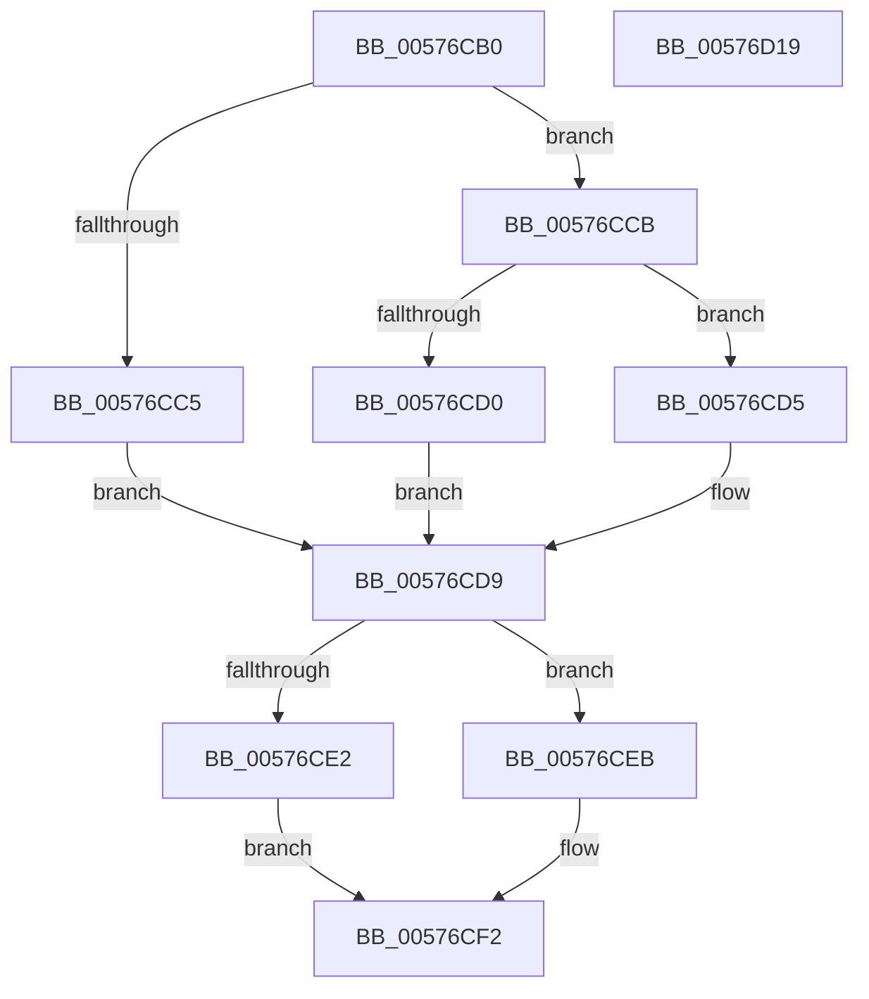

# XmCmpxchgOp

- RVA: `0x00576CB0`–`0x00576D1A` (길이 `106` bytes)
- VA: `0x0000000140576CB0`
- 실행 섹션: `.text`
- PDB 이름 있음: `예`; PDB Function 태그: `아니요`
- unwind 정보 RVA: `0x0005C788`
- 디코드: `34`개 명령, `106/106` bytes 표시
- 미해석 바이트: `0` (있으면 어셈블리에 `.byte`로 보존)

> 이 문서는 커널 이미지의 기계어와 PDB 기호를 분석해 생성했습니다. 4번과 5번은 함수 원형과 자료형을 바이너리 사용 방식에서 추정한 C 해석이며 원본 소스 복구 결과는 아닙니다.

## 1. Dependencies

- 직접 호출 지점: **2**; 고유 호출 대상: **2**
- 직접 호출자로 확인된 함수: **0**
- RIP 상대 이미지 참조: **0**

### Outgoing calls
- `0x00576CF9` → [XmStoreResult](../47/XmStoreResult_function_004739FC.md) (function, `0x004739FC`)
- `0x00576D0F` → [XmSubOperands](../47/XmSubOperands_function_004726C0.md) (function, `0x004726C0`)

### Direct callers
- 이 함수 시작 RVA로 연결되는 직접 call은 확인되지 않았습니다. 간접 호출은 완전히 역산할 수 없습니다.

### Static image references
- 디코드된 RIP-relative 메모리 참조가 없습니다.

## 2. Other-region calls and transfers

- 다른 실행 섹션으로 향하는 call: **0**
- 별도 외부 분기/꼬리 이동을 확인하지 못했습니다.

## 3. Assembly (complete function range)

```asm
00576CB0  48 83 EC 28                     sub rsp, 0x28
00576CB4  8B 41 78                        mov eax, dword ptr [rcx + 0x78]
00576CB7  4C 8B C9                        mov r9, rcx
00576CBA  8B 51 68                        mov edx, dword ptr [rcx + 0x68]
00576CBD  48 83 C1 18                     add rcx, 0x18
00576CC1  85 C0                           test eax, eax
00576CC3  75 06                           jne 0x140576ccb
00576CC5  44 0F B6 11                     movzx r10d, byte ptr [rcx]
00576CC9  EB 0E                           jmp 0x140576cd9
00576CCB  83 F8 03                        cmp eax, 3
00576CCE  75 05                           jne 0x140576cd5
00576CD0  44 8B 11                        mov r10d, dword ptr [rcx]
00576CD3  EB 04                           jmp 0x140576cd9
00576CD5  44 0F B7 11                     movzx r10d, word ptr [rcx]
00576CD9  41 8B 41 10                     mov eax, dword ptr [r9 + 0x10]
00576CDD  41 3B D2                        cmp edx, r10d
00576CE0  75 09                           jne 0x140576ceb
00576CE2  41 8B 51 6C                     mov edx, dword ptr [r9 + 0x6c]
00576CE6  83 C8 40                        or eax, 0x40
00576CE9  EB 07                           jmp 0x140576cf2
00576CEB  49 89 49 58                     mov qword ptr [r9 + 0x58], rcx
00576CEF  83 E0 BF                        and eax, 0xffffffbf
00576CF2  49 8B C9                        mov rcx, r9
00576CF5  41 89 41 10                     mov dword ptr [r9 + 0x10], eax
00576CF9  E8 FE CC EF FF                  call 0x1404739fc
00576CFE  41 8B 49 68                     mov ecx, dword ptr [r9 + 0x68]
00576D02  33 D2                           xor edx, edx
00576D04  41 89 49 6C                     mov dword ptr [r9 + 0x6c], ecx
00576D08  49 8B C9                        mov rcx, r9
00576D0B  45 89 51 68                     mov dword ptr [r9 + 0x68], r10d
00576D0F  E8 AC B9 EF FF                  call 0x1404726c0
00576D14  48 83 C4 28                     add rsp, 0x28
00576D18  C3                              ret
00576D19  CC                              int3
```

## 4. C-style interpretation (structured pseudocode)

```c
__int64 __fastcall XmCmpxchgOp(__int64 a1)
{
    __int64 result;
    __int64 v_rsp;

    v_rsp = (v_rsp) - (40);
    a1 = (a1) + (24);
    if ((unsigned int)((unsigned int)(*(unsigned int *)(a1 + 120))) != 0) goto loc_00576CCB;
    goto loc_00576CD9;
loc_00576CCB:
    if (((unsigned int)((unsigned int)(*(unsigned int *)(a1 + 120)))) != 3) goto loc_00576CD5;
    goto loc_00576CD9;
loc_00576CD5:
loc_00576CD9:
    if (((unsigned int)((unsigned int)(*(unsigned int *)(a1 + 104)))) != ((unsigned int)(*(unsigned __int16 *)(a1)))) goto loc_00576CEB;
    result = (unsigned int)(((unsigned int)(*(unsigned int *)(a1 + 16))) | (64));
    goto loc_00576CF2;
loc_00576CEB:
    *(unsigned __int64 *)(a1 + 88) = a1;
    result = (unsigned int)((result) & (0xFFFFFFBFULL));
loc_00576CF2:
    *(unsigned int *)(a1 + 16) = (unsigned int)(result);
    result = XmStoreResult(a1, (unsigned int)(*(unsigned int *)(a1 + 108)), a3, a1);
    a2 = 0;
    *(unsigned int *)(a1 + 108) = (unsigned int)((unsigned int)(*(unsigned int *)(a1 + 104)));
    *(unsigned int *)(a1 + 104) = (unsigned int)(*(unsigned __int16 *)(a1));
    result = XmSubOperands(a1, a2, a3, a1);
    v_rsp = (v_rsp) + (40);
    return result;
}
```

## 5. (Beta) C Style

```c
int64_t XmCmpxchgOp(void *Arg1)
{
    uint8_t *arg1 = (uint8_t *)Arg1;

    int64_t result;
    int64_t local_rsp;

    local_rsp = (local_rsp) - (40);
    Arg1 = (Arg1) + (24);
    if ((uint32_t)((uint32_t)(*(uint32_t *)(arg1 + 0x78))) != 0) goto loc_00576CCB;
    goto loc_00576CD9;
loc_00576CCB:
    if (((uint32_t)((uint32_t)(*(uint32_t *)(arg1 + 0x78)))) != 3) goto loc_00576CD5;
    goto loc_00576CD9;
loc_00576CD5:
loc_00576CD9:
    if (((uint32_t)((uint32_t)(*(uint32_t *)(arg1 + 0x68)))) != ((uint32_t)(*(uint16_t *)(arg1)))) goto loc_00576CEB;
    result = (uint32_t)(((uint32_t)(*(uint32_t *)(arg1 + 0x10))) | (64));
    goto loc_00576CF2;
loc_00576CEB:
    *(void **)(arg1 + 0x58) = Arg1;
    result = (uint32_t)((result) & (0xFFFFFFBFULL));
loc_00576CF2:
    *(uint32_t *)(arg1 + 0x10) = (uint32_t)(result);
    result = XmStoreResult(Arg1, (uint32_t)(*(uint32_t *)(arg1 + 0x6C)), a3, Arg1);
    a2 = 0;
    *(uint32_t *)(arg1 + 0x6C) = (uint32_t)((uint32_t)(*(uint32_t *)(arg1 + 0x68)));
    *(uint32_t *)(arg1 + 0x68) = (uint32_t)(*(uint16_t *)(arg1));
    result = XmSubOperands(Arg1, a2, a3, Arg1);
    local_rsp = (local_rsp) + (40);
    return result;
}
```

### 관측된 메모리 오프셋

구조체 형식이 확인되지 않은 접근은 인자 기준의 오프셋으로만 기록했습니다.

| 기준 인자 | 오프셋 표현 | 폭 (bit) | 접근 |
|---|---:|---:|---|
| `Arg1` | `+ 0x0` | `8` | `R` |
| `Arg1` | `+ 0x0` | `16` | `R` |
| `Arg1` | `+ 0x0` | `32` | `R` |
| `Arg1` | `+ 0x10` | `32` | `R` |
| `Arg1` | `+ 0x10` | `32` | `W` |
| `Arg1` | `+ 0x58` | `64` | `W` |
| `Arg1` | `+ 0x68` | `32` | `R` |
| `Arg1` | `+ 0x6C` | `32` | `R` |
| `Arg1` | `+ 0x78` | `32` | `R` |

## 6. Execution-region graph

[열기: 2D/3D 그래프와 함수 탐색 컨트롤 패널](../../../control-panel.html?section=text&rva=0x00576CB0&view=graph)

- 2D 그래프는 위에서 아래로 흐르고, 3D 그래프는 빈 공간을 드래그해 회전합니다. Shift+드래그는 이동, 휠은 확대·축소, 함수 노드 선택은 대상 보고서 이동입니다.

### Static fallback


