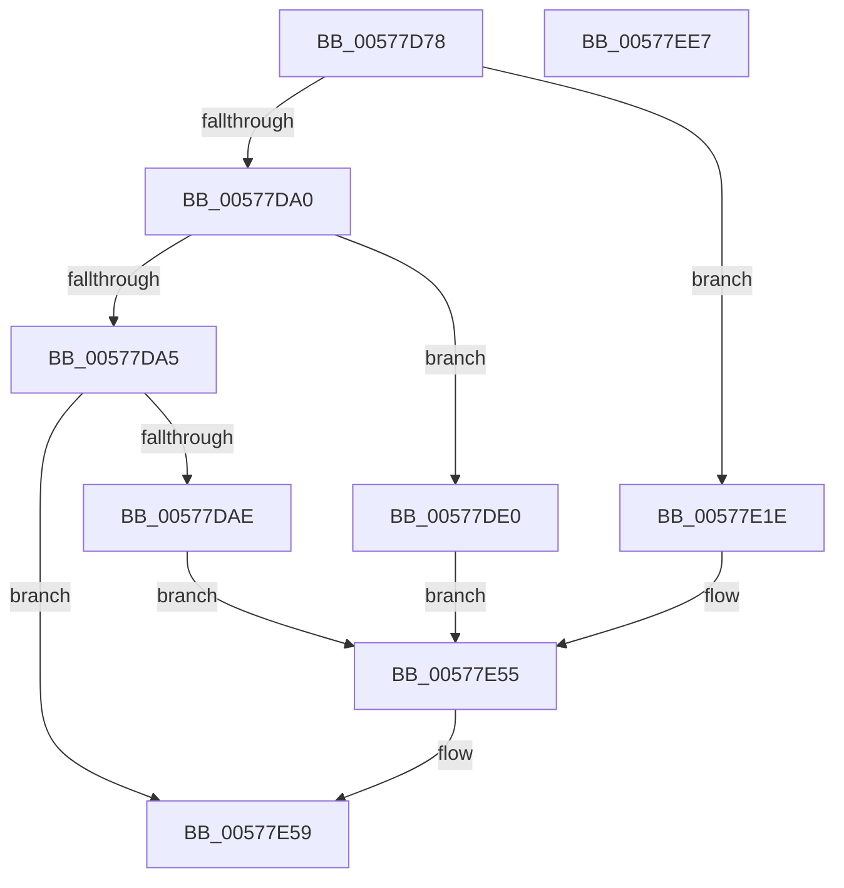

# XmCompareOperands

- RVA: `0x00577D78`–`0x00577EE8` (길이 `368` bytes)
- VA: `0x0000000140577D78`
- 실행 섹션: `.text`
- PDB 이름 있음: `예`; PDB Function 태그: `아니요`
- unwind 정보 RVA: `0x00069588`
- 디코드: `108`개 명령, `368/368` bytes 표시
- 미해석 바이트: `0` (있으면 어셈블리에 `.byte`로 보존)

> 이 문서는 커널 이미지의 기계어와 PDB 기호를 분석해 생성했습니다. 4번과 5번은 함수 원형과 자료형을 바이너리 사용 방식에서 추정한 C 해석이며 원본 소스 복구 결과는 아닙니다.

## 1. Dependencies

- 직접 호출 지점: **0**; 고유 호출 대상: **0**
- 직접 호출자로 확인된 함수: **2**
- RIP 상대 이미지 참조: **1**

### Outgoing calls
- 직접 디코드된 call 명령이 없습니다.

### Direct callers
- [XmCmpsOp](XmCmpsOp_function_00577CD0.md) at `0x00577D33`
- [XmScasOp](XmScasOp_function_00578000.md) at `0x00578053`

### Static image references
- `0x00577E70` → RVA `0x0001A190` (`.rdata`; read)

## 2. Other-region calls and transfers

- 다른 실행 섹션으로 향하는 call: **0**
- 별도 외부 분기/꼬리 이동을 확인하지 못했습니다.

## 3. Assembly (complete function range)

```asm
00577D78  48 89 5C 24 08                  mov qword ptr [rsp + 8], rbx
00577D7D  48 89 74 24 10                  mov qword ptr [rsp + 0x10], rsi
00577D82  48 89 7C 24 18                  mov qword ptr [rsp + 0x18], rdi
00577D87  8B 41 78                        mov eax, dword ptr [rcx + 0x78]
00577D8A  45 33 C9                        xor r9d, r9d
00577D8D  48 8B F9                        mov rdi, rcx
00577D90  41 8B F1                        mov esi, r9d
00577D93  45 8B D1                        mov r10d, r9d
00577D96  41 8B D9                        mov ebx, r9d
00577D99  45 8B D9                        mov r11d, r9d
00577D9C  85 C0                           test eax, eax
00577D9E  74 7E                           je 0x140577e1e
00577DA0  83 E8 01                        sub eax, 1
00577DA3  74 3B                           je 0x140577de0
00577DA5  83 F8 02                        cmp eax, 2
00577DA8  0F 85 AB 00 00 00               jne 0x140577e59
00577DAE  8B 51 6C                        mov edx, dword ptr [rcx + 0x6c]
00577DB1  44 8B DA                        mov r11d, edx
00577DB4  8B 49 68                        mov ecx, dword ptr [rcx + 0x68]
00577DB7  44 2B D9                        sub r11d, ecx
00577DBA  45 8B D3                        mov r10d, r11d
00577DBD  8B C1                           mov eax, ecx
00577DBF  44 33 D2                        xor r10d, edx
00577DC2  41 33 C3                        xor eax, r11d
00577DC5  41 C1 EA 1F                     shr r10d, 0x1f
00577DC9  41 8B DB                        mov ebx, r11d
00577DCC  C1 E8 1F                        shr eax, 0x1f
00577DCF  44 23 D0                        and r10d, eax
00577DD2  C1 EB 1F                        shr ebx, 0x1f
00577DD5  3B D1                           cmp edx, ecx
00577DD7  40 0F 92 C6                     setb sil
00577DDB  45 85 DB                        test r11d, r11d
00577DDE  EB 75                           jmp 0x140577e55
00577DE0  0F B7 51 68                     movzx edx, word ptr [rcx + 0x68]
00577DE4  44 0F B7 41 6C                  movzx r8d, word ptr [rcx + 0x6c]
00577DE9  44 8B D2                        mov r10d, edx
00577DEC  41 0F B7 C0                     movzx eax, r8w
00577DF0  41 8B C8                        mov ecx, r8d
00577DF3  66 2B C2                        sub ax, dx
00577DF6  44 0F B7 D8                     movzx r11d, ax
00577DFA  45 33 D3                        xor r10d, r11d
00577DFD  41 33 CB                        xor ecx, r11d
00577E00  41 C1 EA 0F                     shr r10d, 0xf
00577E04  41 8B DB                        mov ebx, r11d
00577E07  C1 E9 0F                        shr ecx, 0xf
00577E0A  44 23 D1                        and r10d, ecx
00577E0D  C1 EB 0F                        shr ebx, 0xf
00577E10  66 44 3B C2                     cmp r8w, dx
00577E14  40 0F 92 C6                     setb sil
00577E18  66 45 85 DB                     test r11w, r11w
00577E1C  EB 37                           jmp 0x140577e55
00577E1E  0F B6 51 68                     movzx edx, byte ptr [rcx + 0x68]
00577E22  44 0F B6 41 6C                  movzx r8d, byte ptr [rcx + 0x6c]
00577E27  44 8B D2                        mov r10d, edx
00577E2A  41 8A C0                        mov al, r8b
00577E2D  41 8B C8                        mov ecx, r8d
00577E30  2A C2                           sub al, dl
00577E32  44 0F B6 D8                     movzx r11d, al
00577E36  45 33 D3                        xor r10d, r11d
00577E39  41 33 CB                        xor ecx, r11d
00577E3C  41 C1 EA 07                     shr r10d, 7
00577E40  41 8B DB                        mov ebx, r11d
00577E43  C1 E9 07                        shr ecx, 7
00577E46  44 23 D1                        and r10d, ecx
00577E49  C1 EB 07                        shr ebx, 7
00577E4C  44 3A C2                        cmp r8b, dl
00577E4F  40 0F 92 C6                     setb sil
00577E53  84 C0                           test al, al
00577E55  41 0F 94 C1                     sete r9b
00577E59  8B 57 10                        mov edx, dword ptr [rdi + 0x10]
00577E5C  41 83 E1 FD                     and r9d, 0xfffffffd
00577E60  41 8B CB                        mov ecx, r11d
00577E63  83 E2 FE                        and edx, 0xfffffffe
00577E66  83 E1 0F                        and ecx, 0xf
00577E69  41 8B C3                        mov eax, r11d
00577E6C  48 C1 E8 04                     shr rax, 4
00577E70  4C 8D 1D 19 23 AA FF            lea r11, [rip - 0x55dce7]
00577E77  83 E0 0F                        and eax, 0xf
00577E7A  41 C1 E2 0B                     shl r10d, 0xb
00577E7E  0B D6                           or edx, esi
00577E80  48 8B 74 24 10                  mov rsi, qword ptr [rsp + 0x10]
00577E85  83 E2 FB                        and edx, 0xfffffffb
00577E88  46 0F B6 04 18                  movzx r8d, byte ptr [rax + r11]
00577E8D  42 0F B6 04 19                  movzx eax, byte ptr [rcx + r11]
00577E92  0F B6 4F 6C                     movzx ecx, byte ptr [rdi + 0x6c]
00577E96  44 03 C0                        add r8d, eax
00577E99  0F B6 47 68                     movzx eax, byte ptr [rdi + 0x68]
00577E9D  41 F7 D0                        not r8d
00577EA0  41 83 E0 01                     and r8d, 1
00577EA4  83 E1 0F                        and ecx, 0xf
00577EA7  41 C1 E0 02                     shl r8d, 2
00577EAB  83 E0 0F                        and eax, 0xf
00577EAE  44 33 C2                        xor r8d, edx
00577EB1  03 C8                           add ecx, eax
00577EB3  41 81 E0 2F FF FF FF            and r8d, 0xffffff2f
00577EBA  8D 04 1B                        lea eax, [rbx + rbx]
00577EBD  48 8B 5C 24 08                  mov rbx, qword ptr [rsp + 8]
00577EC2  81 E1 30 FF FF FF               and ecx, 0xffffff30
00577EC8  44 0B C1                        or r8d, ecx
00577ECB  44 0B C8                        or r9d, eax
00577ECE  41 C1 E1 06                     shl r9d, 6
00577ED2  45 0B C1                        or r8d, r9d
00577ED5  41 0F BA F0 0B                  btr r8d, 0xb
00577EDA  45 0B C2                        or r8d, r10d
00577EDD  44 89 47 10                     mov dword ptr [rdi + 0x10], r8d
00577EE1  48 8B 7C 24 18                  mov rdi, qword ptr [rsp + 0x18]
00577EE6  C3                              ret
00577EE7  CC                              int3
```

## 4. C-style interpretation (structured pseudocode)

```c
__int64 __fastcall XmCompareOperands(__int64 a1, __int64 a2, __int64 a3, int a4)
{
    __int64 result;
    __int64 v_r10;
    __int64 v_r11;
    __int64 v_rbx;
    __int64 v_rsi;
    unsigned __int64 v_stack_p10;
    unsigned __int64 v_stack_p18;
    unsigned __int64 v_stack_p8;

    v_stack_p8 = v_rbx;
    v_stack_p10 = v_rsi;
    v_stack_p18 = v_rdi;
    a4 = 0;
    if ((unsigned int)((unsigned int)(*(unsigned int *)(a1 + 120))) == 0) goto loc_00577E1E;
    result = (unsigned int)(((unsigned int)(*(unsigned int *)(a1 + 120))) - (1));
    if (condition_is_equal) goto loc_00577DE0;
    if (((unsigned int)(result)) != 2) goto loc_00577E59;
    v_r11 = (unsigned int)(((unsigned int)((unsigned int)((unsigned int)(*(unsigned int *)(a1 + 108))))) - ((unsigned int)((unsigned int)(*(unsigned int *)(a1 + 104)))));
    v_r10 = (unsigned int)(((unsigned int)((unsigned int)(v_r11))) ^ ((unsigned int)((unsigned int)(*(unsigned int *)(a1 + 108)))));
    result = (unsigned int)(((unsigned int)((unsigned int)((unsigned int)(*(unsigned int *)(a1 + 104))))) ^ ((unsigned int)(v_r11)));
    v_r10 = (unsigned int)((v_r10) >> (31));
    result = (unsigned int)((result) >> (31));
    v_r10 = (unsigned int)((v_r10) & ((unsigned int)(result)));
    v_rbx = (unsigned int)(((unsigned int)((unsigned int)(v_r11))) >> (31));
    v_rsi = (((unsigned int)((unsigned int)(*(unsigned int *)(a1 + 108)))) < ((unsigned int)((unsigned int)(*(unsigned int *)(a1 + 104))))) ? 1 : 0;
    goto loc_00577E55;
loc_00577DE0:
    result = (unsigned __int16)(((unsigned __int16)(*(unsigned __int16 *)((unsigned int)(*(unsigned int *)(a1 + 104)) + 108))) - ((unsigned __int16)(*(unsigned __int16 *)((unsigned int)(*(unsigned int *)(a1 + 104)) + 104))));
    v_r10 = (unsigned int)(((unsigned int)((unsigned int)(*(unsigned __int16 *)((unsigned int)(*(unsigned int *)(a1 + 104)) + 104)))) ^ ((unsigned int)((unsigned __int16)(result))));
    a1 = (unsigned int)(((unsigned int)((unsigned int)(*(unsigned __int16 *)((unsigned int)(*(unsigned int *)(a1 + 104)) + 108)))) ^ ((unsigned int)((unsigned __int16)(result))));
    v_r10 = (unsigned int)((v_r10) >> (15));
    a1 = (unsigned int)((a1) >> (15));
    v_r10 = (unsigned int)((v_r10) & ((unsigned int)(a1)));
    v_rbx = (unsigned int)(((unsigned int)((unsigned int)((unsigned __int16)(result)))) >> (15));
    v_rsi = (((unsigned __int16)(*(unsigned __int16 *)((unsigned int)(*(unsigned int *)(a1 + 104)) + 108))) < ((unsigned __int16)(*(unsigned __int16 *)((unsigned int)(*(unsigned int *)(a1 + 104)) + 104)))) ? 1 : 0;
    goto loc_00577E55;
loc_00577E1E:
    result = (unsigned __int8)(((unsigned __int8)(*(unsigned __int8 *)(a1 + 108))) - ((unsigned __int8)(*(unsigned __int8 *)(a1 + 104))));
    v_r10 = (unsigned int)(((unsigned int)((unsigned int)(*(unsigned __int8 *)(a1 + 104)))) ^ ((unsigned int)((unsigned __int8)(result))));
    a1 = (unsigned int)(((unsigned int)((unsigned int)(*(unsigned __int8 *)(a1 + 108)))) ^ ((unsigned int)((unsigned __int8)(result))));
    v_r10 = (unsigned int)((v_r10) >> (7));
    a1 = (unsigned int)((a1) >> (7));
    v_r10 = (unsigned int)((v_r10) & ((unsigned int)(a1)));
    v_rbx = (unsigned int)(((unsigned int)((unsigned int)((unsigned __int8)(result)))) >> (7));
    v_rsi = (((unsigned __int8)(*(unsigned __int8 *)(a1 + 108))) < ((unsigned __int8)(*(unsigned __int8 *)(a1 + 104)))) ? 1 : 0;
loc_00577E55:
    a4 = ((unsigned __int8)(result) == 0) ? 1 : 0;
loc_00577E59:
    a4 = (unsigned int)((a4) & (0xFFFFFFFDULL));
    a2 = (unsigned int)(((unsigned int)(*(unsigned int *)(a1 + 16))) & (0xFFFFFFFEULL));
    a1 = (unsigned int)(((unsigned int)((unsigned int)((unsigned __int8)(result)))) & (15));
    result = ((unsigned int)((unsigned int)((unsigned __int8)(result)))) >> (4);
    result = (unsigned int)((result) & (15));
    v_r10 = (unsigned int)((v_r10) << (11));
    a2 = (unsigned int)((a2) | ((unsigned int)(v_rsi)));
    a2 = (unsigned int)((a2) & (0xFFFFFFFBULL));
    a3 = (unsigned int)((*(unsigned __int8 *)(result + v_rip - 5627111 * 1)) + ((unsigned int)(*(unsigned __int8 *)(a1 + v_rip - 5627111 * 1))));
    a3 = (unsigned int)(~(a3));
    a3 = (unsigned int)((a3) & (1));
    a1 = (unsigned int)((*(unsigned __int8 *)(a1 + 108)) & (15));
    a3 = (unsigned int)((a3) << (2));
    result = (unsigned int)((*(unsigned __int8 *)(a1 + 104)) & (15));
    a3 = (unsigned int)((a3) ^ ((unsigned int)(a2)));
    a1 = (unsigned int)((a1) + ((unsigned int)(result)));
    a3 = (unsigned int)((a3) & (0xFFFFFF2FULL));
    a1 = (unsigned int)((a1) & (0xFFFFFF30ULL));
    a3 = (unsigned int)((a3) | ((unsigned int)(a1)));
    a4 = (unsigned int)((a4) | ((unsigned int)(v_rbx + v_rbx * 1)));
    a4 = (unsigned int)((a4) << (6));
    a3 = (unsigned int)((a3) | (a4));
    a3 = (unsigned int)((a3) | ((unsigned int)(v_r10)));
    *(unsigned int *)(a1 + 16) = (unsigned int)(a3);
    return v_rbx + v_rbx * 1;
}
```

## 5. (Beta) C Style

```c
int64_t XmCompareOperands(void *Arg1, int64_t Arg2, int64_t Arg3, int32_t Arg4)
{
    uint8_t *arg1 = (uint8_t *)Arg1;

    int64_t result;
    int64_t local_r10;
    int64_t local_r11;
    int64_t local_rbx;
    int64_t local_rsi;
    uint64_t v_stack_p10;
    uint64_t v_stack_p18;
    uint64_t v_stack_p8;

    v_stack_p8 = local_rbx;
    v_stack_p10 = local_rsi;
    v_stack_p18 = local_rdi;
    Arg4 = 0;
    if ((uint32_t)((uint32_t)(*(uint32_t *)(arg1 + 0x78))) == 0) goto loc_00577E1E;
    result = (uint32_t)(((uint32_t)(*(uint32_t *)(arg1 + 0x78))) - (1));
    if (condition_is_equal) goto loc_00577DE0;
    if (((uint32_t)(result)) != 2) goto loc_00577E59;
    local_r11 = (uint32_t)(((uint32_t)((uint32_t)((uint32_t)(*(uint32_t *)(arg1 + 0x6C))))) - ((uint32_t)((uint32_t)(*(uint32_t *)(arg1 + 0x68)))));
    local_r10 = (uint32_t)(((uint32_t)((uint32_t)(local_r11))) ^ ((uint32_t)((uint32_t)(*(uint32_t *)(arg1 + 0x6C)))));
    result = (uint32_t)(((uint32_t)((uint32_t)((uint32_t)(*(uint32_t *)(arg1 + 0x68))))) ^ ((uint32_t)(local_r11)));
    local_r10 = (uint32_t)((local_r10) >> (31));
    result = (uint32_t)((result) >> (31));
    local_r10 = (uint32_t)((local_r10) & ((uint32_t)(result)));
    local_rbx = (uint32_t)(((uint32_t)((uint32_t)(local_r11))) >> (31));
    local_rsi = (((uint32_t)((uint32_t)(*(uint32_t *)(arg1 + 0x6C)))) < ((uint32_t)((uint32_t)(*(uint32_t *)(arg1 + 0x68))))) ? 1 : 0;
    goto loc_00577E55;
loc_00577DE0:
    result = (uint16_t)(((uint16_t)(*(uint16_t *)((uint32_t)(*(uint32_t *)(arg1 + 0x68)) + 0x6C))) - ((uint16_t)(*(uint16_t *)((uint32_t)(*(uint32_t *)(arg1 + 0x68)) + 0x68))));
    local_r10 = (uint32_t)(((uint32_t)((uint32_t)(*(uint16_t *)((uint32_t)(*(uint32_t *)(arg1 + 0x68)) + 0x68)))) ^ ((uint32_t)((uint16_t)(result))));
    Arg1 = (uint32_t)(((uint32_t)((uint32_t)(*(uint16_t *)((uint32_t)(*(uint32_t *)(arg1 + 0x68)) + 0x6C)))) ^ ((uint32_t)((uint16_t)(result))));
    local_r10 = (uint32_t)((local_r10) >> (15));
    Arg1 = (uint32_t)((Arg1) >> (15));
    local_r10 = (uint32_t)((local_r10) & ((uint32_t)(Arg1)));
    local_rbx = (uint32_t)(((uint32_t)((uint32_t)((uint16_t)(result)))) >> (15));
    local_rsi = (((uint16_t)(*(uint16_t *)((uint32_t)(*(uint32_t *)(arg1 + 0x68)) + 0x6C))) < ((uint16_t)(*(uint16_t *)((uint32_t)(*(uint32_t *)(arg1 + 0x68)) + 0x68)))) ? 1 : 0;
    goto loc_00577E55;
loc_00577E1E:
    result = (uint8_t)(((uint8_t)(*(uint8_t *)(arg1 + 0x6C))) - ((uint8_t)(*(uint8_t *)(arg1 + 0x68))));
    local_r10 = (uint32_t)(((uint32_t)((uint32_t)(*(uint8_t *)(arg1 + 0x68)))) ^ ((uint32_t)((uint8_t)(result))));
    Arg1 = (uint32_t)(((uint32_t)((uint32_t)(*(uint8_t *)(arg1 + 0x6C)))) ^ ((uint32_t)((uint8_t)(result))));
    local_r10 = (uint32_t)((local_r10) >> (7));
    Arg1 = (uint32_t)((Arg1) >> (7));
    local_r10 = (uint32_t)((local_r10) & ((uint32_t)(Arg1)));
    local_rbx = (uint32_t)(((uint32_t)((uint32_t)((uint8_t)(result)))) >> (7));
    local_rsi = (((uint8_t)(*(uint8_t *)(arg1 + 0x6C))) < ((uint8_t)(*(uint8_t *)(arg1 + 0x68)))) ? 1 : 0;
loc_00577E55:
    Arg4 = ((uint8_t)(result) == 0) ? 1 : 0;
loc_00577E59:
    Arg4 = (uint32_t)((Arg4) & (0xFFFFFFFDULL));
    Arg2 = (uint32_t)(((uint32_t)(*(uint32_t *)(arg1 + 0x10))) & (0xFFFFFFFEULL));
    Arg1 = (uint32_t)(((uint32_t)((uint32_t)((uint8_t)(result)))) & (15));
    result = ((uint32_t)((uint32_t)((uint8_t)(result)))) >> (4);
    result = (uint32_t)((result) & (15));
    local_r10 = (uint32_t)((local_r10) << (11));
    Arg2 = (uint32_t)((Arg2) | ((uint32_t)(local_rsi)));
    Arg2 = (uint32_t)((Arg2) & (0xFFFFFFFBULL));
    Arg3 = (uint32_t)((*(uint8_t *)(result + v_rip - 0x55DCE7 * 1)) + ((uint32_t)(*(uint8_t *)(arg1 + v_rip - 0x55DCE7 * 1))));
    Arg3 = (uint32_t)(~(Arg3));
    Arg3 = (uint32_t)((Arg3) & (1));
    Arg1 = (uint32_t)((*(uint8_t *)(arg1 + 0x6C)) & (15));
    Arg3 = (uint32_t)((Arg3) << (2));
    result = (uint32_t)((*(uint8_t *)(arg1 + 0x68)) & (15));
    Arg3 = (uint32_t)((Arg3) ^ ((uint32_t)(Arg2)));
    Arg1 = (uint32_t)((Arg1) + ((uint32_t)(result)));
    Arg3 = (uint32_t)((Arg3) & (0xFFFFFF2FULL));
    Arg1 = (uint32_t)((Arg1) & (0xFFFFFF30ULL));
    Arg3 = (uint32_t)((Arg3) | ((uint32_t)(Arg1)));
    Arg4 = (uint32_t)((Arg4) | ((uint32_t)(local_rbx + local_rbx * 1)));
    Arg4 = (uint32_t)((Arg4) << (6));
    Arg3 = (uint32_t)((Arg3) | (Arg4));
    Arg3 = (uint32_t)((Arg3) | ((uint32_t)(local_r10)));
    *(uint32_t *)(arg1 + 0x10) = (uint32_t)(Arg3);
    return local_rbx + local_rbx * 1;
}
```

### 관측된 메모리 오프셋

구조체 형식이 확인되지 않은 접근은 인자 기준의 오프셋으로만 기록했습니다.

| 기준 인자 | 오프셋 표현 | 폭 (bit) | 접근 |
|---|---:|---:|---|
| `Arg1` | `+ 0x10` | `32` | `R` |
| `Arg1` | `+ 0x10` | `32` | `W` |
| `Arg1` | `+ 0x68` | `8` | `R` |
| `Arg1` | `+ 0x68` | `16` | `R` |
| `Arg1` | `+ 0x68` | `32` | `R` |
| `Arg1` | `+ 0x6C` | `8` | `R` |
| `Arg1` | `+ 0x6C` | `16` | `R` |
| `Arg1` | `+ 0x6C` | `32` | `R` |
| `Arg1` | `+ 0x78` | `32` | `R` |

## 6. Execution-region graph

[열기: 2D/3D 그래프와 함수 탐색 컨트롤 패널](../../../control-panel.html?section=text&rva=0x00577D78&view=graph)

- 2D 그래프는 위에서 아래로 흐르고, 3D 그래프는 빈 공간을 드래그해 회전합니다. Shift+드래그는 이동, 휠은 확대·축소, 함수 노드 선택은 대상 보고서 이동입니다.

### Static fallback


