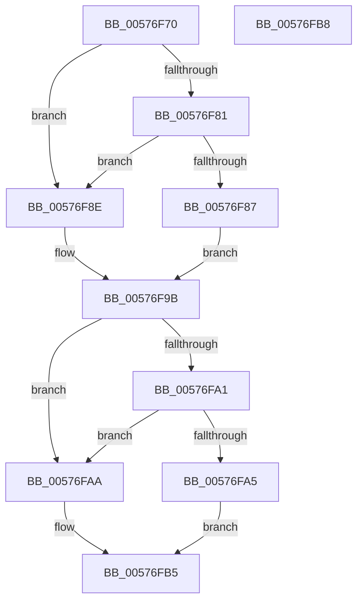

# XmDaaOp

- RVA: `0x00576F70`–`0x00576FB9` (길이 `73` bytes)
- VA: `0x0000000140576F70`
- 실행 섹션: `.text`
- PDB 이름 있음: `예`; PDB Function 태그: `아니요`
- unwind 정보 RVA: `0x000DB714`
- 디코드: `28`개 명령, `73/73` bytes 표시
- 미해석 바이트: `0` (있으면 어셈블리에 `.byte`로 보존)

> 이 문서는 커널 이미지의 기계어와 PDB 기호를 분석해 생성했습니다. 4번과 5번은 함수 원형과 자료형을 바이너리 사용 방식에서 추정한 C 해석이며 원본 소스 복구 결과는 아닙니다.

## 1. Dependencies

- 직접 호출 지점: **0**; 고유 호출 대상: **0**
- 직접 호출자로 확인된 함수: **0**
- RIP 상대 이미지 참조: **0**

### Outgoing calls
- 직접 디코드된 call 명령이 없습니다.

### Direct callers
- 이 함수 시작 RVA로 연결되는 직접 call은 확인되지 않았습니다. 간접 호출은 완전히 역산할 수 없습니다.

### Static image references
- 디코드된 RIP-relative 메모리 참조가 없습니다.

## 2. Other-region calls and transfers

- 다른 실행 섹션으로 향하는 call: **0**
- 별도 외부 분기/꼬리 이동을 확인하지 못했습니다.

## 3. Assembly (complete function range)

```asm
00576F70  44 8A 41 18                     mov r8b, byte ptr [rcx + 0x18]
00576F74  48 8D 51 10                     lea rdx, [rcx + 0x10]
00576F78  41 8A C0                        mov al, r8b
00576F7B  24 0F                           and al, 0xf
00576F7D  3C 09                           cmp al, 9
00576F7F  77 0D                           ja 0x140576f8e
00576F81  8B 02                           mov eax, dword ptr [rdx]
00576F83  A8 10                           test al, 0x10
00576F85  75 07                           jne 0x140576f8e
00576F87  83 E0 EF                        and eax, 0xffffffef
00576F8A  89 02                           mov dword ptr [rdx], eax
00576F8C  EB 0D                           jmp 0x140576f9b
00576F8E  41 80 C0 06                     add r8b, 6
00576F92  83 0A 10                        or dword ptr [rdx], 0x10
00576F95  8B 02                           mov eax, dword ptr [rdx]
00576F97  44 88 41 18                     mov byte ptr [rcx + 0x18], r8b
00576F9B  41 80 F8 09                     cmp r8b, 9
00576F9F  77 09                           ja 0x140576faa
00576FA1  A8 01                           test al, 1
00576FA3  75 05                           jne 0x140576faa
00576FA5  83 E0 FE                        and eax, 0xfffffffe
00576FA8  EB 0B                           jmp 0x140576fb5
00576FAA  41 80 C0 60                     add r8b, 0x60
00576FAE  44 88 41 18                     mov byte ptr [rcx + 0x18], r8b
00576FB2  83 C8 01                        or eax, 1
00576FB5  89 02                           mov dword ptr [rdx], eax
00576FB7  C3                              ret
00576FB8  CC                              int3
```

## 4. C-style interpretation (structured pseudocode)

```c
__int64 __fastcall XmDaaOp(__int64 a1)
{
    __int64 result;

    result = (unsigned __int8)(((unsigned __int8)(*(unsigned __int8 *)(a1 + 24))) & (15));
    if (((unsigned __int8)(result)) > 9) goto loc_00576F8E;
    if ((((unsigned __int8)((unsigned int)(*(unsigned int *)(a1 + 16)))) & (16)) != 0) goto loc_00576F8E;
    result = (unsigned int)(((unsigned int)(*(unsigned int *)(a1 + 16))) & (0xFFFFFFEFULL));
    *(unsigned int *)(a1 + 16) = (unsigned int)(result);
    goto loc_00576F9B;
loc_00576F8E:
    a3 = (unsigned __int8)((*(unsigned __int8 *)(a1 + 24)) + (6));
    *(unsigned __int8 *)(a1 + 24) = (unsigned __int8)(a3);
loc_00576F9B:
    if (((unsigned __int8)(a3)) > 9) goto loc_00576FAA;
    if ((((unsigned __int8)((unsigned int)(*(unsigned int *)(a1 + 16)))) & (1)) != 0) goto loc_00576FAA;
    result = (unsigned int)(((unsigned int)(*(unsigned int *)(a1 + 16))) & (0xFFFFFFFEULL));
    goto loc_00576FB5;
loc_00576FAA:
    a3 = (unsigned __int8)((a3) + (96));
    *(unsigned __int8 *)(a1 + 24) = (unsigned __int8)(a3);
    result = (unsigned int)((result) | (1));
loc_00576FB5:
    *(unsigned int *)(a1 + 16) = (unsigned int)(result);
    return result;
}
```

## 5. (Beta) C Style

```c
int64_t XmDaaOp(void *Arg1)
{
    uint8_t *arg1 = (uint8_t *)Arg1;

    int64_t result;

    result = (uint8_t)(((uint8_t)(*(uint8_t *)(arg1 + 0x18))) & (15));
    if (((uint8_t)(result)) > 9) goto loc_00576F8E;
    if ((((uint8_t)((uint32_t)(*(uint32_t *)(arg1 + 0x10)))) & (16)) != 0) goto loc_00576F8E;
    result = (uint32_t)(((uint32_t)(*(uint32_t *)(arg1 + 0x10))) & (0xFFFFFFEFULL));
    *(uint32_t *)(arg1 + 0x10) = (uint32_t)(result);
    goto loc_00576F9B;
loc_00576F8E:
    a3 = (uint8_t)((*(uint8_t *)(arg1 + 0x18)) + (6));
    *(uint8_t *)(arg1 + 0x18) = (uint8_t)(a3);
loc_00576F9B:
    if (((uint8_t)(a3)) > 9) goto loc_00576FAA;
    if ((((uint8_t)((uint32_t)(*(uint32_t *)(arg1 + 0x10)))) & (1)) != 0) goto loc_00576FAA;
    result = (uint32_t)(((uint32_t)(*(uint32_t *)(arg1 + 0x10))) & (0xFFFFFFFEULL));
    goto loc_00576FB5;
loc_00576FAA:
    a3 = (uint8_t)((a3) + (96));
    *(uint8_t *)(arg1 + 0x18) = (uint8_t)(a3);
    result = (uint32_t)((result) | (1));
loc_00576FB5:
    *(uint32_t *)(arg1 + 0x10) = (uint32_t)(result);
    return result;
}
```

### 관측된 메모리 오프셋

구조체 형식이 확인되지 않은 접근은 인자 기준의 오프셋으로만 기록했습니다.

| 기준 인자 | 오프셋 표현 | 폭 (bit) | 접근 |
|---|---:|---:|---|
| `Arg1` | `+ 0x0` | `32` | `R` |
| `Arg1` | `+ 0x0` | `32` | `R/W` |
| `Arg1` | `+ 0x0` | `32` | `W` |
| `Arg1` | `+ 0x10` | `64` | `R` |
| `Arg1` | `+ 0x18` | `8` | `R` |
| `Arg1` | `+ 0x18` | `8` | `W` |

## 6. Execution-region graph

[열기: 2D/3D 그래프와 함수 탐색 컨트롤 패널](../../../control-panel.html?section=text&rva=0x00576F70&view=graph)

- 2D 그래프는 위에서 아래로 흐르고, 3D 그래프는 빈 공간을 드래그해 회전합니다. Shift+드래그는 이동, 휠은 확대·축소, 함수 노드 선택은 대상 보고서 이동입니다.

### Static fallback


