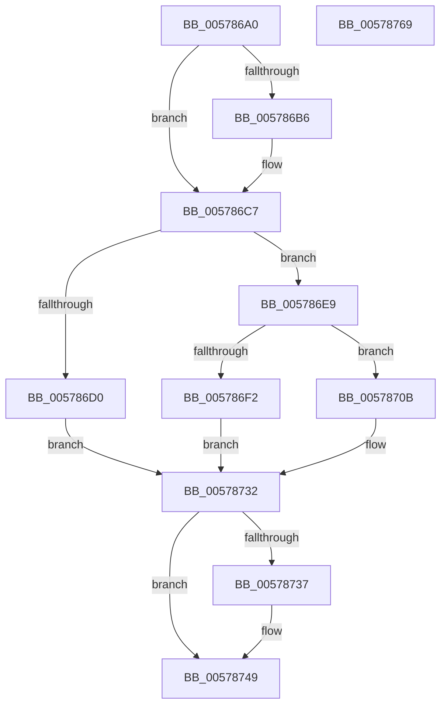

# XmDivOp

- RVA: `0x005786A0`–`0x0057876A` (길이 `202` bytes)
- VA: `0x00000001405786A0`
- 실행 섹션: `.text`
- PDB 이름 있음: `예`; PDB Function 태그: `아니요`
- unwind 정보 RVA: `0x00068D5C`
- 디코드: `63`개 명령, `202/202` bytes 표시
- 미해석 바이트: `0` (있으면 어셈블리에 `.byte`로 보존)

> 이 문서는 커널 이미지의 기계어와 PDB 기호를 분석해 생성했습니다. 4번과 5번은 함수 원형과 자료형을 바이너리 사용 방식에서 추정한 C 해석이며 원본 소스 복구 결과는 아닙니다.

## 1. Dependencies

- 직접 호출 지점: **4**; 고유 호출 대상: **2**
- 직접 호출자로 확인된 함수: **0**
- RIP 상대 이미지 참조: **0**

### Outgoing calls
- `0x005786C1` → [longjmp](../4F/longjmp_function_004FD5F0.md) (function, `0x004FD5F0`)
- `0x00578743` → [longjmp](../4F/longjmp_function_004FD5F0.md) (function, `0x004FD5F0`)
- `0x0057874E` → [XmStoreResult](../47/XmStoreResult_function_004739FC.md) (function, `0x004739FC`)
- `0x00578759` → [XmStoreResult](../47/XmStoreResult_function_004739FC.md) (function, `0x004739FC`)

### Direct callers
- 이 함수 시작 RVA로 연결되는 직접 call은 확인되지 않았습니다. 간접 호출은 완전히 역산할 수 없습니다.

### Static image references
- 디코드된 RIP-relative 메모리 참조가 없습니다.

## 2. Other-region calls and transfers

- 다른 실행 섹션으로 향하는 call: **0**
- 별도 외부 분기/꼬리 이동을 확인하지 못했습니다.

## 3. Assembly (complete function range)

```asm
005786A0  48 89 5C 24 10                  mov qword ptr [rsp + 0x10], rbx
005786A5  57                              push rdi
005786A6  48 83 EC 20                     sub rsp, 0x20
005786AA  44 8B 41 6C                     mov r8d, dword ptr [rcx + 0x6c]
005786AE  4C 8B C9                        mov r9, rcx
005786B1  45 85 C0                        test r8d, r8d
005786B4  75 11                           jne 0x1405786c7
005786B6  48 81 C1 A0 00 00 00            add rcx, 0xa0
005786BD  41 8D 50 02                     lea edx, [r8 + 2]
005786C1  E8 2A 4F F8 FF                  call 0x1404fd5f0
005786C6  CC                              int3
005786C7  8B 41 78                        mov eax, dword ptr [rcx + 0x78]
005786CA  33 D2                           xor edx, edx
005786CC  85 C0                           test eax, eax
005786CE  75 19                           jne 0x1405786e9
005786D0  44 0F B7 51 18                  movzx r10d, word ptr [rcx + 0x18]
005786D5  4C 8D 59 19                     lea r11, [rcx + 0x19]
005786D9  41 8B C2                        mov eax, r10d
005786DC  41 F7 F0                        div r8d
005786DF  41 C1 EA 08                     shr r10d, 8
005786E3  8B FA                           mov edi, edx
005786E5  8B D8                           mov ebx, eax
005786E7  EB 49                           jmp 0x140578732
005786E9  4C 8D 59 20                     lea r11, [rcx + 0x20]
005786ED  83 F8 01                        cmp eax, 1
005786F0  75 19                           jne 0x14057870b
005786F2  45 0F B7 13                     movzx r10d, word ptr [r11]
005786F6  0F B7 49 18                     movzx ecx, word ptr [rcx + 0x18]
005786FA  41 8B C2                        mov eax, r10d
005786FD  C1 E0 10                        shl eax, 0x10
00578700  0B C1                           or eax, ecx
00578702  41 F7 F0                        div r8d
00578705  8B FA                           mov edi, edx
00578707  8B D8                           mov ebx, eax
00578709  EB 27                           jmp 0x140578732
0057870B  8B 41 18                        mov eax, dword ptr [rcx + 0x18]
0057870E  45 8B 13                        mov r10d, dword ptr [r11]
00578711  89 44 24 30                     mov dword ptr [rsp + 0x30], eax
00578715  44 89 54 24 34                  mov dword ptr [rsp + 0x34], r10d
0057871A  48 8B 44 24 30                  mov rax, qword ptr [rsp + 0x30]
0057871F  49 F7 F0                        div r8
00578722  33 D2                           xor edx, edx
00578724  48 8B D8                        mov rbx, rax
00578727  48 8B 44 24 30                  mov rax, qword ptr [rsp + 0x30]
0057872C  49 F7 F0                        div r8
0057872F  48 8B FA                        mov rdi, rdx
00578732  45 3B D0                        cmp r10d, r8d
00578735  72 12                           jb 0x140578749
00578737  49 8D 89 A0 00 00 00            lea rcx, [r9 + 0xa0]
0057873E  BA 03 00 00 00                  mov edx, 3
00578743  E8 A8 4E F8 FF                  call 0x1404fd5f0
00578748  CC                              int3
00578749  8B D3                           mov edx, ebx
0057874B  49 8B C9                        mov rcx, r9
0057874E  E8 A9 B2 EF FF                  call 0x1404739fc
00578753  8B D7                           mov edx, edi
00578755  4D 89 59 58                     mov qword ptr [r9 + 0x58], r11
00578759  E8 9E B2 EF FF                  call 0x1404739fc
0057875E  48 8B 5C 24 38                  mov rbx, qword ptr [rsp + 0x38]
00578763  48 83 C4 20                     add rsp, 0x20
00578767  5F                              pop rdi
00578768  C3                              ret
00578769  CC                              int3
```

## 4. C-style interpretation (structured pseudocode)

```c
__int64 __fastcall XmDivOp(__int64 a1)
{
    __int64 result;
    __int64 v_r10;
    __int64 v_rsp;
    unsigned __int64 v_stack_p10;
    unsigned int v_stack_p8;
    unsigned int v_stack_pC;

    v_stack_p10 = v_rbx;
    v_rsp = (v_rsp) - (32);
    if ((unsigned int)((unsigned int)(*(unsigned int *)(a1 + 108))) == 0) {
        a1 = (a1) + (160);
        a2 = (unsigned int)(*(unsigned int *)(a1 + 108)) + 2;
        result = longjmp(a1, a2, (unsigned int)(*(unsigned int *)(a1 + 108)), a1);
    }
    a2 = 0;
    if ((unsigned int)((unsigned int)(*(unsigned int *)(a1 + 120))) != 0) goto loc_005786E9;
    v_r10 = (unsigned int)((*(unsigned __int16 *)(a1 + 24)) >> (8));
    goto loc_00578732;
loc_005786E9:
    if (((unsigned int)((unsigned int)((unsigned int)(*(unsigned __int16 *)(a1 + 24))))) != 1) goto loc_0057870B;
    result = (unsigned int)(((unsigned int)((unsigned int)(*(unsigned __int16 *)(a1 + 32)))) << (16));
    result = (unsigned int)((result) | ((unsigned int)(*(unsigned __int16 *)(a1 + 24))));
    goto loc_00578732;
loc_0057870B:
    v_stack_p8 = (unsigned int)((unsigned int)(*(unsigned int *)(*(unsigned __int16 *)(a1 + 24) + 24)));
    v_stack_pC = (unsigned int)((unsigned int)(*(unsigned int *)(a1 + 32)));
    a2 = 0;
loc_00578732:
    result = v_stack_p8;
    if (((unsigned int)((unsigned int)(*(unsigned int *)(a1 + 32)))) >= ((unsigned int)((unsigned int)(*(unsigned int *)(a1 + 108))))) {
        a1 = a1 + 160;
        a2 = 3;
        result = longjmp(a1, a2, (unsigned int)(*(unsigned int *)(a1 + 108)), a1);
    }
    result = XmStoreResult(a1, (unsigned int)((unsigned int)(v_stack_p8)), (unsigned int)(*(unsigned int *)(a1 + 108)), a1);
    *(unsigned __int64 *)(a1 + 88) = a1 + 32;
    result = XmStoreResult(a1, 0, (unsigned int)(*(unsigned int *)(a1 + 108)), a1);
    v_rsp = (v_rsp) + (32);
    return result;
}
```

## 5. (Beta) C Style

```c
int64_t XmDivOp(void *Arg1)
{
    uint8_t *arg1 = (uint8_t *)Arg1;

    int64_t result;
    int64_t local_r10;
    int64_t local_rsp;
    uint64_t v_stack_p10;
    uint32_t v_stack_p8;
    uint32_t v_stack_pC;

    v_stack_p10 = local_rbx;
    local_rsp = (local_rsp) - (32);
    if ((uint32_t)((uint32_t)(*(uint32_t *)(arg1 + 0x6C))) == 0) {
        Arg1 = (Arg1) + (160);
        a2 = (uint32_t)(*(uint32_t *)(arg1 + 0x6C)) + 2;
        result = longjmp(Arg1, a2, (uint32_t)(*(uint32_t *)(arg1 + 0x6C)), Arg1);
    }
    a2 = 0;
    if ((uint32_t)((uint32_t)(*(uint32_t *)(arg1 + 0x78))) != 0) goto loc_005786E9;
    local_r10 = (uint32_t)((*(uint16_t *)(arg1 + 0x18)) >> (8));
    goto loc_00578732;
loc_005786E9:
    if (((uint32_t)((uint32_t)((uint32_t)(*(uint16_t *)(arg1 + 0x18))))) != 1) goto loc_0057870B;
    result = (uint32_t)(((uint32_t)((uint32_t)(*(uint16_t *)(arg1 + 0x20)))) << (16));
    result = (uint32_t)((result) | ((uint32_t)(*(uint16_t *)(arg1 + 0x18))));
    goto loc_00578732;
loc_0057870B:
    v_stack_p8 = (uint32_t)((uint32_t)(*(uint32_t *)(*(uint16_t *)(arg1 + 0x18) + 0x18)));
    v_stack_pC = (uint32_t)((uint32_t)(*(uint32_t *)(arg1 + 0x20)));
    a2 = 0;
loc_00578732:
    result = v_stack_p8;
    if (((uint32_t)((uint32_t)(*(uint32_t *)(arg1 + 0x20)))) >= ((uint32_t)((uint32_t)(*(uint32_t *)(arg1 + 0x6C))))) {
        Arg1 = Arg1 + 160;
        a2 = 3;
        result = longjmp(Arg1, a2, (uint32_t)(*(uint32_t *)(arg1 + 0x6C)), Arg1);
    }
    result = XmStoreResult(Arg1, (uint32_t)((uint32_t)(v_stack_p8)), (uint32_t)(*(uint32_t *)(arg1 + 0x6C)), Arg1);
    *(void **)(arg1 + 0x58) = Arg1 + 32;
    result = XmStoreResult(Arg1, 0, (uint32_t)(*(uint32_t *)(arg1 + 0x6C)), Arg1);
    local_rsp = (local_rsp) + (32);
    return result;
}
```

### 관측된 메모리 오프셋

구조체 형식이 확인되지 않은 접근은 인자 기준의 오프셋으로만 기록했습니다.

| 기준 인자 | 오프셋 표현 | 폭 (bit) | 접근 |
|---|---:|---:|---|
| `Arg1` | `+ 0x6C` | `32` | `R` |

## 6. Execution-region graph

[열기: 2D/3D 그래프와 함수 탐색 컨트롤 패널](../../../control-panel.html?section=text&rva=0x005786A0&view=graph)

- 2D 그래프는 위에서 아래로 흐르고, 3D 그래프는 빈 공간을 드래그해 회전합니다. Shift+드래그는 이동, 휠은 확대·축소, 함수 노드 선택은 대상 보고서 이동입니다.

### Static fallback


