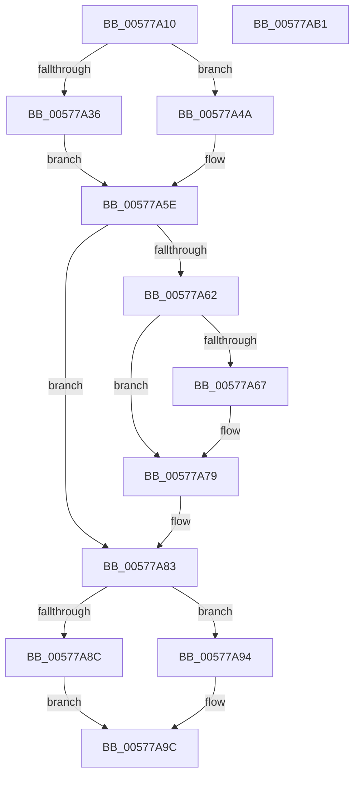

# XmEnterOp

- RVA: `0x00577A10`–`0x00577AB2` (길이 `162` bytes)
- VA: `0x0000000140577A10`
- 실행 섹션: `.text`
- PDB 이름 있음: `예`; PDB Function 태그: `아니요`
- unwind 정보 RVA: `0x0005C954`
- 디코드: `44`개 명령, `162/162` bytes 표시
- 미해석 바이트: `0` (있으면 어셈블리에 `.byte`로 보존)

> 이 문서는 커널 이미지의 기계어와 PDB 기호를 분석해 생성했습니다. 4번과 5번은 함수 원형과 자료형을 바이너리 사용 방식에서 추정한 C 해석이며 원본 소스 복구 결과는 아닙니다.

## 1. Dependencies

- 직접 호출 지점: **4**; 고유 호출 대상: **2**
- 직접 호출자로 확인된 함수: **0**
- RIP 상대 이미지 참조: **0**

### Outgoing calls
- `0x00577A40` → [XmPushStack](../47/XmPushStack_function_00473088.md) (function, `0x00473088`)
- `0x00577A55` → [XmPushStack](../47/XmPushStack_function_00473088.md) (function, `0x00473088`)
- `0x00577A73` → [longjmp](../4F/longjmp_function_004FD5F0.md) (function, `0x004FD5F0`)
- `0x00577A7E` → [XmPushStack](../47/XmPushStack_function_00473088.md) (function, `0x00473088`)

### Direct callers
- 이 함수 시작 RVA로 연결되는 직접 call은 확인되지 않았습니다. 간접 호출은 완전히 역산할 수 없습니다.

### Static image references
- 디코드된 RIP-relative 메모리 참조가 없습니다.

## 2. Other-region calls and transfers

- 다른 실행 섹션으로 향하는 call: **0**
- 별도 외부 분기/꼬리 이동을 확인하지 못했습니다.

## 3. Assembly (complete function range)

```asm
00577A10  48 89 5C 24 08                  mov qword ptr [rsp + 8], rbx
00577A15  48 89 6C 24 10                  mov qword ptr [rsp + 0x10], rbp
00577A1A  48 89 74 24 18                  mov qword ptr [rsp + 0x18], rsi
00577A1F  57                              push rdi
00577A20  48 83 EC 20                     sub rsp, 0x20
00577A24  80 B9 8A 00 00 00 00            cmp byte ptr [rcx + 0x8a], 0
00577A2B  48 8B D9                        mov rbx, rcx
00577A2E  8B 71 6C                        mov esi, dword ptr [rcx + 0x6c]
00577A31  8B 69 68                        mov ebp, dword ptr [rcx + 0x68]
00577A34  74 14                           je 0x140577a4a
00577A36  C7 41 78 03 00 00 00            mov dword ptr [rcx + 0x78], 3
00577A3D  8B 51 2C                        mov edx, dword ptr [rcx + 0x2c]
00577A40  E8 43 B6 EF FF                  call 0x140473088
00577A45  8B 7B 28                        mov edi, dword ptr [rbx + 0x28]
00577A48  EB 14                           jmp 0x140577a5e
00577A4A  C7 41 78 01 00 00 00            mov dword ptr [rcx + 0x78], 1
00577A51  0F B7 51 2C                     movzx edx, word ptr [rcx + 0x2c]
00577A55  E8 2E B6 EF FF                  call 0x140473088
00577A5A  0F B7 7B 28                     movzx edi, word ptr [rbx + 0x28]
00577A5E  85 ED                           test ebp, ebp
00577A60  74 21                           je 0x140577a83
00577A62  83 FD 01                        cmp ebp, 1
00577A65  74 12                           je 0x140577a79
00577A67  48 8D 8B A0 00 00 00            lea rcx, [rbx + 0xa0]
00577A6E  BA 08 00 00 00                  mov edx, 8
00577A73  E8 78 5B F8 FF                  call 0x1404fd5f0
00577A78  CC                              int3
00577A79  8B D7                           mov edx, edi
00577A7B  48 8B CB                        mov rcx, rbx
00577A7E  E8 05 B6 EF FF                  call 0x140473088
00577A83  80 BB 8A 00 00 00 00            cmp byte ptr [rbx + 0x8a], 0
00577A8A  74 08                           je 0x140577a94
00577A8C  29 73 28                        sub dword ptr [rbx + 0x28], esi
00577A8F  89 7B 2C                        mov dword ptr [rbx + 0x2c], edi
00577A92  EB 08                           jmp 0x140577a9c
00577A94  66 29 73 28                     sub word ptr [rbx + 0x28], si
00577A98  66 89 7B 2C                     mov word ptr [rbx + 0x2c], di
00577A9C  48 8B 5C 24 30                  mov rbx, qword ptr [rsp + 0x30]
00577AA1  48 8B 6C 24 38                  mov rbp, qword ptr [rsp + 0x38]
00577AA6  48 8B 74 24 40                  mov rsi, qword ptr [rsp + 0x40]
00577AAB  48 83 C4 20                     add rsp, 0x20
00577AAF  5F                              pop rdi
00577AB0  C3                              ret
00577AB1  CC                              int3
```

## 4. C-style interpretation (structured pseudocode)

```c
__int64 __fastcall XmEnterOp(__int64 a1)
{
    __int64 result;
    __int64 v_rsp;
    unsigned __int64 v_stack_p10;
    unsigned __int64 v_stack_p18;
    unsigned __int64 v_stack_p8;

    v_stack_p8 = v_rbx;
    v_stack_p10 = v_rbp;
    v_stack_p18 = v_rsi;
    v_rsp = (v_rsp) - (32);
    if ((*(unsigned __int8 *)(a1 + 138)) == 0) goto loc_00577A4A;
    *(unsigned int *)(a1 + 120) = 3;
    result = XmPushStack(a1, (unsigned int)(*(unsigned int *)(a1 + 44)), a3, a4);
    goto loc_00577A5E;
loc_00577A4A:
    *(unsigned int *)(a1 + 120) = 1;
    result = XmPushStack(a1, *(unsigned __int16 *)(a1 + 44), a3, a4);
loc_00577A5E:
    if ((unsigned int)((unsigned int)(*(unsigned int *)(a1 + 104))) == 0) goto loc_00577A83;
    if (((unsigned int)((unsigned int)(*(unsigned int *)(a1 + 104)))) != 1) {
        a1 = a1 + 160;
        a2 = 8;
        result = longjmp(a1, a2, a3, a4);
    }
    result = XmPushStack(a1, (unsigned int)((unsigned int)(*(unsigned __int16 *)(a1 + 40))), a3, a4);
loc_00577A83:
    if ((*(unsigned __int8 *)(a1 + 138)) == 0) goto loc_00577A94;
    *(unsigned int *)(a1 + 44) = (unsigned int)(*(unsigned __int16 *)(a1 + 40));
    goto loc_00577A9C;
loc_00577A94:
    *(unsigned __int16 *)(a1 + 44) = (unsigned __int16)(*(unsigned __int16 *)(a1 + 40));
loc_00577A9C:
    v_rsp = (v_rsp) + (32);
    return result;
}
```

## 5. (Beta) C Style

```c
int64_t XmEnterOp(void *Arg1)
{
    uint8_t *arg1 = (uint8_t *)Arg1;

    int64_t result;
    int64_t local_rsp;
    uint64_t v_stack_p10;
    uint64_t v_stack_p18;
    uint64_t v_stack_p8;

    v_stack_p8 = local_rbx;
    v_stack_p10 = local_rbp;
    v_stack_p18 = local_rsi;
    local_rsp = (local_rsp) - (32);
    if ((*(uint8_t *)(arg1 + 0x8A)) == 0) goto loc_00577A4A;
    *(uint32_t *)(arg1 + 0x78) = 3;
    result = XmPushStack(Arg1, (uint32_t)(*(uint32_t *)(arg1 + 0x2C)), a3, a4);
    goto loc_00577A5E;
loc_00577A4A:
    *(uint32_t *)(arg1 + 0x78) = 1;
    result = XmPushStack(Arg1, *(uint16_t *)(arg1 + 0x2C), a3, a4);
loc_00577A5E:
    if ((uint32_t)((uint32_t)(*(uint32_t *)(arg1 + 0x68))) == 0) goto loc_00577A83;
    if (((uint32_t)((uint32_t)(*(uint32_t *)(arg1 + 0x68)))) != 1) {
        Arg1 = Arg1 + 160;
        a2 = 8;
        result = longjmp(Arg1, a2, a3, a4);
    }
    result = XmPushStack(Arg1, (uint32_t)((uint32_t)(*(uint16_t *)(arg1 + 0x28))), a3, a4);
loc_00577A83:
    if ((*(uint8_t *)(arg1 + 0x8A)) == 0) goto loc_00577A94;
    *(uint32_t *)(arg1 + 0x2C) = (uint32_t)(*(uint16_t *)(arg1 + 0x28));
    goto loc_00577A9C;
loc_00577A94:
    *(uint16_t *)(arg1 + 0x2C) = (uint16_t)(*(uint16_t *)(arg1 + 0x28));
loc_00577A9C:
    local_rsp = (local_rsp) + (32);
    return result;
}
```

### 관측된 메모리 오프셋

구조체 형식이 확인되지 않은 접근은 인자 기준의 오프셋으로만 기록했습니다.

| 기준 인자 | 오프셋 표현 | 폭 (bit) | 접근 |
|---|---:|---:|---|
| `Arg1` | `+ 0x28` | `16` | `R` |
| `Arg1` | `+ 0x28` | `16` | `R/W` |
| `Arg1` | `+ 0x28` | `32` | `R` |
| `Arg1` | `+ 0x28` | `32` | `R/W` |
| `Arg1` | `+ 0x2C` | `16` | `R` |
| `Arg1` | `+ 0x2C` | `16` | `W` |
| `Arg1` | `+ 0x2C` | `32` | `R` |
| `Arg1` | `+ 0x2C` | `32` | `W` |
| `Arg1` | `+ 0x68` | `32` | `R` |
| `Arg1` | `+ 0x6C` | `32` | `R` |
| `Arg1` | `+ 0x78` | `32` | `W` |
| `Arg1` | `+ 0x8A` | `8` | `R` |
| `Arg1` | `+ 0xA0` | `64` | `R` |

## 6. Execution-region graph

[열기: 2D/3D 그래프와 함수 탐색 컨트롤 패널](../../../control-panel.html?section=text&rva=0x00577A10&view=graph)

- 2D 그래프는 위에서 아래로 흐르고, 3D 그래프는 빈 공간을 드래그해 회전합니다. Shift+드래그는 이동, 휠은 확대·축소, 함수 노드 선택은 대상 보고서 이동입니다.

### Static fallback


