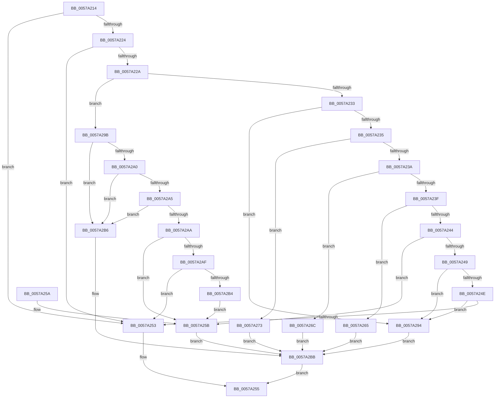

# XmExecuteInt1a

- RVA: `0x0057A214`–`0x0057A2BF` (길이 `171` bytes)
- VA: `0x000000014057A214`
- 실행 섹션: `.text`
- PDB 이름 있음: `예`; PDB Function 태그: `아니요`
- unwind 정보 RVA: `0x000C560C`
- 디코드: `56`개 명령, `171/171` bytes 표시
- 미해석 바이트: `0` (있으면 어셈블리에 `.byte`로 보존)

> 이 문서는 커널 이미지의 기계어와 PDB 기호를 분석해 생성했습니다. 4번과 5번은 함수 원형과 자료형을 바이너리 사용 방식에서 추정한 C 해석이며 원본 소스 복구 결과는 아닙니다.

## 1. Dependencies

- 직접 호출 지점: **4**; 고유 호출 대상: **4**
- 직접 호출자로 확인된 함수: **1**
- RIP 상대 이미지 참조: **2**

### Outgoing calls
- `0x0057A265` → [XmInt1aFindPciClassCode](XmInt1aFindPciClassCode_function_0057A2C8.md) (function, `0x0057A2C8`)
- `0x0057A26C` → [XmInt1aFindPciDevice](XmInt1aFindPciDevice_function_0057A3D4.md) (function, `0x0057A3D4`)
- `0x0057A294` → [XmInt1aReadConfigRegister](XmInt1aReadConfigRegister_function_0057A4EC.md) (function, `0x0057A4EC`)
- `0x0057A2B6` → [XmInt1aWriteConfigRegister](XmInt1aWriteConfigRegister_function_0057A5D8.md) (function, `0x0057A5D8`)

### Direct callers
- [XmIntOp](XmIntOp_function_00577AE0.md) at `0x00577B35`

### Static image references
- `0x0057A21B` → RVA `0x00E10328` (`.data`; read)
- `0x0057A273` → RVA `0x00E10337` (`.data`; read)

## 2. Other-region calls and transfers

- 다른 실행 섹션으로 향하는 call: **0**
- 별도 외부 분기/꼬리 이동을 확인하지 못했습니다.

## 3. Assembly (complete function range)

```asm
0057A214  48 83 EC 28                     sub rsp, 0x28
0057A218  45 33 C0                        xor r8d, r8d
0057A21B  44 38 05 06 61 89 00            cmp byte ptr [rip + 0x896106], r8b
0057A222  74 2F                           je 0x14057a253
0057A224  80 79 19 B1                     cmp byte ptr [rcx + 0x19], 0xb1
0057A228  75 29                           jne 0x14057a253
0057A22A  0F B6 51 18                     movzx edx, byte ptr [rcx + 0x18]
0057A22E  83 FA 0A                        cmp edx, 0xa
0057A231  77 68                           ja 0x14057a29b
0057A233  74 5F                           je 0x14057a294
0057A235  83 EA 01                        sub edx, 1
0057A238  74 39                           je 0x14057a273
0057A23A  83 EA 01                        sub edx, 1
0057A23D  74 2D                           je 0x14057a26c
0057A23F  83 EA 01                        sub edx, 1
0057A242  74 21                           je 0x14057a265
0057A244  83 EA 03                        sub edx, 3
0057A247  74 12                           je 0x14057a25b
0057A249  83 EA 02                        sub edx, 2
0057A24C  74 46                           je 0x14057a294
0057A24E  83 FA 01                        cmp edx, 1
0057A251  74 41                           je 0x14057a294
0057A253  32 C0                           xor al, al
0057A255  48 83 C4 28                     add rsp, 0x28
0057A259  C3                              ret
0057A25A  CC                              int3
0057A25B  83 49 10 01                     or dword ptr [rcx + 0x10], 1
0057A25F  C6 41 19 81                     mov byte ptr [rcx + 0x19], 0x81
0057A263  EB 56                           jmp 0x14057a2bb
0057A265  E8 5E 00 00 00                  call 0x14057a2c8
0057A26A  EB 4F                           jmp 0x14057a2bb
0057A26C  E8 63 01 00 00                  call 0x14057a3d4
0057A271  EB 48                           jmp 0x14057a2bb
0057A273  8A 05 BE 60 89 00               mov al, byte ptr [rip + 0x8960be]
0057A279  83 61 10 FE                     and dword ptr [rcx + 0x10], 0xfffffffe
0057A27D  88 41 1C                        mov byte ptr [rcx + 0x1c], al
0057A280  C7 41 20 50 43 49 20            mov dword ptr [rcx + 0x20], 0x20494350
0057A287  66 44 89 41 18                  mov word ptr [rcx + 0x18], r8w
0057A28C  66 C7 41 24 10 02               mov word ptr [rcx + 0x24], 0x210
0057A292  EB 27                           jmp 0x14057a2bb
0057A294  E8 53 02 00 00                  call 0x14057a4ec
0057A299  EB 20                           jmp 0x14057a2bb
0057A29B  83 EA 0B                        sub edx, 0xb
0057A29E  74 16                           je 0x14057a2b6
0057A2A0  83 EA 01                        sub edx, 1
0057A2A3  74 11                           je 0x14057a2b6
0057A2A5  83 EA 01                        sub edx, 1
0057A2A8  74 0C                           je 0x14057a2b6
0057A2AA  83 EA 01                        sub edx, 1
0057A2AD  74 AC                           je 0x14057a25b
0057A2AF  83 FA 01                        cmp edx, 1
0057A2B2  75 9F                           jne 0x14057a253
0057A2B4  EB A5                           jmp 0x14057a25b
0057A2B6  E8 1D 03 00 00                  call 0x14057a5d8
0057A2BB  B0 01                           mov al, 1
0057A2BD  EB 96                           jmp 0x14057a255
```

## 4. C-style interpretation (structured pseudocode)

```c
__int64 __fastcall XmExecuteInt1a(__int64 a1, __int64 a2, int a3)
{
    __int64 result;
    __int64 v_rsp;

    v_rsp = (v_rsp) - (40);
    a3 = 0;
    if ((*(unsigned __int8 *)(v_rip + 9003270)) == 0) goto loc_0057A253;
    if ((*(unsigned __int8 *)(a1 + 25)) != 177) goto loc_0057A253;
    if (((unsigned int)(*(unsigned __int8 *)(a1 + 24))) > 10) goto loc_0057A29B;
    if (((unsigned int)(*(unsigned __int8 *)(a1 + 24))) == 10) goto loc_0057A294;
    a2 = (unsigned int)((*(unsigned __int8 *)(a1 + 24)) - (1));
    if (condition_is_equal) goto loc_0057A273;
    a2 = (unsigned int)((a2) - (1));
    if (condition_is_equal) goto loc_0057A26C;
    a2 = (unsigned int)((a2) - (1));
    if (condition_is_equal) goto loc_0057A265;
    a2 = (unsigned int)((a2) - (3));
    if (condition_is_equal) goto loc_0057A25B;
    a2 = (unsigned int)((a2) - (2));
    if (condition_is_equal) goto loc_0057A294;
    if (((unsigned int)(a2)) == 1) goto loc_0057A294;
loc_0057A253:
    result = 0;
loc_0057A255:
    v_rsp = (v_rsp) + (40);
    return result;
loc_0057A25B:
    *(unsigned __int8 *)(a1 + 25) = 129;
    goto loc_0057A2BB;
loc_0057A265:
    result = XmInt1aFindPciClassCode(a1, a2, a3, a4);
    goto loc_0057A2BB;
loc_0057A26C:
    result = XmInt1aFindPciDevice(a1, a2, a3, a4);
    goto loc_0057A2BB;
loc_0057A273:
    *(unsigned __int8 *)(a1 + 28) = (unsigned __int8)(*(unsigned __int8 *)(v_rip + 9003198));
    *(unsigned int *)(a1 + 32) = 0x20494350ULL;
    *(unsigned __int16 *)(a1 + 24) = 0;
    *(unsigned __int16 *)(a1 + 36) = 528;
    goto loc_0057A2BB;
loc_0057A294:
    result = XmInt1aReadConfigRegister(a1, a2, a3, a4);
    goto loc_0057A2BB;
loc_0057A29B:
    a2 = (unsigned int)((a2) - (11));
    if (condition_is_equal) goto loc_0057A2B6;
    a2 = (unsigned int)((a2) - (1));
    if (condition_is_equal) goto loc_0057A2B6;
    a2 = (unsigned int)((a2) - (1));
    if (condition_is_equal) goto loc_0057A2B6;
    a2 = (unsigned int)((a2) - (1));
    if (condition_is_equal) goto loc_0057A25B;
    if (((unsigned int)(a2)) != 1) goto loc_0057A253;
    goto loc_0057A25B;
loc_0057A2B6:
    result = XmInt1aWriteConfigRegister(a1, a2, a3, a4);
loc_0057A2BB:
    goto loc_0057A255;
}
```

## 5. (Beta) C Style

```c
int64_t XmExecuteInt1a(void *Arg1, int64_t Arg2, int32_t Arg3)
{
    uint8_t *arg1 = (uint8_t *)Arg1;

    int64_t result;
    int64_t local_rsp;

    local_rsp = (local_rsp) - (40);
    Arg3 = 0;
    if ((*(uint8_t *)(v_rip + 0x896106)) == 0) goto loc_0057A253;
    if ((*(uint8_t *)(arg1 + 0x19)) != 177) goto loc_0057A253;
    if (((uint32_t)(*(uint8_t *)(arg1 + 0x18))) > 10) goto loc_0057A29B;
    if (((uint32_t)(*(uint8_t *)(arg1 + 0x18))) == 10) goto loc_0057A294;
    Arg2 = (uint32_t)((*(uint8_t *)(arg1 + 0x18)) - (1));
    if (condition_is_equal) goto loc_0057A273;
    Arg2 = (uint32_t)((Arg2) - (1));
    if (condition_is_equal) goto loc_0057A26C;
    Arg2 = (uint32_t)((Arg2) - (1));
    if (condition_is_equal) goto loc_0057A265;
    Arg2 = (uint32_t)((Arg2) - (3));
    if (condition_is_equal) goto loc_0057A25B;
    Arg2 = (uint32_t)((Arg2) - (2));
    if (condition_is_equal) goto loc_0057A294;
    if (((uint32_t)(Arg2)) == 1) goto loc_0057A294;
loc_0057A253:
    result = 0;
loc_0057A255:
    local_rsp = (local_rsp) + (40);
    return result;
loc_0057A25B:
    *(uint8_t *)(arg1 + 0x19) = 129;
    goto loc_0057A2BB;
loc_0057A265:
    result = XmInt1aFindPciClassCode(Arg1, Arg2, Arg3, a4);
    goto loc_0057A2BB;
loc_0057A26C:
    result = XmInt1aFindPciDevice(Arg1, Arg2, Arg3, a4);
    goto loc_0057A2BB;
loc_0057A273:
    *(uint8_t *)(arg1 + 0x1C) = (uint8_t)(*(uint8_t *)(v_rip + 0x8960BE));
    *(uint32_t *)(arg1 + 0x20) = 0x20494350ULL;
    *(uint16_t *)(arg1 + 0x18) = 0;
    *(uint16_t *)(arg1 + 0x24) = 528;
    goto loc_0057A2BB;
loc_0057A294:
    result = XmInt1aReadConfigRegister(Arg1, Arg2, Arg3, a4);
    goto loc_0057A2BB;
loc_0057A29B:
    Arg2 = (uint32_t)((Arg2) - (11));
    if (condition_is_equal) goto loc_0057A2B6;
    Arg2 = (uint32_t)((Arg2) - (1));
    if (condition_is_equal) goto loc_0057A2B6;
    Arg2 = (uint32_t)((Arg2) - (1));
    if (condition_is_equal) goto loc_0057A2B6;
    Arg2 = (uint32_t)((Arg2) - (1));
    if (condition_is_equal) goto loc_0057A25B;
    if (((uint32_t)(Arg2)) != 1) goto loc_0057A253;
    goto loc_0057A25B;
loc_0057A2B6:
    result = XmInt1aWriteConfigRegister(Arg1, Arg2, Arg3, a4);
loc_0057A2BB:
    goto loc_0057A255;
}
```

### 관측된 메모리 오프셋

구조체 형식이 확인되지 않은 접근은 인자 기준의 오프셋으로만 기록했습니다.

| 기준 인자 | 오프셋 표현 | 폭 (bit) | 접근 |
|---|---:|---:|---|
| `Arg1` | `+ 0x10` | `32` | `R/W` |
| `Arg1` | `+ 0x18` | `8` | `R` |
| `Arg1` | `+ 0x18` | `16` | `W` |
| `Arg1` | `+ 0x19` | `8` | `R` |
| `Arg1` | `+ 0x19` | `8` | `W` |
| `Arg1` | `+ 0x1C` | `8` | `W` |
| `Arg1` | `+ 0x20` | `32` | `W` |
| `Arg1` | `+ 0x24` | `16` | `W` |

## 6. Execution-region graph

[열기: 2D/3D 그래프와 함수 탐색 컨트롤 패널](../../../control-panel.html?section=text&rva=0x0057A214&view=graph)

- 2D 그래프는 위에서 아래로 흐르고, 3D 그래프는 빈 공간을 드래그해 회전합니다. Shift+드래그는 이동, 휠은 확대·축소, 함수 노드 선택은 대상 보고서 이동입니다.

### Static fallback


