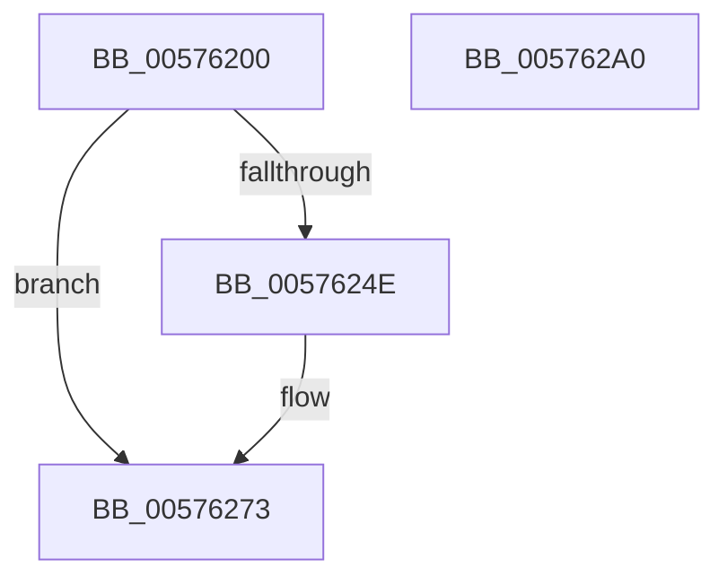

# XmGeneralBitOffset

- RVA: `0x00576200`–`0x005762A1` (길이 `161` bytes)
- VA: `0x0000000140576200`
- 실행 섹션: `.text`
- PDB 이름 있음: `예`; PDB Function 태그: `아니요`
- unwind 정보 RVA: `0x00068D5C`
- 디코드: `45`개 명령, `161/161` bytes 표시
- 미해석 바이트: `0` (있으면 어셈블리에 `.byte`로 보존)

> 이 문서는 커널 이미지의 기계어와 PDB 기호를 분석해 생성했습니다. 4번과 5번은 함수 원형과 자료형을 바이너리 사용 방식에서 추정한 C 해석이며 원본 소스 복구 결과는 아닙니다.

## 1. Dependencies

- 직접 호출 지점: **4**; 고유 호출 대상: **4**
- 직접 호출자로 확인된 함수: **0**
- RIP 상대 이미지 참조: **0**

### Outgoing calls
- `0x00576229` → [XmEvaluateAddressSpecifier](../47/XmEvaluateAddressSpecifier_function_00473224.md) (function, `0x00473224`)
- `0x00576240` → [XmSetSourceValue](../47/XmSetSourceValue_function_004737A8.md) (function, `0x004737A8`)
- `0x0057626B` → [XmGetOffsetAddress](XmGetOffsetAddress_function_00578B84.md) (function, `0x00578B84`)
- `0x0057628B` → [XmSetDestinationValue](../47/XmSetDestinationValue_function_004734EC.md) (function, `0x004734EC`)

### Direct callers
- 이 함수 시작 RVA로 연결되는 직접 call은 확인되지 않았습니다. 간접 호출은 완전히 역산할 수 없습니다.

### Static image references
- 디코드된 RIP-relative 메모리 참조가 없습니다.

## 2. Other-region calls and transfers

- 다른 실행 섹션으로 향하는 call: **0**
- 별도 외부 분기/꼬리 이동을 확인하지 못했습니다.

## 3. Assembly (complete function range)

```asm
00576200  48 89 5C 24 10                  mov qword ptr [rsp + 0x10], rbx
00576205  57                              push rdi
00576206  48 83 EC 20                     sub rsp, 0x20
0057620A  83 64 24 30 00                  and dword ptr [rsp + 0x30], 0
0057620F  48 8B D9                        mov rbx, rcx
00576212  8A 81 8A 00 00 00               mov al, byte ptr [rcx + 0x8a]
00576218  F6 D8                           neg al
0057621A  1B D2                           sbb edx, edx
0057621C  83 E2 02                        and edx, 2
0057621F  FF C2                           inc edx
00576221  89 51 78                        mov dword ptr [rcx + 0x78], edx
00576224  48 8D 54 24 30                  lea rdx, [rsp + 0x30]
00576229  E8 F6 CF EF FF                  call 0x140473224
0057622E  4C 8B C0                        mov r8, rax
00576231  48 8B CB                        mov rcx, rbx
00576234  8B 44 24 30                     mov eax, dword ptr [rsp + 0x30]
00576238  48 83 C0 06                     add rax, 6
0057623C  48 8D 14 83                     lea rdx, [rbx + rax*4]
00576240  E8 63 D5 EF FF                  call 0x1404737a8
00576245  80 BB 8E 00 00 00 00            cmp byte ptr [rbx + 0x8e], 0
0057624C  75 25                           jne 0x140576273
0057624E  83 7B 78 03                     cmp dword ptr [rbx + 0x78], 3
00576252  BA FC FF FF 1F                  mov edx, 0x1ffffffc
00576257  8D 42 02                        lea eax, [rdx + 2]
0057625A  0F 45 D0                        cmovne edx, eax
0057625D  8B 43 6C                        mov eax, dword ptr [rbx + 0x6c]
00576260  C1 E8 03                        shr eax, 3
00576263  23 D0                           and edx, eax
00576265  03 93 80 00 00 00               add edx, dword ptr [rbx + 0x80]
0057626B  E8 14 29 00 00                  call 0x140578b84
00576270  4C 8B C0                        mov r8, rax
00576273  83 7B 78 03                     cmp dword ptr [rbx + 0x78], 3
00576277  B9 1F 00 00 00                  mov ecx, 0x1f
0057627C  8D 51 F0                        lea edx, [rcx - 0x10]
0057627F  0F 45 CA                        cmovne ecx, edx
00576282  49 8B D0                        mov rdx, r8
00576285  21 4B 6C                        and dword ptr [rbx + 0x6c], ecx
00576288  48 8B CB                        mov rcx, rbx
0057628B  E8 5C D2 EF FF                  call 0x1404734ec
00576290  48 8B 5C 24 38                  mov rbx, qword ptr [rsp + 0x38]
00576295  B8 01 00 00 00                  mov eax, 1
0057629A  48 83 C4 20                     add rsp, 0x20
0057629E  5F                              pop rdi
0057629F  C3                              ret
005762A0  CC                              int3
```

## 4. C-style interpretation (structured pseudocode)

```c
__int64 __fastcall XmGeneralBitOffset(__int64 a1, int a2)
{
    __int64 result;
    __int64 v_rsp;
    unsigned __int64 v_stack_p10;
    unsigned int v_stack_p8;

    v_stack_p10 = v_rbx;
    v_rsp = (v_rsp) - (32);
    result = (unsigned __int8)(-(*(unsigned __int8 *)(a1 + 138)));
    a2 = (unsigned int)((a2) & (2));
    a2 = (unsigned int)((a2) + 1);
    *(unsigned int *)(a1 + 120) = a2;
    result = XmEvaluateAddressSpecifier(a1, v_stack_p8, a3, a4);
    result = ((unsigned int)(v_stack_p8)) + (6);
    result = XmSetSourceValue(a1, a1 + result * 4, result, a4);
    if ((*(unsigned __int8 *)(a1 + 142)) == 0) {
        a2 = 0x1FFFFFFCULL;
        result = a2 + 2;
        if ((*(unsigned int *)(a1 + 120)) != 3) { a2 = (unsigned int)(result); }
        result = *(unsigned int *)(a1 + 108);
        result = (unsigned int)((result) >> (3));
        a2 = (unsigned int)((a2) & ((unsigned int)(result)));
        a2 = (unsigned int)((a2) + (*(unsigned int *)(a1 + 128)));
        result = XmGetOffsetAddress(a1, a2, result, a4);
        a3 = result;
    }
    a1 = 31;
    if ((*(unsigned int *)(a1 + 120)) != 3) { a1 = (unsigned int)(31 - 16); }
    result = XmSetDestinationValue(a1, a3, a3, a4);
    v_rsp = (v_rsp) + (32);
    return 1;
}
```

## 5. (Beta) C Style

```c
int64_t XmGeneralBitOffset(void *Arg1, int32_t Arg2)
{
    uint8_t *arg1 = (uint8_t *)Arg1;

    int64_t result;
    int64_t local_rsp;
    uint64_t v_stack_p10;
    uint32_t v_stack_p8;

    v_stack_p10 = local_rbx;
    local_rsp = (local_rsp) - (32);
    result = (uint8_t)(-(*(uint8_t *)(arg1 + 0x8A)));
    Arg2 = (uint32_t)((Arg2) & (2));
    Arg2 = (uint32_t)((Arg2) + 1);
    *(uint32_t *)(arg1 + 0x78) = Arg2;
    result = XmEvaluateAddressSpecifier(Arg1, v_stack_p8, a3, a4);
    result = ((uint32_t)(v_stack_p8)) + (6);
    result = XmSetSourceValue(Arg1, Arg1 + result * 4, result, a4);
    if ((*(uint8_t *)(arg1 + 0x8E)) == 0) {
        Arg2 = 0x1FFFFFFCULL;
        result = Arg2 + 2;
        if ((*(uint32_t *)(arg1 + 0x78)) != 3) { Arg2 = (uint32_t)(result); }
        result = *(uint32_t *)(arg1 + 0x6C);
        result = (uint32_t)((result) >> (3));
        Arg2 = (uint32_t)((Arg2) & ((uint32_t)(result)));
        Arg2 = (uint32_t)((Arg2) + (*(uint32_t *)(arg1 + 0x80)));
        result = XmGetOffsetAddress(Arg1, Arg2, result, a4);
        a3 = result;
    }
    Arg1 = 31;
    if ((*(uint32_t *)(arg1 + 0x78)) != 3) { Arg1 = (uint32_t)(31 - 16); }
    result = XmSetDestinationValue(Arg1, a3, a3, a4);
    local_rsp = (local_rsp) + (32);
    return 1;
}
```

### 관측된 메모리 오프셋

구조체 형식이 확인되지 않은 접근은 인자 기준의 오프셋으로만 기록했습니다.

| 기준 인자 | 오프셋 표현 | 폭 (bit) | 접근 |
|---|---:|---:|---|
| `Arg1` | `+ 0x0 + rax*4` | `64` | `R` |
| `Arg1` | `+ 0x6C` | `32` | `R` |
| `Arg1` | `+ 0x6C` | `32` | `R/W` |
| `Arg1` | `+ 0x78` | `32` | `R` |
| `Arg1` | `+ 0x78` | `32` | `W` |
| `Arg1` | `+ 0x80` | `32` | `R` |
| `Arg1` | `+ 0x8A` | `8` | `R` |
| `Arg1` | `+ 0x8E` | `8` | `R` |

## 6. Execution-region graph

[열기: 2D/3D 그래프와 함수 탐색 컨트롤 패널](../../../control-panel.html?section=text&rva=0x00576200&view=graph)

- 2D 그래프는 위에서 아래로 흐르고, 3D 그래프는 빈 공간을 드래그해 회전합니다. Shift+드래그는 이동, 휠은 확대·축소, 함수 노드 선택은 대상 보고서 이동입니다.

### Static fallback


