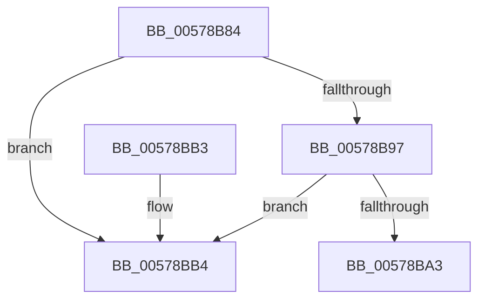

# XmGetOffsetAddress

- RVA: `0x00578B84`–`0x00578BC6` (길이 `66` bytes)
- VA: `0x0000000140578B84`
- 실행 섹션: `.text`
- PDB 이름 있음: `예`; PDB Function 태그: `아니요`
- unwind 정보 RVA: `0x0007A1AC`
- 디코드: `18`개 명령, `66/66` bytes 표시
- 미해석 바이트: `0` (있으면 어셈블리에 `.byte`로 보존)

> 이 문서는 커널 이미지의 기계어와 PDB 기호를 분석해 생성했습니다. 4번과 5번은 함수 원형과 자료형을 바이너리 사용 방식에서 추정한 C 해석이며 원본 소스 복구 결과는 아닙니다.

## 1. Dependencies

- 직접 호출 지점: **2**; 고유 호출 대상: **2**
- 직접 호출자로 확인된 함수: **7**
- RIP 상대 이미지 참조: **0**

### Outgoing calls
- `0x00578BA9` → [x86BiosTranslateAddress](../47/x86BiosTranslateAddress_function_004736C0.md) (function, `0x004736C0`)
- `0x00578BC0` → [longjmp](../4F/longjmp_function_004FD5F0.md) (function, `0x004FD5F0`)

### Direct callers
- [XmGeneralBitOffset](XmGeneralBitOffset_function_00576200.md) at `0x0057626B`
- [XmGroup8BitOffset](XmGroup8BitOffset_function_005764F0.md) at `0x00576555`
- [XmLoadSegment](XmLoadSegment_function_005766C0.md) at `0x00576736`
- [XmSegmentOffset](XmSegmentOffset_function_00576A60.md) at `0x00576A8E`
- [XmXlatOpcode](XmXlatOpcode_function_00576BB0.md) at `0x00576BE0`
- [XmBoundOp](XmBoundOp_function_005782E0.md) at `0x005782F7`
- [XmBoundOp](XmBoundOp_function_005782E0.md) at `0x00578311`
- [sub_006F3D5A](../6F/Unknown_function_006F3D5A.md) at `0x006F3D71`

### Static image references
- 디코드된 RIP-relative 메모리 참조가 없습니다.

## 2. Other-region calls and transfers

- 다른 실행 섹션으로 향하는 call: **0**
- 별도 외부 분기/꼬리 이동을 확인하지 못했습니다.

## 3. Assembly (complete function range)

```asm
00578B84  48 83 EC 28                     sub rsp, 0x28
00578B88  44 8B 51 74                     mov r10d, dword ptr [rcx + 0x74]
00578B8C  46 0F B7 4C 51 44               movzx r9d, word ptr [rcx + r10*2 + 0x44]
00578B92  41 3B D1                        cmp edx, r9d
00578B95  77 1D                           ja 0x140578bb4
00578B97  44 8B 41 78                     mov r8d, dword ptr [rcx + 0x78]
00578B9B  44 03 C2                        add r8d, edx
00578B9E  45 3B C1                        cmp r8d, r9d
00578BA1  77 11                           ja 0x140578bb4
00578BA3  42 0F B7 4C 51 38               movzx ecx, word ptr [rcx + r10*2 + 0x38]
00578BA9  E8 12 AB EF FF                  call 0x1404736c0
00578BAE  48 83 C4 28                     add rsp, 0x28
00578BB2  C3                              ret
00578BB3  CC                              int3
00578BB4  48 81 C1 A0 00 00 00            add rcx, 0xa0
00578BBB  BA 0E 00 00 00                  mov edx, 0xe
00578BC0  E8 2B 4A F8 FF                  call 0x1404fd5f0
00578BC5  CC                              int3
```

## 4. C-style interpretation (structured pseudocode)

```c
__int64 __fastcall XmGetOffsetAddress(__int64 a1, int a2)
{
    __int64 result;
    __int64 v_rsp;

    v_rsp = (v_rsp) - (40);
    if (a2 > ((unsigned int)(*(unsigned __int16 *)(a1 + (unsigned int)(*(unsigned int *)(a1 + 116)) * 2 + 68)))) goto loc_00578BB4;
    a3 = (unsigned int)(((unsigned int)(*(unsigned int *)(a1 + 120))) + (a2));
    if (((unsigned int)(a3)) > ((unsigned int)(*(unsigned __int16 *)(a1 + (unsigned int)(*(unsigned int *)(a1 + 116)) * 2 + 68)))) goto loc_00578BB4;
    result = x86BiosTranslateAddress(*(unsigned __int16 *)(a1 + (unsigned int)(*(unsigned int *)(a1 + 116)) * 2 + 56), a2, a3, *(unsigned __int16 *)(a1 + (unsigned int)(*(unsigned int *)(a1 + 116)) * 2 + 68));
    v_rsp = (v_rsp) + (40);
    return result;
loc_00578BB4:
    a1 = (*(unsigned __int16 *)(a1 + (unsigned int)(*(unsigned int *)(a1 + 116)) * 2 + 56)) + (160);
    result = longjmp(a1, 14, a3, *(unsigned __int16 *)(a1 + (unsigned int)(*(unsigned int *)(a1 + 116)) * 2 + 68));
    return result;
}
```

## 5. (Beta) C Style

```c
int64_t XmGetOffsetAddress(void *Arg1, int32_t Arg2)
{
    uint8_t *arg1 = (uint8_t *)Arg1;

    int64_t result;
    int64_t local_rsp;

    local_rsp = (local_rsp) - (40);
    if (Arg2 > ((uint32_t)(*(uint16_t *)(arg1 + (uint32_t)(*(uint32_t *)(arg1 + 0x74)) * 2 + 0x44)))) goto loc_00578BB4;
    a3 = (uint32_t)(((uint32_t)(*(uint32_t *)(arg1 + 0x78))) + (Arg2));
    if (((uint32_t)(a3)) > ((uint32_t)(*(uint16_t *)(arg1 + (uint32_t)(*(uint32_t *)(arg1 + 0x74)) * 2 + 0x44)))) goto loc_00578BB4;
    result = x86BiosTranslateAddress(*(uint16_t *)(arg1 + (uint32_t)(*(uint32_t *)(arg1 + 0x74)) * 2 + 0x38), Arg2, a3, *(uint16_t *)(arg1 + (uint32_t)(*(uint32_t *)(arg1 + 0x74)) * 2 + 0x44));
    local_rsp = (local_rsp) + (40);
    return result;
loc_00578BB4:
    Arg1 = (*(uint16_t *)(arg1 + (uint32_t)(*(uint32_t *)(arg1 + 0x74)) * 2 + 0x38)) + (160);
    result = longjmp(Arg1, 14, a3, *(uint16_t *)(arg1 + (uint32_t)(*(uint32_t *)(arg1 + 0x74)) * 2 + 0x44));
    return result;
}
```

### 관측된 메모리 오프셋

구조체 형식이 확인되지 않은 접근은 인자 기준의 오프셋으로만 기록했습니다.

| 기준 인자 | 오프셋 표현 | 폭 (bit) | 접근 |
|---|---:|---:|---|
| `Arg1` | `+ 0x38 + r10*2` | `16` | `R` |
| `Arg1` | `+ 0x44 + r10*2` | `16` | `R` |
| `Arg1` | `+ 0x74` | `32` | `R` |
| `Arg1` | `+ 0x78` | `32` | `R` |

## 6. Execution-region graph

[열기: 2D/3D 그래프와 함수 탐색 컨트롤 패널](../../../control-panel.html?section=text&rva=0x00578B84&view=graph)

- 2D 그래프는 위에서 아래로 흐르고, 3D 그래프는 빈 공간을 드래그해 회전합니다. Shift+드래그는 이동, 휠은 확대·축소, 함수 노드 선택은 대상 보고서 이동입니다.

### Static fallback


