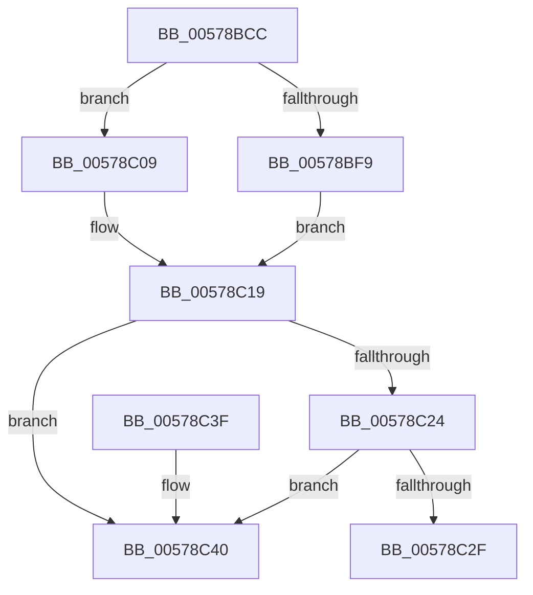

# XmGetStringAddress

- RVA: `0x00578BCC`–`0x00578C52` (길이 `134` bytes)
- VA: `0x0000000140578BCC`
- 실행 섹션: `.text`
- PDB 이름 있음: `예`; PDB Function 태그: `아니요`
- unwind 정보 RVA: `0x0007A1AC`
- 디코드: `34`개 명령, `134/134` bytes 표시
- 미해석 바이트: `0` (있으면 어셈블리에 `.byte`로 보존)

> 이 문서는 커널 이미지의 기계어와 PDB 기호를 분석해 생성했습니다. 4번과 5번은 함수 원형과 자료형을 바이너리 사용 방식에서 추정한 C 해석이며 원본 소스 복구 결과는 아닙니다.

## 1. Dependencies

- 직접 호출 지점: **2**; 고유 호출 대상: **2**
- 직접 호출자로 확인된 함수: **7**
- RIP 상대 이미지 참조: **0**

### Outgoing calls
- `0x00578C35` → [x86BiosTranslateAddress](../47/x86BiosTranslateAddress_function_004736C0.md) (function, `0x004736C0`)
- `0x00578C4C` → [longjmp](../4F/longjmp_function_004FD5F0.md) (function, `0x004FD5F0`)

### Direct callers
- [XmStosOp](../47/XmStosOp_function_00472950.md) at `0x00472A50`
- [XmInsOp](XmInsOp_function_005778F0.md) at `0x0057793A`
- [XmOutsOp](XmOutsOp_function_00577980.md) at `0x005779CD`
- [XmCmpsOp](XmCmpsOp_function_00577CD0.md) at `0x00577D0D`
- [XmCmpsOp](XmCmpsOp_function_00577CD0.md) at `0x00577D23`
- [XmLodsOp](XmLodsOp_function_00577EF0.md) at `0x00577F3C`
- [XmMovsOp](XmMovsOp_function_00577F70.md) at `0x00577FB4`
- [XmMovsOp](XmMovsOp_function_00577F70.md) at `0x00577FCA`
- [XmScasOp](XmScasOp_function_00578000.md) at `0x00578043`

### Static image references
- 디코드된 RIP-relative 메모리 참조가 없습니다.

## 2. Other-region calls and transfers

- 다른 실행 섹션으로 향하는 call: **0**
- 별도 외부 분기/꼬리 이동을 확인하지 못했습니다.

## 3. Assembly (complete function range)

```asm
00578BCC  48 83 EC 28                     sub rsp, 0x28
00578BD0  44 8B 51 78                     mov r10d, dword ptr [rcx + 0x78]
00578BD4  4C 8B C9                        mov r9, rcx
00578BD7  F7 41 10 00 04 00 00            test dword ptr [rcx + 0x10], 0x400
00578BDE  44 8B DA                        mov r11d, edx
00578BE1  41 8B C8                        mov ecx, r8d
00578BE4  41 8D 42 01                     lea eax, [r10 + 1]
00578BE8  41 F7 D2                        not r10d
00578BEB  44 0F 44 D0                     cmove r10d, eax
00578BEF  41 80 B9 89 00 00 00 00         cmp byte ptr [r9 + 0x89], 0
00578BF7  74 10                           je 0x140578c09
00578BF9  41 8B 54 89 18                  mov edx, dword ptr [r9 + rcx*4 + 0x18]
00578BFE  42 8D 04 12                     lea eax, [rdx + r10]
00578C02  41 89 44 89 18                  mov dword ptr [r9 + rcx*4 + 0x18], eax
00578C07  EB 10                           jmp 0x140578c19
00578C09  41 0F B7 54 89 18               movzx edx, word ptr [r9 + rcx*4 + 0x18]
00578C0F  41 8D 04 12                     lea eax, [r10 + rdx]
00578C13  66 41 89 44 89 18               mov word ptr [r9 + rcx*4 + 0x18], ax
00578C19  47 0F B7 44 59 44               movzx r8d, word ptr [r9 + r11*2 + 0x44]
00578C1F  41 3B D0                        cmp edx, r8d
00578C22  77 1C                           ja 0x140578c40
00578C24  41 8B 49 78                     mov ecx, dword ptr [r9 + 0x78]
00578C28  03 CA                           add ecx, edx
00578C2A  41 3B C8                        cmp ecx, r8d
00578C2D  77 11                           ja 0x140578c40
00578C2F  43 0F B7 4C 59 38               movzx ecx, word ptr [r9 + r11*2 + 0x38]
00578C35  E8 86 AA EF FF                  call 0x1404736c0
00578C3A  48 83 C4 28                     add rsp, 0x28
00578C3E  C3                              ret
00578C3F  CC                              int3
00578C40  49 8D 89 A0 00 00 00            lea rcx, [r9 + 0xa0]
00578C47  BA 0E 00 00 00                  mov edx, 0xe
00578C4C  E8 9F 49 F8 FF                  call 0x1404fd5f0
00578C51  CC                              int3
```

## 4. C-style interpretation (structured pseudocode)

```c
__int64 __fastcall XmGetStringAddress(__int64 a1, int a2, int a3)
{
    __int64 result;
    __int64 v_r10;
    __int64 v_rsp;

    v_rsp = (v_rsp) - (40);
    v_r10 = (unsigned int)(~((unsigned int)(*(unsigned int *)(a1 + 120))));
    if (((*(unsigned int *)(a1 + 16)) & (0x400ULL)) == 0) { v_r10 = (unsigned int)((unsigned int)(*(unsigned int *)(a1 + 120)) + 1); }
    if ((*(unsigned __int8 *)(a1 + 137)) == 0) goto loc_00578C09;
    *(unsigned int *)(a1 + (unsigned int)(a3) * 4 + 24) = (unsigned int)((unsigned int)(*(unsigned int *)(a1 + (unsigned int)(a3) * 4 + 24)) + v_r10 * 1);
    goto loc_00578C19;
loc_00578C09:
    *(unsigned __int16 *)(a1 + (unsigned int)(a3) * 4 + 24) = (unsigned __int16)(v_r10 + *(unsigned __int16 *)(a1 + (unsigned int)(a3) * 4 + 24) * 1);
loc_00578C19:
    if (((unsigned int)(*(unsigned __int16 *)(a1 + (unsigned int)(a3) * 4 + 24))) > ((unsigned int)(*(unsigned __int16 *)(a1 + (unsigned int)(a2) * 2 + 68)))) goto loc_00578C40;
    a1 = (unsigned int)(((unsigned int)(*(unsigned int *)(a1 + 120))) + ((unsigned int)(*(unsigned __int16 *)(a1 + (unsigned int)(a3) * 4 + 24))));
    if (((unsigned int)(a1)) > ((unsigned int)(*(unsigned __int16 *)(a1 + (unsigned int)(a2) * 2 + 68)))) goto loc_00578C40;
    result = x86BiosTranslateAddress(*(unsigned __int16 *)(a1 + (unsigned int)(a2) * 2 + 56), *(unsigned __int16 *)(a1 + (unsigned int)(a3) * 4 + 24), *(unsigned __int16 *)(a1 + (unsigned int)(a2) * 2 + 68), a1);
    v_rsp = (v_rsp) + (40);
    return result;
loc_00578C40:
    result = longjmp(a1 + 160, 14, *(unsigned __int16 *)(a1 + (unsigned int)(a2) * 2 + 68), a1);
    return result;
}
```

## 5. (Beta) C Style

```c
int64_t XmGetStringAddress(void *Arg1, int32_t Arg2, int32_t Arg3)
{
    uint8_t *arg1 = (uint8_t *)Arg1;

    int64_t result;
    int64_t local_r10;
    int64_t local_rsp;

    local_rsp = (local_rsp) - (40);
    local_r10 = (uint32_t)(~((uint32_t)(*(uint32_t *)(arg1 + 0x78))));
    if (((*(uint32_t *)(arg1 + 0x10)) & (0x400ULL)) == 0) { local_r10 = (uint32_t)((uint32_t)(*(uint32_t *)(arg1 + 0x78)) + 1); }
    if ((*(uint8_t *)(arg1 + 0x89)) == 0) goto loc_00578C09;
    *(uint32_t *)(arg1 + (uint32_t)(Arg3) * 4 + 0x18) = (uint32_t)((uint32_t)(*(uint32_t *)(arg1 + (uint32_t)(Arg3) * 4 + 0x18)) + local_r10 * 1);
    goto loc_00578C19;
loc_00578C09:
    *(uint16_t *)(arg1 + (uint32_t)(Arg3) * 4 + 0x18) = (uint16_t)(local_r10 + *(uint16_t *)(arg1 + (uint32_t)(Arg3) * 4 + 0x18) * 1);
loc_00578C19:
    if (((uint32_t)(*(uint16_t *)(arg1 + (uint32_t)(Arg3) * 4 + 0x18))) > ((uint32_t)(*(uint16_t *)(arg1 + (uint32_t)(Arg2) * 2 + 0x44)))) goto loc_00578C40;
    Arg1 = (uint32_t)(((uint32_t)(*(uint32_t *)(arg1 + 0x78))) + ((uint32_t)(*(uint16_t *)(arg1 + (uint32_t)(Arg3) * 4 + 0x18))));
    if (((uint32_t)(Arg1)) > ((uint32_t)(*(uint16_t *)(arg1 + (uint32_t)(Arg2) * 2 + 0x44)))) goto loc_00578C40;
    result = x86BiosTranslateAddress(*(uint16_t *)(arg1 + (uint32_t)(Arg2) * 2 + 0x38), *(uint16_t *)(arg1 + (uint32_t)(Arg3) * 4 + 0x18), *(uint16_t *)(arg1 + (uint32_t)(Arg2) * 2 + 0x44), Arg1);
    local_rsp = (local_rsp) + (40);
    return result;
loc_00578C40:
    result = longjmp(Arg1 + 160, 14, *(uint16_t *)(arg1 + (uint32_t)(Arg2) * 2 + 0x44), Arg1);
    return result;
}
```

### 관측된 메모리 오프셋

구조체 형식이 확인되지 않은 접근은 인자 기준의 오프셋으로만 기록했습니다.

| 기준 인자 | 오프셋 표현 | 폭 (bit) | 접근 |
|---|---:|---:|---|
| `Arg1` | `+ 0x10` | `32` | `R` |
| `Arg1` | `+ 0x18 + rcx*4` | `16` | `R` |
| `Arg1` | `+ 0x18 + rcx*4` | `16` | `W` |
| `Arg1` | `+ 0x18 + rcx*4` | `32` | `R` |
| `Arg1` | `+ 0x18 + rcx*4` | `32` | `W` |
| `Arg1` | `+ 0x38 + r11*2` | `16` | `R` |
| `Arg1` | `+ 0x44 + r11*2` | `16` | `R` |
| `Arg1` | `+ 0x78` | `32` | `R` |
| `Arg1` | `+ 0x89` | `8` | `R` |
| `Arg1` | `+ 0xA0` | `64` | `R` |

## 6. Execution-region graph

[열기: 2D/3D 그래프와 함수 탐색 컨트롤 패널](../../../control-panel.html?section=text&rva=0x00578BCC&view=graph)

- 2D 그래프는 위에서 아래로 흐르고, 3D 그래프는 빈 공간을 드래그해 회전합니다. Shift+드래그는 이동, 휠은 확대·축소, 함수 노드 선택은 대상 보고서 이동입니다.

### Static fallback


