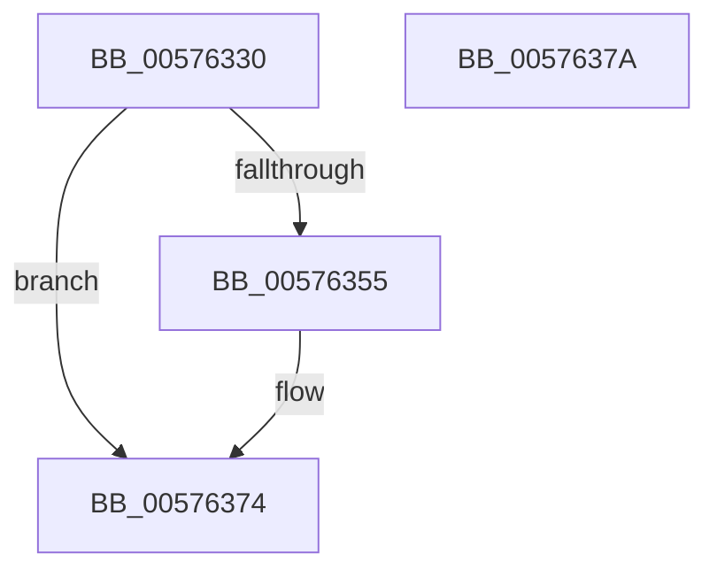

# XmGroup2By1

- RVA: `0x00576330`–`0x0057637B` (길이 `75` bytes)
- VA: `0x0000000140576330`
- 실행 섹션: `.text`
- PDB 이름 있음: `예`; PDB Function 태그: `아니요`
- unwind 정보 RVA: `0x0005CF00`
- 디코드: `22`개 명령, `75/75` bytes 표시
- 미해석 바이트: `0` (있으면 어셈블리에 `.byte`로 보존)

> 이 문서는 커널 이미지의 기계어와 PDB 기호를 분석해 생성했습니다. 4번과 5번은 함수 원형과 자료형을 바이너리 사용 방식에서 추정한 C 해석이며 원본 소스 복구 결과는 아닙니다.

## 1. Dependencies

- 직접 호출 지점: **3**; 고유 호출 대상: **3**
- 직접 호출자로 확인된 함수: **0**
- RIP 상대 이미지 참조: **0**

### Outgoing calls
- `0x0057633E` → [XmSetDataType](../47/XmSetDataType_function_004734C0.md) (function, `0x004734C0`)
- `0x0057634B` → [XmEvaluateAddressSpecifier](../47/XmEvaluateAddressSpecifier_function_00473224.md) (function, `0x00473224`)
- `0x00576365` → [XmSetDestinationValue](../47/XmSetDestinationValue_function_004734EC.md) (function, `0x004734EC`)

### Direct callers
- 이 함수 시작 RVA로 연결되는 직접 call은 확인되지 않았습니다. 간접 호출은 완전히 역산할 수 없습니다.

### Static image references
- 디코드된 RIP-relative 메모리 참조가 없습니다.

## 2. Other-region calls and transfers

- 다른 실행 섹션으로 향하는 call: **0**
- 별도 외부 분기/꼬리 이동을 확인하지 못했습니다.

## 3. Assembly (complete function range)

```asm
00576330  40 53                           push rbx
00576332  48 83 EC 20                     sub rsp, 0x20
00576336  83 64 24 38 00                  and dword ptr [rsp + 0x38], 0
0057633B  48 8B D9                        mov rbx, rcx
0057633E  E8 7D D1 EF FF                  call 0x1404734c0
00576343  48 8D 54 24 38                  lea rdx, [rsp + 0x38]
00576348  48 8B CB                        mov rcx, rbx
0057634B  E8 D4 CE EF FF                  call 0x140473224
00576350  48 85 C0                        test rax, rax
00576353  74 1F                           je 0x140576374
00576355  41 B8 01 00 00 00               mov r8d, 1
0057635B  48 8B D0                        mov rdx, rax
0057635E  48 8B CB                        mov rcx, rbx
00576361  44 89 43 6C                     mov dword ptr [rbx + 0x6c], r8d
00576365  E8 82 D1 EF FF                  call 0x1404734ec
0057636A  8B 4C 24 38                     mov ecx, dword ptr [rsp + 0x38]
0057636E  41 8B C0                        mov eax, r8d
00576371  01 4B 7C                        add dword ptr [rbx + 0x7c], ecx
00576374  48 83 C4 20                     add rsp, 0x20
00576378  5B                              pop rbx
00576379  C3                              ret
0057637A  CC                              int3
```

## 4. C-style interpretation (structured pseudocode)

```c
__int64 __fastcall XmGroup2By1(__int64 a1)
{
    __int64 result;
    __int64 v_rsp;
    unsigned int v_stack_p10;

    v_rsp = (v_rsp) - (32);
    result = XmSetDataType(a1, a2, a3, a4);
    result = XmEvaluateAddressSpecifier(a1, v_stack_p10, a3, a4);
    if (result != 0) {
        a3 = 1;
        a2 = result;
        a1 = a1;
        *(unsigned int *)(a1 + 108) = (unsigned int)(a3);
        result = XmSetDestinationValue(a1, a2, a3, a4);
        a1 = v_stack_p10;
        result = (unsigned int)(a3);
    }
    v_rsp = (v_rsp) + (32);
    return result;
}
```

## 5. (Beta) C Style

```c
int64_t XmGroup2By1(void *Arg1)
{
    uint8_t *arg1 = (uint8_t *)Arg1;

    int64_t result;
    int64_t local_rsp;
    uint32_t v_stack_p10;

    local_rsp = (local_rsp) - (32);
    result = XmSetDataType(Arg1, a2, a3, a4);
    result = XmEvaluateAddressSpecifier(Arg1, v_stack_p10, a3, a4);
    if (result != 0) {
        a3 = 1;
        a2 = result;
        Arg1 = Arg1;
        *(uint32_t *)(arg1 + 0x6C) = (uint32_t)(a3);
        result = XmSetDestinationValue(Arg1, a2, a3, a4);
        Arg1 = v_stack_p10;
        result = (uint32_t)(a3);
    }
    local_rsp = (local_rsp) + (32);
    return result;
}
```

### 관측된 메모리 오프셋

구조체 형식이 확인되지 않은 접근은 인자 기준의 오프셋으로만 기록했습니다.

| 기준 인자 | 오프셋 표현 | 폭 (bit) | 접근 |
|---|---:|---:|---|
| `Arg1` | `+ 0x6C` | `32` | `W` |
| `Arg1` | `+ 0x7C` | `32` | `R/W` |

## 6. Execution-region graph

[열기: 2D/3D 그래프와 함수 탐색 컨트롤 패널](../../../control-panel.html?section=text&rva=0x00576330&view=graph)

- 2D 그래프는 위에서 아래로 흐르고, 3D 그래프는 빈 공간을 드래그해 회전합니다. Shift+드래그는 이동, 휠은 확대·축소, 함수 노드 선택은 대상 보고서 이동입니다.

### Static fallback


