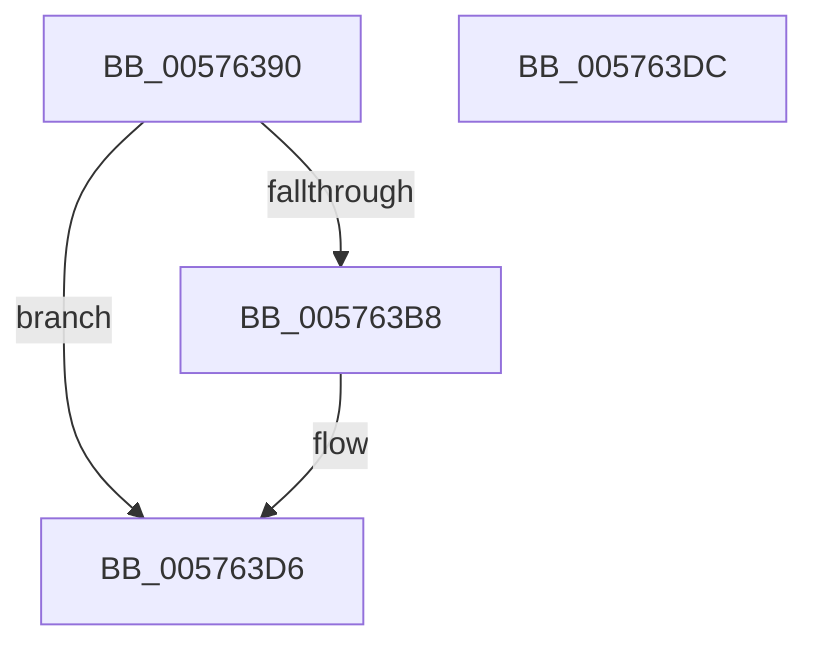

# XmGroup2ByCL

- RVA: `0x00576390`–`0x005763DD` (길이 `77` bytes)
- VA: `0x0000000140576390`
- 실행 섹션: `.text`
- PDB 이름 있음: `예`; PDB Function 태그: `아니요`
- unwind 정보 RVA: `0x0005CF00`
- 디코드: `23`개 명령, `77/77` bytes 표시
- 미해석 바이트: `0` (있으면 어셈블리에 `.byte`로 보존)

> 이 문서는 커널 이미지의 기계어와 PDB 기호를 분석해 생성했습니다. 4번과 5번은 함수 원형과 자료형을 바이너리 사용 방식에서 추정한 C 해석이며 원본 소스 복구 결과는 아닙니다.

## 1. Dependencies

- 직접 호출 지점: **3**; 고유 호출 대상: **3**
- 직접 호출자로 확인된 함수: **0**
- RIP 상대 이미지 참조: **0**

### Outgoing calls
- `0x0057639E` → [XmSetDataType](../47/XmSetDataType_function_004734C0.md) (function, `0x004734C0`)
- `0x005763AB` → [XmEvaluateAddressSpecifier](../47/XmEvaluateAddressSpecifier_function_00473224.md) (function, `0x00473224`)
- `0x005763C5` → [XmSetDestinationValue](../47/XmSetDestinationValue_function_004734EC.md) (function, `0x004734EC`)

### Direct callers
- 이 함수 시작 RVA로 연결되는 직접 call은 확인되지 않았습니다. 간접 호출은 완전히 역산할 수 없습니다.

### Static image references
- 디코드된 RIP-relative 메모리 참조가 없습니다.

## 2. Other-region calls and transfers

- 다른 실행 섹션으로 향하는 call: **0**
- 별도 외부 분기/꼬리 이동을 확인하지 못했습니다.

## 3. Assembly (complete function range)

```asm
00576390  40 53                           push rbx
00576392  48 83 EC 20                     sub rsp, 0x20
00576396  83 64 24 38 00                  and dword ptr [rsp + 0x38], 0
0057639B  48 8B D9                        mov rbx, rcx
0057639E  E8 1D D1 EF FF                  call 0x1404734c0
005763A3  48 8D 54 24 38                  lea rdx, [rsp + 0x38]
005763A8  48 8B CB                        mov rcx, rbx
005763AB  E8 74 CE EF FF                  call 0x140473224
005763B0  48 8B D0                        mov rdx, rax
005763B3  48 85 C0                        test rax, rax
005763B6  74 1E                           je 0x1405763d6
005763B8  0F B6 43 1C                     movzx eax, byte ptr [rbx + 0x1c]
005763BC  48 8B CB                        mov rcx, rbx
005763BF  83 E0 1F                        and eax, 0x1f
005763C2  89 43 6C                        mov dword ptr [rbx + 0x6c], eax
005763C5  E8 22 D1 EF FF                  call 0x1404734ec
005763CA  8B 44 24 38                     mov eax, dword ptr [rsp + 0x38]
005763CE  01 43 7C                        add dword ptr [rbx + 0x7c], eax
005763D1  B8 01 00 00 00                  mov eax, 1
005763D6  48 83 C4 20                     add rsp, 0x20
005763DA  5B                              pop rbx
005763DB  C3                              ret
005763DC  CC                              int3
```

## 4. C-style interpretation (structured pseudocode)

```c
__int64 __fastcall XmGroup2ByCL(__int64 a1)
{
    __int64 result;
    __int64 v_rsp;
    unsigned int v_stack_p10;

    v_rsp = (v_rsp) - (32);
    result = XmSetDataType(a1, a2, a3, a4);
    result = XmEvaluateAddressSpecifier(a1, v_stack_p10, a3, a4);
    if (result != 0) {
        result = *(unsigned __int8 *)(a1 + 28);
        a1 = a1;
        result = (unsigned int)((result) & (31));
        *(unsigned int *)(a1 + 108) = (unsigned int)(result);
        result = XmSetDestinationValue(a1, result, a3, a4);
        result = v_stack_p10;
        result = 1;
    }
    v_rsp = (v_rsp) + (32);
    return result;
}
```

## 5. (Beta) C Style

```c
int64_t XmGroup2ByCL(void *Arg1)
{
    uint8_t *arg1 = (uint8_t *)Arg1;

    int64_t result;
    int64_t local_rsp;
    uint32_t v_stack_p10;

    local_rsp = (local_rsp) - (32);
    result = XmSetDataType(Arg1, a2, a3, a4);
    result = XmEvaluateAddressSpecifier(Arg1, v_stack_p10, a3, a4);
    if (result != 0) {
        result = *(uint8_t *)(arg1 + 0x1C);
        Arg1 = Arg1;
        result = (uint32_t)((result) & (31));
        *(uint32_t *)(arg1 + 0x6C) = (uint32_t)(result);
        result = XmSetDestinationValue(Arg1, result, a3, a4);
        result = v_stack_p10;
        result = 1;
    }
    local_rsp = (local_rsp) + (32);
    return result;
}
```

### 관측된 메모리 오프셋

구조체 형식이 확인되지 않은 접근은 인자 기준의 오프셋으로만 기록했습니다.

| 기준 인자 | 오프셋 표현 | 폭 (bit) | 접근 |
|---|---:|---:|---|
| `Arg1` | `+ 0x1C` | `8` | `R` |
| `Arg1` | `+ 0x6C` | `32` | `W` |
| `Arg1` | `+ 0x7C` | `32` | `R/W` |

## 6. Execution-region graph

[열기: 2D/3D 그래프와 함수 탐색 컨트롤 패널](../../../control-panel.html?section=text&rva=0x00576390&view=graph)

- 2D 그래프는 위에서 아래로 흐르고, 3D 그래프는 빈 공간을 드래그해 회전합니다. Shift+드래그는 이동, 휠은 확대·축소, 함수 노드 선택은 대상 보고서 이동입니다.

### Static fallback


