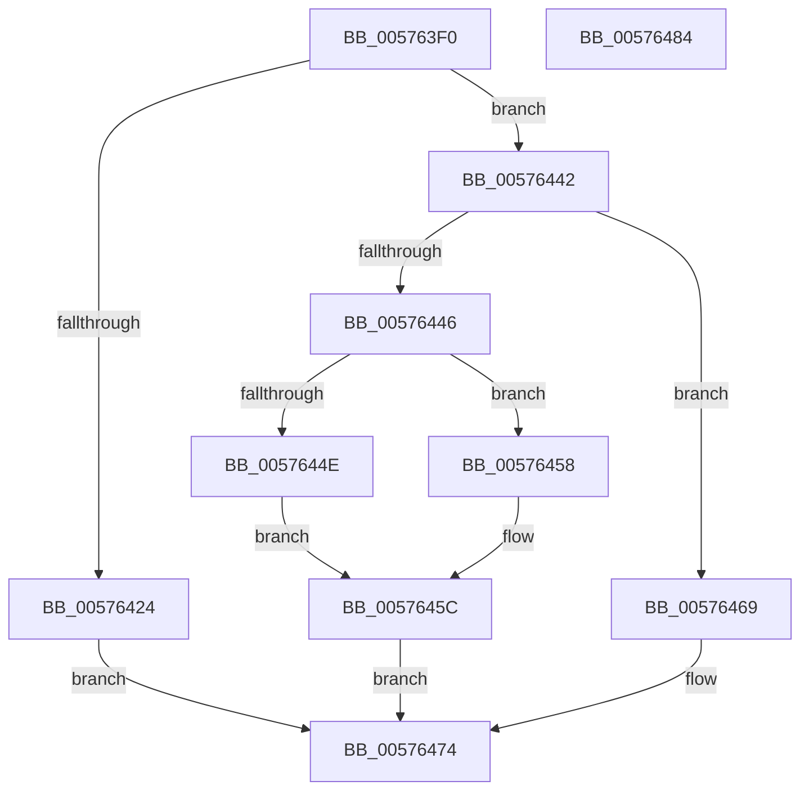

# XmGroup3General

- RVA: `0x005763F0`–`0x00576485` (길이 `149` bytes)
- VA: `0x00000001405763F0`
- 실행 섹션: `.text`
- PDB 이름 있음: `예`; PDB Function 태그: `아니요`
- unwind 정보 RVA: `0x00068D5C`
- 디코드: `45`개 명령, `149/149` bytes 표시
- 미해석 바이트: `0` (있으면 어셈블리에 `.byte`로 보존)

> 이 문서는 커널 이미지의 기계어와 PDB 기호를 분석해 생성했습니다. 4번과 5번은 함수 원형과 자료형을 바이너리 사용 방식에서 추정한 C 해석이며 원본 소스 복구 결과는 아닙니다.

## 1. Dependencies

- 직접 호출 지점: **7**; 고유 호출 대상: **5**
- 직접 호출자로 확인된 함수: **0**
- RIP 상대 이미지 참조: **0**

### Outgoing calls
- `0x00576402` → [XmSetDataType](../47/XmSetDataType_function_004734C0.md) (function, `0x004734C0`)
- `0x0057640F` → [XmEvaluateAddressSpecifier](../47/XmEvaluateAddressSpecifier_function_00473224.md) (function, `0x00473224`)
- `0x00576429` → [XmGetImmediateSourceValue](../47/XmGetImmediateSourceValue_function_0047340C.md) (function, `0x0047340C`)
- `0x00576437` → [XmSetDestinationValue](../47/XmSetDestinationValue_function_004734EC.md) (function, `0x004734EC`)
- `0x00576451` → [XmSetDestinationValue](../47/XmSetDestinationValue_function_004734EC.md) (function, `0x004734EC`)
- `0x00576462` → [XmSetSourceValue](../47/XmSetSourceValue_function_004737A8.md) (function, `0x004737A8`)
- `0x0057646F` → [XmSetDestinationValue](../47/XmSetDestinationValue_function_004734EC.md) (function, `0x004734EC`)

### Direct callers
- 이 함수 시작 RVA로 연결되는 직접 call은 확인되지 않았습니다. 간접 호출은 완전히 역산할 수 없습니다.

### Static image references
- 디코드된 RIP-relative 메모리 참조가 없습니다.

## 2. Other-region calls and transfers

- 다른 실행 섹션으로 향하는 call: **0**
- 별도 외부 분기/꼬리 이동을 확인하지 못했습니다.

## 3. Assembly (complete function range)

```asm
005763F0  48 89 5C 24 10                  mov qword ptr [rsp + 0x10], rbx
005763F5  57                              push rdi
005763F6  48 83 EC 20                     sub rsp, 0x20
005763FA  83 64 24 30 00                  and dword ptr [rsp + 0x30], 0
005763FF  48 8B D9                        mov rbx, rcx
00576402  E8 B9 D0 EF FF                  call 0x1404734c0
00576407  48 8D 54 24 30                  lea rdx, [rsp + 0x30]
0057640C  48 8B CB                        mov rcx, rbx
0057640F  E8 10 CE EF FF                  call 0x140473224
00576414  48 8B F8                        mov rdi, rax
00576417  8B 44 24 30                     mov eax, dword ptr [rsp + 0x30]
0057641B  01 43 7C                        add dword ptr [rbx + 0x7c], eax
0057641E  83 7B 7C 16                     cmp dword ptr [rbx + 0x7c], 0x16
00576422  75 1E                           jne 0x140576442
00576424  33 D2                           xor edx, edx
00576426  48 8B CB                        mov rcx, rbx
00576429  E8 DE CF EF FF                  call 0x14047340c
0057642E  48 8B D7                        mov rdx, rdi
00576431  48 8B CB                        mov rcx, rbx
00576434  44 8B C0                        mov r8d, eax
00576437  E8 B0 D0 EF FF                  call 0x1404734ec
0057643C  44 89 43 6C                     mov dword ptr [rbx + 0x6c], r8d
00576440  EB 32                           jmp 0x140576474
00576442  A8 04                           test al, 4
00576444  74 23                           je 0x140576469
00576446  48 8D 53 18                     lea rdx, [rbx + 0x18]
0057644A  A8 02                           test al, 2
0057644C  75 0A                           jne 0x140576458
0057644E  48 8B CB                        mov rcx, rbx
00576451  E8 96 D0 EF FF                  call 0x1404734ec
00576456  EB 04                           jmp 0x14057645c
00576458  48 89 53 58                     mov qword ptr [rbx + 0x58], rdx
0057645C  48 8B D7                        mov rdx, rdi
0057645F  48 8B CB                        mov rcx, rbx
00576462  E8 41 D3 EF FF                  call 0x1404737a8
00576467  EB 0B                           jmp 0x140576474
00576469  48 8B D7                        mov rdx, rdi
0057646C  48 8B CB                        mov rcx, rbx
0057646F  E8 78 D0 EF FF                  call 0x1404734ec
00576474  48 8B 5C 24 38                  mov rbx, qword ptr [rsp + 0x38]
00576479  B8 01 00 00 00                  mov eax, 1
0057647E  48 83 C4 20                     add rsp, 0x20
00576482  5F                              pop rdi
00576483  C3                              ret
00576484  CC                              int3
```

## 4. C-style interpretation (structured pseudocode)

```c
__int64 __fastcall XmGroup3General(__int64 a1)
{
    __int64 result;
    __int64 v_rsp;
    unsigned __int64 v_stack_p10;
    unsigned int v_stack_p8;

    v_stack_p10 = v_rbx;
    v_rsp = (v_rsp) - (32);
    result = XmSetDataType(a1, a2, a3, a4);
    result = XmEvaluateAddressSpecifier(a1, v_stack_p8, a3, a4);
    if ((*(unsigned int *)(a1 + 124)) != 22) goto loc_00576442;
    a2 = 0;
    result = XmGetImmediateSourceValue(a1, a2, a3, a4);
    result = XmSetDestinationValue(a1, result, (unsigned int)((unsigned int)(result)), a4);
    *(unsigned int *)(a1 + 108) = (unsigned int)((unsigned int)((unsigned int)(result)));
    goto loc_00576474;
loc_00576442:
    if ((((unsigned __int8)(result)) & (4)) == 0) goto loc_00576469;
    if ((((unsigned __int8)(result)) & (2)) != 0) goto loc_00576458;
    result = XmSetDestinationValue(a1, a1 + 24, (unsigned int)((unsigned int)(result)), a4);
    goto loc_0057645C;
loc_00576458:
    *(unsigned __int64 *)(a1 + 88) = a1 + 24;
loc_0057645C:
    result = XmSetSourceValue(a1, result, (unsigned int)((unsigned int)(result)), a4);
    goto loc_00576474;
loc_00576469:
    result = XmSetDestinationValue(a1, result, (unsigned int)((unsigned int)(result)), a4);
loc_00576474:
    v_rsp = (v_rsp) + (32);
    return 1;
}
```

## 5. (Beta) C Style

```c
int64_t XmGroup3General(void *Arg1)
{
    uint8_t *arg1 = (uint8_t *)Arg1;

    int64_t result;
    int64_t local_rsp;
    uint64_t v_stack_p10;
    uint32_t v_stack_p8;

    v_stack_p10 = local_rbx;
    local_rsp = (local_rsp) - (32);
    result = XmSetDataType(Arg1, a2, a3, a4);
    result = XmEvaluateAddressSpecifier(Arg1, v_stack_p8, a3, a4);
    if ((*(uint32_t *)(arg1 + 0x7C)) != 22) goto loc_00576442;
    a2 = 0;
    result = XmGetImmediateSourceValue(Arg1, a2, a3, a4);
    result = XmSetDestinationValue(Arg1, result, (uint32_t)((uint32_t)(result)), a4);
    *(uint32_t *)(arg1 + 0x6C) = (uint32_t)((uint32_t)((uint32_t)(result)));
    goto loc_00576474;
loc_00576442:
    if ((((uint8_t)(result)) & (4)) == 0) goto loc_00576469;
    if ((((uint8_t)(result)) & (2)) != 0) goto loc_00576458;
    result = XmSetDestinationValue(Arg1, Arg1 + 24, (uint32_t)((uint32_t)(result)), a4);
    goto loc_0057645C;
loc_00576458:
    *(void **)(arg1 + 0x58) = Arg1 + 24;
loc_0057645C:
    result = XmSetSourceValue(Arg1, result, (uint32_t)((uint32_t)(result)), a4);
    goto loc_00576474;
loc_00576469:
    result = XmSetDestinationValue(Arg1, result, (uint32_t)((uint32_t)(result)), a4);
loc_00576474:
    local_rsp = (local_rsp) + (32);
    return 1;
}
```

### 관측된 메모리 오프셋

구조체 형식이 확인되지 않은 접근은 인자 기준의 오프셋으로만 기록했습니다.

| 기준 인자 | 오프셋 표현 | 폭 (bit) | 접근 |
|---|---:|---:|---|
| `Arg1` | `+ 0x18` | `64` | `R` |
| `Arg1` | `+ 0x58` | `64` | `W` |
| `Arg1` | `+ 0x6C` | `32` | `W` |
| `Arg1` | `+ 0x7C` | `32` | `R` |
| `Arg1` | `+ 0x7C` | `32` | `R/W` |

## 6. Execution-region graph

[열기: 2D/3D 그래프와 함수 탐색 컨트롤 패널](../../../control-panel.html?section=text&rva=0x005763F0&view=graph)

- 2D 그래프는 위에서 아래로 흐르고, 3D 그래프는 빈 공간을 드래그해 회전합니다. Shift+드래그는 이동, 휠은 확대·축소, 함수 노드 선택은 대상 보고서 이동입니다.

### Static fallback


