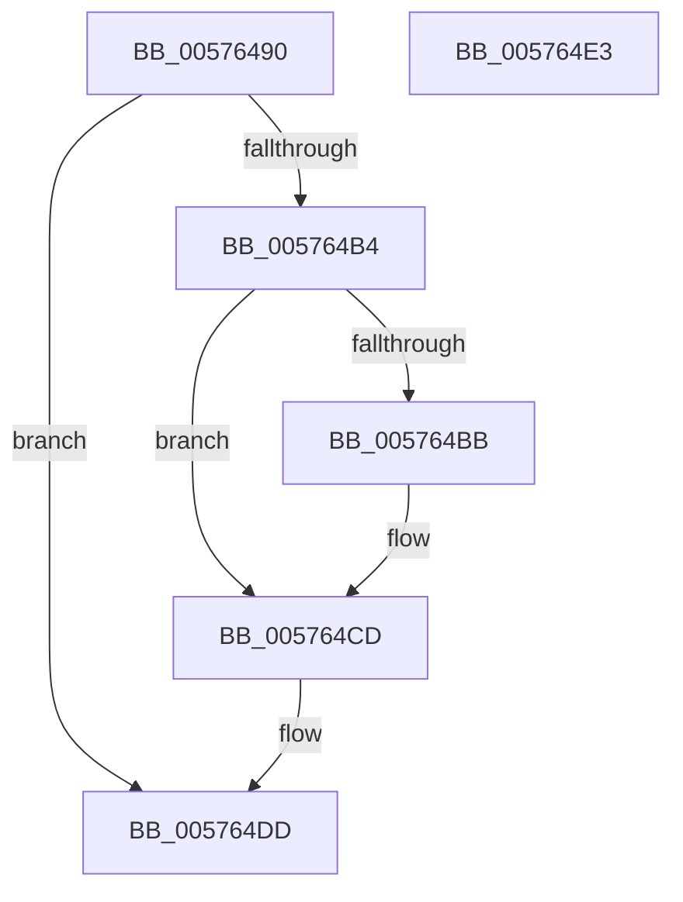

# XmGroup7General

- RVA: `0x00576490`–`0x005764E4` (길이 `84` bytes)
- VA: `0x0000000140576490`
- 실행 섹션: `.text`
- PDB 이름 있음: `예`; PDB Function 태그: `아니요`
- unwind 정보 RVA: `0x0005CF00`
- 디코드: `23`개 명령, `84/84` bytes 표시
- 미해석 바이트: `0` (있으면 어셈블리에 `.byte`로 보존)

> 이 문서는 커널 이미지의 기계어와 PDB 기호를 분석해 생성했습니다. 4번과 5번은 함수 원형과 자료형을 바이너리 사용 방식에서 추정한 C 해석이며 원본 소스 복구 결과는 아닙니다.

## 1. Dependencies

- 직접 호출 지점: **3**; 고유 호출 대상: **3**
- 직접 호출자로 확인된 함수: **0**
- RIP 상대 이미지 참조: **0**

### Outgoing calls
- `0x005764AA` → [XmEvaluateAddressSpecifier](../47/XmEvaluateAddressSpecifier_function_00473224.md) (function, `0x00473224`)
- `0x005764C7` → [longjmp](../4F/longjmp_function_004FD5F0.md) (function, `0x004FD5F0`)
- `0x005764D3` → [XmSetDestinationValue](../47/XmSetDestinationValue_function_004734EC.md) (function, `0x004734EC`)

### Direct callers
- 이 함수 시작 RVA로 연결되는 직접 call은 확인되지 않았습니다. 간접 호출은 완전히 역산할 수 없습니다.

### Static image references
- 디코드된 RIP-relative 메모리 참조가 없습니다.

## 2. Other-region calls and transfers

- 다른 실행 섹션으로 향하는 call: **0**
- 별도 외부 분기/꼬리 이동을 확인하지 못했습니다.

## 3. Assembly (complete function range)

```asm
00576490  40 53                           push rbx
00576492  48 83 EC 20                     sub rsp, 0x20
00576496  83 64 24 30 00                  and dword ptr [rsp + 0x30], 0
0057649B  48 8D 54 24 30                  lea rdx, [rsp + 0x30]
005764A0  48 8B D9                        mov rbx, rcx
005764A3  C7 41 78 01 00 00 00            mov dword ptr [rcx + 0x78], 1
005764AA  E8 75 CD EF FF                  call 0x140473224
005764AF  48 85 C0                        test rax, rax
005764B2  74 29                           je 0x1405764dd
005764B4  83 7C 24 30 04                  cmp dword ptr [rsp + 0x30], 4
005764B9  74 12                           je 0x1405764cd
005764BB  48 8D 8B A0 00 00 00            lea rcx, [rbx + 0xa0]
005764C2  BA 0C 00 00 00                  mov edx, 0xc
005764C7  E8 24 71 F8 FF                  call 0x1404fd5f0
005764CC  CC                              int3
005764CD  48 8B D0                        mov rdx, rax
005764D0  48 8B CB                        mov rcx, rbx
005764D3  E8 14 D0 EF FF                  call 0x1404734ec
005764D8  B8 01 00 00 00                  mov eax, 1
005764DD  48 83 C4 20                     add rsp, 0x20
005764E1  5B                              pop rbx
005764E2  C3                              ret
005764E3  CC                              int3
```

## 4. C-style interpretation (structured pseudocode)

```c
__int64 __fastcall XmGroup7General(__int64 a1)
{
    __int64 result;
    __int64 v_rsp;
    unsigned int v_stack_p8;

    v_rsp = (v_rsp) - (32);
    *(unsigned int *)(a1 + 120) = 1;
    result = XmEvaluateAddressSpecifier(a1, v_stack_p8, a3, a4);
    if (result == 0) goto loc_005764DD;
    if (v_stack_p8 != 4) {
        a1 = a1 + 160;
        a2 = 12;
        result = longjmp(a1, a2, a3, a4);
    }
    result = XmSetDestinationValue(a1, result, a3, a4);
loc_005764DD:
    v_rsp = (v_rsp) + (32);
    return 1;
}
```

## 5. (Beta) C Style

```c
int64_t XmGroup7General(void *Arg1)
{
    uint8_t *arg1 = (uint8_t *)Arg1;

    int64_t result;
    int64_t local_rsp;
    uint32_t v_stack_p8;

    local_rsp = (local_rsp) - (32);
    *(uint32_t *)(arg1 + 0x78) = 1;
    result = XmEvaluateAddressSpecifier(Arg1, v_stack_p8, a3, a4);
    if (result == 0) goto loc_005764DD;
    if (v_stack_p8 != 4) {
        Arg1 = Arg1 + 160;
        a2 = 12;
        result = longjmp(Arg1, a2, a3, a4);
    }
    result = XmSetDestinationValue(Arg1, result, a3, a4);
loc_005764DD:
    local_rsp = (local_rsp) + (32);
    return 1;
}
```

### 관측된 메모리 오프셋

구조체 형식이 확인되지 않은 접근은 인자 기준의 오프셋으로만 기록했습니다.

| 기준 인자 | 오프셋 표현 | 폭 (bit) | 접근 |
|---|---:|---:|---|
| `Arg1` | `+ 0x78` | `32` | `W` |
| `Arg1` | `+ 0xA0` | `64` | `R` |

## 6. Execution-region graph

[열기: 2D/3D 그래프와 함수 탐색 컨트롤 패널](../../../control-panel.html?section=text&rva=0x00576490&view=graph)

- 2D 그래프는 위에서 아래로 흐르고, 3D 그래프는 빈 공간을 드래그해 회전합니다. Shift+드래그는 이동, 휠은 확대·축소, 함수 노드 선택은 대상 보고서 이동입니다.

### Static fallback


