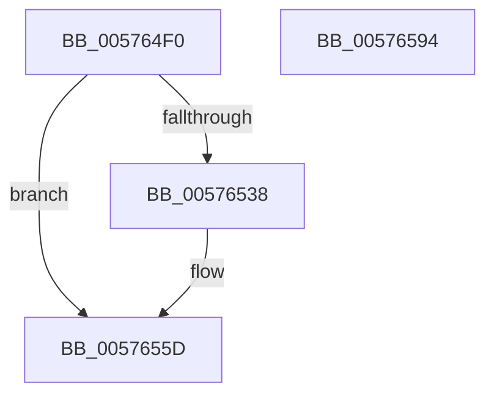

# XmGroup8BitOffset

- RVA: `0x005764F0`–`0x00576595` (길이 `165` bytes)
- VA: `0x00000001405764F0`
- 실행 섹션: `.text`
- PDB 이름 있음: `예`; PDB Function 태그: `아니요`
- unwind 정보 RVA: `0x00068D5C`
- 디코드: `47`개 명령, `165/165` bytes 표시
- 미해석 바이트: `0` (있으면 어셈블리에 `.byte`로 보존)

> 이 문서는 커널 이미지의 기계어와 PDB 기호를 분석해 생성했습니다. 4번과 5번은 함수 원형과 자료형을 바이너리 사용 방식에서 추정한 C 해석이며 원본 소스 복구 결과는 아닙니다.

## 1. Dependencies

- 직접 호출 지점: **4**; 고유 호출 대상: **4**
- 직접 호출자로 확인된 함수: **0**
- RIP 상대 이미지 참조: **0**

### Outgoing calls
- `0x00576519` → [XmEvaluateAddressSpecifier](../47/XmEvaluateAddressSpecifier_function_00473224.md) (function, `0x00473224`)
- `0x00576524` → [XmGetCodeByte](../47/XmGetCodeByte_function_00473678.md) (function, `0x00473678`)
- `0x00576555` → [XmGetOffsetAddress](XmGetOffsetAddress_function_00578B84.md) (function, `0x00578B84`)
- `0x00576575` → [XmSetDestinationValue](../47/XmSetDestinationValue_function_004734EC.md) (function, `0x004734EC`)

### Direct callers
- 이 함수 시작 RVA로 연결되는 직접 call은 확인되지 않았습니다. 간접 호출은 완전히 역산할 수 없습니다.

### Static image references
- 디코드된 RIP-relative 메모리 참조가 없습니다.

## 2. Other-region calls and transfers

- 다른 실행 섹션으로 향하는 call: **0**
- 별도 외부 분기/꼬리 이동을 확인하지 못했습니다.

## 3. Assembly (complete function range)

```asm
005764F0  48 89 5C 24 10                  mov qword ptr [rsp + 0x10], rbx
005764F5  57                              push rdi
005764F6  48 83 EC 20                     sub rsp, 0x20
005764FA  83 64 24 30 00                  and dword ptr [rsp + 0x30], 0
005764FF  48 8B D9                        mov rbx, rcx
00576502  8A 81 8A 00 00 00               mov al, byte ptr [rcx + 0x8a]
00576508  F6 D8                           neg al
0057650A  1B D2                           sbb edx, edx
0057650C  83 E2 02                        and edx, 2
0057650F  FF C2                           inc edx
00576511  89 51 78                        mov dword ptr [rcx + 0x78], edx
00576514  48 8D 54 24 30                  lea rdx, [rsp + 0x30]
00576519  E8 06 CD EF FF                  call 0x140473224
0057651E  48 8B CB                        mov rcx, rbx
00576521  48 8B F8                        mov rdi, rax
00576524  E8 4F D1 EF FF                  call 0x140473678
00576529  80 BB 8E 00 00 00 00            cmp byte ptr [rbx + 0x8e], 0
00576530  0F B6 C0                        movzx eax, al
00576533  89 43 6C                        mov dword ptr [rbx + 0x6c], eax
00576536  75 25                           jne 0x14057655d
00576538  83 7B 78 03                     cmp dword ptr [rbx + 0x78], 3
0057653C  BA FC FF FF 1F                  mov edx, 0x1ffffffc
00576541  8D 4A 02                        lea ecx, [rdx + 2]
00576544  0F 45 D1                        cmovne edx, ecx
00576547  C1 E8 03                        shr eax, 3
0057654A  23 D0                           and edx, eax
0057654C  48 8B CB                        mov rcx, rbx
0057654F  03 93 80 00 00 00               add edx, dword ptr [rbx + 0x80]
00576555  E8 2A 26 00 00                  call 0x140578b84
0057655A  48 8B F8                        mov rdi, rax
0057655D  83 7B 78 03                     cmp dword ptr [rbx + 0x78], 3
00576561  B9 1F 00 00 00                  mov ecx, 0x1f
00576566  8D 51 F0                        lea edx, [rcx - 0x10]
00576569  0F 45 CA                        cmovne ecx, edx
0057656C  48 8B D7                        mov rdx, rdi
0057656F  21 4B 6C                        and dword ptr [rbx + 0x6c], ecx
00576572  48 8B CB                        mov rcx, rbx
00576575  E8 72 CF EF FF                  call 0x1404734ec
0057657A  8B 4C 24 30                     mov ecx, dword ptr [rsp + 0x30]
0057657E  B8 01 00 00 00                  mov eax, 1
00576583  83 E1 03                        and ecx, 3
00576586  01 4B 7C                        add dword ptr [rbx + 0x7c], ecx
00576589  48 8B 5C 24 38                  mov rbx, qword ptr [rsp + 0x38]
0057658E  48 83 C4 20                     add rsp, 0x20
00576592  5F                              pop rdi
00576593  C3                              ret
00576594  CC                              int3
```

## 4. C-style interpretation (structured pseudocode)

```c
__int64 __fastcall XmGroup8BitOffset(__int64 a1, int a2)
{
    __int64 result;
    __int64 v_rdi;
    __int64 v_rsp;
    unsigned __int64 v_stack_p10;
    unsigned int v_stack_p8;

    v_stack_p10 = v_rbx;
    v_rsp = (v_rsp) - (32);
    result = (unsigned __int8)(-(*(unsigned __int8 *)(a1 + 138)));
    a2 = (unsigned int)((a2) & (2));
    a2 = (unsigned int)((a2) + 1);
    *(unsigned int *)(a1 + 120) = a2;
    result = XmEvaluateAddressSpecifier(a1, v_stack_p8, a3, a4);
    result = XmGetCodeByte(a1, v_stack_p8, a3, a4);
    *(unsigned int *)(a1 + 108) = (unsigned int)((unsigned __int8)(result));
    result = (unsigned __int8)(result);
    v_rdi = result;
    if ((*(unsigned __int8 *)(a1 + 142)) == 0) {
        a2 = 0x1FFFFFFCULL;
        a1 = a2 + 2;
        if ((*(unsigned int *)(a1 + 120)) != 3) { a2 = (unsigned int)(a1); }
        result = (unsigned int)(((unsigned __int8)(result)) >> (3));
        a2 = (unsigned int)((a2) & ((unsigned int)(result)));
        a1 = a1;
        a2 = (unsigned int)((a2) + (*(unsigned int *)(a1 + 128)));
        result = XmGetOffsetAddress(a1, a2, a3, a4);
        v_rdi = result;
    }
    a1 = 31;
    if ((*(unsigned int *)(a1 + 120)) != 3) { a1 = (unsigned int)(31 - 16); }
    result = XmSetDestinationValue(a1, v_rdi, a3, a4);
    a1 = (unsigned int)(((unsigned int)(v_stack_p8)) & (3));
    v_rsp = (v_rsp) + (32);
    return 1;
}
```

## 5. (Beta) C Style

```c
int64_t XmGroup8BitOffset(void *Arg1, int32_t Arg2)
{
    uint8_t *arg1 = (uint8_t *)Arg1;

    int64_t result;
    int64_t local_rdi;
    int64_t local_rsp;
    uint64_t v_stack_p10;
    uint32_t v_stack_p8;

    v_stack_p10 = local_rbx;
    local_rsp = (local_rsp) - (32);
    result = (uint8_t)(-(*(uint8_t *)(arg1 + 0x8A)));
    Arg2 = (uint32_t)((Arg2) & (2));
    Arg2 = (uint32_t)((Arg2) + 1);
    *(uint32_t *)(arg1 + 0x78) = Arg2;
    result = XmEvaluateAddressSpecifier(Arg1, v_stack_p8, a3, a4);
    result = XmGetCodeByte(Arg1, v_stack_p8, a3, a4);
    *(uint32_t *)(arg1 + 0x6C) = (uint32_t)((uint8_t)(result));
    result = (uint8_t)(result);
    local_rdi = result;
    if ((*(uint8_t *)(arg1 + 0x8E)) == 0) {
        Arg2 = 0x1FFFFFFCULL;
        Arg1 = Arg2 + 2;
        if ((*(uint32_t *)(arg1 + 0x78)) != 3) { Arg2 = (uint32_t)(Arg1); }
        result = (uint32_t)(((uint8_t)(result)) >> (3));
        Arg2 = (uint32_t)((Arg2) & ((uint32_t)(result)));
        Arg1 = Arg1;
        Arg2 = (uint32_t)((Arg2) + (*(uint32_t *)(arg1 + 0x80)));
        result = XmGetOffsetAddress(Arg1, Arg2, a3, a4);
        local_rdi = result;
    }
    Arg1 = 31;
    if ((*(uint32_t *)(arg1 + 0x78)) != 3) { Arg1 = (uint32_t)(31 - 16); }
    result = XmSetDestinationValue(Arg1, local_rdi, a3, a4);
    Arg1 = (uint32_t)(((uint32_t)(v_stack_p8)) & (3));
    local_rsp = (local_rsp) + (32);
    return 1;
}
```

### 관측된 메모리 오프셋

구조체 형식이 확인되지 않은 접근은 인자 기준의 오프셋으로만 기록했습니다.

| 기준 인자 | 오프셋 표현 | 폭 (bit) | 접근 |
|---|---:|---:|---|
| `Arg1` | `+ 0x6C` | `32` | `R/W` |
| `Arg1` | `+ 0x6C` | `32` | `W` |
| `Arg1` | `+ 0x78` | `32` | `R` |
| `Arg1` | `+ 0x78` | `32` | `W` |
| `Arg1` | `+ 0x7C` | `32` | `R/W` |
| `Arg1` | `+ 0x80` | `32` | `R` |
| `Arg1` | `+ 0x8A` | `8` | `R` |
| `Arg1` | `+ 0x8E` | `8` | `R` |

## 6. Execution-region graph

[열기: 2D/3D 그래프와 함수 탐색 컨트롤 패널](../../../control-panel.html?section=text&rva=0x005764F0&view=graph)

- 2D 그래프는 위에서 아래로 흐르고, 3D 그래프는 빈 공간을 드래그해 회전합니다. Shift+드래그는 이동, 휠은 확대·축소, 함수 노드 선택은 대상 보고서 이동입니다.

### Static fallback


