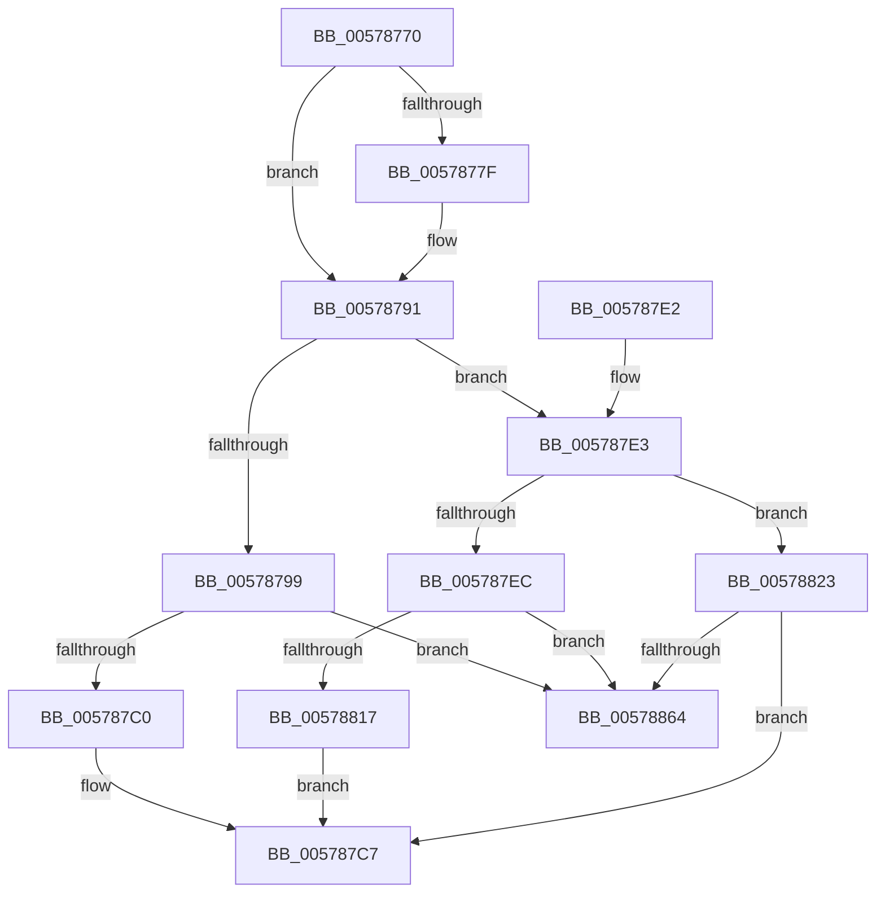

# XmIdivOp

- RVA: `0x00578770`–`0x00578876` (길이 `262` bytes)
- VA: `0x0000000140578770`
- 실행 섹션: `.text`
- PDB 이름 있음: `예`; PDB Function 태그: `아니요`
- unwind 정보 RVA: `0x000C5558`
- 디코드: `77`개 명령, `262/262` bytes 표시
- 미해석 바이트: `0` (있으면 어셈블리에 `.byte`로 보존)

> 이 문서는 커널 이미지의 기계어와 PDB 기호를 분석해 생성했습니다. 4번과 5번은 함수 원형과 자료형을 바이너리 사용 방식에서 추정한 C 해석이며 원본 소스 복구 결과는 아닙니다.

## 1. Dependencies

- 직접 호출 지점: **4**; 고유 호출 대상: **2**
- 직접 호출자로 확인된 함수: **0**
- RIP 상대 이미지 참조: **0**

### Outgoing calls
- `0x0057878B` → [longjmp](../4F/longjmp_function_004FD5F0.md) (function, `0x004FD5F0`)
- `0x005787CC` → [XmStoreResult](../47/XmStoreResult_function_004739FC.md) (function, `0x004739FC`)
- `0x005787D8` → [XmStoreResult](../47/XmStoreResult_function_004739FC.md) (function, `0x004739FC`)
- `0x00578870` → [longjmp](../4F/longjmp_function_004FD5F0.md) (function, `0x004FD5F0`)

### Direct callers
- 이 함수 시작 RVA로 연결되는 직접 call은 확인되지 않았습니다. 간접 호출은 완전히 역산할 수 없습니다.

### Static image references
- 디코드된 RIP-relative 메모리 참조가 없습니다.

## 2. Other-region calls and transfers

- 다른 실행 섹션으로 향하는 call: **0**
- 별도 외부 분기/꼬리 이동을 확인하지 못했습니다.

## 3. Assembly (complete function range)

```asm
00578770  48 83 EC 28                     sub rsp, 0x28
00578774  4C 8B C9                        mov r9, rcx
00578777  48 63 49 6C                     movsxd rcx, dword ptr [rcx + 0x6c]
0057877B  85 C9                           test ecx, ecx
0057877D  75 12                           jne 0x140578791
0057877F  49 8D 89 A0 00 00 00            lea rcx, [r9 + 0xa0]
00578786  BA 02 00 00 00                  mov edx, 2
0057878B  E8 60 4E F8 FF                  call 0x1404fd5f0
00578790  CC                              int3
00578791  41 8B 41 78                     mov eax, dword ptr [r9 + 0x78]
00578795  85 C0                           test eax, eax
00578797  75 4A                           jne 0x1405787e3
00578799  41 0F BE 49 6C                  movsx ecx, byte ptr [r9 + 0x6c]
0057879E  4D 8D 59 19                     lea r11, [r9 + 0x19]
005787A2  41 0F BF 41 18                  movsx eax, word ptr [r9 + 0x18]
005787A7  99                              cdq
005787A8  F7 F9                           idiv ecx
005787AA  8B C8                           mov ecx, eax
005787AC  C1 E1 18                        shl ecx, 0x18
005787AF  C1 F9 17                        sar ecx, 0x17
005787B2  33 C8                           xor ecx, eax
005787B4  F7 C1 00 FF FF FF               test ecx, 0xffffff00
005787BA  0F 85 A4 00 00 00               jne 0x140578864
005787C0  0F B6 C8                        movzx ecx, al
005787C3  44 0F B6 D2                     movzx r10d, dl
005787C7  8B D1                           mov edx, ecx
005787C9  49 8B C9                        mov rcx, r9
005787CC  E8 2B B2 EF FF                  call 0x1404739fc
005787D1  41 8B D2                        mov edx, r10d
005787D4  4D 89 59 58                     mov qword ptr [r9 + 0x58], r11
005787D8  E8 1F B2 EF FF                  call 0x1404739fc
005787DD  48 83 C4 28                     add rsp, 0x28
005787E1  C3                              ret
005787E2  CC                              int3
005787E3  4D 8D 59 20                     lea r11, [r9 + 0x20]
005787E7  83 F8 01                        cmp eax, 1
005787EA  75 37                           jne 0x140578823
005787EC  41 0F B7 49 18                  movzx ecx, word ptr [r9 + 0x18]
005787F1  41 0F B7 03                     movzx eax, word ptr [r11]
005787F5  C1 E0 10                        shl eax, 0x10
005787F8  0B C1                           or eax, ecx
005787FA  41 0F BF 49 6C                  movsx ecx, word ptr [r9 + 0x6c]
005787FF  99                              cdq
00578800  F7 F9                           idiv ecx
00578802  8B C8                           mov ecx, eax
00578804  44 8B D2                        mov r10d, edx
00578807  C1 E1 10                        shl ecx, 0x10
0057880A  C1 F9 0F                        sar ecx, 0xf
0057880D  33 C8                           xor ecx, eax
0057880F  F7 C1 00 00 FF FF               test ecx, 0xffff0000
00578815  75 4D                           jne 0x140578864
00578817  0F B7 C8                        movzx ecx, ax
0057881A  41 81 E2 FF 0F 00 00            and r10d, 0xfff
00578821  EB A4                           jmp 0x1405787c7
00578823  41 8B 03                        mov eax, dword ptr [r11]
00578826  4C 8B C1                        mov r8, rcx
00578829  89 44 24 34                     mov dword ptr [rsp + 0x34], eax
0057882D  41 8B 41 18                     mov eax, dword ptr [r9 + 0x18]
00578831  89 44 24 30                     mov dword ptr [rsp + 0x30], eax
00578835  48 8B 44 24 30                  mov rax, qword ptr [rsp + 0x30]
0057883A  48 99                           cqo
0057883C  48 F7 F9                        idiv rcx
0057883F  48 8B C8                        mov rcx, rax
00578842  48 8B 44 24 30                  mov rax, qword ptr [rsp + 0x30]
00578847  48 99                           cqo
00578849  49 F7 F8                        idiv r8
0057884C  4C 8B C1                        mov r8, rcx
0057884F  8B C1                           mov eax, ecx
00578851  49 C1 E8 20                     shr r8, 0x20
00578855  4C 8B D2                        mov r10, rdx
00578858  C1 F8 1F                        sar eax, 0x1f
0057885B  44 3B C0                        cmp r8d, eax
0057885E  0F 84 63 FF FF FF               je 0x1405787c7
00578864  49 8D 89 A0 00 00 00            lea rcx, [r9 + 0xa0]
0057886B  BA 03 00 00 00                  mov edx, 3
00578870  E8 7B 4D F8 FF                  call 0x1404fd5f0
00578875  CC                              int3
```

## 4. C-style interpretation (structured pseudocode)

```c
__int64 __fastcall XmIdivOp(__int64 a1)
{
    __int64 result;
    __int64 v_r10;
    __int64 v_rsp;
    unsigned int v_stack_p30;
    unsigned int v_stack_p34;

    v_rsp = (v_rsp) - (40);
    if ((unsigned int)((int)(*(unsigned int *)(a1 + 108))) == 0) {
        a1 = a1 + 160;
        a2 = 2;
        result = longjmp(a1, a2, a3, a1);
    }
    if ((unsigned int)((unsigned int)(*(unsigned int *)(a1 + 120))) != 0) goto loc_005787E3;
    a1 = (unsigned int)(((unsigned int)((unsigned int)((__int16)(*(unsigned __int16 *)(a1 + 24))))) << (24));
    a1 = (unsigned int)((a1) >> (23));
    a1 = (unsigned int)((a1) ^ ((unsigned int)((__int16)(*(unsigned __int16 *)(a1 + 24)))));
    if ((((unsigned int)(a1)) & (0xFFFFFF00ULL)) != 0) goto loc_00578864;
loc_005787C7:
    result = XmStoreResult(a1, (unsigned int)((unsigned int)((unsigned __int8)((__int16)(*(unsigned __int16 *)(a1 + 24))))), a3, a1);
    *(unsigned __int64 *)(a1 + 88) = a1 + 25;
    result = XmStoreResult(a1, (unsigned int)((unsigned int)((unsigned __int8)(a2))), a3, a1);
    v_rsp = (v_rsp) + (40);
    return result;
loc_005787E3:
    if (((unsigned int)(result)) != 1) goto loc_00578823;
    result = (unsigned int)((*(unsigned __int16 *)(a1 + 32)) << (16));
    result = (unsigned int)((result) | ((unsigned int)(*(unsigned __int16 *)(a1 + 24))));
    a1 = (unsigned int)(((unsigned int)((unsigned int)(result))) << (16));
    a1 = (unsigned int)((a1) >> (15));
    a1 = (unsigned int)((a1) ^ ((unsigned int)(result)));
    if ((((unsigned int)(a1)) & (0xFFFF0000ULL)) != 0) goto loc_00578864;
    v_r10 = (unsigned int)(((unsigned int)((unsigned int)((unsigned int)((unsigned int)((unsigned __int8)(a2)))))) & (0xFFFULL));
    goto loc_005787C7;
loc_00578823:
    v_stack_p34 = (unsigned int)((unsigned int)(*(unsigned int *)(a1 + 32)));
    v_stack_p30 = (unsigned int)((unsigned int)(*(unsigned int *)(a1 + 24)));
    a3 = (v_stack_p30) >> (32);
    result = (unsigned int)(((unsigned int)((unsigned int)(v_stack_p30))) >> (31));
    if (((unsigned int)(a3)) == ((unsigned int)(result))) goto loc_005787C7;
loc_00578864:
    result = longjmp(a1 + 160, 3, a3, a1);
    return result;
}
```

## 5. (Beta) C Style

```c
int64_t XmIdivOp(void *Arg1)
{
    uint8_t *arg1 = (uint8_t *)Arg1;

    int64_t result;
    int64_t local_r10;
    int64_t local_rsp;
    uint32_t v_stack_p30;
    uint32_t v_stack_p34;

    local_rsp = (local_rsp) - (40);
    if ((uint32_t)((int32_t)(*(uint32_t *)(arg1 + 0x6C))) == 0) {
        Arg1 = Arg1 + 160;
        a2 = 2;
        result = longjmp(Arg1, a2, a3, Arg1);
    }
    if ((uint32_t)((uint32_t)(*(uint32_t *)(arg1 + 0x78))) != 0) goto loc_005787E3;
    Arg1 = (uint32_t)(((uint32_t)((uint32_t)((int16_t)(*(uint16_t *)(arg1 + 0x18))))) << (24));
    Arg1 = (uint32_t)((Arg1) >> (23));
    Arg1 = (uint32_t)((Arg1) ^ ((uint32_t)((int16_t)(*(uint16_t *)(arg1 + 0x18)))));
    if ((((uint32_t)(Arg1)) & (0xFFFFFF00ULL)) != 0) goto loc_00578864;
loc_005787C7:
    result = XmStoreResult(Arg1, (uint32_t)((uint32_t)((uint8_t)((int16_t)(*(uint16_t *)(arg1 + 0x18))))), a3, Arg1);
    *(void **)(arg1 + 0x58) = Arg1 + 25;
    result = XmStoreResult(Arg1, (uint32_t)((uint32_t)((uint8_t)(a2))), a3, Arg1);
    local_rsp = (local_rsp) + (40);
    return result;
loc_005787E3:
    if (((uint32_t)(result)) != 1) goto loc_00578823;
    result = (uint32_t)((*(uint16_t *)(arg1 + 0x20)) << (16));
    result = (uint32_t)((result) | ((uint32_t)(*(uint16_t *)(arg1 + 0x18))));
    Arg1 = (uint32_t)(((uint32_t)((uint32_t)(result))) << (16));
    Arg1 = (uint32_t)((Arg1) >> (15));
    Arg1 = (uint32_t)((Arg1) ^ ((uint32_t)(result)));
    if ((((uint32_t)(Arg1)) & (0xFFFF0000ULL)) != 0) goto loc_00578864;
    local_r10 = (uint32_t)(((uint32_t)((uint32_t)((uint32_t)((uint32_t)((uint8_t)(a2)))))) & (0xFFFULL));
    goto loc_005787C7;
loc_00578823:
    v_stack_p34 = (uint32_t)((uint32_t)(*(uint32_t *)(arg1 + 0x20)));
    v_stack_p30 = (uint32_t)((uint32_t)(*(uint32_t *)(arg1 + 0x18)));
    a3 = (v_stack_p30) >> (32);
    result = (uint32_t)(((uint32_t)((uint32_t)(v_stack_p30))) >> (31));
    if (((uint32_t)(a3)) == ((uint32_t)(result))) goto loc_005787C7;
loc_00578864:
    result = longjmp(Arg1 + 160, 3, a3, Arg1);
    return result;
}
```

### 관측된 메모리 오프셋

구조체 형식이 확인되지 않은 접근은 인자 기준의 오프셋으로만 기록했습니다.

| 기준 인자 | 오프셋 표현 | 폭 (bit) | 접근 |
|---|---:|---:|---|
| `Arg1` | `+ 0x6C` | `32` | `R` |
| `Arg1` | `+ 0xA0` | `64` | `R` |

## 6. Execution-region graph

[열기: 2D/3D 그래프와 함수 탐색 컨트롤 패널](../../../control-panel.html?section=text&rva=0x00578770&view=graph)

- 2D 그래프는 위에서 아래로 흐르고, 3D 그래프는 빈 공간을 드래그해 회전합니다. Shift+드래그는 이동, 휠은 확대·축소, 함수 노드 선택은 대상 보고서 이동입니다.

### Static fallback


