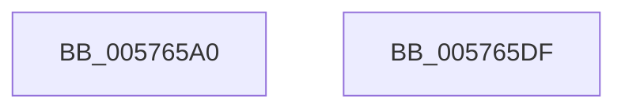

# XmImmediateEnter

- RVA: `0x005765A0`–`0x005765E0` (길이 `64` bytes)
- VA: `0x00000001405765A0`
- 실행 섹션: `.text`
- PDB 이름 있음: `예`; PDB Function 태그: `아니요`
- unwind 정보 RVA: `0x0005CF00`
- 디코드: `21`개 명령, `64/64` bytes 표시
- 미해석 바이트: `0` (있으면 어셈블리에 `.byte`로 보존)

> 이 문서는 커널 이미지의 기계어와 PDB 기호를 분석해 생성했습니다. 4번과 5번은 함수 원형과 자료형을 바이너리 사용 방식에서 추정한 C 해석이며 원본 소스 복구 결과는 아닙니다.

## 1. Dependencies

- 직접 호출 지점: **2**; 고유 호출 대상: **2**
- 직접 호출자로 확인된 함수: **0**
- RIP 상대 이미지 참조: **0**

### Outgoing calls
- `0x005765A9` → [XmGetWordImmediate](../47/XmGetWordImmediate_function_004731DC.md) (function, `0x004731DC`)
- `0x005765B7` → [XmGetCodeByte](../47/XmGetCodeByte_function_00473678.md) (function, `0x00473678`)

### Direct callers
- 이 함수 시작 RVA로 연결되는 직접 call은 확인되지 않았습니다. 간접 호출은 완전히 역산할 수 없습니다.

### Static image references
- 디코드된 RIP-relative 메모리 참조가 없습니다.

## 2. Other-region calls and transfers

- 다른 실행 섹션으로 향하는 call: **0**
- 별도 외부 분기/꼬리 이동을 확인하지 못했습니다.

## 3. Assembly (complete function range)

```asm
005765A0  40 53                           push rbx
005765A2  48 83 EC 20                     sub rsp, 0x20
005765A6  48 8B D9                        mov rbx, rcx
005765A9  E8 2E CC EF FF                  call 0x1404731dc
005765AE  0F B7 C0                        movzx eax, ax
005765B1  48 8B CB                        mov rcx, rbx
005765B4  89 43 6C                        mov dword ptr [rbx + 0x6c], eax
005765B7  E8 BC D0 EF FF                  call 0x140473678
005765BC  83 E0 1F                        and eax, 0x1f
005765BF  89 43 68                        mov dword ptr [rbx + 0x68], eax
005765C2  8A 83 8A 00 00 00               mov al, byte ptr [rbx + 0x8a]
005765C8  F6 D8                           neg al
005765CA  B8 01 00 00 00                  mov eax, 1
005765CF  1B D2                           sbb edx, edx
005765D1  83 E2 02                        and edx, 2
005765D4  03 D0                           add edx, eax
005765D6  89 53 78                        mov dword ptr [rbx + 0x78], edx
005765D9  48 83 C4 20                     add rsp, 0x20
005765DD  5B                              pop rbx
005765DE  C3                              ret
005765DF  CC                              int3
```

## 4. C-style interpretation (structured pseudocode)

```c
__int64 __fastcall XmImmediateEnter(__int64 a1, int a2)
{
    __int64 result;
    __int64 v_rsp;

    v_rsp = (v_rsp) - (32);
    result = XmGetWordImmediate(a1, a2, a3, a4);
    *(unsigned int *)(a1 + 108) = (unsigned int)((unsigned __int16)(result));
    result = XmGetCodeByte(a1, a2, a3, a4);
    result = (unsigned int)((result) & (31));
    *(unsigned int *)(a1 + 104) = (unsigned int)(result);
    result = (unsigned __int8)(-(*(unsigned __int8 *)(a1 + 138)));
    a2 = (unsigned int)((a2) & (2));
    a2 = (unsigned int)((a2) + (1));
    *(unsigned int *)(a1 + 120) = a2;
    v_rsp = (v_rsp) + (32);
    return 1;
}
```

## 5. (Beta) C Style

```c
int64_t XmImmediateEnter(void *Arg1, int32_t Arg2)
{
    uint8_t *arg1 = (uint8_t *)Arg1;

    int64_t result;
    int64_t local_rsp;

    local_rsp = (local_rsp) - (32);
    result = XmGetWordImmediate(Arg1, Arg2, a3, a4);
    *(uint32_t *)(arg1 + 0x6C) = (uint32_t)((uint16_t)(result));
    result = XmGetCodeByte(Arg1, Arg2, a3, a4);
    result = (uint32_t)((result) & (31));
    *(uint32_t *)(arg1 + 0x68) = (uint32_t)(result);
    result = (uint8_t)(-(*(uint8_t *)(arg1 + 0x8A)));
    Arg2 = (uint32_t)((Arg2) & (2));
    Arg2 = (uint32_t)((Arg2) + (1));
    *(uint32_t *)(arg1 + 0x78) = Arg2;
    local_rsp = (local_rsp) + (32);
    return 1;
}
```

### 관측된 메모리 오프셋

구조체 형식이 확인되지 않은 접근은 인자 기준의 오프셋으로만 기록했습니다.

| 기준 인자 | 오프셋 표현 | 폭 (bit) | 접근 |
|---|---:|---:|---|
| `Arg1` | `+ 0x68` | `32` | `W` |
| `Arg1` | `+ 0x6C` | `32` | `W` |
| `Arg1` | `+ 0x78` | `32` | `W` |
| `Arg1` | `+ 0x8A` | `8` | `R` |

## 6. Execution-region graph

[열기: 2D/3D 그래프와 함수 탐색 컨트롤 패널](../../../control-panel.html?section=text&rva=0x005765A0&view=graph)

- 2D 그래프는 위에서 아래로 흐르고, 3D 그래프는 빈 공간을 드래그해 회전합니다. Shift+드래그는 이동, 휠은 확대·축소, 함수 노드 선택은 대상 보고서 이동입니다.

### Static fallback


