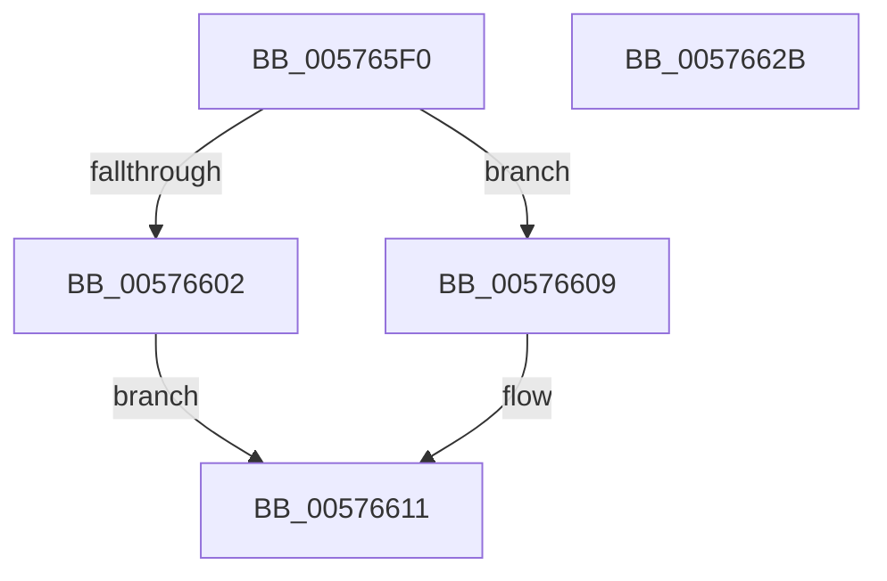

# XmImmediateJump

- RVA: `0x005765F0`–`0x0057662C` (길이 `60` bytes)
- VA: `0x00000001405765F0`
- 실행 섹션: `.text`
- PDB 이름 있음: `예`; PDB Function 태그: `아니요`
- unwind 정보 RVA: `0x0005CF00`
- 디코드: `18`개 명령, `60/60` bytes 표시
- 미해석 바이트: `0` (있으면 어셈블리에 `.byte`로 보존)

> 이 문서는 커널 이미지의 기계어와 PDB 기호를 분석해 생성했습니다. 4번과 5번은 함수 원형과 자료형을 바이너리 사용 방식에서 추정한 C 해석이며 원본 소스 복구 결과는 아닙니다.

## 1. Dependencies

- 직접 호출 지점: **3**; 고유 호출 대상: **2**
- 직접 호출자로 확인된 함수: **0**
- RIP 상대 이미지 참조: **0**

### Outgoing calls
- `0x00576602` → [XmGetLongImmediate](../56/XmGetLongImmediate_function_0056DC70.md) (function, `0x0056DC70`)
- `0x00576609` → [XmGetWordImmediate](../47/XmGetWordImmediate_function_004731DC.md) (function, `0x004731DC`)
- `0x00576617` → [XmGetWordImmediate](../47/XmGetWordImmediate_function_004731DC.md) (function, `0x004731DC`)

### Direct callers
- 이 함수 시작 RVA로 연결되는 직접 call은 확인되지 않았습니다. 간접 호출은 완전히 역산할 수 없습니다.

### Static image references
- 디코드된 RIP-relative 메모리 참조가 없습니다.

## 2. Other-region calls and transfers

- 다른 실행 섹션으로 향하는 call: **0**
- 별도 외부 분기/꼬리 이동을 확인하지 못했습니다.

## 3. Assembly (complete function range)

```asm
005765F0  40 53                           push rbx
005765F2  48 83 EC 20                     sub rsp, 0x20
005765F6  80 B9 8A 00 00 00 00            cmp byte ptr [rcx + 0x8a], 0
005765FD  48 8B D9                        mov rbx, rcx
00576600  74 07                           je 0x140576609
00576602  E8 69 76 FF FF                  call 0x14056dc70
00576607  EB 08                           jmp 0x140576611
00576609  E8 CE CB EF FF                  call 0x1404731dc
0057660E  0F B7 C0                        movzx eax, ax
00576611  48 8B CB                        mov rcx, rbx
00576614  89 43 68                        mov dword ptr [rbx + 0x68], eax
00576617  E8 C0 CB EF FF                  call 0x1404731dc
0057661C  66 89 43 52                     mov word ptr [rbx + 0x52], ax
00576620  B8 01 00 00 00                  mov eax, 1
00576625  48 83 C4 20                     add rsp, 0x20
00576629  5B                              pop rbx
0057662A  C3                              ret
0057662B  CC                              int3
```

## 4. C-style interpretation (structured pseudocode)

```c
__int64 __fastcall XmImmediateJump(__int64 a1)
{
    __int64 result;
    __int64 v_rsp;

    v_rsp = (v_rsp) - (32);
    if ((*(unsigned __int8 *)(a1 + 138)) == 0) goto loc_00576609;
    result = XmGetLongImmediate(a1, a2, a3, a4);
    goto loc_00576611;
loc_00576609:
    result = XmGetWordImmediate(a1, a2, a3, a4);
loc_00576611:
    *(unsigned int *)(a1 + 104) = (unsigned int)((unsigned __int16)(result));
    result = XmGetWordImmediate(a1, a2, a3, a4);
    *(unsigned __int16 *)(a1 + 82) = (unsigned __int16)(result);
    v_rsp = (v_rsp) + (32);
    return 1;
}
```

## 5. (Beta) C Style

```c
int64_t XmImmediateJump(void *Arg1)
{
    uint8_t *arg1 = (uint8_t *)Arg1;

    int64_t result;
    int64_t local_rsp;

    local_rsp = (local_rsp) - (32);
    if ((*(uint8_t *)(arg1 + 0x8A)) == 0) goto loc_00576609;
    result = XmGetLongImmediate(Arg1, a2, a3, a4);
    goto loc_00576611;
loc_00576609:
    result = XmGetWordImmediate(Arg1, a2, a3, a4);
loc_00576611:
    *(uint32_t *)(arg1 + 0x68) = (uint32_t)((uint16_t)(result));
    result = XmGetWordImmediate(Arg1, a2, a3, a4);
    *(uint16_t *)(arg1 + 0x52) = (uint16_t)(result);
    local_rsp = (local_rsp) + (32);
    return 1;
}
```

### 관측된 메모리 오프셋

구조체 형식이 확인되지 않은 접근은 인자 기준의 오프셋으로만 기록했습니다.

| 기준 인자 | 오프셋 표현 | 폭 (bit) | 접근 |
|---|---:|---:|---|
| `Arg1` | `+ 0x52` | `16` | `W` |
| `Arg1` | `+ 0x68` | `32` | `W` |
| `Arg1` | `+ 0x8A` | `8` | `R` |

## 6. Execution-region graph

[열기: 2D/3D 그래프와 함수 탐색 컨트롤 패널](../../../control-panel.html?section=text&rva=0x005765F0&view=graph)

- 2D 그래프는 위에서 아래로 흐르고, 3D 그래프는 빈 공간을 드래그해 회전합니다. Shift+드래그는 이동, 휠은 확대·축소, 함수 노드 선택은 대상 보고서 이동입니다.

### Static fallback


