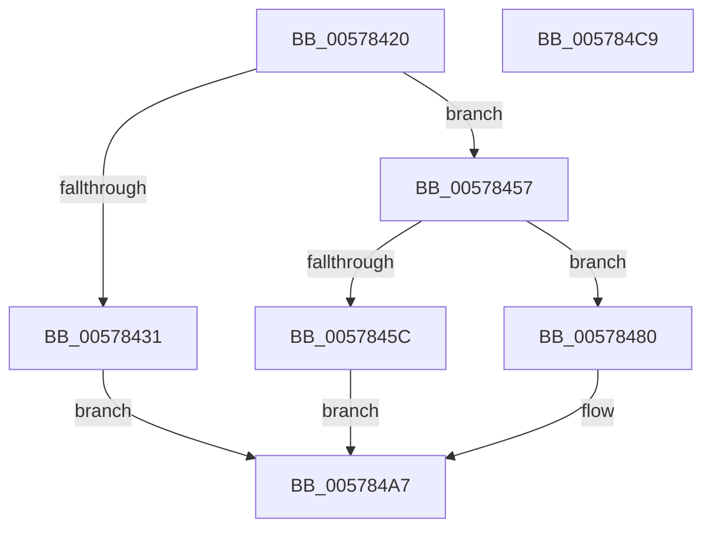

# XmImulOp

- RVA: `0x00578420`–`0x005784CA` (길이 `170` bytes)
- VA: `0x0000000140578420`
- 실행 섹션: `.text`
- PDB 이름 있음: `예`; PDB Function 태그: `아니요`
- unwind 정보 RVA: `0x0005C788`
- 디코드: `47`개 명령, `170/170` bytes 표시
- 미해석 바이트: `0` (있으면 어셈블리에 `.byte`로 보존)

> 이 문서는 커널 이미지의 기계어와 PDB 기호를 분석해 생성했습니다. 4번과 5번은 함수 원형과 자료형을 바이너리 사용 방식에서 추정한 C 해석이며 원본 소스 복구 결과는 아닙니다.

## 1. Dependencies

- 직접 호출 지점: **3**; 고유 호출 대상: **1**
- 직접 호출자로 확인된 함수: **0**
- RIP 상대 이미지 참조: **0**

### Outgoing calls
- `0x00578443` → [XmStoreResult](../47/XmStoreResult_function_004739FC.md) (function, `0x004739FC`)
- `0x00578470` → [XmStoreResult](../47/XmStoreResult_function_004739FC.md) (function, `0x004739FC`)
- `0x00578492` → [XmStoreResult](../47/XmStoreResult_function_004739FC.md) (function, `0x004739FC`)

### Direct callers
- 이 함수 시작 RVA로 연결되는 직접 call은 확인되지 않았습니다. 간접 호출은 완전히 역산할 수 없습니다.

### Static image references
- 디코드된 RIP-relative 메모리 참조가 없습니다.

## 2. Other-region calls and transfers

- 다른 실행 섹션으로 향하는 call: **0**
- 별도 외부 분기/꼬리 이동을 확인하지 못했습니다.

## 3. Assembly (complete function range)

```asm
00578420  48 83 EC 28                     sub rsp, 0x28
00578424  8B 41 78                        mov eax, dword ptr [rcx + 0x78]
00578427  45 33 D2                        xor r10d, r10d
0057842A  4C 8B D9                        mov r11, rcx
0057842D  85 C0                           test eax, eax
0057842F  75 26                           jne 0x140578457
00578431  4C 0F BE 49 6C                  movsx r9, byte ptr [rcx + 0x6c]
00578436  48 0F BE 41 68                  movsx rax, byte ptr [rcx + 0x68]
0057843B  4C 0F AF C8                     imul r9, rax
0057843F  41 0F B6 D1                     movzx edx, r9b
00578443  E8 B4 B5 EF FF                  call 0x1404739fc
00578448  41 8A C9                        mov cl, r9b
0057844B  41 C1 E9 08                     shr r9d, 8
0057844F  C0 F9 07                        sar cl, 7
00578452  44 3A C9                        cmp r9b, cl
00578455  EB 50                           jmp 0x1405784a7
00578457  83 F8 03                        cmp eax, 3
0057845A  75 24                           jne 0x140578480
0057845C  4C 63 49 6C                     movsxd r9, dword ptr [rcx + 0x6c]
00578460  48 63 41 68                     movsxd rax, dword ptr [rcx + 0x68]
00578464  4C 0F AF C8                     imul r9, rax
00578468  41 8B D1                        mov edx, r9d
0057846B  4C 89 4C 24 30                  mov qword ptr [rsp + 0x30], r9
00578470  E8 87 B5 EF FF                  call 0x1404739fc
00578475  41 C1 F9 1F                     sar r9d, 0x1f
00578479  44 39 4C 24 34                  cmp dword ptr [rsp + 0x34], r9d
0057847E  EB 27                           jmp 0x1405784a7
00578480  4C 0F BF 49 6C                  movsx r9, word ptr [rcx + 0x6c]
00578485  48 0F BF 41 68                  movsx rax, word ptr [rcx + 0x68]
0057848A  4C 0F AF C8                     imul r9, rax
0057848E  41 0F B7 D1                     movzx edx, r9w
00578492  E8 65 B5 EF FF                  call 0x1404739fc
00578497  41 0F B7 C9                     movzx ecx, r9w
0057849B  41 C1 E9 10                     shr r9d, 0x10
0057849F  66 C1 F9 0F                     sar cx, 0xf
005784A3  66 44 3B C9                     cmp r9w, cx
005784A7  41 8B 43 10                     mov eax, dword ptr [r11 + 0x10]
005784AB  41 0F 95 C2                     setne r10b
005784AF  83 E0 FE                        and eax, 0xfffffffe
005784B2  41 0B C2                        or eax, r10d
005784B5  41 C1 E2 0B                     shl r10d, 0xb
005784B9  0F BA F0 0B                     btr eax, 0xb
005784BD  41 0B C2                        or eax, r10d
005784C0  41 89 43 10                     mov dword ptr [r11 + 0x10], eax
005784C4  48 83 C4 28                     add rsp, 0x28
005784C8  C3                              ret
005784C9  CC                              int3
```

## 4. C-style interpretation (structured pseudocode)

```c
__int64 __fastcall XmImulOp(__int64 a1)
{
    __int64 result;
    __int64 v_r10;
    __int64 v_rsp;
    unsigned __int64 v_stack_p8;
    unsigned int v_stack_pC;

    v_rsp = (v_rsp) - (40);
    v_r10 = 0;
    if ((unsigned int)((unsigned int)(*(unsigned int *)(a1 + 120))) != 0) goto loc_00578457;
    a4 = ((__int8)(*(unsigned __int8 *)(a1 + 108))) * ((__int8)(*(unsigned __int8 *)(a1 + 104)));
    result = XmStoreResult(a1, (unsigned __int8)(a4), a3, a4);
    a4 = (unsigned int)((a4) >> (8));
    a1 = (unsigned __int8)(((unsigned __int8)(a4)) >> (7));
    goto loc_005784A7;
loc_00578457:
    if (((unsigned int)(result)) != 3) goto loc_00578480;
    a4 = ((int)(*(unsigned int *)(a1 + 108))) * ((int)(*(unsigned int *)(a1 + 104)));
    v_stack_p8 = a4;
    result = XmStoreResult(a1, (unsigned int)((unsigned int)(a4)), a3, a4);
    a4 = (unsigned int)((a4) >> (31));
    goto loc_005784A7;
loc_00578480:
    a4 = ((__int16)(*(unsigned __int16 *)(a1 + 108))) * ((__int16)(*(unsigned __int16 *)(a1 + 104)));
    result = XmStoreResult(a1, (unsigned __int16)(a4), a3, a4);
    a4 = (unsigned int)((a4) >> (16));
    a1 = (unsigned __int16)(((unsigned __int16)(a4)) >> (15));
loc_005784A7:
    v_r10 = (((unsigned __int16)(a4)) != ((unsigned __int16)(a1))) ? 1 : 0;
    result = (unsigned int)(((unsigned int)(*(unsigned int *)(a1 + 16))) & (0xFFFFFFFEULL));
    result = (unsigned int)((result) | ((unsigned int)(v_r10)));
    v_r10 = (unsigned int)((v_r10) << (11));
    result = (unsigned int)((result) | ((unsigned int)(v_r10)));
    *(unsigned int *)(a1 + 16) = (unsigned int)(result);
    v_rsp = (v_rsp) + (40);
    return result;
}
```

## 5. (Beta) C Style

```c
int64_t XmImulOp(void *Arg1)
{
    uint8_t *arg1 = (uint8_t *)Arg1;

    int64_t result;
    int64_t local_r10;
    int64_t local_rsp;
    uint64_t v_stack_p8;
    uint32_t v_stack_pC;

    local_rsp = (local_rsp) - (40);
    local_r10 = 0;
    if ((uint32_t)((uint32_t)(*(uint32_t *)(arg1 + 0x78))) != 0) goto loc_00578457;
    a4 = ((int8_t)(*(uint8_t *)(arg1 + 0x6C))) * ((int8_t)(*(uint8_t *)(arg1 + 0x68)));
    result = XmStoreResult(Arg1, (uint8_t)(a4), a3, a4);
    a4 = (uint32_t)((a4) >> (8));
    Arg1 = (uint8_t)(((uint8_t)(a4)) >> (7));
    goto loc_005784A7;
loc_00578457:
    if (((uint32_t)(result)) != 3) goto loc_00578480;
    a4 = ((int32_t)(*(uint32_t *)(arg1 + 0x6C))) * ((int32_t)(*(uint32_t *)(arg1 + 0x68)));
    v_stack_p8 = a4;
    result = XmStoreResult(Arg1, (uint32_t)((uint32_t)(a4)), a3, a4);
    a4 = (uint32_t)((a4) >> (31));
    goto loc_005784A7;
loc_00578480:
    a4 = ((int16_t)(*(uint16_t *)(arg1 + 0x6C))) * ((int16_t)(*(uint16_t *)(arg1 + 0x68)));
    result = XmStoreResult(Arg1, (uint16_t)(a4), a3, a4);
    a4 = (uint32_t)((a4) >> (16));
    Arg1 = (uint16_t)(((uint16_t)(a4)) >> (15));
loc_005784A7:
    local_r10 = (((uint16_t)(a4)) != ((uint16_t)(Arg1))) ? 1 : 0;
    result = (uint32_t)(((uint32_t)(*(uint32_t *)(arg1 + 0x10))) & (0xFFFFFFFEULL));
    result = (uint32_t)((result) | ((uint32_t)(local_r10)));
    local_r10 = (uint32_t)((local_r10) << (11));
    result = (uint32_t)((result) | ((uint32_t)(local_r10)));
    *(uint32_t *)(arg1 + 0x10) = (uint32_t)(result);
    local_rsp = (local_rsp) + (40);
    return result;
}
```

### 관측된 메모리 오프셋

구조체 형식이 확인되지 않은 접근은 인자 기준의 오프셋으로만 기록했습니다.

| 기준 인자 | 오프셋 표현 | 폭 (bit) | 접근 |
|---|---:|---:|---|
| `Arg1` | `+ 0x68` | `8` | `R` |
| `Arg1` | `+ 0x68` | `16` | `R` |
| `Arg1` | `+ 0x68` | `32` | `R` |
| `Arg1` | `+ 0x6C` | `8` | `R` |
| `Arg1` | `+ 0x6C` | `16` | `R` |
| `Arg1` | `+ 0x6C` | `32` | `R` |
| `Arg1` | `+ 0x78` | `32` | `R` |

## 6. Execution-region graph

[열기: 2D/3D 그래프와 함수 탐색 컨트롤 패널](../../../control-panel.html?section=text&rva=0x00578420&view=graph)

- 2D 그래프는 위에서 아래로 흐르고, 3D 그래프는 빈 공간을 드래그해 회전합니다. Shift+드래그는 이동, 휠은 확대·축소, 함수 노드 선택은 대상 보고서 이동입니다.

### Static fallback


