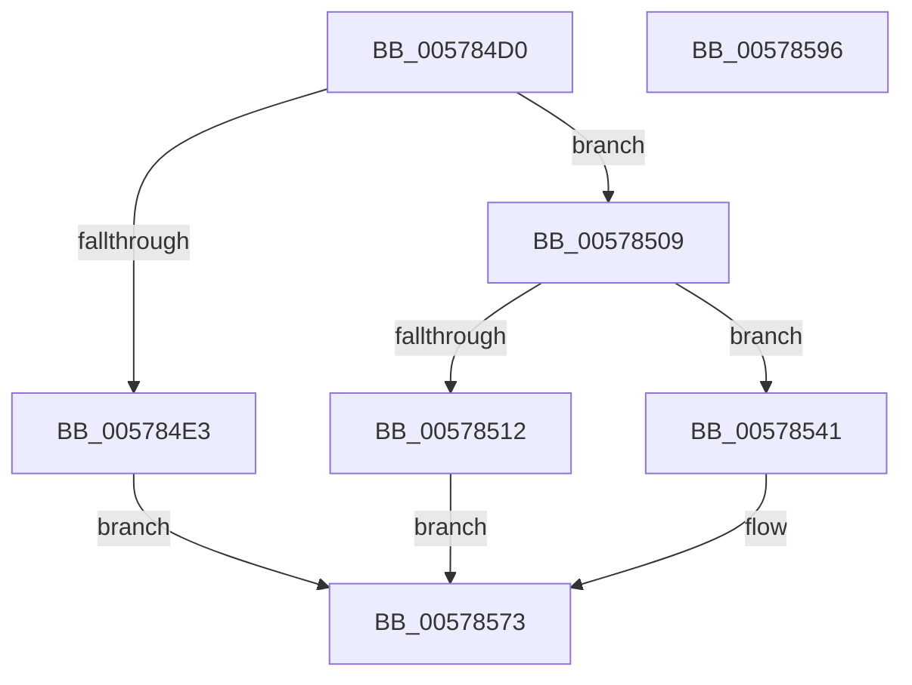

# XmImulxOp

- RVA: `0x005784D0`–`0x00578597` (길이 `199` bytes)
- VA: `0x00000001405784D0`
- 실행 섹션: `.text`
- PDB 이름 있음: `예`; PDB Function 태그: `아니요`
- unwind 정보 RVA: `0x0005CF00`
- 디코드: `56`개 명령, `199/199` bytes 표시
- 미해석 바이트: `0` (있으면 어셈블리에 `.byte`로 보존)

> 이 문서는 커널 이미지의 기계어와 PDB 기호를 분석해 생성했습니다. 4번과 5번은 함수 원형과 자료형을 바이너리 사용 방식에서 추정한 C 해석이며 원본 소스 복구 결과는 아닙니다.

## 1. Dependencies

- 직접 호출 지점: **5**; 고유 호출 대상: **1**
- 직접 호출자로 확인된 함수: **0**
- RIP 상대 이미지 참조: **0**

### Outgoing calls
- `0x005784F8` → [XmStoreResult](../47/XmStoreResult_function_004739FC.md) (function, `0x004739FC`)
- `0x00578526` → [XmStoreResult](../47/XmStoreResult_function_004739FC.md) (function, `0x004739FC`)
- `0x00578533` → [XmStoreResult](../47/XmStoreResult_function_004739FC.md) (function, `0x004739FC`)
- `0x00578553` → [XmStoreResult](../47/XmStoreResult_function_004739FC.md) (function, `0x004739FC`)
- `0x00578563` → [XmStoreResult](../47/XmStoreResult_function_004739FC.md) (function, `0x004739FC`)

### Direct callers
- 이 함수 시작 RVA로 연결되는 직접 call은 확인되지 않았습니다. 간접 호출은 완전히 역산할 수 없습니다.

### Static image references
- 디코드된 RIP-relative 메모리 참조가 없습니다.

## 2. Other-region calls and transfers

- 다른 실행 섹션으로 향하는 call: **0**
- 별도 외부 분기/꼬리 이동을 확인하지 못했습니다.

## 3. Assembly (complete function range)

```asm
005784D0  40 53                           push rbx
005784D2  48 83 EC 20                     sub rsp, 0x20
005784D6  8B 41 78                        mov eax, dword ptr [rcx + 0x78]
005784D9  45 33 DB                        xor r11d, r11d
005784DC  4C 8B D1                        mov r10, rcx
005784DF  85 C0                           test eax, eax
005784E1  75 26                           jne 0x140578509
005784E3  0F BE 51 6C                     movsx edx, byte ptr [rcx + 0x6c]
005784E7  0F BE 41 68                     movsx eax, byte ptr [rcx + 0x68]
005784EB  0F AF D0                        imul edx, eax
005784EE  C7 41 78 01 00 00 00            mov dword ptr [rcx + 0x78], 1
005784F5  0F B7 D2                        movzx edx, dx
005784F8  E8 FF B4 EF FF                  call 0x1404739fc
005784FD  8A 49 18                        mov cl, byte ptr [rcx + 0x18]
00578500  C0 F9 07                        sar cl, 7
00578503  41 38 4A 19                     cmp byte ptr [r10 + 0x19], cl
00578507  EB 6A                           jmp 0x140578573
00578509  48 8D 59 20                     lea rbx, [rcx + 0x20]
0057850D  83 F8 03                        cmp eax, 3
00578510  75 2F                           jne 0x140578541
00578512  4C 63 49 6C                     movsxd r9, dword ptr [rcx + 0x6c]
00578516  48 63 41 68                     movsxd rax, dword ptr [rcx + 0x68]
0057851A  4C 0F AF C8                     imul r9, rax
0057851E  41 8B D1                        mov edx, r9d
00578521  4C 89 4C 24 30                  mov qword ptr [rsp + 0x30], r9
00578526  E8 D1 B4 EF FF                  call 0x1404739fc
0057852B  8B 54 24 34                     mov edx, dword ptr [rsp + 0x34]
0057852F  48 89 59 58                     mov qword ptr [rcx + 0x58], rbx
00578533  E8 C4 B4 EF FF                  call 0x1404739fc
00578538  41 C1 F9 1F                     sar r9d, 0x1f
0057853C  41 3B D1                        cmp edx, r9d
0057853F  EB 32                           jmp 0x140578573
00578541  4C 0F BF 49 6C                  movsx r9, word ptr [rcx + 0x6c]
00578546  48 0F BF 41 68                  movsx rax, word ptr [rcx + 0x68]
0057854B  4C 0F AF C8                     imul r9, rax
0057854F  41 0F B7 D1                     movzx edx, r9w
00578553  E8 A4 B4 EF FF                  call 0x1404739fc
00578558  41 C1 E9 10                     shr r9d, 0x10
0057855C  41 8B D1                        mov edx, r9d
0057855F  48 89 59 58                     mov qword ptr [rcx + 0x58], rbx
00578563  E8 94 B4 EF FF                  call 0x1404739fc
00578568  0F B7 49 18                     movzx ecx, word ptr [rcx + 0x18]
0057856C  66 C1 F9 0F                     sar cx, 0xf
00578570  66 39 0B                        cmp word ptr [rbx], cx
00578573  41 8B 42 10                     mov eax, dword ptr [r10 + 0x10]
00578577  41 0F 95 C3                     setne r11b
0057857B  83 E0 FE                        and eax, 0xfffffffe
0057857E  41 0B C3                        or eax, r11d
00578581  41 C1 E3 0B                     shl r11d, 0xb
00578585  0F BA F0 0B                     btr eax, 0xb
00578589  41 0B C3                        or eax, r11d
0057858C  41 89 42 10                     mov dword ptr [r10 + 0x10], eax
00578590  48 83 C4 20                     add rsp, 0x20
00578594  5B                              pop rbx
00578595  C3                              ret
00578596  CC                              int3
```

## 4. C-style interpretation (structured pseudocode)

```c
__int64 __fastcall XmImulxOp(__int64 a1)
{
    __int64 result;
    __int64 v_r11;
    __int64 v_rsp;
    unsigned __int64 v_stack_p8;
    unsigned int v_stack_pC;

    v_rsp = (v_rsp) - (32);
    v_r11 = 0;
    if ((unsigned int)((unsigned int)(*(unsigned int *)(a1 + 120))) != 0) goto loc_00578509;
    a2 = (unsigned int)(((__int8)(*(unsigned __int8 *)(a1 + 108))) * ((unsigned int)((__int8)(*(unsigned __int8 *)(a1 + 104)))));
    *(unsigned int *)(a1 + 120) = 1;
    result = XmStoreResult(a1, (unsigned __int16)(a2), a3, a4);
    a1 = (unsigned __int8)((*(unsigned __int8 *)(a1 + 24)) >> (7));
    goto loc_00578573;
loc_00578509:
    if (((unsigned int)(result)) != 3) goto loc_00578541;
    a4 = ((int)(*(unsigned int *)(a1 + 108))) * ((int)(*(unsigned int *)(a1 + 104)));
    v_stack_p8 = a4;
    result = XmStoreResult(a1, (unsigned int)((unsigned int)(a4)), a3, a4);
    *(unsigned __int64 *)(a1 + 88) = a1 + 32;
    result = XmStoreResult(a1, (unsigned int)(v_stack_pC), a3, a4);
    a4 = (unsigned int)((a4) >> (31));
    goto loc_00578573;
loc_00578541:
    a4 = ((__int16)(*(unsigned __int16 *)(a1 + 108))) * ((__int16)(*(unsigned __int16 *)(a1 + 104)));
    result = XmStoreResult(a1, (unsigned __int16)(a4), a3, a4);
    a4 = (unsigned int)((a4) >> (16));
    *(unsigned __int64 *)(a1 + 88) = a1 + 32;
    result = XmStoreResult(a1, (unsigned int)((unsigned int)(a4)), a3, a4);
    a1 = (unsigned __int16)((*(unsigned __int16 *)(a1 + 24)) >> (15));
loc_00578573:
    v_r11 = ((*(unsigned __int16 *)(a1 + 32)) != ((unsigned __int16)(a1))) ? 1 : 0;
    result = (unsigned int)(((unsigned int)(*(unsigned int *)(a1 + 16))) & (0xFFFFFFFEULL));
    result = (unsigned int)((result) | ((unsigned int)(v_r11)));
    v_r11 = (unsigned int)((v_r11) << (11));
    result = (unsigned int)((result) | ((unsigned int)(v_r11)));
    *(unsigned int *)(a1 + 16) = (unsigned int)(result);
    v_rsp = (v_rsp) + (32);
    return result;
}
```

## 5. (Beta) C Style

```c
int64_t XmImulxOp(void *Arg1)
{
    uint8_t *arg1 = (uint8_t *)Arg1;

    int64_t result;
    int64_t local_r11;
    int64_t local_rsp;
    uint64_t v_stack_p8;
    uint32_t v_stack_pC;

    local_rsp = (local_rsp) - (32);
    local_r11 = 0;
    if ((uint32_t)((uint32_t)(*(uint32_t *)(arg1 + 0x78))) != 0) goto loc_00578509;
    a2 = (uint32_t)(((int8_t)(*(uint8_t *)(arg1 + 0x6C))) * ((uint32_t)((int8_t)(*(uint8_t *)(arg1 + 0x68)))));
    *(uint32_t *)(arg1 + 0x78) = 1;
    result = XmStoreResult(Arg1, (uint16_t)(a2), a3, a4);
    Arg1 = (uint8_t)((*(uint8_t *)(arg1 + 0x18)) >> (7));
    goto loc_00578573;
loc_00578509:
    if (((uint32_t)(result)) != 3) goto loc_00578541;
    a4 = ((int32_t)(*(uint32_t *)(arg1 + 0x6C))) * ((int32_t)(*(uint32_t *)(arg1 + 0x68)));
    v_stack_p8 = a4;
    result = XmStoreResult(Arg1, (uint32_t)((uint32_t)(a4)), a3, a4);
    *(void **)(arg1 + 0x58) = Arg1 + 32;
    result = XmStoreResult(Arg1, (uint32_t)(v_stack_pC), a3, a4);
    a4 = (uint32_t)((a4) >> (31));
    goto loc_00578573;
loc_00578541:
    a4 = ((int16_t)(*(uint16_t *)(arg1 + 0x6C))) * ((int16_t)(*(uint16_t *)(arg1 + 0x68)));
    result = XmStoreResult(Arg1, (uint16_t)(a4), a3, a4);
    a4 = (uint32_t)((a4) >> (16));
    *(void **)(arg1 + 0x58) = Arg1 + 32;
    result = XmStoreResult(Arg1, (uint32_t)((uint32_t)(a4)), a3, a4);
    Arg1 = (uint16_t)((*(uint16_t *)(arg1 + 0x18)) >> (15));
loc_00578573:
    local_r11 = ((*(uint16_t *)(arg1 + 0x20)) != ((uint16_t)(Arg1))) ? 1 : 0;
    result = (uint32_t)(((uint32_t)(*(uint32_t *)(arg1 + 0x10))) & (0xFFFFFFFEULL));
    result = (uint32_t)((result) | ((uint32_t)(local_r11)));
    local_r11 = (uint32_t)((local_r11) << (11));
    result = (uint32_t)((result) | ((uint32_t)(local_r11)));
    *(uint32_t *)(arg1 + 0x10) = (uint32_t)(result);
    local_rsp = (local_rsp) + (32);
    return result;
}
```

### 관측된 메모리 오프셋

구조체 형식이 확인되지 않은 접근은 인자 기준의 오프셋으로만 기록했습니다.

| 기준 인자 | 오프셋 표현 | 폭 (bit) | 접근 |
|---|---:|---:|---|
| `Arg1` | `+ 0x0` | `16` | `R` |
| `Arg1` | `+ 0x20` | `64` | `R` |
| `Arg1` | `+ 0x68` | `8` | `R` |
| `Arg1` | `+ 0x68` | `16` | `R` |
| `Arg1` | `+ 0x68` | `32` | `R` |
| `Arg1` | `+ 0x6C` | `8` | `R` |
| `Arg1` | `+ 0x6C` | `16` | `R` |
| `Arg1` | `+ 0x6C` | `32` | `R` |
| `Arg1` | `+ 0x78` | `32` | `R` |
| `Arg1` | `+ 0x78` | `32` | `W` |

## 6. Execution-region graph

[열기: 2D/3D 그래프와 함수 탐색 컨트롤 패널](../../../control-panel.html?section=text&rva=0x005784D0&view=graph)

- 2D 그래프는 위에서 아래로 흐르고, 3D 그래프는 빈 공간을 드래그해 회전합니다. Shift+드래그는 이동, 휠은 확대·축소, 함수 노드 선택은 대상 보고서 이동입니다.

### Static fallback


