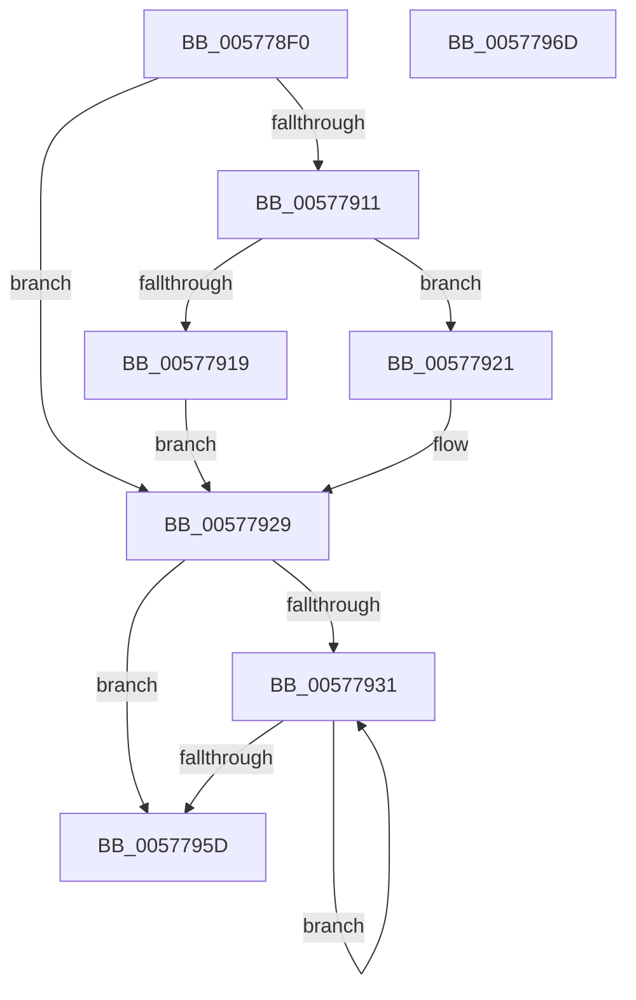

# XmInsOp

- RVA: `0x005778F0`–`0x0057796E` (길이 `126` bytes)
- VA: `0x00000001405778F0`
- 실행 섹션: `.text`
- PDB 이름 있음: `예`; PDB Function 태그: `아니요`
- unwind 정보 RVA: `0x00060BC4`
- 디코드: `38`개 명령, `126/126` bytes 표시
- 미해석 바이트: `0` (있으면 어셈블리에 `.byte`로 보존)

> 이 문서는 커널 이미지의 기계어와 PDB 기호를 분석해 생성했습니다. 4번과 5번은 함수 원형과 자료형을 바이너리 사용 방식에서 추정한 C 해석이며 원본 소스 복구 결과는 아닙니다.

## 1. Dependencies

- 직접 호출 지점: **3**; 고유 호출 대상: **3**
- 직접 호출자로 확인된 함수: **0**
- RIP 상대 이미지 참조: **0**

### Outgoing calls
- `0x0057793A` → [XmGetStringAddress](XmGetStringAddress_function_00578BCC.md) (function, `0x00578BCC`)
- `0x00577949` → [x86BiosReadIoSpace](../47/x86BiosReadIoSpace_function_00473850.md) (function, `0x00473850`)
- `0x00577953` → [XmStoreResult](../47/XmStoreResult_function_004739FC.md) (function, `0x004739FC`)

### Direct callers
- 이 함수 시작 RVA로 연결되는 직접 call은 확인되지 않았습니다. 간접 호출은 완전히 역산할 수 없습니다.

### Static image references
- 디코드된 RIP-relative 메모리 참조가 없습니다.

## 2. Other-region calls and transfers

- 다른 실행 섹션으로 향하는 call: **0**
- 별도 외부 분기/꼬리 이동을 확인하지 못했습니다.

## 3. Assembly (complete function range)

```asm
005778F0  48 89 5C 24 08                  mov qword ptr [rsp + 8], rbx
005778F5  48 89 74 24 10                  mov qword ptr [rsp + 0x10], rsi
005778FA  57                              push rdi
005778FB  48 83 EC 20                     sub rsp, 0x20
005778FF  33 C0                           xor eax, eax
00577901  48 8B D9                        mov rbx, rcx
00577904  BF 01 00 00 00                  mov edi, 1
00577909  38 81 8B 00 00 00               cmp byte ptr [rcx + 0x8b], al
0057790F  74 18                           je 0x140577929
00577911  38 81 89 00 00 00               cmp byte ptr [rcx + 0x89], al
00577917  74 08                           je 0x140577921
00577919  8B 79 1C                        mov edi, dword ptr [rcx + 0x1c]
0057791C  89 41 1C                        mov dword ptr [rcx + 0x1c], eax
0057791F  EB 08                           jmp 0x140577929
00577921  0F B7 79 1C                     movzx edi, word ptr [rcx + 0x1c]
00577925  66 89 41 1C                     mov word ptr [rcx + 0x1c], ax
00577929  0F B7 71 6C                     movzx esi, word ptr [rcx + 0x6c]
0057792D  85 FF                           test edi, edi
0057792F  74 2C                           je 0x14057795d
00577931  33 D2                           xor edx, edx
00577933  48 8B CB                        mov rcx, rbx
00577936  44 8D 42 07                     lea r8d, [rdx + 7]
0057793A  E8 8D 12 00 00                  call 0x140578bcc
0057793F  8B 4B 78                        mov ecx, dword ptr [rbx + 0x78]
00577942  0F B7 D6                        movzx edx, si
00577945  48 89 43 58                     mov qword ptr [rbx + 0x58], rax
00577949  E8 02 BF EF FF                  call 0x140473850
0057794E  8B D0                           mov edx, eax
00577950  48 8B CB                        mov rcx, rbx
00577953  E8 A4 C0 EF FF                  call 0x1404739fc
00577958  83 C7 FF                        add edi, -1
0057795B  75 D4                           jne 0x140577931
0057795D  48 8B 5C 24 30                  mov rbx, qword ptr [rsp + 0x30]
00577962  48 8B 74 24 38                  mov rsi, qword ptr [rsp + 0x38]
00577967  48 83 C4 20                     add rsp, 0x20
0057796B  5F                              pop rdi
0057796C  C3                              ret
0057796D  CC                              int3
```

## 4. C-style interpretation (structured pseudocode)

```c
__int64 __fastcall XmInsOp(__int64 a1, int a2)
{
    __int64 result;
    __int64 v_rdi;
    __int64 v_rsp;
    unsigned __int64 v_stack_p10;
    unsigned __int64 v_stack_p8;

    v_stack_p8 = v_rbx;
    v_stack_p10 = v_rsi;
    v_rsp = (v_rsp) - (32);
    result = 0;
    if ((*(unsigned __int8 *)(a1 + 139)) == 0) goto loc_00577929;
    if ((*(unsigned __int8 *)(a1 + 137)) == 0) goto loc_00577921;
    *(unsigned int *)(a1 + 28) = 0;
    goto loc_00577929;
loc_00577921:
    *(unsigned __int16 *)(a1 + 28) = 0;
loc_00577929:
    if ((unsigned int)(*(unsigned __int16 *)(a1 + 28)) == 0) goto loc_0057795D;
loc_00577931:
    a2 = 0;
    result = XmGetStringAddress(a1, a2, a2 + 7, a4);
    *(unsigned __int64 *)(a1 + 88) = result;
    result = x86BiosReadIoSpace((unsigned int)(*(unsigned int *)(a1 + 120)), (unsigned __int16)(*(unsigned __int16 *)(a1 + 108)), a2 + 7, a4);
    result = XmStoreResult(a1, (unsigned int)((unsigned int)(result)), a2 + 7, a4);
    v_rdi = (unsigned int)((*(unsigned __int16 *)(a1 + 28)) + (-1));
    if (condition_is_not_equal) goto loc_00577931;
loc_0057795D:
    v_rsp = (v_rsp) + (32);
    return result;
}
```

## 5. (Beta) C Style

```c
int64_t XmInsOp(void *Arg1, int32_t Arg2)
{
    uint8_t *arg1 = (uint8_t *)Arg1;

    int64_t result;
    int64_t local_rdi;
    int64_t local_rsp;
    uint64_t v_stack_p10;
    uint64_t v_stack_p8;

    v_stack_p8 = local_rbx;
    v_stack_p10 = local_rsi;
    local_rsp = (local_rsp) - (32);
    result = 0;
    if ((*(uint8_t *)(arg1 + 0x8B)) == 0) goto loc_00577929;
    if ((*(uint8_t *)(arg1 + 0x89)) == 0) goto loc_00577921;
    *(uint32_t *)(arg1 + 0x1C) = 0;
    goto loc_00577929;
loc_00577921:
    *(uint16_t *)(arg1 + 0x1C) = 0;
loc_00577929:
    if ((uint32_t)(*(uint16_t *)(arg1 + 0x1C)) == 0) goto loc_0057795D;
loc_00577931:
    Arg2 = 0;
    result = XmGetStringAddress(Arg1, Arg2, Arg2 + 7, a4);
    *(uint64_t *)(arg1 + 0x58) = result;
    result = x86BiosReadIoSpace((uint32_t)(*(uint32_t *)(arg1 + 0x78)), (uint16_t)(*(uint16_t *)(arg1 + 0x6C)), Arg2 + 7, a4);
    result = XmStoreResult(Arg1, (uint32_t)((uint32_t)(result)), Arg2 + 7, a4);
    local_rdi = (uint32_t)((*(uint16_t *)(arg1 + 0x1C)) + (-1));
    if (condition_is_not_equal) goto loc_00577931;
loc_0057795D:
    local_rsp = (local_rsp) + (32);
    return result;
}
```

### 관측된 메모리 오프셋

구조체 형식이 확인되지 않은 접근은 인자 기준의 오프셋으로만 기록했습니다.

| 기준 인자 | 오프셋 표현 | 폭 (bit) | 접근 |
|---|---:|---:|---|
| `Arg1` | `+ 0x1C` | `16` | `R` |
| `Arg1` | `+ 0x1C` | `16` | `W` |
| `Arg1` | `+ 0x1C` | `32` | `R` |
| `Arg1` | `+ 0x1C` | `32` | `W` |
| `Arg1` | `+ 0x58` | `64` | `W` |
| `Arg1` | `+ 0x6C` | `16` | `R` |
| `Arg1` | `+ 0x78` | `32` | `R` |
| `Arg1` | `+ 0x89` | `8` | `R` |
| `Arg1` | `+ 0x8B` | `8` | `R` |

## 6. Execution-region graph

[열기: 2D/3D 그래프와 함수 탐색 컨트롤 패널](../../../control-panel.html?section=text&rva=0x005778F0&view=graph)

- 2D 그래프는 위에서 아래로 흐르고, 3D 그래프는 빈 공간을 드래그해 회전합니다. Shift+드래그는 이동, 휠은 확대·축소, 함수 노드 선택은 대상 보고서 이동입니다.

### Static fallback


