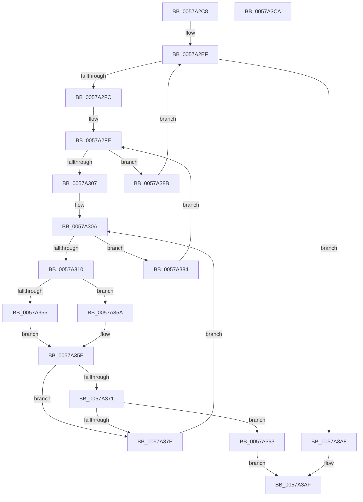

# XmInt1aFindPciClassCode

- RVA: `0x0057A2C8`–`0x0057A3CB` (길이 `259` bytes)
- VA: `0x000000014057A2C8`
- 실행 섹션: `.text`
- PDB 이름 있음: `예`; PDB Function 태그: `아니요`
- unwind 정보 RVA: `0x000C517C`
- 디코드: `80`개 명령, `259/259` bytes 표시
- 미해석 바이트: `0` (있으면 어셈블리에 `.byte`로 보존)

> 이 문서는 커널 이미지의 기계어와 PDB 기호를 분석해 생성했습니다. 4번과 5번은 함수 원형과 자료형을 바이너리 사용 방식에서 추정한 C 해석이며 원본 소스 복구 결과는 아닙니다.

## 1. Dependencies

- 직접 호출 지점: **1**; 고유 호출 대상: **1**
- 직접 호출자로 확인된 함수: **1**
- RIP 상대 이미지 참조: **2**

### Outgoing calls
- `0x0057A34B` → [guard_dispatch_icall](../6B/guard_dispatch_icall_function_006BAAD0.md) (function, `0x006BAAD0`)

### Direct callers
- [XmExecuteInt1a](XmExecuteInt1a_function_0057A214.md) at `0x0057A265`

### Static image references
- `0x0057A2EF` → RVA `0x00E10337` (`.data`; read)
- `0x0057A342` → RVA `0x00FC2300` (`.data`; read)

## 2. Other-region calls and transfers

- 다른 실행 섹션으로 향하는 call: **0**
- 별도 외부 분기/꼬리 이동을 확인하지 못했습니다.

## 3. Assembly (complete function range)

```asm
0057A2C8  48 89 5C 24 08                  mov qword ptr [rsp + 8], rbx
0057A2CD  48 89 6C 24 18                  mov qword ptr [rsp + 0x18], rbp
0057A2D2  56                              push rsi
0057A2D3  57                              push rdi
0057A2D4  41 54                           push r12
0057A2D6  41 56                           push r14
0057A2D8  41 57                           push r15
0057A2DA  48 83 EC 30                     sub rsp, 0x30
0057A2DE  33 ED                           xor ebp, ebp
0057A2E0  48 8B F9                        mov rdi, rcx
0057A2E3  44 8B E5                        mov r12d, ebp
0057A2E6  89 6C 24 68                     mov dword ptr [rsp + 0x68], ebp
0057A2EA  8B DD                           mov ebx, ebp
0057A2EC  44 8A FD                        mov r15b, bpl
0057A2EF  44 3A 3D 41 60 89 00            cmp r15b, byte ptr [rip + 0x896041]
0057A2F6  0F 83 AC 00 00 00               jae 0x14057a3a8
0057A2FC  8B F5                           mov esi, ebp
0057A2FE  83 FE 20                        cmp esi, 0x20
0057A301  0F 83 84 00 00 00               jae 0x14057a38b
0057A307  44 8B F5                        mov r14d, ebp
0057A30A  41 83 FE 08                     cmp r14d, 8
0057A30E  73 74                           jae 0x14057a384
0057A310  8B C3                           mov eax, ebx
0057A312  C7 44 24 20 04 00 00 00         mov dword ptr [rsp + 0x20], 4
0057A31A  25 00 FF FF FF                  and eax, 0xffffff00
0057A31F  4C 8D 44 24 68                  lea r8, [rsp + 0x68]
0057A324  41 8B CE                        mov ecx, r14d
0057A327  41 B9 08 00 00 00               mov r9d, 8
0057A32D  83 E1 07                        and ecx, 7
0057A330  C1 E1 05                        shl ecx, 5
0057A333  8B D9                           mov ebx, ecx
0057A335  41 0F B6 CF                     movzx ecx, r15b
0057A339  0B D8                           or ebx, eax
0057A33B  8B C6                           mov eax, esi
0057A33D  83 E0 1F                        and eax, 0x1f
0057A340  0B D8                           or ebx, eax
0057A342  48 8B 05 B7 7F A4 00            mov rax, qword ptr [rip + 0xa47fb7]
0057A349  8B D3                           mov edx, ebx
0057A34B  E8 80 07 14 00                  call 0x1406baad0
0057A350  83 F8 04                        cmp eax, 4
0057A353  74 05                           je 0x14057a35a
0057A355  83 C9 FF                        or ecx, 0xffffffff
0057A358  EB 04                           jmp 0x14057a35e
0057A35A  8B 4C 24 68                     mov ecx, dword ptr [rsp + 0x68]
0057A35E  8B 47 1C                        mov eax, dword ptr [rdi + 0x1c]
0057A361  C1 E9 08                        shr ecx, 8
0057A364  25 FF FF FF 00                  and eax, 0xffffff
0057A369  89 4C 24 68                     mov dword ptr [rsp + 0x68], ecx
0057A36D  3B C8                           cmp ecx, eax
0057A36F  75 0E                           jne 0x14057a37f
0057A371  0F B7 4F 30                     movzx ecx, word ptr [rdi + 0x30]
0057A375  41 8B C4                        mov eax, r12d
0057A378  41 FF C4                        inc r12d
0057A37B  3B C1                           cmp eax, ecx
0057A37D  74 14                           je 0x14057a393
0057A37F  41 FF C6                        inc r14d
0057A382  EB 86                           jmp 0x14057a30a
0057A384  FF C6                           inc esi
0057A386  E9 73 FF FF FF                  jmp 0x14057a2fe
0057A38B  41 FE C7                        inc r15b
0057A38E  E9 5C FF FF FF                  jmp 0x14057a2ef
0057A393  40 C0 E6 03                     shl sil, 3
0057A397  41 0A F6                        or sil, r14b
0057A39A  44 88 7F 25                     mov byte ptr [rdi + 0x25], r15b
0057A39E  83 67 10 FE                     and dword ptr [rdi + 0x10], 0xfffffffe
0057A3A2  40 88 77 24                     mov byte ptr [rdi + 0x24], sil
0057A3A6  EB 07                           jmp 0x14057a3af
0057A3A8  83 4F 10 01                     or dword ptr [rdi + 0x10], 1
0057A3AC  40 B5 86                        mov bpl, 0x86
0057A3AF  40 88 6F 19                     mov byte ptr [rdi + 0x19], bpl
0057A3B3  48 8B 5C 24 60                  mov rbx, qword ptr [rsp + 0x60]
0057A3B8  48 8B 6C 24 70                  mov rbp, qword ptr [rsp + 0x70]
0057A3BD  48 83 C4 30                     add rsp, 0x30
0057A3C1  41 5F                           pop r15
0057A3C3  41 5E                           pop r14
0057A3C5  41 5C                           pop r12
0057A3C7  5F                              pop rdi
0057A3C8  5E                              pop rsi
0057A3C9  C3                              ret
0057A3CA  CC                              int3
```

## 4. C-style interpretation (structured pseudocode)

```c
__int64 __fastcall XmInt1aFindPciClassCode(__int64 a1)
{
    __int64 result;
    __int64 v_r12;
    __int64 v_r14;
    __int64 v_r15;
    __int64 v_rbp;
    __int64 v_rbx;
    __int64 v_rsi;
    __int64 v_rsp;
    unsigned int v_stack_m38;
    unsigned int v_stack_p10;
    unsigned __int64 v_stack_p18;
    unsigned __int64 v_stack_p8;

    v_stack_p8 = v_rbx;
    v_stack_p18 = v_rbp;
    v_rsp = (v_rsp) - (48);
    v_rbp = 0;
    v_stack_p10 = 0;
loc_0057A2EF:
    if (0 >= (*(unsigned __int8 *)(v_rip + 9003073))) goto loc_0057A3A8;
loc_0057A2FE:
    if (0 >= 32) goto loc_0057A38B;
loc_0057A30A:
    if (0 >= 8) goto loc_0057A384;
    v_stack_m38 = 4;
    result = (unsigned int)((0) & (0xFFFFFF00ULL));
    a1 = (unsigned int)((0) & (7));
    a1 = (unsigned int)((a1) << (5));
    v_rbx = (unsigned int)(((unsigned int)((unsigned int)(a1))) | ((unsigned int)(result)));
    result = (unsigned int)((0) & (31));
    v_rbx = (unsigned int)((v_rbx) | ((unsigned int)(result)));
    result = guard_dispatch_icall(0, (unsigned int)((unsigned int)(v_rbx)), v_stack_p10, 8);
    if (((unsigned int)(result)) == 4) goto loc_0057A35A;
    a1 = (unsigned int)((0) | (0xFFFFFFFFULL));
    goto loc_0057A35E;
loc_0057A35A:
loc_0057A35E:
    a1 = (unsigned int)(((unsigned int)(v_stack_p10)) >> (8));
    result = (unsigned int)(((unsigned int)(*(unsigned int *)(a1 + 28))) & (0xFFFFFFULL));
    v_stack_p10 = (unsigned int)(a1);
    if (((unsigned int)(a1)) != ((unsigned int)(result))) goto loc_0057A37F;
    v_r12 = (unsigned int)((0) + 1);
    if (0 == ((unsigned int)(*(unsigned __int16 *)(a1 + 48)))) goto loc_0057A393;
loc_0057A37F:
    v_r14 = (unsigned int)((0) + 1);
    goto loc_0057A30A;
loc_0057A384:
    v_rsi = (unsigned int)((0) + 1);
    goto loc_0057A2FE;
loc_0057A38B:
    v_r15 = (unsigned __int8)((0) + 1);
    goto loc_0057A2EF;
loc_0057A393:
    v_rsi = (unsigned __int8)((v_rsi) << (3));
    v_rsi = (unsigned __int8)((v_rsi) | ((unsigned __int8)(v_r14)));
    *(unsigned __int8 *)(a1 + 37) = (unsigned __int8)(v_r15);
    *(unsigned __int8 *)(a1 + 36) = (unsigned __int8)(v_rsi);
    goto loc_0057A3AF;
loc_0057A3A8:
loc_0057A3AF:
    *(unsigned __int8 *)(a1 + 25) = 134;
    v_rsp = (v_rsp) + (48);
    return 0;
}
```

## 5. (Beta) C Style

```c
int64_t XmInt1aFindPciClassCode(void *Arg1)
{
    uint8_t *arg1 = (uint8_t *)Arg1;

    int64_t result;
    int64_t local_r12;
    int64_t local_r14;
    int64_t local_r15;
    int64_t local_rbp;
    int64_t local_rbx;
    int64_t local_rsi;
    int64_t local_rsp;
    uint32_t v_stack_m38;
    uint32_t v_stack_p10;
    uint64_t v_stack_p18;
    uint64_t v_stack_p8;

    v_stack_p8 = local_rbx;
    v_stack_p18 = local_rbp;
    local_rsp = (local_rsp) - (48);
    local_rbp = 0;
    v_stack_p10 = 0;
loc_0057A2EF:
    if (0 >= (*(uint8_t *)(v_rip + 0x896041))) goto loc_0057A3A8;
loc_0057A2FE:
    if (0 >= 32) goto loc_0057A38B;
loc_0057A30A:
    if (0 >= 8) goto loc_0057A384;
    v_stack_m38 = 4;
    result = (uint32_t)((0) & (0xFFFFFF00ULL));
    Arg1 = (uint32_t)((0) & (7));
    Arg1 = (uint32_t)((Arg1) << (5));
    local_rbx = (uint32_t)(((uint32_t)((uint32_t)(Arg1))) | ((uint32_t)(result)));
    result = (uint32_t)((0) & (31));
    local_rbx = (uint32_t)((local_rbx) | ((uint32_t)(result)));
    result = guard_dispatch_icall(0, (uint32_t)((uint32_t)(local_rbx)), v_stack_p10, 8);
    if (((uint32_t)(result)) == 4) goto loc_0057A35A;
    Arg1 = (uint32_t)((0) | (0xFFFFFFFFULL));
    goto loc_0057A35E;
loc_0057A35A:
loc_0057A35E:
    Arg1 = (uint32_t)(((uint32_t)(v_stack_p10)) >> (8));
    result = (uint32_t)(((uint32_t)(*(uint32_t *)(arg1 + 0x1C))) & (0xFFFFFFULL));
    v_stack_p10 = (uint32_t)(Arg1);
    if (((uint32_t)(Arg1)) != ((uint32_t)(result))) goto loc_0057A37F;
    local_r12 = (uint32_t)((0) + 1);
    if (0 == ((uint32_t)(*(uint16_t *)(arg1 + 0x30)))) goto loc_0057A393;
loc_0057A37F:
    local_r14 = (uint32_t)((0) + 1);
    goto loc_0057A30A;
loc_0057A384:
    local_rsi = (uint32_t)((0) + 1);
    goto loc_0057A2FE;
loc_0057A38B:
    local_r15 = (uint8_t)((0) + 1);
    goto loc_0057A2EF;
loc_0057A393:
    local_rsi = (uint8_t)((local_rsi) << (3));
    local_rsi = (uint8_t)((local_rsi) | ((uint8_t)(local_r14)));
    *(uint8_t *)(arg1 + 0x25) = (uint8_t)(local_r15);
    *(uint8_t *)(arg1 + 0x24) = (uint8_t)(local_rsi);
    goto loc_0057A3AF;
loc_0057A3A8:
loc_0057A3AF:
    *(uint8_t *)(arg1 + 0x19) = 134;
    local_rsp = (local_rsp) + (48);
    return 0;
}
```

### 관측된 메모리 오프셋

구조체 형식이 확인되지 않은 접근은 인자 기준의 오프셋으로만 기록했습니다.

| 기준 인자 | 오프셋 표현 | 폭 (bit) | 접근 |
|---|---:|---:|---|
| `Arg1` | `+ 0x10` | `32` | `R/W` |
| `Arg1` | `+ 0x19` | `8` | `W` |
| `Arg1` | `+ 0x1C` | `32` | `R` |
| `Arg1` | `+ 0x24` | `8` | `W` |
| `Arg1` | `+ 0x25` | `8` | `W` |
| `Arg1` | `+ 0x30` | `16` | `R` |

## 6. Execution-region graph

[열기: 2D/3D 그래프와 함수 탐색 컨트롤 패널](../../../control-panel.html?section=text&rva=0x0057A2C8&view=graph)

- 2D 그래프는 위에서 아래로 흐르고, 3D 그래프는 빈 공간을 드래그해 회전합니다. Shift+드래그는 이동, 휠은 확대·축소, 함수 노드 선택은 대상 보고서 이동입니다.

### Static fallback


