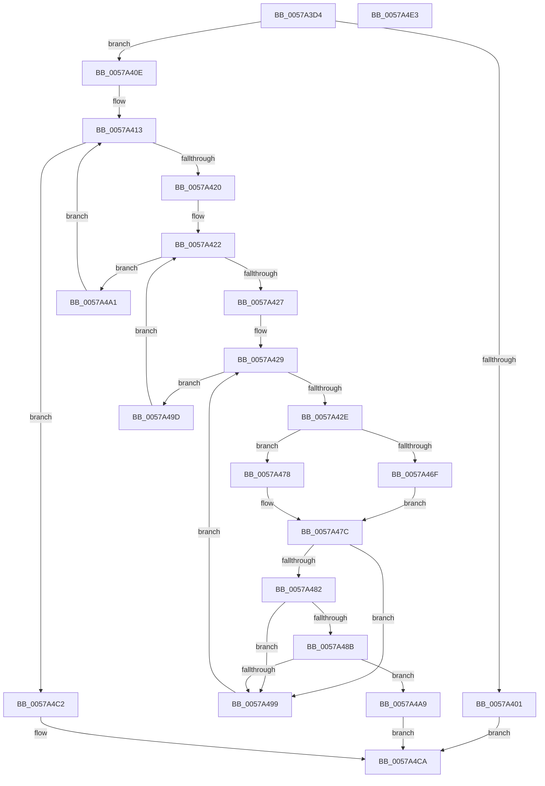

# XmInt1aFindPciDevice

- RVA: `0x0057A3D4`–`0x0057A4E4` (길이 `272` bytes)
- VA: `0x000000014057A3D4`
- 실행 섹션: `.text`
- PDB 이름 있음: `예`; PDB Function 태그: `아니요`
- unwind 정보 RVA: `0x0009F048`
- 디코드: `84`개 명령, `272/272` bytes 표시
- 미해석 바이트: `0` (있으면 어셈블리에 `.byte`로 보존)

> 이 문서는 커널 이미지의 기계어와 PDB 기호를 분석해 생성했습니다. 4번과 5번은 함수 원형과 자료형을 바이너리 사용 방식에서 추정한 C 해석이며 원본 소스 복구 결과는 아닙니다.

## 1. Dependencies

- 직접 호출 지점: **1**; 고유 호출 대상: **1**
- 직접 호출자로 확인된 함수: **1**
- RIP 상대 이미지 참조: **2**

### Outgoing calls
- `0x0057A465` → [guard_dispatch_icall](../6B/guard_dispatch_icall_function_006BAAD0.md) (function, `0x006BAAD0`)

### Direct callers
- [XmExecuteInt1a](XmExecuteInt1a_function_0057A214.md) at `0x0057A26C`

### Static image references
- `0x0057A413` → RVA `0x00E10337` (`.data`; read)
- `0x0057A45C` → RVA `0x00FC2300` (`.data`; read)

## 2. Other-region calls and transfers

- 다른 실행 섹션으로 향하는 call: **0**
- 별도 외부 분기/꼬리 이동을 확인하지 못했습니다.

## 3. Assembly (complete function range)

```asm
0057A3D4  48 8B C4                        mov rax, rsp
0057A3D7  48 89 58 10                     mov qword ptr [rax + 0x10], rbx
0057A3DB  48 89 68 18                     mov qword ptr [rax + 0x18], rbp
0057A3DF  48 89 70 20                     mov qword ptr [rax + 0x20], rsi
0057A3E3  57                              push rdi
0057A3E4  41 56                           push r14
0057A3E6  41 57                           push r15
0057A3E8  48 83 EC 30                     sub rsp, 0x30
0057A3EC  45 33 FF                        xor r15d, r15d
0057A3EF  48 8B F9                        mov rdi, rcx
0057A3F2  44 21 78 08                     and dword ptr [rax + 8], r15d
0057A3F6  B8 FF FF 00 00                  mov eax, 0xffff
0057A3FB  66 39 41 18                     cmp word ptr [rcx + 0x18], ax
0057A3FF  75 0D                           jne 0x14057a40e
0057A401  83 49 10 01                     or dword ptr [rcx + 0x10], 1
0057A405  C6 41 19 83                     mov byte ptr [rcx + 0x19], 0x83
0057A409  E9 BC 00 00 00                  jmp 0x14057a4ca
0057A40E  33 DB                           xor ebx, ebx
0057A410  45 32 F6                        xor r14b, r14b
0057A413  44 3A 35 1D 5F 89 00            cmp r14b, byte ptr [rip + 0x895f1d]
0057A41A  0F 83 A2 00 00 00               jae 0x14057a4c2
0057A420  33 F6                           xor esi, esi
0057A422  83 FE 20                        cmp esi, 0x20
0057A425  73 7A                           jae 0x14057a4a1
0057A427  33 ED                           xor ebp, ebp
0057A429  83 FD 08                        cmp ebp, 8
0057A42C  73 6F                           jae 0x14057a49d
0057A42E  8B C3                           mov eax, ebx
0057A430  C7 44 24 20 04 00 00 00         mov dword ptr [rsp + 0x20], 4
0057A438  25 00 FF FF FF                  and eax, 0xffffff00
0057A43D  4C 8D 44 24 50                  lea r8, [rsp + 0x50]
0057A442  8B CD                           mov ecx, ebp
0057A444  45 33 C9                        xor r9d, r9d
0057A447  83 E1 07                        and ecx, 7
0057A44A  C1 E1 05                        shl ecx, 5
0057A44D  8B D9                           mov ebx, ecx
0057A44F  41 0F B6 CE                     movzx ecx, r14b
0057A453  0B D8                           or ebx, eax
0057A455  8B C6                           mov eax, esi
0057A457  83 E0 1F                        and eax, 0x1f
0057A45A  0B D8                           or ebx, eax
0057A45C  48 8B 05 9D 7E A4 00            mov rax, qword ptr [rip + 0xa47e9d]
0057A463  8B D3                           mov edx, ebx
0057A465  E8 66 06 14 00                  call 0x1406baad0
0057A46A  83 F8 04                        cmp eax, 4
0057A46D  74 09                           je 0x14057a478
0057A46F  83 C9 FF                        or ecx, 0xffffffff
0057A472  89 4C 24 50                     mov dword ptr [rsp + 0x50], ecx
0057A476  EB 04                           jmp 0x14057a47c
0057A478  8B 4C 24 50                     mov ecx, dword ptr [rsp + 0x50]
0057A47C  66 3B 4F 20                     cmp cx, word ptr [rdi + 0x20]
0057A480  75 17                           jne 0x14057a499
0057A482  C1 E9 10                        shr ecx, 0x10
0057A485  66 3B 4F 1C                     cmp cx, word ptr [rdi + 0x1c]
0057A489  75 0E                           jne 0x14057a499
0057A48B  0F B7 4F 30                     movzx ecx, word ptr [rdi + 0x30]
0057A48F  41 8B C7                        mov eax, r15d
0057A492  41 FF C7                        inc r15d
0057A495  3B C1                           cmp eax, ecx
0057A497  74 10                           je 0x14057a4a9
0057A499  FF C5                           inc ebp
0057A49B  EB 8C                           jmp 0x14057a429
0057A49D  FF C6                           inc esi
0057A49F  EB 81                           jmp 0x14057a422
0057A4A1  41 FE C6                        inc r14b
0057A4A4  E9 6A FF FF FF                  jmp 0x14057a413
0057A4A9  40 C0 E6 03                     shl sil, 3
0057A4AD  40 0A F5                        or sil, bpl
0057A4B0  44 88 77 25                     mov byte ptr [rdi + 0x25], r14b
0057A4B4  83 67 10 FE                     and dword ptr [rdi + 0x10], 0xfffffffe
0057A4B8  40 88 77 24                     mov byte ptr [rdi + 0x24], sil
0057A4BC  C6 47 19 00                     mov byte ptr [rdi + 0x19], 0
0057A4C0  EB 08                           jmp 0x14057a4ca
0057A4C2  83 4F 10 01                     or dword ptr [rdi + 0x10], 1
0057A4C6  C6 47 19 86                     mov byte ptr [rdi + 0x19], 0x86
0057A4CA  48 8B 5C 24 58                  mov rbx, qword ptr [rsp + 0x58]
0057A4CF  48 8B 6C 24 60                  mov rbp, qword ptr [rsp + 0x60]
0057A4D4  48 8B 74 24 68                  mov rsi, qword ptr [rsp + 0x68]
0057A4D9  48 83 C4 30                     add rsp, 0x30
0057A4DD  41 5F                           pop r15
0057A4DF  41 5E                           pop r14
0057A4E1  5F                              pop rdi
0057A4E2  C3                              ret
0057A4E3  CC                              int3
```

## 4. C-style interpretation (structured pseudocode)

```c
__int64 __fastcall XmInt1aFindPciDevice(__int64 a1, __int64 a2, __int64 a3, int a4)
{
    __int64 result;
    __int64 v_r14;
    __int64 v_r15;
    __int64 v_rbp;
    __int64 v_rbx;
    __int64 v_rsi;
    __int64 v_rsp;
    unsigned int v_stack_m28;
    unsigned __int64 v_stack_p10;
    unsigned __int64 v_stack_p18;
    unsigned __int64 v_stack_p20;
    unsigned __int64 v_stack_p8;

    *(unsigned __int64 *)(v_rsp + 16) = v_rbx;
    *(unsigned __int64 *)(v_rsp + 24) = v_rbp;
    *(unsigned __int64 *)(v_rsp + 32) = v_rsi;
    v_rsp = (v_rsp) - (48);
    v_r15 = 0;
    if ((*(unsigned __int16 *)(a1 + 24)) != ((unsigned __int16)((unsigned int)(0xFFFFULL)))) goto loc_0057A40E;
    *(unsigned __int8 *)(a1 + 25) = 131;
    goto loc_0057A4CA;
loc_0057A40E:
    v_rbx = 0;
    v_r14 = 0;
loc_0057A413:
    if (0 >= (*(unsigned __int8 *)(v_rip + 9002781))) goto loc_0057A4C2;
    v_rsi = 0;
loc_0057A422:
    if (0 >= 32) goto loc_0057A4A1;
    v_rbp = 0;
loc_0057A429:
    if (0 >= 8) goto loc_0057A49D;
    v_stack_m28 = 4;
    result = (unsigned int)((0) & (0xFFFFFF00ULL));
    a4 = 0;
    a1 = (unsigned int)((0) & (7));
    a1 = (unsigned int)((a1) << (5));
    v_rbx = (unsigned int)(((unsigned int)((unsigned int)(a1))) | ((unsigned int)(result)));
    result = (unsigned int)((0) & (31));
    v_rbx = (unsigned int)((v_rbx) | ((unsigned int)(result)));
    result = guard_dispatch_icall(0, (unsigned int)((unsigned int)(v_rbx)), v_stack_p8, a4);
    if (((unsigned int)(result)) == 4) goto loc_0057A478;
    a1 = (unsigned int)((0) | (0xFFFFFFFFULL));
    v_stack_p8 = (unsigned int)(a1);
    goto loc_0057A47C;
loc_0057A478:
loc_0057A47C:
    if (((unsigned __int16)((unsigned int)(v_stack_p8))) != (*(unsigned __int16 *)(a1 + 32))) goto loc_0057A499;
    a1 = (unsigned int)(((unsigned int)(v_stack_p8)) >> (16));
    if (((unsigned __int16)(a1)) != (*(unsigned __int16 *)(a1 + 28))) goto loc_0057A499;
    v_r15 = (unsigned int)((v_r15) + 1);
    if (0 == ((unsigned int)(*(unsigned __int16 *)(a1 + 48)))) goto loc_0057A4A9;
loc_0057A499:
    v_rbp = (unsigned int)((v_rbp) + 1);
    goto loc_0057A429;
loc_0057A49D:
    v_rsi = (unsigned int)((v_rsi) + 1);
    goto loc_0057A422;
loc_0057A4A1:
    v_r14 = (unsigned __int8)((v_r14) + 1);
    goto loc_0057A413;
loc_0057A4A9:
    v_rsi = (unsigned __int8)((v_rsi) << (3));
    v_rsi = (unsigned __int8)((v_rsi) | ((unsigned __int8)(v_rbp)));
    *(unsigned __int8 *)(a1 + 37) = (unsigned __int8)(v_r14);
    *(unsigned __int8 *)(a1 + 36) = (unsigned __int8)(v_rsi);
    *(unsigned __int8 *)(a1 + 25) = 0;
    goto loc_0057A4CA;
loc_0057A4C2:
    *(unsigned __int8 *)(a1 + 25) = 134;
loc_0057A4CA:
    v_rsp = (v_rsp) + (48);
    return 0;
}
```

## 5. (Beta) C Style

```c
int64_t XmInt1aFindPciDevice(void *Arg1, int64_t Arg2, int64_t Arg3, int32_t Arg4)
{
    uint8_t *arg1 = (uint8_t *)Arg1;

    int64_t result;
    int64_t local_r14;
    int64_t local_r15;
    int64_t local_rbp;
    int64_t local_rbx;
    int64_t local_rsi;
    int64_t local_rsp;
    uint32_t v_stack_m28;
    uint64_t v_stack_p10;
    uint64_t v_stack_p18;
    uint64_t v_stack_p20;
    uint64_t v_stack_p8;

    *(uint64_t *)(local_rsp + 0x10) = local_rbx;
    *(uint64_t *)(local_rsp + 0x18) = local_rbp;
    *(uint64_t *)(local_rsp + 0x20) = local_rsi;
    local_rsp = (local_rsp) - (48);
    local_r15 = 0;
    if ((*(uint16_t *)(arg1 + 0x18)) != ((uint16_t)((uint32_t)(0xFFFFULL)))) goto loc_0057A40E;
    *(uint8_t *)(arg1 + 0x19) = 131;
    goto loc_0057A4CA;
loc_0057A40E:
    local_rbx = 0;
    local_r14 = 0;
loc_0057A413:
    if (0 >= (*(uint8_t *)(v_rip + 0x895F1D))) goto loc_0057A4C2;
    local_rsi = 0;
loc_0057A422:
    if (0 >= 32) goto loc_0057A4A1;
    local_rbp = 0;
loc_0057A429:
    if (0 >= 8) goto loc_0057A49D;
    v_stack_m28 = 4;
    result = (uint32_t)((0) & (0xFFFFFF00ULL));
    Arg4 = 0;
    Arg1 = (uint32_t)((0) & (7));
    Arg1 = (uint32_t)((Arg1) << (5));
    local_rbx = (uint32_t)(((uint32_t)((uint32_t)(Arg1))) | ((uint32_t)(result)));
    result = (uint32_t)((0) & (31));
    local_rbx = (uint32_t)((local_rbx) | ((uint32_t)(result)));
    result = guard_dispatch_icall(0, (uint32_t)((uint32_t)(local_rbx)), v_stack_p8, Arg4);
    if (((uint32_t)(result)) == 4) goto loc_0057A478;
    Arg1 = (uint32_t)((0) | (0xFFFFFFFFULL));
    v_stack_p8 = (uint32_t)(Arg1);
    goto loc_0057A47C;
loc_0057A478:
loc_0057A47C:
    if (((uint16_t)((uint32_t)(v_stack_p8))) != (*(uint16_t *)(arg1 + 0x20))) goto loc_0057A499;
    Arg1 = (uint32_t)(((uint32_t)(v_stack_p8)) >> (16));
    if (((uint16_t)(Arg1)) != (*(uint16_t *)(arg1 + 0x1C))) goto loc_0057A499;
    local_r15 = (uint32_t)((local_r15) + 1);
    if (0 == ((uint32_t)(*(uint16_t *)(arg1 + 0x30)))) goto loc_0057A4A9;
loc_0057A499:
    local_rbp = (uint32_t)((local_rbp) + 1);
    goto loc_0057A429;
loc_0057A49D:
    local_rsi = (uint32_t)((local_rsi) + 1);
    goto loc_0057A422;
loc_0057A4A1:
    local_r14 = (uint8_t)((local_r14) + 1);
    goto loc_0057A413;
loc_0057A4A9:
    local_rsi = (uint8_t)((local_rsi) << (3));
    local_rsi = (uint8_t)((local_rsi) | ((uint8_t)(local_rbp)));
    *(uint8_t *)(arg1 + 0x25) = (uint8_t)(local_r14);
    *(uint8_t *)(arg1 + 0x24) = (uint8_t)(local_rsi);
    *(uint8_t *)(arg1 + 0x19) = 0;
    goto loc_0057A4CA;
loc_0057A4C2:
    *(uint8_t *)(arg1 + 0x19) = 134;
loc_0057A4CA:
    local_rsp = (local_rsp) + (48);
    return 0;
}
```

### 관측된 메모리 오프셋

구조체 형식이 확인되지 않은 접근은 인자 기준의 오프셋으로만 기록했습니다.

| 기준 인자 | 오프셋 표현 | 폭 (bit) | 접근 |
|---|---:|---:|---|
| `Arg1` | `+ 0x10` | `32` | `R/W` |
| `Arg1` | `+ 0x18` | `16` | `R` |
| `Arg1` | `+ 0x19` | `8` | `W` |
| `Arg1` | `+ 0x1C` | `16` | `R` |
| `Arg1` | `+ 0x20` | `16` | `R` |
| `Arg1` | `+ 0x24` | `8` | `W` |
| `Arg1` | `+ 0x25` | `8` | `W` |
| `Arg1` | `+ 0x30` | `16` | `R` |

## 6. Execution-region graph

[열기: 2D/3D 그래프와 함수 탐색 컨트롤 패널](../../../control-panel.html?section=text&rva=0x0057A3D4&view=graph)

- 2D 그래프는 위에서 아래로 흐르고, 3D 그래프는 빈 공간을 드래그해 회전합니다. Shift+드래그는 이동, 휠은 확대·축소, 함수 노드 선택은 대상 보고서 이동입니다.

### Static fallback


