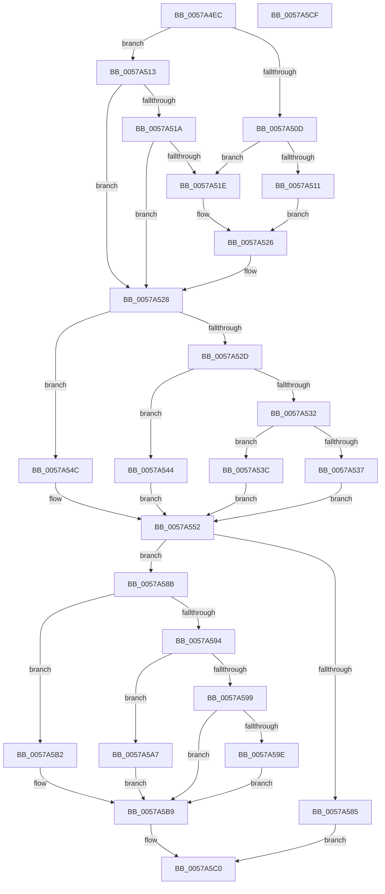

# XmInt1aReadConfigRegister

- RVA: `0x0057A4EC`–`0x0057A5D0` (길이 `228` bytes)
- VA: `0x000000014057A4EC`
- 실행 섹션: `.text`
- PDB 이름 있음: `예`; PDB Function 태그: `아니요`
- unwind 정보 RVA: `0x0008A658`
- 디코드: `73`개 명령, `228/228` bytes 표시
- 미해석 바이트: `0` (있으면 어셈블리에 `.byte`로 보존)

> 이 문서는 커널 이미지의 기계어와 PDB 기호를 분석해 생성했습니다. 4번과 5번은 함수 원형과 자료형을 바이너리 사용 방식에서 추정한 C 해석이며 원본 소스 복구 결과는 아닙니다.

## 1. Dependencies

- 직접 호출 지점: **1**; 고유 호출 대상: **1**
- 직접 호출자로 확인된 함수: **1**
- RIP 상대 이미지 참조: **1**

### Outgoing calls
- `0x0057A57C` → [guard_dispatch_icall](../6B/guard_dispatch_icall_function_006BAAD0.md) (function, `0x006BAAD0`)

### Direct callers
- [XmExecuteInt1a](XmExecuteInt1a_function_0057A214.md) at `0x0057A294`

### Static image references
- `0x0057A575` → RVA `0x00FC2300` (`.data`; read)

## 2. Other-region calls and transfers

- 다른 실행 섹션으로 향하는 call: **0**
- 별도 외부 분기/꼬리 이동을 확인하지 못했습니다.

## 3. Assembly (complete function range)

```asm
0057A4EC  48 89 5C 24 10                  mov qword ptr [rsp + 0x10], rbx
0057A4F1  57                              push rdi
0057A4F2  48 83 EC 30                     sub rsp, 0x30
0057A4F6  83 64 24 40 00                  and dword ptr [rsp + 0x40], 0
0057A4FB  48 8B D9                        mov rbx, rcx
0057A4FE  0F B6 49 18                     movzx ecx, byte ptr [rcx + 0x18]
0057A502  40 B7 87                        mov dil, 0x87
0057A505  8A 43 24                        mov al, byte ptr [rbx + 0x24]
0057A508  80 F9 09                        cmp cl, 9
0057A50B  75 06                           jne 0x14057a513
0057A50D  A8 01                           test al, 1
0057A50F  75 0D                           jne 0x14057a51e
0057A511  EB 13                           jmp 0x14057a526
0057A513  8A D0                           mov dl, al
0057A515  80 F9 0A                        cmp cl, 0xa
0057A518  75 0E                           jne 0x14057a528
0057A51A  A8 03                           test al, 3
0057A51C  74 0A                           je 0x14057a528
0057A51E  83 4B 10 01                     or dword ptr [rbx + 0x10], 1
0057A522  40 88 7B 19                     mov byte ptr [rbx + 0x19], dil
0057A526  8A D0                           mov dl, al
0057A528  83 E9 08                        sub ecx, 8
0057A52B  74 1F                           je 0x14057a54c
0057A52D  83 E9 01                        sub ecx, 1
0057A530  74 12                           je 0x14057a544
0057A532  83 F9 01                        cmp ecx, 1
0057A535  74 05                           je 0x14057a53c
0057A537  45 33 C0                        xor r8d, r8d
0057A53A  EB 16                           jmp 0x14057a552
0057A53C  41 B8 04 00 00 00               mov r8d, 4
0057A542  EB 0E                           jmp 0x14057a552
0057A544  41 B8 02 00 00 00               mov r8d, 2
0057A54A  EB 06                           jmp 0x14057a552
0057A54C  41 B8 01 00 00 00               mov r8d, 1
0057A552  44 0F B7 4B 34                  movzx r9d, word ptr [rbx + 0x34]
0057A557  0F B6 4B 25                     movzx ecx, byte ptr [rbx + 0x25]
0057A55B  0F B6 C2                        movzx eax, dl
0057A55E  8B D0                           mov edx, eax
0057A560  44 89 44 24 20                  mov dword ptr [rsp + 0x20], r8d
0057A565  83 E2 07                        and edx, 7
0057A568  C1 E8 03                        shr eax, 3
0057A56B  C1 E2 05                        shl edx, 5
0057A56E  4C 8D 44 24 40                  lea r8, [rsp + 0x40]
0057A573  0B D0                           or edx, eax
0057A575  48 8B 05 84 7D A4 00            mov rax, qword ptr [rip + 0xa47d84]
0057A57C  E8 4F 05 14 00                  call 0x1406baad0
0057A581  85 C0                           test eax, eax
0057A583  75 06                           jne 0x14057a58b
0057A585  83 4B 10 01                     or dword ptr [rbx + 0x10], 1
0057A589  EB 35                           jmp 0x14057a5c0
0057A58B  0F B6 4B 18                     movzx ecx, byte ptr [rbx + 0x18]
0057A58F  83 E9 08                        sub ecx, 8
0057A592  74 1E                           je 0x14057a5b2
0057A594  83 E9 01                        sub ecx, 1
0057A597  74 0E                           je 0x14057a5a7
0057A599  83 F9 01                        cmp ecx, 1
0057A59C  75 1B                           jne 0x14057a5b9
0057A59E  8B 44 24 40                     mov eax, dword ptr [rsp + 0x40]
0057A5A2  89 43 1C                        mov dword ptr [rbx + 0x1c], eax
0057A5A5  EB 12                           jmp 0x14057a5b9
0057A5A7  0F B7 44 24 40                  movzx eax, word ptr [rsp + 0x40]
0057A5AC  66 89 43 1C                     mov word ptr [rbx + 0x1c], ax
0057A5B0  EB 07                           jmp 0x14057a5b9
0057A5B2  8A 44 24 40                     mov al, byte ptr [rsp + 0x40]
0057A5B6  88 43 1C                        mov byte ptr [rbx + 0x1c], al
0057A5B9  83 63 10 FE                     and dword ptr [rbx + 0x10], 0xfffffffe
0057A5BD  40 32 FF                        xor dil, dil
0057A5C0  40 88 7B 19                     mov byte ptr [rbx + 0x19], dil
0057A5C4  48 8B 5C 24 48                  mov rbx, qword ptr [rsp + 0x48]
0057A5C9  48 83 C4 30                     add rsp, 0x30
0057A5CD  5F                              pop rdi
0057A5CE  C3                              ret
0057A5CF  CC                              int3
```

## 4. C-style interpretation (structured pseudocode)

```c
__int64 __fastcall XmInt1aReadConfigRegister(__int64 a1, __int64 a2, int a3)
{
    __int64 result;
    __int64 v_rdi;
    __int64 v_rsp;
    unsigned int v_stack_m18;
    unsigned __int64 v_stack_p10;
    unsigned int v_stack_p8;

    v_stack_p10 = v_rbx;
    v_rsp = (v_rsp) - (48);
    if (((unsigned __int8)(*(unsigned __int8 *)(a1 + 24))) != 9) goto loc_0057A513;
    if ((((unsigned __int8)(*(unsigned __int8 *)(a1 + 36))) & (1)) != 0) goto loc_0057A51E;
    goto loc_0057A526;
loc_0057A513:
    if (((unsigned __int8)(*(unsigned __int8 *)(a1 + 24))) != 10) goto loc_0057A528;
    if ((((unsigned __int8)(*(unsigned __int8 *)(a1 + 36))) & (3)) == 0) goto loc_0057A528;
loc_0057A51E:
    *(unsigned __int8 *)(a1 + 25) = 135;
loc_0057A526:
loc_0057A528:
    a1 = (unsigned int)((*(unsigned __int8 *)(a1 + 24)) - (8));
    if (condition_is_equal) goto loc_0057A54C;
    a1 = (unsigned int)((a1) - (1));
    if (condition_is_equal) goto loc_0057A544;
    if (((unsigned int)(a1)) == 1) goto loc_0057A53C;
    a3 = 0;
    goto loc_0057A552;
loc_0057A53C:
    goto loc_0057A552;
loc_0057A544:
    goto loc_0057A552;
loc_0057A54C:
loc_0057A552:
    v_stack_m18 = 1;
    a2 = (unsigned int)(((unsigned int)((unsigned int)((unsigned __int8)((unsigned __int8)(*(unsigned __int8 *)(a1 + 36)))))) & (7));
    result = (unsigned int)(((unsigned __int8)((unsigned __int8)(*(unsigned __int8 *)(a1 + 36)))) >> (3));
    a2 = (unsigned int)((a2) << (5));
    a2 = (unsigned int)((a2) | ((unsigned int)(result)));
    result = guard_dispatch_icall(*(unsigned __int8 *)(a1 + 37), a2, v_stack_p8, *(unsigned __int16 *)(a1 + 52));
    if ((unsigned int)(result) != 0) goto loc_0057A58B;
    goto loc_0057A5C0;
loc_0057A58B:
    a1 = (unsigned int)((*(unsigned __int8 *)(a1 + 24)) - (8));
    if (condition_is_equal) goto loc_0057A5B2;
    a1 = (unsigned int)((a1) - (1));
    if (condition_is_equal) goto loc_0057A5A7;
    if (((unsigned int)(a1)) != 1) goto loc_0057A5B9;
    *(unsigned int *)(a1 + 28) = (unsigned int)((unsigned int)(v_stack_p8));
    goto loc_0057A5B9;
loc_0057A5A7:
    *(unsigned __int16 *)(a1 + 28) = (unsigned __int16)(v_stack_p8);
    goto loc_0057A5B9;
loc_0057A5B2:
    *(unsigned __int8 *)(a1 + 28) = (unsigned __int8)(v_stack_p8);
loc_0057A5B9:
    v_rdi = 0;
loc_0057A5C0:
    *(unsigned __int8 *)(a1 + 25) = 0;
    v_rsp = (v_rsp) + (48);
    return v_stack_p8;
}
```

## 5. (Beta) C Style

```c
int64_t XmInt1aReadConfigRegister(void *Arg1, int64_t Arg2, int32_t Arg3)
{
    uint8_t *arg1 = (uint8_t *)Arg1;

    int64_t result;
    int64_t local_rdi;
    int64_t local_rsp;
    uint32_t v_stack_m18;
    uint64_t v_stack_p10;
    uint32_t v_stack_p8;

    v_stack_p10 = local_rbx;
    local_rsp = (local_rsp) - (48);
    if (((uint8_t)(*(uint8_t *)(arg1 + 0x18))) != 9) goto loc_0057A513;
    if ((((uint8_t)(*(uint8_t *)(arg1 + 0x24))) & (1)) != 0) goto loc_0057A51E;
    goto loc_0057A526;
loc_0057A513:
    if (((uint8_t)(*(uint8_t *)(arg1 + 0x18))) != 10) goto loc_0057A528;
    if ((((uint8_t)(*(uint8_t *)(arg1 + 0x24))) & (3)) == 0) goto loc_0057A528;
loc_0057A51E:
    *(uint8_t *)(arg1 + 0x19) = 135;
loc_0057A526:
loc_0057A528:
    Arg1 = (uint32_t)((*(uint8_t *)(arg1 + 0x18)) - (8));
    if (condition_is_equal) goto loc_0057A54C;
    Arg1 = (uint32_t)((Arg1) - (1));
    if (condition_is_equal) goto loc_0057A544;
    if (((uint32_t)(Arg1)) == 1) goto loc_0057A53C;
    Arg3 = 0;
    goto loc_0057A552;
loc_0057A53C:
    goto loc_0057A552;
loc_0057A544:
    goto loc_0057A552;
loc_0057A54C:
loc_0057A552:
    v_stack_m18 = 1;
    Arg2 = (uint32_t)(((uint32_t)((uint32_t)((uint8_t)((uint8_t)(*(uint8_t *)(arg1 + 0x24)))))) & (7));
    result = (uint32_t)(((uint8_t)((uint8_t)(*(uint8_t *)(arg1 + 0x24)))) >> (3));
    Arg2 = (uint32_t)((Arg2) << (5));
    Arg2 = (uint32_t)((Arg2) | ((uint32_t)(result)));
    result = guard_dispatch_icall(*(uint8_t *)(arg1 + 0x25), Arg2, v_stack_p8, *(uint16_t *)(arg1 + 0x34));
    if ((uint32_t)(result) != 0) goto loc_0057A58B;
    goto loc_0057A5C0;
loc_0057A58B:
    Arg1 = (uint32_t)((*(uint8_t *)(arg1 + 0x18)) - (8));
    if (condition_is_equal) goto loc_0057A5B2;
    Arg1 = (uint32_t)((Arg1) - (1));
    if (condition_is_equal) goto loc_0057A5A7;
    if (((uint32_t)(Arg1)) != 1) goto loc_0057A5B9;
    *(uint32_t *)(arg1 + 0x1C) = (uint32_t)((uint32_t)(v_stack_p8));
    goto loc_0057A5B9;
loc_0057A5A7:
    *(uint16_t *)(arg1 + 0x1C) = (uint16_t)(v_stack_p8);
    goto loc_0057A5B9;
loc_0057A5B2:
    *(uint8_t *)(arg1 + 0x1C) = (uint8_t)(v_stack_p8);
loc_0057A5B9:
    local_rdi = 0;
loc_0057A5C0:
    *(uint8_t *)(arg1 + 0x19) = 0;
    local_rsp = (local_rsp) + (48);
    return v_stack_p8;
}
```

### 관측된 메모리 오프셋

구조체 형식이 확인되지 않은 접근은 인자 기준의 오프셋으로만 기록했습니다.

| 기준 인자 | 오프셋 표현 | 폭 (bit) | 접근 |
|---|---:|---:|---|
| `Arg1` | `+ 0x10` | `32` | `R/W` |
| `Arg1` | `+ 0x18` | `8` | `R` |
| `Arg1` | `+ 0x19` | `8` | `W` |
| `Arg1` | `+ 0x1C` | `8` | `W` |
| `Arg1` | `+ 0x1C` | `16` | `W` |
| `Arg1` | `+ 0x1C` | `32` | `W` |
| `Arg1` | `+ 0x24` | `8` | `R` |
| `Arg1` | `+ 0x25` | `8` | `R` |
| `Arg1` | `+ 0x34` | `16` | `R` |

## 6. Execution-region graph

[열기: 2D/3D 그래프와 함수 탐색 컨트롤 패널](../../../control-panel.html?section=text&rva=0x0057A4EC&view=graph)

- 2D 그래프는 위에서 아래로 흐르고, 3D 그래프는 빈 공간을 드래그해 회전합니다. Shift+드래그는 이동, 휠은 확대·축소, 함수 노드 선택은 대상 보고서 이동입니다.

### Static fallback


