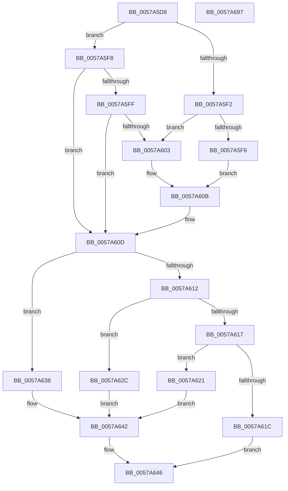

# XmInt1aWriteConfigRegister

- RVA: `0x0057A5D8`–`0x0057A698` (길이 `192` bytes)
- VA: `0x000000014057A5D8`
- 실행 섹션: `.text`
- PDB 이름 있음: `예`; PDB Function 태그: `아니요`
- unwind 정보 RVA: `0x00064C80`
- 디코드: `63`개 명령, `192/192` bytes 표시
- 미해석 바이트: `0` (있으면 어셈블리에 `.byte`로 보존)

> 이 문서는 커널 이미지의 기계어와 PDB 기호를 분석해 생성했습니다. 4번과 5번은 함수 원형과 자료형을 바이너리 사용 방식에서 추정한 C 해석이며 원본 소스 복구 결과는 아닙니다.

## 1. Dependencies

- 직접 호출 지점: **1**; 고유 호출 대상: **1**
- 직접 호출자로 확인된 함수: **1**
- RIP 상대 이미지 참조: **1**

### Outgoing calls
- `0x0057A670` → [guard_dispatch_icall](../6B/guard_dispatch_icall_function_006BAAD0.md) (function, `0x006BAAD0`)

### Direct callers
- [XmExecuteInt1a](XmExecuteInt1a_function_0057A214.md) at `0x0057A2B6`

### Static image references
- `0x0057A669` → RVA `0x00FC2308` (`.data`; read)

## 2. Other-region calls and transfers

- 다른 실행 섹션으로 향하는 call: **0**
- 별도 외부 분기/꼬리 이동을 확인하지 못했습니다.

## 3. Assembly (complete function range)

```asm
0057A5D8  40 53                           push rbx
0057A5DA  48 83 EC 30                     sub rsp, 0x30
0057A5DE  83 64 24 40 00                  and dword ptr [rsp + 0x40], 0
0057A5E3  48 8B D9                        mov rbx, rcx
0057A5E6  0F B6 49 18                     movzx ecx, byte ptr [rcx + 0x18]
0057A5EA  8A 43 24                        mov al, byte ptr [rbx + 0x24]
0057A5ED  80 F9 0C                        cmp cl, 0xc
0057A5F0  75 06                           jne 0x14057a5f8
0057A5F2  A8 01                           test al, 1
0057A5F4  75 0D                           jne 0x14057a603
0057A5F6  EB 13                           jmp 0x14057a60b
0057A5F8  8A D0                           mov dl, al
0057A5FA  80 F9 0D                        cmp cl, 0xd
0057A5FD  75 0E                           jne 0x14057a60d
0057A5FF  A8 03                           test al, 3
0057A601  74 0A                           je 0x14057a60d
0057A603  83 4B 10 01                     or dword ptr [rbx + 0x10], 1
0057A607  C6 43 19 87                     mov byte ptr [rbx + 0x19], 0x87
0057A60B  8A D0                           mov dl, al
0057A60D  83 E9 0B                        sub ecx, 0xb
0057A610  74 26                           je 0x14057a638
0057A612  83 E9 01                        sub ecx, 1
0057A615  74 15                           je 0x14057a62c
0057A617  83 F9 01                        cmp ecx, 1
0057A61A  74 05                           je 0x14057a621
0057A61C  45 33 C0                        xor r8d, r8d
0057A61F  EB 25                           jmp 0x14057a646
0057A621  8B 43 1C                        mov eax, dword ptr [rbx + 0x1c]
0057A624  41 B8 04 00 00 00               mov r8d, 4
0057A62A  EB 16                           jmp 0x14057a642
0057A62C  0F B7 43 1C                     movzx eax, word ptr [rbx + 0x1c]
0057A630  41 B8 02 00 00 00               mov r8d, 2
0057A636  EB 0A                           jmp 0x14057a642
0057A638  0F B6 43 1C                     movzx eax, byte ptr [rbx + 0x1c]
0057A63C  41 B8 01 00 00 00               mov r8d, 1
0057A642  89 44 24 40                     mov dword ptr [rsp + 0x40], eax
0057A646  44 0F B7 4B 34                  movzx r9d, word ptr [rbx + 0x34]
0057A64B  0F B6 4B 25                     movzx ecx, byte ptr [rbx + 0x25]
0057A64F  0F B6 C2                        movzx eax, dl
0057A652  8B D0                           mov edx, eax
0057A654  44 89 44 24 20                  mov dword ptr [rsp + 0x20], r8d
0057A659  83 E2 07                        and edx, 7
0057A65C  C1 E8 03                        shr eax, 3
0057A65F  C1 E2 05                        shl edx, 5
0057A662  4C 8D 44 24 40                  lea r8, [rsp + 0x40]
0057A667  0B D0                           or edx, eax
0057A669  48 8B 05 98 7C A4 00            mov rax, qword ptr [rip + 0xa47c98]
0057A670  E8 5B 04 14 00                  call 0x1406baad0
0057A675  8B 53 10                        mov edx, dword ptr [rbx + 0x10]
0057A678  8B CA                           mov ecx, edx
0057A67A  83 C9 01                        or ecx, 1
0057A67D  83 E2 FE                        and edx, 0xfffffffe
0057A680  85 C0                           test eax, eax
0057A682  0F 45 D1                        cmovne edx, ecx
0057A685  F7 D8                           neg eax
0057A687  89 53 10                        mov dword ptr [rbx + 0x10], edx
0057A68A  1A C0                           sbb al, al
0057A68C  24 87                           and al, 0x87
0057A68E  88 43 19                        mov byte ptr [rbx + 0x19], al
0057A691  48 83 C4 30                     add rsp, 0x30
0057A695  5B                              pop rbx
0057A696  C3                              ret
0057A697  CC                              int3
```

## 4. C-style interpretation (structured pseudocode)

```c
__int64 __fastcall XmInt1aWriteConfigRegister(__int64 a1, __int64 a2, int a3)
{
    __int64 result;
    __int64 v_rsp;
    unsigned int v_stack_m18;
    unsigned int v_stack_p8;

    v_rsp = (v_rsp) - (48);
    if (((unsigned __int8)(*(unsigned __int8 *)(a1 + 24))) != 12) goto loc_0057A5F8;
    if ((((unsigned __int8)(*(unsigned __int8 *)(a1 + 36))) & (1)) != 0) goto loc_0057A603;
    goto loc_0057A60B;
loc_0057A5F8:
    if (((unsigned __int8)(*(unsigned __int8 *)(a1 + 24))) != 13) goto loc_0057A60D;
    if ((((unsigned __int8)(*(unsigned __int8 *)(a1 + 36))) & (3)) == 0) goto loc_0057A60D;
loc_0057A603:
    *(unsigned __int8 *)(a1 + 25) = 135;
loc_0057A60B:
loc_0057A60D:
    a1 = (unsigned int)((*(unsigned __int8 *)(a1 + 24)) - (11));
    if (condition_is_equal) goto loc_0057A638;
    a1 = (unsigned int)((a1) - (1));
    if (condition_is_equal) goto loc_0057A62C;
    if (((unsigned int)(a1)) == 1) goto loc_0057A621;
    a3 = 0;
    goto loc_0057A646;
loc_0057A621:
    goto loc_0057A642;
loc_0057A62C:
    goto loc_0057A642;
loc_0057A638:
loc_0057A642:
    v_stack_p8 = (unsigned int)(*(unsigned __int8 *)(a1 + 28));
loc_0057A646:
    v_stack_m18 = 1;
    a2 = (unsigned int)(((unsigned int)((unsigned int)((unsigned __int8)((unsigned __int8)(*(unsigned __int8 *)(a1 + 36)))))) & (7));
    result = (unsigned int)(((unsigned __int8)((unsigned __int8)(*(unsigned __int8 *)(a1 + 36)))) >> (3));
    a2 = (unsigned int)((a2) << (5));
    a2 = (unsigned int)((a2) | ((unsigned int)(result)));
    result = guard_dispatch_icall(*(unsigned __int8 *)(a1 + 37), a2, v_stack_p8, *(unsigned __int16 *)(a1 + 52));
    a1 = (unsigned int)(((unsigned int)((unsigned int)((unsigned int)(*(unsigned int *)(a1 + 16))))) | (1));
    a2 = (unsigned int)(((unsigned int)(*(unsigned int *)(a1 + 16))) & (0xFFFFFFFEULL));
    if ((unsigned int)(result) != 0) { a2 = (unsigned int)(a1); }
    result = (unsigned int)(-(result));
    *(unsigned int *)(a1 + 16) = (unsigned int)(a2);
    result = (unsigned __int8)((result) & (135));
    *(unsigned __int8 *)(a1 + 25) = (unsigned __int8)(result);
    v_rsp = (v_rsp) + (48);
    return result;
}
```

## 5. (Beta) C Style

```c
int64_t XmInt1aWriteConfigRegister(void *Arg1, int64_t Arg2, int32_t Arg3)
{
    uint8_t *arg1 = (uint8_t *)Arg1;

    int64_t result;
    int64_t local_rsp;
    uint32_t v_stack_m18;
    uint32_t v_stack_p8;

    local_rsp = (local_rsp) - (48);
    if (((uint8_t)(*(uint8_t *)(arg1 + 0x18))) != 12) goto loc_0057A5F8;
    if ((((uint8_t)(*(uint8_t *)(arg1 + 0x24))) & (1)) != 0) goto loc_0057A603;
    goto loc_0057A60B;
loc_0057A5F8:
    if (((uint8_t)(*(uint8_t *)(arg1 + 0x18))) != 13) goto loc_0057A60D;
    if ((((uint8_t)(*(uint8_t *)(arg1 + 0x24))) & (3)) == 0) goto loc_0057A60D;
loc_0057A603:
    *(uint8_t *)(arg1 + 0x19) = 135;
loc_0057A60B:
loc_0057A60D:
    Arg1 = (uint32_t)((*(uint8_t *)(arg1 + 0x18)) - (11));
    if (condition_is_equal) goto loc_0057A638;
    Arg1 = (uint32_t)((Arg1) - (1));
    if (condition_is_equal) goto loc_0057A62C;
    if (((uint32_t)(Arg1)) == 1) goto loc_0057A621;
    Arg3 = 0;
    goto loc_0057A646;
loc_0057A621:
    goto loc_0057A642;
loc_0057A62C:
    goto loc_0057A642;
loc_0057A638:
loc_0057A642:
    v_stack_p8 = (uint32_t)(*(uint8_t *)(arg1 + 0x1C));
loc_0057A646:
    v_stack_m18 = 1;
    Arg2 = (uint32_t)(((uint32_t)((uint32_t)((uint8_t)((uint8_t)(*(uint8_t *)(arg1 + 0x24)))))) & (7));
    result = (uint32_t)(((uint8_t)((uint8_t)(*(uint8_t *)(arg1 + 0x24)))) >> (3));
    Arg2 = (uint32_t)((Arg2) << (5));
    Arg2 = (uint32_t)((Arg2) | ((uint32_t)(result)));
    result = guard_dispatch_icall(*(uint8_t *)(arg1 + 0x25), Arg2, v_stack_p8, *(uint16_t *)(arg1 + 0x34));
    Arg1 = (uint32_t)(((uint32_t)((uint32_t)((uint32_t)(*(uint32_t *)(arg1 + 0x10))))) | (1));
    Arg2 = (uint32_t)(((uint32_t)(*(uint32_t *)(arg1 + 0x10))) & (0xFFFFFFFEULL));
    if ((uint32_t)(result) != 0) { Arg2 = (uint32_t)(Arg1); }
    result = (uint32_t)(-(result));
    *(uint32_t *)(arg1 + 0x10) = (uint32_t)(Arg2);
    result = (uint8_t)((result) & (135));
    *(uint8_t *)(arg1 + 0x19) = (uint8_t)(result);
    local_rsp = (local_rsp) + (48);
    return result;
}
```

### 관측된 메모리 오프셋

구조체 형식이 확인되지 않은 접근은 인자 기준의 오프셋으로만 기록했습니다.

| 기준 인자 | 오프셋 표현 | 폭 (bit) | 접근 |
|---|---:|---:|---|
| `Arg1` | `+ 0x10` | `32` | `R` |
| `Arg1` | `+ 0x10` | `32` | `R/W` |
| `Arg1` | `+ 0x10` | `32` | `W` |
| `Arg1` | `+ 0x18` | `8` | `R` |
| `Arg1` | `+ 0x19` | `8` | `W` |
| `Arg1` | `+ 0x1C` | `8` | `R` |
| `Arg1` | `+ 0x1C` | `16` | `R` |
| `Arg1` | `+ 0x1C` | `32` | `R` |
| `Arg1` | `+ 0x24` | `8` | `R` |
| `Arg1` | `+ 0x25` | `8` | `R` |
| `Arg1` | `+ 0x34` | `16` | `R` |

## 6. Execution-region graph

[열기: 2D/3D 그래프와 함수 탐색 컨트롤 패널](../../../control-panel.html?section=text&rva=0x0057A5D8&view=graph)

- 2D 그래프는 위에서 아래로 흐르고, 3D 그래프는 빈 공간을 드래그해 회전합니다. Shift+드래그는 이동, 휠은 확대·축소, 함수 노드 선택은 대상 보고서 이동입니다.

### Static fallback


