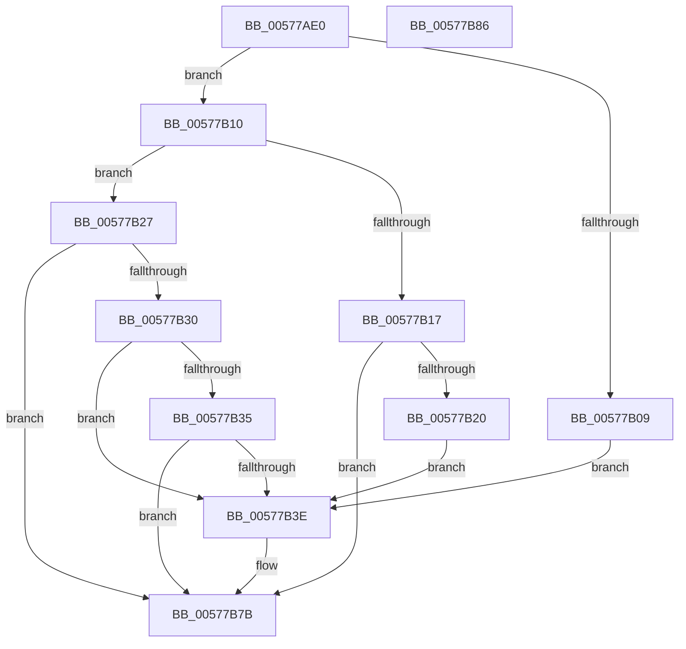

# XmIntOp

- RVA: `0x00577AE0`–`0x00577B87` (길이 `167` bytes)
- VA: `0x0000000140577AE0`
- 실행 섹션: `.text`
- PDB 이름 있음: `예`; PDB Function 태그: `아니요`
- unwind 정보 RVA: `0x0005CAAC`
- 디코드: `51`개 명령, `167/167` bytes 표시
- 미해석 바이트: `0` (있으면 어셈블리에 `.byte`로 보존)

> 이 문서는 커널 이미지의 기계어와 PDB 기호를 분석해 생성했습니다. 4번과 5번은 함수 원형과 자료형을 바이너리 사용 방식에서 추정한 C 해석이며 원본 소스 복구 결과는 아닙니다.

## 1. Dependencies

- 직접 호출 지점: **5**; 고유 호출 대상: **3**
- 직접 호출자로 확인된 함수: **0**
- RIP 상대 이미지 참조: **0**

### Outgoing calls
- `0x00577B35` → [XmExecuteInt1a](XmExecuteInt1a_function_0057A214.md) (function, `0x0057A214`)
- `0x00577B44` → [XmPushStack](../47/XmPushStack_function_00473088.md) (function, `0x00473088`)
- `0x00577B50` → [XmPushStack](../47/XmPushStack_function_00473088.md) (function, `0x00473088`)
- `0x00577B5B` → [XmPushStack](../47/XmPushStack_function_00473088.md) (function, `0x00473088`)
- `0x00577B64` → [x86BiosTranslateAddress](../47/x86BiosTranslateAddress_function_004736C0.md) (function, `0x004736C0`)

### Direct callers
- 이 함수 시작 RVA로 연결되는 직접 call은 확인되지 않았습니다. 간접 호출은 완전히 역산할 수 없습니다.

### Static image references
- 디코드된 RIP-relative 메모리 참조가 없습니다.

## 2. Other-region calls and transfers

- 다른 실행 섹션으로 향하는 call: **0**
- 별도 외부 분기/꼬리 이동을 확인하지 못했습니다.

## 3. Assembly (complete function range)

```asm
00577AE0  48 89 5C 24 08                  mov qword ptr [rsp + 8], rbx
00577AE5  57                              push rdi
00577AE6  48 83 EC 20                     sub rsp, 0x20
00577AEA  8A 81 8A 00 00 00               mov al, byte ptr [rcx + 0x8a]
00577AF0  48 8B D9                        mov rbx, rcx
00577AF3  F6 D8                           neg al
00577AF5  1B D2                           sbb edx, edx
00577AF7  83 E2 02                        and edx, 2
00577AFA  FF C2                           inc edx
00577AFC  89 51 78                        mov dword ptr [rcx + 0x78], edx
00577AFF  8B 41 70                        mov eax, dword ptr [rcx + 0x70]
00577B02  3D CC 00 00 00                  cmp eax, 0xcc
00577B07  75 07                           jne 0x140577b10
00577B09  BF 03 00 00 00                  mov edi, 3
00577B0E  EB 2E                           jmp 0x140577b3e
00577B10  3D CE 00 00 00                  cmp eax, 0xce
00577B15  75 10                           jne 0x140577b27
00577B17  F7 41 10 00 08 00 00            test dword ptr [rcx + 0x10], 0x800
00577B1E  74 5B                           je 0x140577b7b
00577B20  BF 04 00 00 00                  mov edi, 4
00577B25  EB 17                           jmp 0x140577b3e
00577B27  0F B6 79 6C                     movzx edi, byte ptr [rcx + 0x6c]
00577B2B  83 FF 42                        cmp edi, 0x42
00577B2E  74 4B                           je 0x140577b7b
00577B30  83 FF 1A                        cmp edi, 0x1a
00577B33  75 09                           jne 0x140577b3e
00577B35  E8 DA 26 00 00                  call 0x14057a214
00577B3A  84 C0                           test al, al
00577B3C  75 3D                           jne 0x140577b7b
00577B3E  8B 53 10                        mov edx, dword ptr [rbx + 0x10]
00577B41  48 8B CB                        mov rcx, rbx
00577B44  E8 3F B5 EF FF                  call 0x140473088
00577B49  0F B7 53 3A                     movzx edx, word ptr [rbx + 0x3a]
00577B4D  48 8B CB                        mov rcx, rbx
00577B50  E8 33 B5 EF FF                  call 0x140473088
00577B55  8B 53 14                        mov edx, dword ptr [rbx + 0x14]
00577B58  48 8B CB                        mov rcx, rbx
00577B5B  E8 28 B5 EF FF                  call 0x140473088
00577B60  33 D2                           xor edx, edx
00577B62  33 C9                           xor ecx, ecx
00577B64  E8 57 BB EF FF                  call 0x1404736c0
00577B69  8B D7                           mov edx, edi
00577B6B  0F B7 4C 90 02                  movzx ecx, word ptr [rax + rdx*4 + 2]
00577B70  66 89 4B 3A                     mov word ptr [rbx + 0x3a], cx
00577B74  0F B7 04 90                     movzx eax, word ptr [rax + rdx*4]
00577B78  89 43 14                        mov dword ptr [rbx + 0x14], eax
00577B7B  48 8B 5C 24 30                  mov rbx, qword ptr [rsp + 0x30]
00577B80  48 83 C4 20                     add rsp, 0x20
00577B84  5F                              pop rdi
00577B85  C3                              ret
00577B86  CC                              int3
```

## 4. C-style interpretation (structured pseudocode)

```c
__int64 __fastcall XmIntOp(__int64 a1, int a2)
{
    __int64 result;
    __int64 v_rsp;
    unsigned __int64 v_stack_p8;

    v_stack_p8 = v_rbx;
    v_rsp = (v_rsp) - (32);
    result = (unsigned __int8)(-(*(unsigned __int8 *)(a1 + 138)));
    a2 = (unsigned int)((a2) & (2));
    a2 = (unsigned int)((a2) + 1);
    *(unsigned int *)(a1 + 120) = a2;
    if (((unsigned int)((unsigned int)(*(unsigned int *)(a1 + 112)))) != 204) goto loc_00577B10;
    goto loc_00577B3E;
loc_00577B10:
    if (((unsigned int)((unsigned int)(*(unsigned int *)(a1 + 112)))) != 206) goto loc_00577B27;
    if (((*(unsigned int *)(a1 + 16)) & (0x800ULL)) == 0) goto loc_00577B7B;
    goto loc_00577B3E;
loc_00577B27:
    if (((unsigned int)(*(unsigned __int8 *)(a1 + 108))) == 66) goto loc_00577B7B;
    if (((unsigned int)(*(unsigned __int8 *)(a1 + 108))) != 26) goto loc_00577B3E;
    result = XmExecuteInt1a(a1, a2, a3, a4);
    if ((unsigned __int8)(result) == 0) {
        a2 = *(unsigned int *)(a1 + 16);
        a1 = a1;
        result = XmPushStack(a1, a2, a3, a4);
        a2 = *(unsigned __int16 *)(a1 + 58);
        a1 = a1;
        result = XmPushStack(a1, a2, a3, a4);
        a2 = *(unsigned int *)(a1 + 20);
        a1 = a1;
        result = XmPushStack(a1, a2, a3, a4);
        a2 = 0;
        a1 = 0;
        result = x86BiosTranslateAddress(a1, a2, a3, a4);
        a2 = (unsigned int)(*(unsigned __int8 *)(a1 + 108));
        a1 = *(unsigned __int16 *)(result + a2 * 4 + 2);
        *(unsigned __int16 *)(a1 + 58) = (unsigned __int16)(a1);
        result = *(unsigned __int16 *)(result + a2 * 4);
        *(unsigned int *)(a1 + 20) = (unsigned int)(result);
    }
    v_rsp = (v_rsp) + (32);
    return result;
}
```

## 5. (Beta) C Style

```c
int64_t XmIntOp(void *Arg1, int32_t Arg2)
{
    uint8_t *arg1 = (uint8_t *)Arg1;

    int64_t result;
    int64_t local_rsp;
    uint64_t v_stack_p8;

    v_stack_p8 = local_rbx;
    local_rsp = (local_rsp) - (32);
    result = (uint8_t)(-(*(uint8_t *)(arg1 + 0x8A)));
    Arg2 = (uint32_t)((Arg2) & (2));
    Arg2 = (uint32_t)((Arg2) + 1);
    *(uint32_t *)(arg1 + 0x78) = Arg2;
    if (((uint32_t)((uint32_t)(*(uint32_t *)(arg1 + 0x70)))) != 204) goto loc_00577B10;
    goto loc_00577B3E;
loc_00577B10:
    if (((uint32_t)((uint32_t)(*(uint32_t *)(arg1 + 0x70)))) != 206) goto loc_00577B27;
    if (((*(uint32_t *)(arg1 + 0x10)) & (0x800ULL)) == 0) goto loc_00577B7B;
    goto loc_00577B3E;
loc_00577B27:
    if (((uint32_t)(*(uint8_t *)(arg1 + 0x6C))) == 66) goto loc_00577B7B;
    if (((uint32_t)(*(uint8_t *)(arg1 + 0x6C))) != 26) goto loc_00577B3E;
    result = XmExecuteInt1a(Arg1, Arg2, a3, a4);
    if ((uint8_t)(result) == 0) {
        Arg2 = *(uint32_t *)(arg1 + 0x10);
        Arg1 = Arg1;
        result = XmPushStack(Arg1, Arg2, a3, a4);
        Arg2 = *(uint16_t *)(arg1 + 0x3A);
        Arg1 = Arg1;
        result = XmPushStack(Arg1, Arg2, a3, a4);
        Arg2 = *(uint32_t *)(arg1 + 0x14);
        Arg1 = Arg1;
        result = XmPushStack(Arg1, Arg2, a3, a4);
        Arg2 = 0;
        Arg1 = 0;
        result = x86BiosTranslateAddress(Arg1, Arg2, a3, a4);
        Arg2 = (uint32_t)(*(uint8_t *)(arg1 + 0x6C));
        Arg1 = *(uint16_t *)(result + Arg2 * 4 + 0x2);
        *(uint16_t *)(arg1 + 0x3A) = (uint16_t)(Arg1);
        result = *(uint16_t *)(result + Arg2 * 4);
        *(uint32_t *)(arg1 + 0x14) = (uint32_t)(result);
    }
    local_rsp = (local_rsp) + (32);
    return result;
}
```

### 관측된 메모리 오프셋

구조체 형식이 확인되지 않은 접근은 인자 기준의 오프셋으로만 기록했습니다.

| 기준 인자 | 오프셋 표현 | 폭 (bit) | 접근 |
|---|---:|---:|---|
| `Arg1` | `+ 0x10` | `32` | `R` |
| `Arg1` | `+ 0x14` | `32` | `R` |
| `Arg1` | `+ 0x14` | `32` | `W` |
| `Arg1` | `+ 0x3A` | `16` | `R` |
| `Arg1` | `+ 0x3A` | `16` | `W` |
| `Arg1` | `+ 0x6C` | `8` | `R` |
| `Arg1` | `+ 0x70` | `32` | `R` |
| `Arg1` | `+ 0x78` | `32` | `W` |
| `Arg1` | `+ 0x8A` | `8` | `R` |

## 6. Execution-region graph

[열기: 2D/3D 그래프와 함수 탐색 컨트롤 패널](../../../control-panel.html?section=text&rva=0x00577AE0&view=graph)

- 2D 그래프는 위에서 아래로 흐르고, 3D 그래프는 빈 공간을 드래그해 회전합니다. Shift+드래그는 이동, 휠은 확대·축소, 함수 노드 선택은 대상 보고서 이동입니다.

### Static fallback


