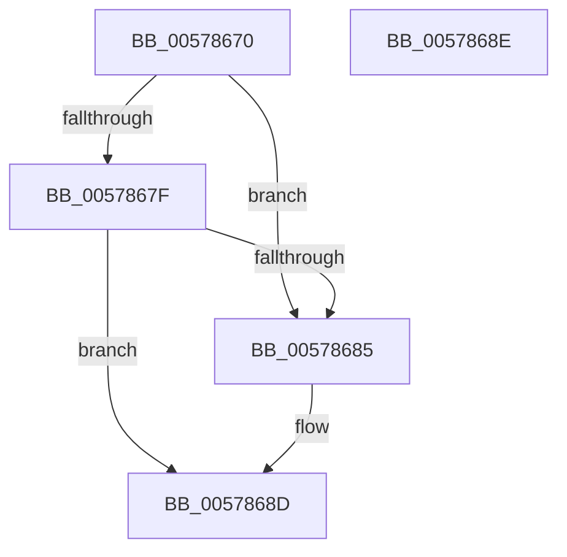

# XmJmpOp

- RVA: `0x00578670`–`0x0057868F` (길이 `31` bytes)
- VA: `0x0000000140578670`
- 실행 섹션: `.text`
- PDB 이름 있음: `예`; PDB Function 태그: `아니요`
- unwind 정보 RVA: `0x000DB714`
- 디코드: `10`개 명령, `31/31` bytes 표시
- 미해석 바이트: `0` (있으면 어셈블리에 `.byte`로 보존)

> 이 문서는 커널 이미지의 기계어와 PDB 기호를 분석해 생성했습니다. 4번과 5번은 함수 원형과 자료형을 바이너리 사용 방식에서 추정한 C 해석이며 원본 소스 복구 결과는 아닙니다.

## 1. Dependencies

- 직접 호출 지점: **0**; 고유 호출 대상: **0**
- 직접 호출자로 확인된 함수: **0**
- RIP 상대 이미지 참조: **0**

### Outgoing calls
- 직접 디코드된 call 명령이 없습니다.

### Direct callers
- 이 함수 시작 RVA로 연결되는 직접 call은 확인되지 않았습니다. 간접 호출은 완전히 역산할 수 없습니다.

### Static image references
- 디코드된 RIP-relative 메모리 참조가 없습니다.

## 2. Other-region calls and transfers

- 다른 실행 섹션으로 향하는 call: **0**
- 별도 외부 분기/꼬리 이동을 확인하지 못했습니다.

## 3. Assembly (complete function range)

```asm
00578670  81 79 70 EA 00 00 00            cmp dword ptr [rcx + 0x70], 0xea
00578677  8B 41 68                        mov eax, dword ptr [rcx + 0x68]
0057867A  89 41 14                        mov dword ptr [rcx + 0x14], eax
0057867D  74 06                           je 0x140578685
0057867F  83 79 7C 22                     cmp dword ptr [rcx + 0x7c], 0x22
00578683  74 08                           je 0x14057868d
00578685  0F B7 41 52                     movzx eax, word ptr [rcx + 0x52]
00578689  66 89 41 3A                     mov word ptr [rcx + 0x3a], ax
0057868D  C3                              ret
0057868E  CC                              int3
```

## 4. C-style interpretation (structured pseudocode)

```c
__int64 __fastcall XmJmpOp(__int64 a1)
{
    __int64 result;

    *(unsigned int *)(a1 + 20) = (unsigned int)((unsigned int)(*(unsigned int *)(a1 + 104)));
    if ((*(unsigned int *)(a1 + 112)) == 234) goto loc_00578685;
    result = (unsigned int)(*(unsigned int *)(a1 + 104));
    if ((*(unsigned int *)(a1 + 124)) != 34) {
        result = *(unsigned __int16 *)(a1 + 82);
        *(unsigned __int16 *)(a1 + 58) = (unsigned __int16)(result);
    }
    return result;
}
```

## 5. (Beta) C Style

```c
int64_t XmJmpOp(void *Arg1)
{
    uint8_t *arg1 = (uint8_t *)Arg1;

    int64_t result;

    *(uint32_t *)(arg1 + 0x14) = (uint32_t)((uint32_t)(*(uint32_t *)(arg1 + 0x68)));
    if ((*(uint32_t *)(arg1 + 0x70)) == 234) goto loc_00578685;
    result = (uint32_t)(*(uint32_t *)(arg1 + 0x68));
    if ((*(uint32_t *)(arg1 + 0x7C)) != 34) {
        result = *(uint16_t *)(arg1 + 0x52);
        *(uint16_t *)(arg1 + 0x3A) = (uint16_t)(result);
    }
    return result;
}
```

### 관측된 메모리 오프셋

구조체 형식이 확인되지 않은 접근은 인자 기준의 오프셋으로만 기록했습니다.

| 기준 인자 | 오프셋 표현 | 폭 (bit) | 접근 |
|---|---:|---:|---|
| `Arg1` | `+ 0x14` | `32` | `W` |
| `Arg1` | `+ 0x3A` | `16` | `W` |
| `Arg1` | `+ 0x52` | `16` | `R` |
| `Arg1` | `+ 0x68` | `32` | `R` |
| `Arg1` | `+ 0x70` | `32` | `R` |
| `Arg1` | `+ 0x7C` | `32` | `R` |

## 6. Execution-region graph

[열기: 2D/3D 그래프와 함수 탐색 컨트롤 패널](../../../control-panel.html?section=text&rva=0x00578670&view=graph)

- 2D 그래프는 위에서 아래로 흐르고, 3D 그래프는 빈 공간을 드래그해 회전합니다. Shift+드래그는 이동, 휠은 확대·축소, 함수 노드 선택은 대상 보고서 이동입니다.

### Static fallback


