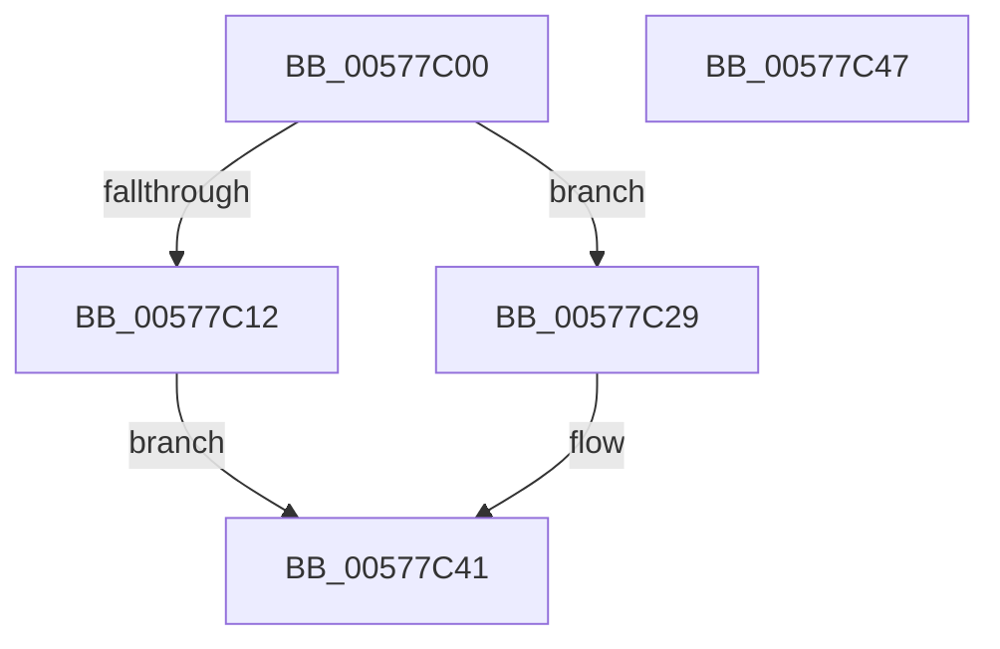

# XmLeaveOp

- RVA: `0x00577C00`–`0x00577C48` (길이 `72` bytes)
- VA: `0x0000000140577C00`
- 실행 섹션: `.text`
- PDB 이름 있음: `예`; PDB Function 태그: `아니요`
- unwind 정보 RVA: `0x0005CF00`
- 디코드: `20`개 명령, `72/72` bytes 표시
- 미해석 바이트: `0` (있으면 어셈블리에 `.byte`로 보존)

> 이 문서는 커널 이미지의 기계어와 PDB 기호를 분석해 생성했습니다. 4번과 5번은 함수 원형과 자료형을 바이너리 사용 방식에서 추정한 C 해석이며 원본 소스 복구 결과는 아닙니다.

## 1. Dependencies

- 직접 호출 지점: **2**; 고유 호출 대상: **1**
- 직접 호출자로 확인된 함수: **0**
- RIP 상대 이미지 참조: **0**

### Outgoing calls
- `0x00577C1F` → [XmPopStack](../47/XmPopStack_function_00472588.md) (function, `0x00472588`)
- `0x00577C38` → [XmPopStack](../47/XmPopStack_function_00472588.md) (function, `0x00472588`)

### Direct callers
- 이 함수 시작 RVA로 연결되는 직접 call은 확인되지 않았습니다. 간접 호출은 완전히 역산할 수 없습니다.

### Static image references
- 디코드된 RIP-relative 메모리 참조가 없습니다.

## 2. Other-region calls and transfers

- 다른 실행 섹션으로 향하는 call: **0**
- 별도 외부 분기/꼬리 이동을 확인하지 못했습니다.

## 3. Assembly (complete function range)

```asm
00577C00  40 53                           push rbx
00577C02  48 83 EC 20                     sub rsp, 0x20
00577C06  80 B9 8A 00 00 00 00            cmp byte ptr [rcx + 0x8a], 0
00577C0D  48 8B D9                        mov rbx, rcx
00577C10  74 17                           je 0x140577c29
00577C12  C7 41 78 03 00 00 00            mov dword ptr [rcx + 0x78], 3
00577C19  8B 41 2C                        mov eax, dword ptr [rcx + 0x2c]
00577C1C  89 41 28                        mov dword ptr [rcx + 0x28], eax
00577C1F  E8 64 A9 EF FF                  call 0x140472588
00577C24  89 43 2C                        mov dword ptr [rbx + 0x2c], eax
00577C27  EB 18                           jmp 0x140577c41
00577C29  C7 41 78 01 00 00 00            mov dword ptr [rcx + 0x78], 1
00577C30  0F B7 41 2C                     movzx eax, word ptr [rcx + 0x2c]
00577C34  66 89 41 28                     mov word ptr [rcx + 0x28], ax
00577C38  E8 4B A9 EF FF                  call 0x140472588
00577C3D  66 89 43 2C                     mov word ptr [rbx + 0x2c], ax
00577C41  48 83 C4 20                     add rsp, 0x20
00577C45  5B                              pop rbx
00577C46  C3                              ret
00577C47  CC                              int3
```

## 4. C-style interpretation (structured pseudocode)

```c
__int64 __fastcall XmLeaveOp(__int64 a1)
{
    __int64 result;
    __int64 v_rsp;

    v_rsp = (v_rsp) - (32);
    if ((*(unsigned __int8 *)(a1 + 138)) == 0) goto loc_00577C29;
    *(unsigned int *)(a1 + 120) = 3;
    *(unsigned int *)(a1 + 40) = (unsigned int)((unsigned int)(*(unsigned int *)(a1 + 44)));
    result = XmPopStack(a1, a2, a3, a4);
    *(unsigned int *)(a1 + 44) = (unsigned int)(result);
    goto loc_00577C41;
loc_00577C29:
    *(unsigned int *)(a1 + 120) = 1;
    *(unsigned __int16 *)(a1 + 40) = (unsigned __int16)(*(unsigned __int16 *)(a1 + 44));
    result = XmPopStack(a1, a2, a3, a4);
    *(unsigned __int16 *)(a1 + 44) = (unsigned __int16)(result);
loc_00577C41:
    v_rsp = (v_rsp) + (32);
    return result;
}
```

## 5. (Beta) C Style

```c
int64_t XmLeaveOp(void *Arg1)
{
    uint8_t *arg1 = (uint8_t *)Arg1;

    int64_t result;
    int64_t local_rsp;

    local_rsp = (local_rsp) - (32);
    if ((*(uint8_t *)(arg1 + 0x8A)) == 0) goto loc_00577C29;
    *(uint32_t *)(arg1 + 0x78) = 3;
    *(uint32_t *)(arg1 + 0x28) = (uint32_t)((uint32_t)(*(uint32_t *)(arg1 + 0x2C)));
    result = XmPopStack(Arg1, a2, a3, a4);
    *(uint32_t *)(arg1 + 0x2C) = (uint32_t)(result);
    goto loc_00577C41;
loc_00577C29:
    *(uint32_t *)(arg1 + 0x78) = 1;
    *(uint16_t *)(arg1 + 0x28) = (uint16_t)(*(uint16_t *)(arg1 + 0x2C));
    result = XmPopStack(Arg1, a2, a3, a4);
    *(uint16_t *)(arg1 + 0x2C) = (uint16_t)(result);
loc_00577C41:
    local_rsp = (local_rsp) + (32);
    return result;
}
```

### 관측된 메모리 오프셋

구조체 형식이 확인되지 않은 접근은 인자 기준의 오프셋으로만 기록했습니다.

| 기준 인자 | 오프셋 표현 | 폭 (bit) | 접근 |
|---|---:|---:|---|
| `Arg1` | `+ 0x28` | `16` | `W` |
| `Arg1` | `+ 0x28` | `32` | `W` |
| `Arg1` | `+ 0x2C` | `16` | `R` |
| `Arg1` | `+ 0x2C` | `16` | `W` |
| `Arg1` | `+ 0x2C` | `32` | `R` |
| `Arg1` | `+ 0x2C` | `32` | `W` |
| `Arg1` | `+ 0x78` | `32` | `W` |
| `Arg1` | `+ 0x8A` | `8` | `R` |

## 6. Execution-region graph

[열기: 2D/3D 그래프와 함수 탐색 컨트롤 패널](../../../control-panel.html?section=text&rva=0x00577C00&view=graph)

- 2D 그래프는 위에서 아래로 흐르고, 3D 그래프는 빈 공간을 드래그해 회전합니다. Shift+드래그는 이동, 휠은 확대·축소, 함수 노드 선택은 대상 보고서 이동입니다.

### Static fallback


