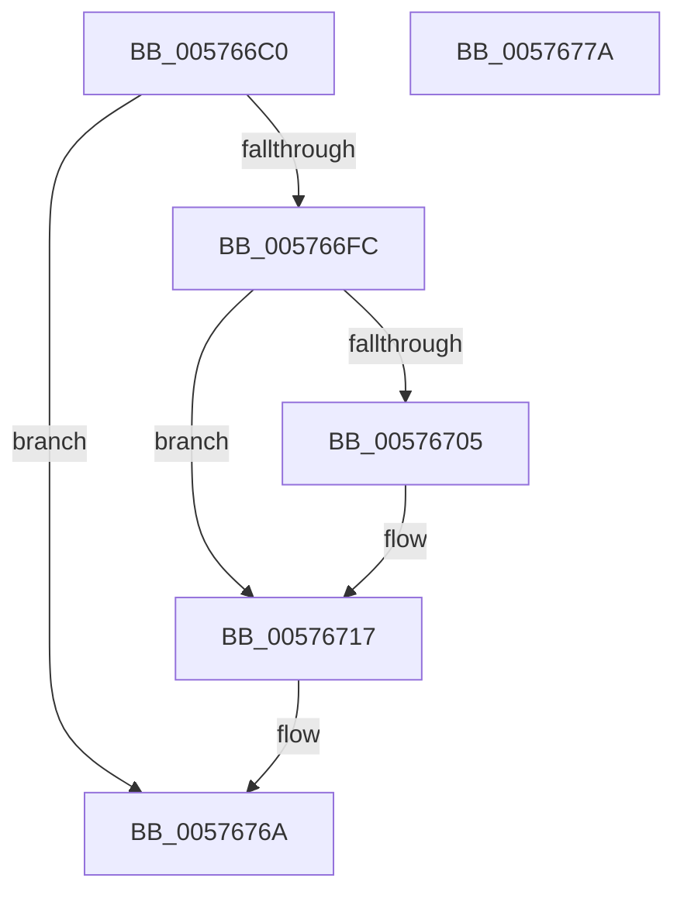

# XmLoadSegment

- RVA: `0x005766C0`–`0x0057677B` (길이 `187` bytes)
- VA: `0x00000001405766C0`
- 실행 섹션: `.text`
- PDB 이름 있음: `예`; PDB Function 태그: `아니요`
- unwind 정보 RVA: `0x0005FD94`
- 디코드: `50`개 명령, `187/187` bytes 표시
- 미해석 바이트: `0` (있으면 어셈블리에 `.byte`로 보존)

> 이 문서는 커널 이미지의 기계어와 PDB 기호를 분석해 생성했습니다. 4번과 5번은 함수 원형과 자료형을 바이너리 사용 방식에서 추정한 C 해석이며 원본 소스 복구 결과는 아닙니다.

## 1. Dependencies

- 직접 호출 지점: **5**; 고유 호출 대상: **5**
- 직접 호출자로 확인된 함수: **0**
- RIP 상대 이미지 참조: **0**

### Outgoing calls
- `0x005766F2` → [XmEvaluateAddressSpecifier](../47/XmEvaluateAddressSpecifier_function_00473224.md) (function, `0x00473224`)
- `0x00576711` → [longjmp](../4F/longjmp_function_004FD5F0.md) (function, `0x004FD5F0`)
- `0x0057671D` → [XmSetSourceValue](../47/XmSetSourceValue_function_004737A8.md) (function, `0x004737A8`)
- `0x00576736` → [XmGetOffsetAddress](XmGetOffsetAddress_function_00578B84.md) (function, `0x00578B84`)
- `0x00576741` → [XmSetDestinationValue](../47/XmSetDestinationValue_function_004734EC.md) (function, `0x004734EC`)

### Direct callers
- 이 함수 시작 RVA로 연결되는 직접 call은 확인되지 않았습니다. 간접 호출은 완전히 역산할 수 없습니다.

### Static image references
- 디코드된 RIP-relative 메모리 참조가 없습니다.

## 2. Other-region calls and transfers

- 다른 실행 섹션으로 향하는 call: **0**
- 별도 외부 분기/꼬리 이동을 확인하지 못했습니다.

## 3. Assembly (complete function range)

```asm
005766C0  48 89 5C 24 10                  mov qword ptr [rsp + 0x10], rbx
005766C5  48 89 74 24 18                  mov qword ptr [rsp + 0x18], rsi
005766CA  57                              push rdi
005766CB  48 83 EC 20                     sub rsp, 0x20
005766CF  83 64 24 30 00                  and dword ptr [rsp + 0x30], 0
005766D4  48 8B F9                        mov rdi, rcx
005766D7  8A 81 8A 00 00 00               mov al, byte ptr [rcx + 0x8a]
005766DD  0F B6 71 51                     movzx esi, byte ptr [rcx + 0x51]
005766E1  F6 D8                           neg al
005766E3  1B D2                           sbb edx, edx
005766E5  83 E2 02                        and edx, 2
005766E8  FF C2                           inc edx
005766EA  89 51 78                        mov dword ptr [rcx + 0x78], edx
005766ED  48 8D 54 24 30                  lea rdx, [rsp + 0x30]
005766F2  E8 2D CB EF FF                  call 0x140473224
005766F7  48 85 C0                        test rax, rax
005766FA  74 6E                           je 0x14057676a
005766FC  80 BF 8E 00 00 00 00            cmp byte ptr [rdi + 0x8e], 0
00576703  74 12                           je 0x140576717
00576705  48 8D 8F A0 00 00 00            lea rcx, [rdi + 0xa0]
0057670C  BA 0B 00 00 00                  mov edx, 0xb
00576711  E8 DA 6E F8 FF                  call 0x1404fd5f0
00576716  CC                              int3
00576717  48 8B D0                        mov rdx, rax
0057671A  48 8B CF                        mov rcx, rdi
0057671D  E8 86 D0 EF FF                  call 0x1404737a8
00576722  8B 5F 78                        mov ebx, dword ptr [rdi + 0x78]
00576725  8B 97 80 00 00 00               mov edx, dword ptr [rdi + 0x80]
0057672B  FF C2                           inc edx
0057672D  C7 47 78 01 00 00 00            mov dword ptr [rdi + 0x78], 1
00576734  03 D3                           add edx, ebx
00576736  E8 49 24 00 00                  call 0x140578b84
0057673B  48 8B D0                        mov rdx, rax
0057673E  48 8B CF                        mov rcx, rdi
00576741  E8 A6 CD EF FF                  call 0x1404734ec
00576746  0F B7 4F 68                     movzx ecx, word ptr [rdi + 0x68]
0057674A  8D 56 FA                        lea edx, [rsi - 6]
0057674D  66 89 4C 57 38                  mov word ptr [rdi + rdx*2 + 0x38], cx
00576752  B8 01 00 00 00                  mov eax, 1
00576757  8B 54 24 30                     mov edx, dword ptr [rsp + 0x30]
0057675B  48 83 C2 06                     add rdx, 6
0057675F  89 5F 78                        mov dword ptr [rdi + 0x78], ebx
00576762  48 8D 14 97                     lea rdx, [rdi + rdx*4]
00576766  48 89 57 58                     mov qword ptr [rdi + 0x58], rdx
0057676A  48 8B 5C 24 38                  mov rbx, qword ptr [rsp + 0x38]
0057676F  48 8B 74 24 40                  mov rsi, qword ptr [rsp + 0x40]
00576774  48 83 C4 20                     add rsp, 0x20
00576778  5F                              pop rdi
00576779  C3                              ret
0057677A  CC                              int3
```

## 4. C-style interpretation (structured pseudocode)

```c
__int64 __fastcall XmLoadSegment(__int64 a1, int a2)
{
    __int64 result;
    __int64 v_rsp;
    unsigned __int64 v_stack_p10;
    unsigned __int64 v_stack_p18;
    unsigned int v_stack_p8;

    v_stack_p10 = v_rbx;
    v_stack_p18 = v_rsi;
    v_rsp = (v_rsp) - (32);
    result = (unsigned __int8)(-(*(unsigned __int8 *)(a1 + 138)));
    a2 = (unsigned int)((a2) & (2));
    a2 = (unsigned int)((a2) + 1);
    *(unsigned int *)(a1 + 120) = a2;
    result = XmEvaluateAddressSpecifier(a1, v_stack_p8, a3, a4);
    if (result == 0) goto loc_0057676A;
    if ((*(unsigned __int8 *)(a1 + 142)) != 0) {
        a1 = a1 + 160;
        a2 = 11;
        result = longjmp(a1, a2, a3, a4);
    }
    result = XmSetSourceValue(a1, result, a3, a4);
    a2 = (unsigned int)(((unsigned int)(*(unsigned int *)(a1 + 128))) + 1);
    *(unsigned int *)(a1 + 120) = 1;
    a2 = (unsigned int)((a2) + ((unsigned int)((unsigned int)(*(unsigned int *)(a1 + 120)))));
    result = XmGetOffsetAddress(a1, a2, a3, a4);
    result = XmSetDestinationValue(a1, result, a3, a4);
    *(unsigned __int16 *)(a1 + *(unsigned __int8 *)(a1 + 81) - 6 * 2 + 56) = (unsigned __int16)(*(unsigned __int16 *)(a1 + 104));
    a2 = ((unsigned int)(v_stack_p8)) + (6);
    *(unsigned int *)(a1 + 120) = (unsigned int)((unsigned int)(*(unsigned int *)(a1 + 120)));
    *(unsigned __int64 *)(a1 + 88) = a1 + a2 * 4;
loc_0057676A:
    v_rsp = (v_rsp) + (32);
    return 1;
}
```

## 5. (Beta) C Style

```c
int64_t XmLoadSegment(void *Arg1, int32_t Arg2)
{
    uint8_t *arg1 = (uint8_t *)Arg1;

    int64_t result;
    int64_t local_rsp;
    uint64_t v_stack_p10;
    uint64_t v_stack_p18;
    uint32_t v_stack_p8;

    v_stack_p10 = local_rbx;
    v_stack_p18 = local_rsi;
    local_rsp = (local_rsp) - (32);
    result = (uint8_t)(-(*(uint8_t *)(arg1 + 0x8A)));
    Arg2 = (uint32_t)((Arg2) & (2));
    Arg2 = (uint32_t)((Arg2) + 1);
    *(uint32_t *)(arg1 + 0x78) = Arg2;
    result = XmEvaluateAddressSpecifier(Arg1, v_stack_p8, a3, a4);
    if (result == 0) goto loc_0057676A;
    if ((*(uint8_t *)(arg1 + 0x8E)) != 0) {
        Arg1 = Arg1 + 160;
        Arg2 = 11;
        result = longjmp(Arg1, Arg2, a3, a4);
    }
    result = XmSetSourceValue(Arg1, result, a3, a4);
    Arg2 = (uint32_t)(((uint32_t)(*(uint32_t *)(arg1 + 0x80))) + 1);
    *(uint32_t *)(arg1 + 0x78) = 1;
    Arg2 = (uint32_t)((Arg2) + ((uint32_t)((uint32_t)(*(uint32_t *)(arg1 + 0x78)))));
    result = XmGetOffsetAddress(Arg1, Arg2, a3, a4);
    result = XmSetDestinationValue(Arg1, result, a3, a4);
    *(uint16_t *)(arg1 + *(uint8_t *)(arg1 + 0x51) - 0x6 * 2 + 0x38) = (uint16_t)(*(uint16_t *)(arg1 + 0x68));
    Arg2 = ((uint32_t)(v_stack_p8)) + (6);
    *(uint32_t *)(arg1 + 0x78) = (uint32_t)((uint32_t)(*(uint32_t *)(arg1 + 0x78)));
    *(void **)(arg1 + 0x58) = Arg1 + Arg2 * 4;
loc_0057676A:
    local_rsp = (local_rsp) + (32);
    return 1;
}
```

### 관측된 메모리 오프셋

구조체 형식이 확인되지 않은 접근은 인자 기준의 오프셋으로만 기록했습니다.

| 기준 인자 | 오프셋 표현 | 폭 (bit) | 접근 |
|---|---:|---:|---|
| `Arg1` | `+ 0x0 + rdx*4` | `64` | `R` |
| `Arg1` | `+ 0x38 + rdx*2` | `16` | `W` |
| `Arg1` | `+ 0x51` | `8` | `R` |
| `Arg1` | `+ 0x58` | `64` | `W` |
| `Arg1` | `+ 0x68` | `16` | `R` |
| `Arg1` | `+ 0x78` | `32` | `R` |
| `Arg1` | `+ 0x78` | `32` | `W` |
| `Arg1` | `+ 0x80` | `32` | `R` |
| `Arg1` | `+ 0x8A` | `8` | `R` |
| `Arg1` | `+ 0x8E` | `8` | `R` |
| `Arg1` | `+ 0xA0` | `64` | `R` |

## 6. Execution-region graph

[열기: 2D/3D 그래프와 함수 탐색 컨트롤 패널](../../../control-panel.html?section=text&rva=0x005766C0&view=graph)

- 2D 그래프는 위에서 아래로 흐르고, 3D 그래프는 빈 공간을 드래그해 회전합니다. Shift+드래그는 이동, 휠은 확대·축소, 함수 노드 선택은 대상 보고서 이동입니다.

### Static fallback


