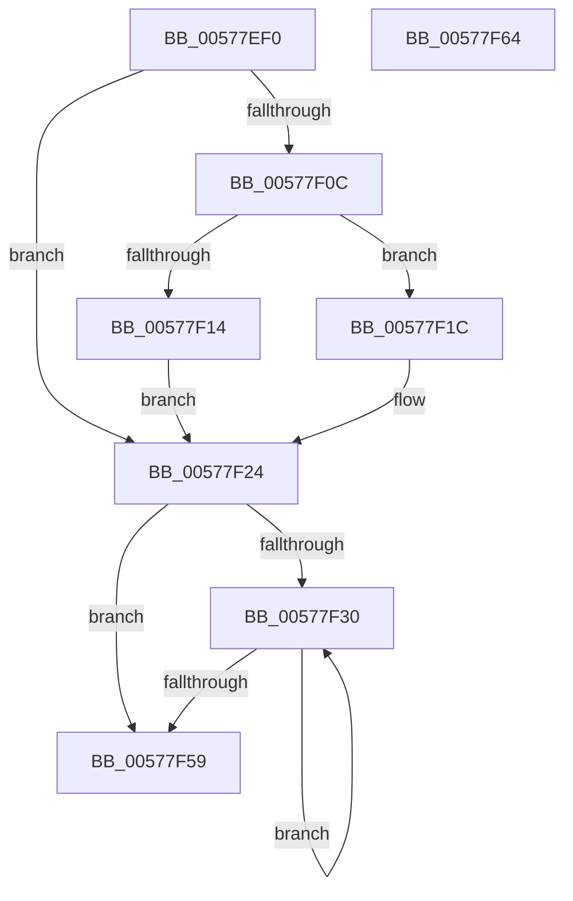

# XmLodsOp

- RVA: `0x00577EF0`–`0x00577F65` (길이 `117` bytes)
- VA: `0x0000000140577EF0`
- 실행 섹션: `.text`
- PDB 이름 있음: `예`; PDB Function 태그: `아니요`
- unwind 정보 RVA: `0x0005CAAC`
- 디코드: `35`개 명령, `117/117` bytes 표시
- 미해석 바이트: `0` (있으면 어셈블리에 `.byte`로 보존)

> 이 문서는 커널 이미지의 기계어와 PDB 기호를 분석해 생성했습니다. 4번과 5번은 함수 원형과 자료형을 바이너리 사용 방식에서 추정한 C 해석이며 원본 소스 복구 결과는 아닙니다.

## 1. Dependencies

- 직접 호출 지점: **3**; 고유 호출 대상: **3**
- 직접 호출자로 확인된 함수: **0**
- RIP 상대 이미지 참조: **0**

### Outgoing calls
- `0x00577F3C` → [XmGetStringAddress](XmGetStringAddress_function_00578BCC.md) (function, `0x00578BCC`)
- `0x00577F47` → [XmSetSourceValue](../47/XmSetSourceValue_function_004737A8.md) (function, `0x004737A8`)
- `0x00577F4F` → [XmStoreResult](../47/XmStoreResult_function_004739FC.md) (function, `0x004739FC`)

### Direct callers
- 이 함수 시작 RVA로 연결되는 직접 call은 확인되지 않았습니다. 간접 호출은 완전히 역산할 수 없습니다.

### Static image references
- 디코드된 RIP-relative 메모리 참조가 없습니다.

## 2. Other-region calls and transfers

- 다른 실행 섹션으로 향하는 call: **0**
- 별도 외부 분기/꼬리 이동을 확인하지 못했습니다.

## 3. Assembly (complete function range)

```asm
00577EF0  48 89 5C 24 08                  mov qword ptr [rsp + 8], rbx
00577EF5  57                              push rdi
00577EF6  48 83 EC 20                     sub rsp, 0x20
00577EFA  48 8B D9                        mov rbx, rcx
00577EFD  BF 01 00 00 00                  mov edi, 1
00577F02  33 C9                           xor ecx, ecx
00577F04  38 8B 8B 00 00 00               cmp byte ptr [rbx + 0x8b], cl
00577F0A  74 18                           je 0x140577f24
00577F0C  38 8B 89 00 00 00               cmp byte ptr [rbx + 0x89], cl
00577F12  74 08                           je 0x140577f1c
00577F14  8B 7B 1C                        mov edi, dword ptr [rbx + 0x1c]
00577F17  89 4B 1C                        mov dword ptr [rbx + 0x1c], ecx
00577F1A  EB 08                           jmp 0x140577f24
00577F1C  0F B7 7B 1C                     movzx edi, word ptr [rbx + 0x1c]
00577F20  66 89 4B 1C                     mov word ptr [rbx + 0x1c], cx
00577F24  48 8D 43 18                     lea rax, [rbx + 0x18]
00577F28  48 89 43 58                     mov qword ptr [rbx + 0x58], rax
00577F2C  85 FF                           test edi, edi
00577F2E  74 29                           je 0x140577f59
00577F30  8B 53 74                        mov edx, dword ptr [rbx + 0x74]
00577F33  41 B8 06 00 00 00               mov r8d, 6
00577F39  48 8B CB                        mov rcx, rbx
00577F3C  E8 8B 0C 00 00                  call 0x140578bcc
00577F41  48 8B D0                        mov rdx, rax
00577F44  48 8B CB                        mov rcx, rbx
00577F47  E8 5C B8 EF FF                  call 0x1404737a8
00577F4C  8B 53 6C                        mov edx, dword ptr [rbx + 0x6c]
00577F4F  E8 A8 BA EF FF                  call 0x1404739fc
00577F54  83 C7 FF                        add edi, -1
00577F57  75 D7                           jne 0x140577f30
00577F59  48 8B 5C 24 30                  mov rbx, qword ptr [rsp + 0x30]
00577F5E  48 83 C4 20                     add rsp, 0x20
00577F62  5F                              pop rdi
00577F63  C3                              ret
00577F64  CC                              int3
```

## 4. C-style interpretation (structured pseudocode)

```c
__int64 __fastcall XmLodsOp(__int64 a1)
{
    __int64 result;
    __int64 v_rdi;
    __int64 v_rsp;
    unsigned __int64 v_stack_p8;

    v_stack_p8 = v_rbx;
    v_rsp = (v_rsp) - (32);
    a1 = 0;
    if ((*(unsigned __int8 *)(a1 + 139)) == 0) goto loc_00577F24;
    if ((*(unsigned __int8 *)(a1 + 137)) == 0) goto loc_00577F1C;
    *(unsigned int *)(a1 + 28) = 0;
    goto loc_00577F24;
loc_00577F1C:
    *(unsigned __int16 *)(a1 + 28) = 0;
loc_00577F24:
    *(unsigned __int64 *)(a1 + 88) = a1 + 24;
    if ((unsigned int)(*(unsigned __int16 *)(a1 + 28)) == 0) goto loc_00577F59;
loc_00577F30:
    result = XmGetStringAddress(0, (unsigned int)(*(unsigned int *)(a1 + 116)), 6, a4);
    result = XmSetSourceValue(0, result, 6, a4);
    result = XmStoreResult(0, (unsigned int)(*(unsigned int *)(a1 + 108)), 6, a4);
    v_rdi = (unsigned int)((*(unsigned __int16 *)(a1 + 28)) + (-1));
    if (condition_is_not_equal) goto loc_00577F30;
loc_00577F59:
    v_rsp = (v_rsp) + (32);
    return result;
}
```

## 5. (Beta) C Style

```c
int64_t XmLodsOp(void *Arg1)
{
    uint8_t *arg1 = (uint8_t *)Arg1;

    int64_t result;
    int64_t local_rdi;
    int64_t local_rsp;
    uint64_t v_stack_p8;

    v_stack_p8 = local_rbx;
    local_rsp = (local_rsp) - (32);
    Arg1 = 0;
    if ((*(uint8_t *)(arg1 + 0x8B)) == 0) goto loc_00577F24;
    if ((*(uint8_t *)(arg1 + 0x89)) == 0) goto loc_00577F1C;
    *(uint32_t *)(arg1 + 0x1C) = 0;
    goto loc_00577F24;
loc_00577F1C:
    *(uint16_t *)(arg1 + 0x1C) = 0;
loc_00577F24:
    *(void **)(arg1 + 0x58) = Arg1 + 24;
    if ((uint32_t)(*(uint16_t *)(arg1 + 0x1C)) == 0) goto loc_00577F59;
loc_00577F30:
    result = XmGetStringAddress(0, (uint32_t)(*(uint32_t *)(arg1 + 0x74)), 6, a4);
    result = XmSetSourceValue(0, result, 6, a4);
    result = XmStoreResult(0, (uint32_t)(*(uint32_t *)(arg1 + 0x6C)), 6, a4);
    local_rdi = (uint32_t)((*(uint16_t *)(arg1 + 0x1C)) + (-1));
    if (condition_is_not_equal) goto loc_00577F30;
loc_00577F59:
    local_rsp = (local_rsp) + (32);
    return result;
}
```

### 관측된 메모리 오프셋

구조체 형식이 확인되지 않은 접근은 인자 기준의 오프셋으로만 기록했습니다.

| 기준 인자 | 오프셋 표현 | 폭 (bit) | 접근 |
|---|---:|---:|---|
| `Arg1` | `+ 0x18` | `64` | `R` |
| `Arg1` | `+ 0x1C` | `16` | `R` |
| `Arg1` | `+ 0x1C` | `16` | `W` |
| `Arg1` | `+ 0x1C` | `32` | `R` |
| `Arg1` | `+ 0x1C` | `32` | `W` |
| `Arg1` | `+ 0x58` | `64` | `W` |
| `Arg1` | `+ 0x6C` | `32` | `R` |
| `Arg1` | `+ 0x74` | `32` | `R` |
| `Arg1` | `+ 0x89` | `8` | `R` |
| `Arg1` | `+ 0x8B` | `8` | `R` |

## 6. Execution-region graph

[열기: 2D/3D 그래프와 함수 탐색 컨트롤 패널](../../../control-panel.html?section=text&rva=0x00577EF0&view=graph)

- 2D 그래프는 위에서 아래로 흐르고, 3D 그래프는 빈 공간을 드래그해 회전합니다. Shift+드래그는 이동, 휠은 확대·축소, 함수 노드 선택은 대상 보고서 이동입니다.

### Static fallback


