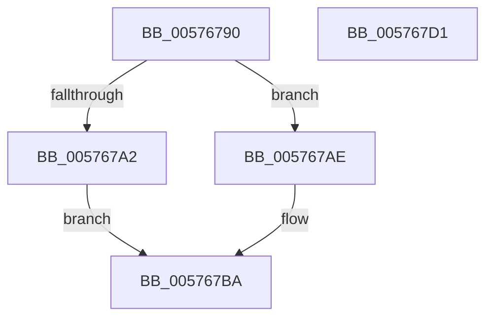

# XmLongJump

- RVA: `0x00576790`–`0x005767D2` (길이 `66` bytes)
- VA: `0x0000000140576790`
- 실행 섹션: `.text`
- PDB 이름 있음: `예`; PDB Function 태그: `아니요`
- unwind 정보 RVA: `0x0005CF00`
- 디코드: `21`개 명령, `66/66` bytes 표시
- 미해석 바이트: `0` (있으면 어셈블리에 `.byte`로 보존)

> 이 문서는 커널 이미지의 기계어와 PDB 기호를 분석해 생성했습니다. 4번과 5번은 함수 원형과 자료형을 바이너리 사용 방식에서 추정한 C 해석이며 원본 소스 복구 결과는 아닙니다.

## 1. Dependencies

- 직접 호출 지점: **2**; 고유 호출 대상: **2**
- 직접 호출자로 확인된 함수: **0**
- RIP 상대 이미지 참조: **0**

### Outgoing calls
- `0x005767A2` → [XmGetLongImmediate](../56/XmGetLongImmediate_function_0056DC70.md) (function, `0x0056DC70`)
- `0x005767AE` → [XmGetWordImmediate](../47/XmGetWordImmediate_function_004731DC.md) (function, `0x004731DC`)

### Direct callers
- 이 함수 시작 RVA로 연결되는 직접 call은 확인되지 않았습니다. 간접 호출은 완전히 역산할 수 없습니다.

### Static image references
- 디코드된 RIP-relative 메모리 참조가 없습니다.

## 2. Other-region calls and transfers

- 다른 실행 섹션으로 향하는 call: **0**
- 별도 외부 분기/꼬리 이동을 확인하지 못했습니다.

## 3. Assembly (complete function range)

```asm
00576790  40 53                           push rbx
00576792  48 83 EC 20                     sub rsp, 0x20
00576796  80 B9 8A 00 00 00 00            cmp byte ptr [rcx + 0x8a], 0
0057679D  48 8B D9                        mov rbx, rcx
005767A0  74 0C                           je 0x1405767ae
005767A2  E8 C9 74 FF FF                  call 0x14056dc70
005767A7  8B 4B 14                        mov ecx, dword ptr [rbx + 0x14]
005767AA  03 C8                           add ecx, eax
005767AC  EB 0C                           jmp 0x1405767ba
005767AE  E8 29 CA EF FF                  call 0x1404731dc
005767B3  66 03 43 14                     add ax, word ptr [rbx + 0x14]
005767B7  0F B7 C8                        movzx ecx, ax
005767BA  89 4B 68                        mov dword ptr [rbx + 0x68], ecx
005767BD  8B 43 70                        mov eax, dword ptr [rbx + 0x70]
005767C0  83 E0 0F                        and eax, 0xf
005767C3  89 43 6C                        mov dword ptr [rbx + 0x6c], eax
005767C6  B8 01 00 00 00                  mov eax, 1
005767CB  48 83 C4 20                     add rsp, 0x20
005767CF  5B                              pop rbx
005767D0  C3                              ret
005767D1  CC                              int3
```

## 4. C-style interpretation (structured pseudocode)

```c
__int64 __fastcall XmLongJump(__int64 a1)
{
    __int64 result;
    __int64 v_rsp;

    v_rsp = (v_rsp) - (32);
    if ((*(unsigned __int8 *)(a1 + 138)) == 0) goto loc_005767AE;
    result = XmGetLongImmediate(a1, a2, a3, a4);
    a1 = (unsigned int)(((unsigned int)(*(unsigned int *)(a1 + 20))) + ((unsigned int)(result)));
    goto loc_005767BA;
loc_005767AE:
    result = XmGetWordImmediate(a1, a2, a3, a4);
    result = (unsigned __int16)((result) + (*(unsigned __int16 *)(a1 + 20)));
loc_005767BA:
    *(unsigned int *)(a1 + 104) = (unsigned int)((unsigned __int16)(result));
    result = (unsigned int)(((unsigned int)(*(unsigned int *)(a1 + 112))) & (15));
    *(unsigned int *)(a1 + 108) = (unsigned int)(result);
    v_rsp = (v_rsp) + (32);
    return 1;
}
```

## 5. (Beta) C Style

```c
int64_t XmLongJump(void *Arg1)
{
    uint8_t *arg1 = (uint8_t *)Arg1;

    int64_t result;
    int64_t local_rsp;

    local_rsp = (local_rsp) - (32);
    if ((*(uint8_t *)(arg1 + 0x8A)) == 0) goto loc_005767AE;
    result = XmGetLongImmediate(Arg1, a2, a3, a4);
    Arg1 = (uint32_t)(((uint32_t)(*(uint32_t *)(arg1 + 0x14))) + ((uint32_t)(result)));
    goto loc_005767BA;
loc_005767AE:
    result = XmGetWordImmediate(Arg1, a2, a3, a4);
    result = (uint16_t)((result) + (*(uint16_t *)(arg1 + 0x14)));
loc_005767BA:
    *(uint32_t *)(arg1 + 0x68) = (uint32_t)((uint16_t)(result));
    result = (uint32_t)(((uint32_t)(*(uint32_t *)(arg1 + 0x70))) & (15));
    *(uint32_t *)(arg1 + 0x6C) = (uint32_t)(result);
    local_rsp = (local_rsp) + (32);
    return 1;
}
```

### 관측된 메모리 오프셋

구조체 형식이 확인되지 않은 접근은 인자 기준의 오프셋으로만 기록했습니다.

| 기준 인자 | 오프셋 표현 | 폭 (bit) | 접근 |
|---|---:|---:|---|
| `Arg1` | `+ 0x14` | `16` | `R` |
| `Arg1` | `+ 0x14` | `32` | `R` |
| `Arg1` | `+ 0x68` | `32` | `W` |
| `Arg1` | `+ 0x6C` | `32` | `W` |
| `Arg1` | `+ 0x70` | `32` | `R` |
| `Arg1` | `+ 0x8A` | `8` | `R` |

## 6. Execution-region graph

[열기: 2D/3D 그래프와 함수 탐색 컨트롤 패널](../../../control-panel.html?section=text&rva=0x00576790&view=graph)

- 2D 그래프는 위에서 아래로 흐르고, 3D 그래프는 빈 공간을 드래그해 회전합니다. Shift+드래그는 이동, 휠은 확대·축소, 함수 노드 선택은 대상 보고서 이동입니다.

### Static fallback


